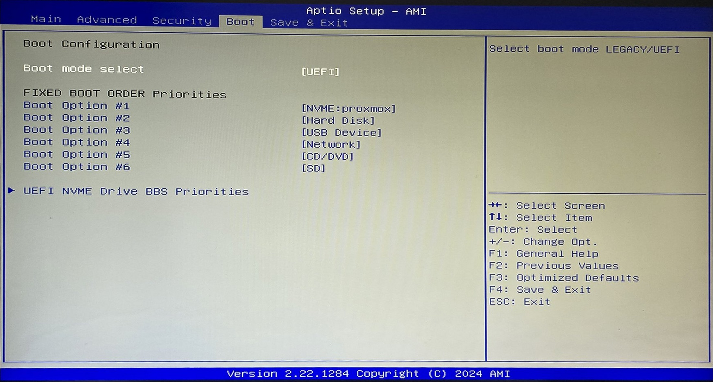
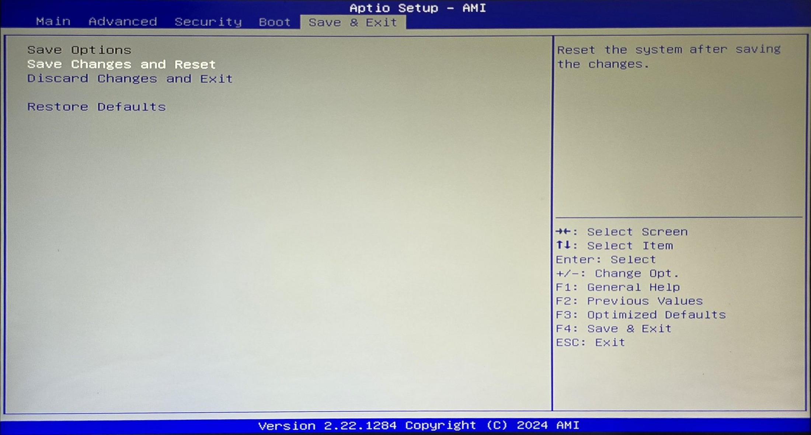

# Brique 00 — Installer et sécuriser l'hyperviseur Proxmox VE 9

> **Tuto pas à pas pour quelqu'un qui débute complètement.**  
> Chaque action a son numéro. Chaque capture est placée **juste sous l'action qu'elle montre**, avec  
> une légende qui dit **ce que tu dois voir** et **quoi faire si ce n'est pas pareil**.  
> Les vraies erreurs faites pendant le lab sont gardées, avec leur correction : ce sont elles qui  
> apprennent le plus.

---

## 🧾 Fiche de la brique

| | |
| --- | --- |
| **Objectif** | Transformer un mini PC en **serveur de virtualisation** (hyperviseur) prêt à accueillir les serveurs de l'entreprise, à jour et protégé |
| **Durée** | Environ **3 h** la première fois (dont 30 min de dépannage si ça plante comme chez moi) |
| **Niveau** | Débutant : aucune connaissance Linux nécessaire |
| **Résultat** | Proxmox VE 9.2 sur `pve01` (192.168.1.210), à jour, un compte admin nominatif, double authentification |
| **Brique suivante** | [01 · pare-feu pfSense](../01-pfsense/) |

### Le matériel

| Élément | Ce que j'ai utilisé | Minimum conseillé |
| --- | --- | --- |
| Serveur | Mini PC **Minisforum NAB5** : Intel Core i5-12450H, 32 Go de RAM, SSD NVMe 512 Go, 2 cartes réseau 2,5 Gb/s | Processeur 64 bits avec virtualisation (Intel VT-x / AMD-V), 16 Go de RAM, SSD 256 Go |
| Clé USB | 8 Go ou plus | ⚠️ Elle sera **entièrement effacée** |
| Écran + clavier | Branchés sur le mini PC **le temps de l'installation** seulement | Ensuite tout se fait à distance |
| Câble réseau | Mini PC ↔ box Internet | |
| PC de travail | Windows 11, sur le même réseau que la box | Pour télécharger, préparer la clé, puis administrer |

### Les logiciels (tous gratuits)

| Logiciel | Rôle | Où le trouver |
| --- | --- | --- |
| **Proxmox VE 9.2** (ISO) | L'hyperviseur à installer | `https://www.proxmox.com/en/downloads` |
| **balenaEtcher** | Copier l'ISO sur la clé USB | `https://etcher.balena.io` |
| Une **appli d'authentification** sur le téléphone | Codes de double authentification | Microsoft Authenticator, Google Authenticator, Aegis… |
| Un **gestionnaire de mots de passe** | Ranger les mots de passe et codes de secours | KeePassXC, Bitwarden… |

### Ce que tu sauras faire à la fin

- Choisir une adresse IP fixe **sans créer de conflit** sur un réseau existant.
- Vérifier qu'un fichier téléchargé est **authentique** (empreinte SHA-256).
- Lire et régler un **BIOS**.
- Installer Proxmox et **dépanner un plantage** avec une vraie méthode.
- Mettre à jour un serveur Linux sans abonnement.
- Appliquer les règles de sécurité des accès : **groupes**, **compte nominatif**, **double authentification**.

---

## 📖 Comment lire ce tuto

| Repère | Sens |
| --- | --- |
| 🎯 | **Le but** de l'étape, en une phrase |
| 💡 | **Pourquoi** on le fait, ou une explication pour comprendre |
| **3.2** | Une **action** à faire (étape 3, action 2). Une action = un clic, une saisie ou une commande |
| 📸 | **La capture** de ce que tu dois voir, avec sa légende |
| ✅ | **Vérification** : comment savoir que c'est réussi |
| ❌ | **Si ça ne marche pas** (souvent l'erreur que j'ai vraiment eue) |
| 🏢 | **En entreprise**, ce qu'on ferait autrement |
| ⚠️ | Attention, piège ou risque |
| 📷 | **Capture manquante** : l'écran n'a pas été photographié pendant le lab, il est décrit en texte |

---

## 🗂️ Sommaire

- [Partie 0 — Comprendre avant de commencer](#partie-0--comprendre-avant-de-commencer)
- [Partie 1 — Préparer l'intervention](#partie-1--préparer-lintervention) (étapes 1 à 4)
- [Partie 2 — Le BIOS](#partie-2--le-bios) (étapes 5 à 7)
- [Partie 3 — Installer Proxmox](#partie-3--installer-proxmox) (étapes 8 à 15)
- [Partie 4 — Premier démarrage](#partie-4--premier-démarrage) (étapes 16 et 17)
- [Partie 5 — Mettre le serveur à jour](#partie-5--mettre-le-serveur-à-jour) (étapes 18 à 20)
- [Partie 6 — Sécuriser les accès](#partie-6--sécuriser-les-accès) (étapes 21 à 24)
- [Partie 7 — Recette](#partie-7--recette-on-vérifie-que-tout-marche)
- [Annexes](#annexes) : dépannage, antisèche, entreprise, entretien, écarts, lexique

---

## Partie 0 — Comprendre avant de commencer

### 0.1 Le besoin

L'entreprise fictive **AEROTRANS** (transport, une trentaine de salariés) doit faire tourner
**plusieurs serveurs** : annuaire des comptes, pare-feu, outil de tickets, supervision, sauvegarde…
Acheter une machine par serveur coûterait cher, prendrait de la place et consommerait beaucoup.

💡 **Un hyperviseur** est un logiciel qui **découpe** un ordinateur physique en plusieurs
**machines virtuelles** (VM). Image : un **immeuble** (le serveur physique) découpé en
**appartements** (les VM). Chaque appartement a ses murs, sa porte, son compteur. Si un locataire
casse tout chez lui, les voisins ne sont pas touchés.

### 0.2 Pourquoi Proxmox

| Critère | Proxmox VE | VMware ESXi | Microsoft Hyper-V |
| --- | --- | --- | --- |
| Coût | Gratuit (support payant en option) | Payant depuis le rachat par Broadcom | Inclus avec Windows Server |
| Usage en PME | En forte hausse (migrations depuis VMware) | Historique, en recul | Très répandu chez Microsoft |
| Administration | Interface web, rien à installer | Interface web | Console Windows |
| Sauvegarde intégrée | Oui | Non (outil tiers) | Partielle |

**Choix : Proxmox VE.** Gratuit, complet, et de plus en plus demandé depuis la hausse des tarifs de
VMware. Hyper-V reste à connaître : on le croise souvent en entreprise.

### 0.3 Le schéma de ce qu'on construit

```
     INTERNET
        |
   [ Box Freebox ]  192.168.1.254   (passerelle + DHCP du réseau 192.168.1.0/24)
        |
     câble réseau
        |
   [ Mini PC pve01 ]  192.168.1.210  <-- Proxmox, administré depuis un navigateur
        |                               https://192.168.1.210:8006
   (plus tard : les VM pfSense, AD, GLPI...)

   [ PC de travail ]  192.168.1.98 (adresse donnée par la box)
```

### 0.4 Petit vocabulaire (à relire si un mot bloque)

| Mot | Sens simple |
| --- | --- |
| **Adresse IP** | Le « numéro de maison » d'un appareil sur le réseau |
| **IP fixe** | Une adresse qui ne change jamais. Un serveur doit toujours être au même endroit |
| **DHCP** | Le service (ici la box) qui **distribue automatiquement** des adresses aux appareils |
| **Passerelle** | La « porte de sortie » du réseau vers Internet (ici la box) |
| **DNS** | L'annuaire qui traduit un nom (proxmox.com) en adresse IP |
| **ISO** | Un fichier qui contient tout un CD/DVD d'installation |
| **BIOS / UEFI** | Le petit logiciel de la carte mère qui démarre la machine, avant le système |
| **Nœud** | Un serveur physique Proxmox (ici un seul : `pve01`) |
| **LVM-thin** | Une façon de ranger les disques des VM : on ne consomme que l'espace réellement utilisé |

---

## Partie 1 — Préparer l'intervention

> 💡 En entreprise, on ne branche **jamais** un serveur « pour voir ». On prépare d'abord : quelle  
> adresse, quel fichier, quel matériel. C'est ce qu'on fait ici, depuis le PC de travail.

### Étape 1 · Relever le réseau existant

🎯 Savoir comment le réseau est organisé : quelle plage d'adresses, quelle passerelle.

💡 Si on donne au serveur une adresse **déjà prise** par un autre appareil, on crée un **conflit IP** :
les deux appareils se « battent » pour la même adresse et le serveur devient injoignable.

**1.1** Sur le PC de travail, appuie sur la touche **Windows**, tape `cmd`, puis **Entrée**.
Une fenêtre noire s'ouvre : c'est l'**invite de commandes**.

**1.2** Tape la commande suivante, puis **Entrée** :

```
ipconfig
```

💡 `ipconfig` affiche la configuration réseau de **toutes** les cartes réseau du PC.


> 📸 **Ce que tu dois voir** : plusieurs blocs « Carte Ethernet… ». Cherche **celui qui a une  
> « Passerelle par défaut » remplie** : chez moi, c'est **Carte Ethernet Ethernet**, avec  
> `192.168.1.98` / `255.255.255.0` / `192.168.1.254`. C'est la vraie connexion au réseau.  
> Les autres (VMware, VirtualBox, OpenVPN…) sont des cartes **virtuelles** sans passerelle : on les ignore.

**1.3** Note les 3 valeurs de la bonne carte :

| Information | Valeur relevée | Ce que ça veut dire |
| --- | --- | --- |
| Adresse IPv4 du PC | `192.168.1.98` | Donnée automatiquement par la box (DHCP) |
| Masque | `255.255.255.0` (on écrit aussi **/24**) | Le réseau est `192.168.1.x` : les adresses utilisables vont de `.1` à `.254` |
| Passerelle | `192.168.1.254` | La box : sortie vers Internet |

✅ **Vérification** : tu as noté le réseau (`192.168.1.x`, masque /24) et l'adresse de la box (`.254`).

---

### Étape 2 · Choisir l'adresse fixe du serveur

🎯 Trouver une adresse que **personne d'autre** n'utilisera jamais.

💡 La règle : un serveur a une IP fixe choisie **en dehors** de la plage que la box distribue toute
seule. Sinon, un jour, la box pourrait donner « ton » adresse à un téléphone.

**2.1** Dans le navigateur du PC, ouvre l'interface de la box. Pour une Freebox :
`http://mafreebox.freebox.fr`, puis connecte-toi.

**2.2** Ouvre **Paramètres de la Freebox**, reste en **Mode avancé**, et clique sur l'icône **DHCP**.

**2.3** Dans l'onglet **Serveur DHCP**, regarde les 2 champs **Début de la plage d'adresses** et
**Fin de la plage d'adresses**.


> 📸 **Ce que tu dois voir** : la fenêtre **Réseau local / DHCP**. Chez moi la box distribue de  
> **192.168.1.2** à **192.168.1.200**. Donc les adresses **201 à 253** ne seront jamais données par la  
> box : elles sont **libres pour les équipements fixes**.  
> ⚠️ Ne modifie rien ici : clique sur **Annuler** pour fermer.

❌ **Piège évité pendant le lab** : l'adresse `192.168.1.200`, proposée au départ, est **la dernière de
la plage DHCP**. La box aurait pu la donner à un autre appareil. D'où la règle : **toujours vérifier la
plage avant de choisir**.

**2.4** Choisis l'adresse du serveur et prévois la suite. Mon plan :

| Adresse | Équipement |
| --- | --- |
| `192.168.1.210` | **pve01** : l'administration de Proxmox |
| `192.168.1.211` | pfSense, côté Internet (brique 01) |
| `192.168.1.212` à `.220` | Réserve pour plus tard |

**2.5** Vérifie que l'adresse est vraiment libre. Dans l'invite de commandes, tape :

```
ping 192.168.1.210
```

💡 `ping` envoie 4 petits messages à une adresse et attend une réponse. Si personne ne répond, l'adresse
est libre.


> 📸 **Ce que tu dois voir** : pour `.200` puis pour `.210`, 4 lignes  
> **« Réponse de 192.168.1.98 : Impossible de joindre l'hôte de destination »**.  
> ⚠️ **Piège de lecture** : en bas, Windows écrit « reçus = 4, perdus = 0 ». Ça a l'air d'un succès,  
> mais **regarde qui répond** : c'est **192.168.1.98, ton propre PC**. Il dit « j'ai cherché qui avait  
> cette adresse, personne n'a répondu » (requête **ARP** sans réponse).  
> **Donc l'adresse est libre.** Une adresse occupée répondrait :  
> `Réponse de 192.168.1.210 : octets=32 temps=…`.

✅ **Vérification — décision finale** :

| Réglage du serveur | Valeur |
| --- | --- |
| Adresse IP | `192.168.1.210` |
| Masque | `/24` |
| Passerelle | `192.168.1.254` |
| DNS | `192.168.1.254` |
| Nom | `pve01.lab.home.arpa` |

🏢 **En entreprise** : on ne « devine » pas l'adresse. On la prend dans le **plan d'adressage**
(un tableau tenu à jour de toutes les adresses), puis on la réserve **avant** l'installation.
Voir le [plan d'adressage du lab](../docs/plan-adressage.md).

---

### Étape 3 · Télécharger l'image d'installation et vérifier son empreinte

🎯 Récupérer Proxmox **sur le site officiel**, et **prouver** que le fichier n'est ni abîmé ni modifié.

💡 L'**empreinte** (ou *hash*) est comme l'**empreinte digitale** d'un fichier : un long code calculé à
partir de son contenu. Si un seul octet change (téléchargement coupé, fichier piégé), l'empreinte change
complètement. L'éditeur publie l'empreinte officielle : on compare.

**3.1** Va sur `https://www.proxmox.com/en/downloads`, puis clique sur **Proxmox Virtual Environment**.

> 📷 **Capture manquante** : la page de téléchargement. Elle propose plusieurs lignes :

| Ligne proposée | Je prends ? | Pourquoi |
| --- | --- | --- |
| For ARM64: Proxmox VE 9.2 ISO Installer | ❌ | Réservée aux processeurs **ARM** |
| **Proxmox VE 9.2 ISO Installer** (version 9.2-1, 1,71 Go) | ✅ | Notre processeur Intel est un **x86_64** |
| Proxmox VE 8.4 ISO Installer | ❌ | Ancienne génération |

💡 **x86_64** (aussi appelé **amd64**) et **ARM** sont deux familles de processeurs incompatibles.
« amd64 » ne veut **pas** dire « réservé à AMD » : Intel l'utilise aussi.

**3.2** Clique sur **Download** pour la bonne ligne. Sur la même page, **copie l'empreinte SHA256**
affichée sous le lien (un long code de 64 caractères) et colle-la dans un bloc-notes.

**3.3** Quand le téléchargement est fini, ouvre l'invite de commandes **dans le dossier
Téléchargements** :

```
cd %USERPROFILE%\Downloads
```

💡 `cd` = *change directory* : « va dans ce dossier ». `%USERPROFILE%` remplace `C:\Users\ton-nom`.

**3.4** Calcule l'empreinte du fichier :

```
certutil -hashfile proxmox-ve_9.2-1.iso SHA256
```

- `certutil -hashfile` : outil intégré à Windows qui calcule l'empreinte d'un fichier ;
- `SHA256` : l'algorithme de calcul (le même que celui publié par Proxmox).

> 📷 **Capture manquante** : le résultat de `certutil`. Il affiche une ligne de 64 caractères puis  
> « CertUtil: -hashfile La commande s'est terminée correctement. »

**3.5** Compare les deux empreintes, caractère par caractère (au moins le début et la fin) :

| | Empreinte SHA256 |
| --- | --- |
| Publiée par Proxmox | `4e88fe416df9b527624a175f24c9aa07c714d3332afb1ee3dbf3879573ef2c6c` |
| Calculée sur mon fichier | `4e88fe416df9b527624a175f24c9aa07c714d3332afb1ee3dbf3879573ef2c6c` |

✅ **Vérification** : les deux sont **identiques**, l'image est intègre.

❌ **Si elles diffèrent** : supprime le fichier et retélécharge-le. **On n'installe jamais une image
non vérifiée.**

🏢 **En entreprise** : c'est une règle de sécurité écrite (on parle d'**intégrité**). Un logiciel piégé
installé sur un hyperviseur compromettrait **tous** les serveurs qu'il héberge.

---

### Étape 4 · Créer la clé USB d'installation

🎯 Copier l'image sur une clé USB pour démarrer le mini PC dessus.

💡 On ne peut pas simplement **copier-coller** le fichier ISO sur la clé : il faut **l'écrire** d'une
façon spéciale pour que la clé devienne « démarrable ». C'est le rôle de **balenaEtcher**, qui en plus
**vérifie** la copie à la fin.

**4.1** Branche la clé USB sur le PC.
⚠️ **Tout son contenu va être effacé.** Sauvegarde ce qui est dessus avant.

**4.2** Ouvre **balenaEtcher**, puis clique sur **Flash from file** et choisis
`proxmox-ve_9.2-1.iso` dans Téléchargements.

**4.3** Clique sur **Select target** et coche **ta clé USB**.
⚠️ **Vérifie sa taille** (par exemple 14,9 Go pour une clé de 16 Go) : si tu choisis un autre disque,
tu l'effaces !

**4.4** Clique sur **Flash!**, puis sur **Oui** quand Windows demande l'autorisation.
Attends : Etcher écrit la clé, puis la **vérifie** (2 barres de progression).

> 📷 **Capture manquante** : l'écran principal d'Etcher avec les 3 boutons (fichier, cible, Flash!).


> 📸 **Ce que tu dois voir** : **Flash Completed!** avec `proxmox-ve_9.2-1.iso` et  
> **1 Successful target** (point vert). La clé est prête.  
> ❌ Si tu vois « Failed », change de port USB ou de clé et recommence.

**4.5** Juste après, Windows peut afficher **« Vous devez formater le disque du lecteur E: avant de
l'utiliser »**.


> 📸 **Ce que tu vois** : la fenêtre Windows qui propose **Formater le disque** ou **Annuler**.  
> ⚠️ **Clique sur Annuler**, parfois plusieurs fois (une fenêtre par partition de la clé).  
> 💡 Windows ne sait pas lire le format de la clé Proxmox (c'est du Linux). Si tu formates,  
> **tu détruis l'image** qu'on vient d'écrire.

**4.6** Retire la clé avec **Éjecter** (icône USB en bas à droite de Windows).

✅ **Vérification** : Etcher a affiché « Flash Completed! » et tu as cliqué sur **Annuler** à chaque
proposition de formatage.

---

## Partie 2 — Le BIOS

> 💡 Le **BIOS** (aujourd'hui **UEFI**) est le logiciel de la carte mère. Il démarre avant tout le reste  
> et décide **sur quel disque démarrer** et **quelles fonctions du processeur sont activées**.  
> Un BIOS se **vérifie toujours**, même sur une machine neuve.
>
> **Comment on se déplace dans ce BIOS** (AMI Aptio) : pas de souris.
>
> | Touche | Effet |
> | --- | --- |
> | ← → | Changer d'onglet (Main, Advanced, Security, Boot, Save & Exit) |
> | ↑ ↓ | Monter / descendre dans la liste |
> | **Entrée** | Ouvrir un sous-menu ou une liste de choix |
> | **+ / -** | Changer la valeur sélectionnée |
> | **Échap** | Revenir en arrière |
> | **F4** | **Enregistrer et quitter** (Save & Exit) |

### Étape 5 · Entrer dans le BIOS et relever le matériel

🎯 Vérifier que la machine est bien celle qu'on croit (processeur, mémoire) et relever les infos utiles.

**5.1** Branche sur le mini PC : l'**écran**, le **clavier**, le **câble réseau** (vers la box) et la
**clé USB**. Utilise la **prise réseau de gauche** : elle deviendra `nic0`, le réseau
d'administration.

**5.2** Allume le mini PC et appuie **plusieurs fois de suite sur Suppr** (*Del*) dès l'allumage,
jusqu'à voir un écran bleu et gris.


> 📸 **Ce que tu dois voir** : l'onglet **Main** du **Aptio Setup – AMI**. On y lit :
>
> | Ligne | Valeur | Remarque |
> | --- | --- | --- |
> | BIOS Version | 1.00 (01/03/2024) | Utile si on cherche une mise à jour du BIOS |
> | Processor Type | 12th Gen Intel Core i5-12450H | Un **x86_64** : c'est la bonne ISO |
> | Total Memory | 32768 MB à 3200 MHz | **32 Go** confirmés |
> | System Time | 14:19 alors qu'il est 16:19 à Paris | Horloge en **UTC** : **ne la change pas** |
>
> (L'UUID, un identifiant unique de la machine, est flouté.)

💡 **Pourquoi ne pas mettre l'heure de Paris ?** Linux considère que l'horloge de la carte mère est en
**temps universel (UTC)** et ajoute lui-même le fuseau horaire. Si on la réglait à l'heure de Paris,
Proxmox afficherait 2 heures de décalage.

✅ **Vérification** : processeur Intel 64 bits et 32 Go de RAM affichés.

---

### Étape 6 · Vérifier les réglages de l'onglet Advanced

🎯 S'assurer que la virtualisation est active et que rien d'inutile n'est allumé.

**6.1** Avec la flèche **→**, va sur l'onglet **Advanced**.


> 📸 **Ce que tu dois voir (état d'origine)** : **Active Performance-cores = [All]** et  
> **Active Efficient-cores = [0]**. Puis les sous-menus ACPI Setting, Trusted Computing, Hardware  
> monitor, System Devices Configuration, Power & Performance.  
> 💡 Ce processeur a **4 cœurs « performance »** (puissants) et **4 cœurs « efficaces »** (E-cores,  
> économes). Ici les E-cores sont **coupés** (0).

**6.2** *(Ce que j'ai fait pendant le lab — et qui a causé une panne, voir étape 13.)* Descends sur
**Active Efficient-cores** et passe la valeur à **[All]** avec **+**.


> 📸 **Ce que tu vois** : **Active Efficient-cores = [All]**. L'idée était d'avoir les 12 threads au  
> lieu de 8.  
> ⚠️ **Sur cette machine, ce réglage fait planter l'installation.** Si tu as le même mini PC,  
> **laisse [0]** et passe directement à 6.3. Toute l'histoire est à l'étape 13.

**6.3** Descends sur **System Devices Configuration** et appuie sur **Entrée**.


> 📸 **Ce que tu dois voir** :
>
> | Réglage | Valeur | On garde ? | Pourquoi |
> | --- | --- | --- | --- |
> | **VT-d** | Enabled | ✅ | Permet de confier un équipement physique (carte réseau, disque) directement à une VM |
> | SR-IOV Support | Disabled | ✅ | Partage avancé de carte réseau, inutile ici |
> | SATA Controller(s) | Enabled | ✅ | Pour un futur disque SATA (sauvegardes) |
> | Audio | Enabled | ✅ | Sans importance sur un serveur |
> | Network Stack | Disabled | ✅ | Démarrage par le réseau (PXE) : inutile |
>
> Rien à changer. Appuie sur **Échap** pour revenir.

💡 **Et VT-x ?** C'est la virtualisation du processeur, **indispensable** à Proxmox. Elle n'apparaît
pas dans ce BIOS : sur ce mini PC, elle est activée par défaut et cachée. Si elle était coupée,
l'installateur afficherait « No support for KVM virtualization detected ».

**6.4** Descends sur **Power & Performance**, appuie sur **Entrée**, puis ouvre le sous-menu des
limites de puissance.


> 📸 **Ce que tu vois** : Platform PL1 Power = 0, PL2 = 64000, Power Limit 1 = 0, Power Limit 2 =  
> 64000, Tcc Activation Offset = 10. Ce sont les **limites de consommation électrique** du processeur  
> (en milliwatts), réglées par le fabricant pour son refroidissement.  
> **Ne touche à rien** : les augmenter ferait chauffer le mini PC. **Échap** pour revenir.

✅ **Vérification** : VT-d est **Enabled**, rien d'autre n'a été modifié (à part les E-cores, voir
l'avertissement de 6.2).

---

### Étape 7 · Démarrer sur la clé USB

🎯 Dire au BIOS de démarrer **d'abord sur la clé**, pour lancer l'installateur.

**7.1** Avec **→**, va sur l'onglet **Boot**.



> 📸 **Ce que tu dois voir (avant)** : **Boot mode select = [UEFI]** et l'ordre de démarrage  
> **Boot Option #1 = [NVME:proxmox]** (le SSD interne, qui contient un ancien Proxmox), #2 Hard Disk,  
> **#3 = [USB Device]**…  
> 💡 Le BIOS essaie les options **dans l'ordre**. Tant que le SSD est en #1, la clé ne sera jamais  
> utilisée.

**7.2** Descends sur **Boot Option #1**, appuie sur **Entrée**, choisis **USB Device**, puis **Entrée**.


> 📸 **Ce que tu dois voir (après)** : **Boot Option #1 = [USB Device]**, et le NVMe est descendu en #3.

**7.3** Enregistre et redémarre. Deux façons, au choix :
- appuie sur **F4**, choisis **Yes**, puis **Entrée** ;
- ou va sur l'onglet **Save & Exit**, choisis **Save Changes and Reset**, puis **Entrée** et **Yes**.



> 📸 **Ce que tu vois** : l'onglet **Save & Exit**.
>
> | Choix | Effet |
> | --- | --- |
> | **Save Changes and Reset** | ✅ Enregistre et redémarre |
> | Discard Changes and Exit | Quitte **sans** enregistrer (utile si tu as fait une bêtise) |
> | Restore Defaults | Remet **tous** les réglages d'usine : ⚠️ à éviter sans raison |

La machine redémarre.

✅ **Vérification** : au redémarrage, l'écran d'accueil **Proxmox** s'affiche (étape 8).
❌ Si le PC redémarre sur l'ancien système : la clé n'est pas en #1, ou elle a été mal écrite (refais
l'étape 4).

---

## Partie 3 — Installer Proxmox

### Étape 8 · Lancer l'installateur

🎯 Démarrer l'installation en mode graphique (avec souris).


> 📸 **Ce que tu dois voir** : **Welcome to Proxmox Virtual Environment**, avec 4 choix.
>
> | Choix | Quand l'utiliser |
> | --- | --- |
> | **Install Proxmox VE (Graphical)** | ✅ Le cas normal : installation avec fenêtres et souris |
> | Install Proxmox VE (Terminal UI) | Si le mode graphique ne s'affiche pas (carte graphique exotique) |
> | Install Proxmox VE (Terminal UI, Serial Console) | Serveur sans écran, piloté par câble série |
> | Advanced Options | Dépannage, mode debug |

**8.1** **Install Proxmox VE (Graphical)** est déjà sélectionné : appuie sur **Entrée**.

**8.2** Un écran de licence (*End User License Agreement*) s'affiche : clique sur **I agree**.

> 📷 **Capture manquante** : l'écran de licence (texte de la licence GNU AGPL + bouton « I agree »).

---

### Étape 9 · Choisir le disque d'installation

🎯 Indiquer **sur quel disque** installer Proxmox, et comment le découper.


> 📸 **Ce que tu dois voir** : l'écran **Proxmox Virtual Environment (PVE)**, et en bas  
> **Target Harddisk = /dev/nvme0n1 (476.94GiB, KINGSTON OM8PGP4512Q-A0)**.  
> 💡 `/dev/nvme0n1` est le nom Linux du **premier SSD NVMe**. C'est le seul disque interne : bon choix.  
> ⚠️ Le texte de droite prévient : **toutes les données de ce disque seront effacées.**

**9.1** Vérifie que **Target Harddisk** affiche bien le SSD interne (et **pas** la clé USB).

**9.2** Clique sur **Options** (à droite du disque).


> 📸 **Ce que tu dois voir** : la fenêtre **Harddisk options** avec **Filesystem = ext4**,  
> **hdsize = 476.0** et les autres champs (swapsize, maxroot, minfree, maxvz) **vides**.

**9.3** Laisse **ext4**, laisse les champs vides, et clique sur **OK**.

💡 **Pourquoi ext4 et pas ZFS ?**

| Système de fichiers | Point fort | Point faible | Pour nous |
| --- | --- | --- | --- |
| **ext4 + LVM-thin** | Simple, léger, très éprouvé | Pas de protection si le disque meurt | ✅ Un seul disque |
| ZFS | Protège les données **avec plusieurs disques** (miroir) | Consomme beaucoup de RAM | ❌ Avec un seul disque, il perd son intérêt et mange la RAM des VM |

Les champs vides = tailles **automatiques** : Proxmox crée une partie système (ext4, environ 94 Go) et
met tout le reste dans un espace **LVM-thin** pour les disques des VM.

**9.4** Clique sur **Next**.

✅ **Vérification** : disque `/dev/nvme0n1`, système de fichiers `ext4`.

---

### Étape 10 · Pays, fuseau horaire et clavier


> 📸 **Ce que tu dois voir** : **Location and Time Zone selection**, avec Country = **France**,  
> Time zone = **Europe/Paris**, Keyboard Layout = **French**.

**10.1** Si ce n'est pas déjà rempli : tape `France` dans **Country**, choisis **Europe/Paris** et
**French**.

**10.2** Clique sur **Next**.

💡 Le fuseau sert à avoir la **bonne heure dans les journaux** (indispensable pour enquêter sur un
incident). Le clavier **French** = AZERTY : sinon, tes mots de passe tapés plus tard ne correspondraient
pas.

---

### Étape 11 · Mot de passe root et e-mail

🎯 Protéger le compte **root** (le super-administrateur) et indiquer où envoyer les alertes.


> 📸 **Ce que tu dois voir** : **Administration Password and Email Address**, avec **Password**,  
> **Confirm** et **Email**. Les mots de passe s'affichent en points, et l'adresse e-mail est floutée  
> sur la capture.

**11.1** Génère un mot de passe **solide** dans ton gestionnaire de mots de passe (au moins
**16 caractères**, lettres, chiffres, symboles) et enregistre-le **avant** de le taper.

**11.2** Tape-le dans **Password**, puis à l'identique dans **Confirm**.
⚠️ Le clavier est maintenant en AZERTY : vérifie les caractères spéciaux.

**11.3** Tape ton adresse e-mail dans **Email**, puis clique sur **Next**.

💡 **L'e-mail** reçoit les **alertes importantes** : disque qui lâche, sauvegarde ratée…

⚠️ **Règle de sécurité** : un mot de passe n'apparaît **jamais** sur une capture, dans un document, un
message ou une conversation (même avec une IA). Il vit **uniquement** dans le gestionnaire de mots de
passe.

---

### Étape 12 · Le réseau d'administration

🎯 Donner au serveur l'adresse fixe choisie à l'étape 2.


> 📸 **Ce que tu dois voir** : **Management Network Configuration**, rempli ainsi :
>
> | Champ | Valeur | Explication |
> | --- | --- | --- |
> | Management Interface | `nic0` (point **vert**) | La carte réseau branchée. **Point vert = câble branché** ; point rouge = rien de branché. L'adresse MAC est floutée |
> | Hostname (FQDN) | `pve01.lab.home.arpa` | `pve01` = rôle (Proxmox VE) + numéro. `lab.home.arpa` = le domaine du lab |
> | IP Address (CIDR) | `192.168.1.210` / `24` | L'adresse choisie à l'étape 2 |
> | Gateway | `192.168.1.254` | La box |
> | DNS Server | `192.168.1.254` | La box (elle fait aussi annuaire DNS) |
> | **Pin network interface names** | ✅ coché | Garde les noms `nic0` / `nic1` fixes après les mises à jour |

**12.1** Vérifie **Management Interface** : choisis la carte avec le **point vert**.

**12.2** Remplace le contenu de chaque champ par les valeurs du tableau.

**12.3** Vérifie que **Pin network interface names** est **coché**, puis clique sur **Next**.

💡 **Pourquoi `home.arpa` ?** Ce domaine est **réservé aux réseaux privés** (norme RFC 8375) : il
n'existera jamais sur Internet, donc aucun risque de conflit avec un vrai site.

❌ **Erreur du lab** : au 2e essai d'installation, l'installateur avait pré-rempli une **adresse IPv6**
fournie par la box. J'ai remis à la main les valeurs IPv4 prévues. Les captures qui montraient cette
IPv6 ne sont pas publiées : **une adresse IP publique ne se publie jamais**.

---

### Étape 13 · Vérifier le résumé et installer


> 📸 **Ce que tu dois voir** : **Summary**, le récapitulatif de tout ce qu'on a choisi :  
> Filesystem `ext4`, Disk `/dev/nvme0n1`, France, Europe/Paris, fr, nic0, pve01,  
> `192.168.1.210/24`, gateway et DNS `192.168.1.254`.  
> ⚠️ **Sur cette capture, la case « Automatically reboot after successful installation » est encore  
> cochée.** Décoche-la (voir 13.2).

**13.1** Relis **chaque ligne**. C'est la dernière chance de corriger avant que le disque soit effacé.
En cas d'erreur, clique sur **Previous**.

**13.2** **Décoche** « Automatically reboot after successful installation ».

💡 Si la machine redémarrait toute seule avec la clé encore branchée et en **Boot Option #1**,
l'installateur **se relancerait**. En décochant, on garde la main pour retirer la clé au bon moment.

**13.3** Clique sur **Install**. L'installation dure **5 à 15 minutes**.

> 💡 **Formatage** : l'installateur efface le disque et recrée tout. C'est un effacement **rapide**.  
> 🏢 Pour **recycler** un disque en entreprise (revente, destruction), on fait un **effacement sécurisé**  
> (`blkdiscard`, *secure erase*), et on le trace dans un registre.

---

### Étape 14 · Dépannage : l'installation plante (la vraie panne du lab)

❌ **Ce qui s'est passé** :

| Essai | Symptôme |
| --- | --- |
| 1er | Clic sur **Install** : retour immédiat au menu de départ |
| 2e | La barre démarre puis, vers **25 %**, **écran noir** et **redémarrage brutal** |

💡 **La méthode de diagnostic, pas à pas** :

1. **Observer** : un redémarrage brutal **sans aucun message d'erreur** = un **plantage matériel**
   (processeur, mémoire, alimentation), pas une erreur du logiciel Proxmox.
2. **Se rappeler l'historique** : cette machine faisait déjà tourner un Proxmox, **stable**.
3. **Appliquer la règle d'or** ⭐ : **« le dernier changement est le premier suspect »**. Le seul
   changement important depuis : l'activation des **E-cores** dans le BIOS (action 6.2).
4. **Tester une seule chose** : retour au BIOS (**Suppr** au démarrage) > **Advanced** >
   **Active Efficient-cores = [0]** > **F4** > **Yes**. **Rien d'autre** ne change : on relance
   l'installation exactement pareil, toujours en mode graphique.
5. **Conclure** : l'installation passe. Le seul paramètre modifié était les E-cores : **ce sont eux
   les coupables** sur ce BIOS. Le mode graphique est mis hors de cause.


> 📸 **Ce que tu dois voir** : **Installation successful!** et l'adresse à utiliser  
> `https://192.168.1.210:8006`, avec un bouton **Reboot** en bas à droite.

💡 **En entretien**, ça se raconte comme ça : *« Mon installation plantait sans message. J'ai appliqué
la règle du dernier changement, je suis revenu à la configuration stable en ne changeant qu'un seul
paramètre, et l'installation est passée. »*

**À faire plus tard** : réactiver les E-cores et faire un **test de charge** (ou mettre à jour le BIOS)
pour voir si la machine reste stable.

✅ **Vérification** : l'écran **Installation successful!** est affiché.

---

### Étape 15 · Retirer la clé et redémarrer

**15.1** **Retire la clé USB** du mini PC.

**15.2** Clique sur **Reboot**.

💡 On retire la clé **avant** de redémarrer pour ne pas relancer l'installateur (elle est encore en
Boot Option #1). On remettra le bon ordre de démarrage à l'étape 20.

---

## Partie 4 — Premier démarrage

### Étape 16 · Vérifier que le serveur répond

🎯 S'assurer que le serveur est joignable **à distance**. À partir de maintenant, on n'utilise plus
l'écran du mini PC.


> 📸 **Ce que tu dois voir sur l'écran du mini PC** : **Welcome to the Proxmox Virtual Environment.  
> Please use your web browser to configure this server - connect to: https://192.168.1.210:8006/**,  
> puis **pve01 login:**.  
> 💡 Pas besoin de se connecter ici : l'administration se fait depuis un navigateur. Tu peux débrancher  
> l'écran et le clavier.

**16.1** Sur le PC de travail, dans l'invite de commandes :

```
ping 192.168.1.210
```


> 📸 **Ce que tu dois voir** : cette fois, **« Réponse de 192.168.1.210 : octets=32 temps=… TTL=64 »**.  
> C'est **le serveur lui-même** qui répond (comparé à l'étape 2.5, où c'était ton PC).  
> 💡 Le 1er ping est plus lent (**362 ms**) : c'est le temps de la résolution **ARP** (« qui a cette  
> adresse ? »), ensuite mémorisée (les suivants : < 1 ms).  
> 💡 **TTL=64** est la valeur de départ typique de **Linux** (Windows : 128). Un simple ping donne un  
> indice sur le système d'en face.

✅ **Vérification** : 4 réponses de `192.168.1.210`, 0 % de perte.
❌ **Pas de réponse** : vérifie le câble (voyants de la prise réseau), que le câble est sur la **bonne
prise** (`nic0`), et l'adresse tapée à l'étape 12.

---

### Étape 17 · Première connexion à l'interface web

🎯 Ouvrir l'interface d'administration de Proxmox depuis le PC.

**17.1** Dans le navigateur, tape exactement : `https://192.168.1.210:8006`

💡 **8006** est le **port** de l'interface Proxmox : une « porte » précise sur le serveur. Sans `:8006`,
la page ne s'ouvre pas. Et c'est bien **https** (chiffré), pas http.


> 📸 **Ce que tu vois** : **« Votre connexion n'est pas privée »** avec le code  
> `NET::ERR_CERT_AUTHORITY_INVALID`.  
> 💡 **Pas de panique** : Proxmox utilise un certificat **autosigné**. La connexion **est chiffrée**,  
> mais aucune autorité de confiance n'a vérifié l'identité du serveur. On l'accepte **uniquement**  
> parce qu'on sait pourquoi, et qu'on est sur notre propre réseau.

**17.2** Clique sur **Paramètres avancés**, puis sur **Continuer vers le site 192.168.1.210
(dangereux)**.

🏢 **En entreprise** : on remplace ce certificat par un certificat signé par l'**autorité de
certification interne** de l'entreprise. Plus d'alerte, et un vrai contrôle d'identité. (Voir
« Points en suspens ».)


> 📸 **Ce que tu dois voir** : la fenêtre **Connexion au serveur Proxmox VE**.

**17.3** Remplis :

| Champ | Valeur | Explication |
| --- | --- | --- |
| Nom d'utilisateur | `root` | Le super-administrateur créé à l'installation |
| Mot de passe | celui de l'étape 11 | Copié depuis le gestionnaire de mots de passe |
| Royaume | **Linux PAM standard authentication** | **PAM** = les comptes système de Linux (root en fait partie) |
| Langue | **Français - français** | |

**17.4** Clique sur **Connexion**.


> 📸 **Ce que tu vois** : l'interface Proxmox, avec 2 fenêtres par-dessus :  
> - au centre : **« Aucun abonnement en cours de validité »**. Clique sur **OK**. 💡 C'est normal : on  
>   utilise la version gratuite, sans support payant. Ce message reviendra à chaque connexion ;  
> - en haut à droite : le navigateur propose d'**enregistrer l'identifiant**. Clique sur **Jamais** :  
>   les mots de passe vont dans le gestionnaire, pas dans le navigateur.

**17.5** Repère les éléments de l'arbre à gauche (**Vue serveur**) :

| Élément | Rôle |
| --- | --- |
| **Centre de données** | Le niveau le plus haut : réglages communs (droits, stockage, sauvegardes…) |
| **pve01** | Le serveur physique (le « nœud ») |
| **local (pve01)** | Les fichiers : images ISO, modèles, sauvegardes |
| **local-lvm (pve01)** | Les disques des VM (LVM-thin) |

✅ **Vérification** : tu es connecté en `root@pam` (affiché en haut à droite) et tu vois `pve01`.

---

## Partie 5 — Mettre le serveur à jour

### Étape 18 · Corriger les dépôts de mises à jour

🎯 Permettre au serveur de télécharger ses mises à jour **sans abonnement payant**.

💡 Un **dépôt** est un « magasin » en ligne où le serveur va chercher ses logiciels et ses mises à jour.

❌ **Ce qu'on constate** : en bas de l'écran, dans **Tâches**, une ligne **rouge** :
« Mettre à jour la base de données des paquets » → **Erreur : command 'apt-get update' failed**.

💡 **La cause** : Proxmox active par défaut les dépôts **Enterprise**, réservés aux clients qui paient
un abonnement. Sans abonnement, ils refusent l'accès. Or **un serveur qui ne peut pas se mettre à jour
est un risque de sécurité** : les failles connues ne sont jamais corrigées.

**18.1** Dans l'arbre de gauche, clique sur **pve01**.

**18.2** Dans le menu du milieu, clique sur **Mises à jour**, puis sur **Dépôts** juste en dessous.


> 📸 **Ce que tu vois (avant)** : un bandeau orange **« Le dépôt « Enterprise » est activé, mais vous  
> n'avez pas d'abonnement en cours de validité »**, et 3 fichiers de dépôts :
>
> | Dépôt | Origine | Ce qu'on va faire |
> | --- | --- | --- |
> | `ceph-squid` (composant **enterprise**) | Proxmox, **payant** | Désactiver. On n'utilise pas Ceph (stockage en cluster) |
> | `trixie`, `trixie-updates` | **Debian** (la base de Proxmox) | Garder |
> | `trixie-security` | Debian | **Garder absolument** : les correctifs de sécurité |
> | `pve-enterprise` | Proxmox, **payant** | Désactiver |
>
> En bas, la tâche en rouge : `apt-get update` a échoué.

**18.3** Clique sur la ligne **ceph-squid / enterprise**, puis sur le bouton **Désactiver** (en haut
du tableau).

**18.4** Clique sur la ligne **pve-enterprise**, puis sur **Désactiver**.

**18.5** Clique sur **Ajouter**. Dans la fenêtre, choisis **No-Subscription** dans la liste
**Dépôt**, puis clique sur **Ajouter**.

> 📷 **Capture manquante** : la petite fenêtre **Ajouter : Dépôt** avec la liste déroulante  
> (Enterprise, **No-Subscription**, Test…).


> 📸 **Ce que tu dois voir (après)** :  
> - les 2 dépôts **enterprise** sont **grisés** (désactivés) ;  
> - une nouvelle ligne **`pve-no-subscription`** avec une coche ✅ ;  
> - en haut, le bandeau **« Le dépôt « No-Subscription » n'est pas recommandé pour une utilisation en  
>   production »** : c'est un **avertissement normal** pour un lab, pas une erreur.

💡 **Enterprise ou No-Subscription ?** Ce sont **les mêmes logiciels**. Les paquets Enterprise sont
juste **testés plus longtemps** avant d'être publiés : c'est ce que paient les entreprises, avec le
support. No-Subscription convient parfaitement à un lab.

✅ **Vérification** : seul `pve-no-subscription` (+ les dépôts Debian) est actif.

---

### Étape 19 · Installer les mises à jour

**19.1** Toujours dans **pve01**, clique sur **Mises à jour** (le menu au-dessus de Dépôts).

**19.2** Clique sur **Rafraîchir**. Une petite fenêtre de tâche s'ouvre : attends **TASK OK**, puis
ferme-la.

💡 **Rafraîchir** = la commande Linux `apt update` : le serveur télécharge le **catalogue** des
dernières versions disponibles. Il **n'installe rien** encore.


> 📸 **Ce que tu dois voir** : la liste **Origine : Debian (106 items)**, avec pour chaque paquet sa  
> version **actuelle** et sa **nouvelle** version.  
> En bas, dans **Tâches** : « Mettre à jour la base de données des paquets » est maintenant **OK**.

**19.3** Clique sur **Mettre à niveau**. Une fenêtre de **terminal** (écran noir) s'ouvre.

💡 **Mettre à niveau** = `apt dist-upgrade` : installe les nouvelles versions et peut **ajouter ou
retirer** des paquets (par exemple installer un **nouveau noyau** Linux).

**19.4** Le terminal demande **« Do you want to continue? [Y/n] »** : tape `y` puis **Entrée**.


> 📸 **Ce que tu vois** : pendant l'installation, l'outil **apt-listchanges** affiche les  
> **changements importants** d'un paquet (ici **rsync**, devenu plus strict sur la sécurité), avec  
> **(press q to quit)** tout en bas.  
> **Lis**, puis appuie sur **q** pour continuer.  
> 🏢 En production, on lit **vraiment** ces notes : un changement de comportement peut casser un script  
> de sauvegarde, par exemple.


> 📸 **Ce que tu dois voir à la fin** : **Your System is up-to-date**, puis  
> **« Seems you installed a kernel update - Please consider rebooting this node to activate the new  
> kernel »** et l'invite `root@pve01:/#`.  
> 💡 Un **nouveau noyau** (le cœur du système Linux) a été installé. Il ne sera utilisé **qu'après un  
> redémarrage**.

**19.5** Ferme la fenêtre du terminal.

✅ **Vérification** : « Your System is up-to-date ».

---

### Étape 20 · Redémarrer et vérifier

**20.1** En haut à droite, clique sur **Redémarrer** (avec **pve01** sélectionné), puis confirme.

🏢 **En production** : on ne redémarre **jamais** un hyperviseur comme ça. On **planifie** (hors
heures de travail), on **prévient les utilisateurs**, et on arrête proprement les VM avant.

**20.2** Pendant le redémarrage, appuie plusieurs fois sur **Suppr** pour entrer dans le BIOS
(il faut rebrancher l'écran et le clavier pour cette étape).

**20.3** Onglet **Boot** > **Boot Option #1** > **Entrée** > choisis **NVME:proxmox** > **Entrée**.


> 📸 **Ce que tu dois voir** : **Boot Option #1 = [NVME:proxmox]**, USB Device redescendu en #3.  
> 💡 Un serveur doit toujours démarrer sur **son propre disque**, même si quelqu'un oublie une clé USB  
> branchée dessus.

**20.4** **F4** > **Yes**. Le serveur redémarre sur Proxmox.

**20.5** Reconnecte-toi à `https://192.168.1.210:8006` puis clique sur **pve01** > **Résumé**.


> 📸 **Ce que tu dois voir** : la page **Résumé** de pve01, avec les graphiques d'utilisation (CPU,  
> mémoire, réseau). Contrôle ces valeurs :
>
> | Contrôle | Valeur | Verdict |
> | --- | --- | --- |
> | Version du noyau | `Linux 7.0.14-20-pve` | ✅ Le **nouveau** noyau est actif |
> | Version de PVE Manager | `pve-manager/9.2.21` | ✅ À jour |
> | Processeurs | 8 × Intel Core i5-12450H | 4 cœurs performance × 2 threads (E-cores coupés, étape 14) |
> | Utilisation de la mémoire | sur **31,09 Gio** | ✅ 32 Go installés |
> | Espace disque (root) | **93,93 Gio** | La partie système ; le reste du SSD est dans `local-lvm` pour les VM |
> | Mode d'amorçage | **EFI** | ✅ Démarrage UEFI moderne |

✅ **Vérification** : le noyau affiché est bien le nouveau, et le serveur a démarré seul sur le NVMe.

---

## Partie 6 — Sécuriser les accès

> 💡 **Les 4 principes à retenir** (on les retrouvera dans **toutes** les briques) :  
> 1. **Les droits vont aux groupes, pas aux personnes** (on parle de **RBAC** : contrôle d'accès par  
>    **rôles**). Un admin arrive : on l'ajoute au groupe. Il part : on le retire, et tous ses droits  
>    partent d'un coup.  
> 2. **Moindre privilège** : chacun reçoit le **minimum** nécessaire à son travail.  
> 3. **Pas de travail quotidien en root** : chaque admin a **son propre** compte, pour savoir **qui a  
>    fait quoi** dans les journaux. Root devient un compte **de secours** (*break-glass* : « briser la  
>    vitre en cas d'urgence »).  
> 4. **Double authentification** (mot de passe + code du téléphone) sur tous les comptes admin.

### Étape 21 · Créer le groupe admin-infra et lui donner les droits

🎯 Créer **le groupe** des administrateurs, et donner les droits **au groupe**.

**21.1** Dans l'arbre de gauche, clique sur **Centre de données**.

**21.2** Dans le menu du milieu, déplie **Permissions**, puis clique sur **Groupes**.

**21.3** Clique sur **Créer**. Remplis :

| Champ | Valeur |
| --- | --- |
| Nom | `admin-infra` |
| Commentaire | `Administrateurs de l'infrastructure` |

puis clique sur **Créer**.

> 📷 **Capture manquante** : la fenêtre **Créer : Groupe** et le groupe dans la liste.

**21.4** Clique sur **Permissions** (le titre du menu, pas un sous-menu), puis sur
**Ajouter** > **Permission de groupe**.

**21.5** Remplis :

| Champ | Valeur | Explication |
| --- | --- | --- |
| Chemin | `/` | La racine : **tout** Proxmox |
| Groupe | `admin-infra` | |
| Rôle | **Administrator** | Tous les droits |
| Propager | ✅ coché | Les droits s'appliquent à **tout ce qui est en dessous** (nœuds, VM, stockages) |

puis clique sur **Ajouter**.


> 📸 **Ce que tu dois voir** : dans **Centre de données > Permissions**, une ligne  
> **Chemin `/` · Utilisateur/Groupe `@admin-infra` · Rôle `Administrator` · Propager `true`**.  
> 💡 Le **`@`** devant le nom signifie que c'est un **groupe** (et pas un utilisateur).

✅ **Vérification** : la ligne `@admin-infra` est visible.

---

### Étape 22 · Créer le compte nominatif paulo@pve

🎯 Avoir **mon propre compte** admin, pour ne plus utiliser root au quotidien.

**22.1** Toujours dans **Centre de données > Permissions**, clique sur **Utilisateurs**, puis sur
**Ajouter**.

**22.2** Remplis :

| Champ | Valeur |
| --- | --- |
| Nom d'utilisateur | `paulo` |
| Royaume | **Proxmox VE authentication server** |
| Mot de passe / Confirmer | Un **nouveau** mot de passe, différent de root, généré et rangé dans le gestionnaire |
| Groupe | `admin-infra` ⚠️ (c'est l'oubli que j'ai fait, voir 22.4) |

puis clique sur **Ajouter**. L'identifiant complet devient **`paulo@pve`**.

> 📷 **Capture manquante** : la fenêtre **Ajouter : Utilisateur**.

💡 **Quel royaume choisir ?**

| Royaume | Nature du compte | Pour qui |
| --- | --- | --- |
| Linux PAM (`@pam`) | Un **vrai compte Linux**, qui peut aussi ouvrir une session sur le système | Réservé à **root** |
| Proxmox VE (`@pve`) | Existe **seulement dans Proxmox**, sans accès direct au système | ✅ Les admins |

Les champs « Mot de passe » n'apparaissent **qu'avec** le royaume Proxmox VE (avec PAM, c'est le mot de
passe du compte Linux qui sert).

**22.3** **Teste le compte** : ouvre une **fenêtre de navigation privée** (**Ctrl + Maj + N**), va
sur `https://192.168.1.210:8006`, et connecte-toi avec `paulo`, royaume **Proxmox VE authentication
server**.

💡 **Pourquoi en navigation privée ?** Ta session root reste ouverte dans l'autre fenêtre. Si le
nouveau compte ne marche pas, tu peux corriger sans tout refaire.


> 📸 **❌ Ce que j'ai vu (erreur du lab)** : connecté en `paulo@pve`, le menu ne montre que  
> **Rechercher, Utilisateurs, Jetons d'API, Double facteur**, et **Créer une VM** est grisé.  
> **Le compte n'a aucun droit** : je ne l'avais **pas mis dans le groupe** à la création.

**22.4** **Correction** (dans la fenêtre root) : **Utilisateurs** > clic sur `paulo@pve` >
**Éditer** > **Groupe** = `admin-infra` > **OK**. Puis, dans la fenêtre privée, **déconnexion et
reconnexion** en `paulo`.


> 📸 **Ce que tu dois voir** : en haut à droite **paulo@pve**, le menu **complet** (Résumé, Stockage,  
> Sauvegarde, Permissions…) et les ressources **localnetwork, pve01, local, local-lvm**.  
> Les droits du **groupe** sont bien arrivés.

💡 **Bon réflexe pro** : on **teste toujours** un compte après l'avoir créé, en se connectant **avec
lui**. Créer n'est pas vérifier.

✅ **Vérification** : `paulo@pve` voit l'interface complète.

---

### Étape 23 · Activer la double authentification (TOTP)

🎯 Qu'un mot de passe volé **ne suffise pas** pour entrer.

💡 **TOTP** (*Time-based One-Time Password*) : une appli sur le téléphone affiche un **code à 6
chiffres** qui change toutes les 30 secondes. Pour se connecter, il faut le mot de passe **et** ce code.

**23.1** Connecté en **`paulo@pve`** : **Centre de données > Permissions > Double facteur** >
**Ajouter** > **TOTP**.

**23.2** Une fenêtre affiche un **QR code**. Dans l'appli d'authentification du téléphone, ajoute un
compte et **scanne le QR code**.
⚠️ **Ne fais jamais de capture du QR code** : il contient la **clé secrète**. Quiconque a cette
image peut générer tes codes.

**23.3** Tape le **code à 6 chiffres** affiché par l'appli dans le champ **Vérifier le code**, mets
`2FA` en **Description**, puis clique sur **Ajouter**.

> 📷 **Capture manquante (volontairement)** : la fenêtre du QR code ne se photographie pas.

**23.4** Clique à nouveau sur **Ajouter** > **Recovery Keys** (clés de récupération).
Des **codes de secours** à usage unique s'affichent **une seule fois** : copie-les **immédiatement**
dans le gestionnaire de mots de passe.

💡 Ils servent si tu **perds ton téléphone** : chaque code permet **une** connexion.


> 📸 **Ce que tu dois voir** : dans **Double facteur**, 2 lignes pour **paulo@pve** :  
> type **recovery** (les codes de secours) et type **totp** (description 2FA), toutes deux  
> **Activé : Oui**.

**23.5** Déconnecte-toi, puis connecte-toi en **`root`** (royaume Linux PAM), et refais **23.1 à
23.4** pour root.


> 📸 **Ce que tu dois voir** : **4 lignes** : `root@pam` recovery + totp, `paulo@pve` recovery + totp.

**23.6** **Teste avant de fermer la dernière session** : déconnecte-toi puis reconnecte-toi. Après le
mot de passe, Proxmox doit demander le **code à 6 chiffres**.
⚠️ Garde **une** session admin ouverte pendant ce test : si quelque chose cloche, tu peux encore
corriger.

> 📷 **Capture manquante** : la fenêtre « Second facteur » qui demande le code à la connexion.

💡 **Accès de dernier recours** : la double authentification protège l'**interface web**. La
**console physique** du serveur (écran + clavier branchés dessus) reste utilisable avec root si on
perd à la fois le téléphone et les codes de secours.

✅ **Vérification** : le code est demandé pour `paulo@pve` **et** pour `root@pam`.

---

### Étape 24 · Ranger root comme compte de secours

🎯 Ne plus utiliser root au quotidien.

**24.1** À partir de maintenant, **toutes** les connexions se font en **`paulo@pve`**.

**24.2** Root (mot de passe + codes de secours) reste **uniquement dans le gestionnaire de mots de
passe**, pour les urgences : compte `paulo` bloqué, problème de droits…

🏢 **En entreprise** : les identifiants de secours sont souvent mis **sous enveloppe scellée** dans un
coffre, ou dans un coffre-fort numérique avec **journal d'accès**. Chaque utilisation doit être
justifiée.

---

## Partie 7 — Recette (on vérifie que tout marche)

> 💡 La **recette**, c'est la liste des tests qui prouvent que le travail est terminé. En entreprise,  
> c'est elle qu'on montre au client ou au chef avant de dire « c'est en production ».

| # | Test | Comment | Résultat attendu | Résultat |
| --- | --- | --- | --- | --- |
| 1 | Le serveur répond | `ping 192.168.1.210` depuis le PC | 4 réponses de `.210`, TTL=64 | ✅ |
| 2 | L'interface s'ouvre | `https://192.168.1.210:8006` | Page de connexion Proxmox | ✅ |
| 3 | Le système est à jour | pve01 > Résumé | Noyau `7.0.14-20-pve`, 31 Gio, EFI | ✅ |
| 4 | Les dépôts marchent | pve01 > Mises à jour > Rafraîchir | Tâche **OK**, pas de ligne rouge | ✅ |
| 5 | Le démarrage est correct | Redémarrage complet | Démarre sur le NVMe, la console affiche l'adresse | ✅ |
| 6 | Le compte nominatif a ses droits | Connexion `paulo@pve` | Interface complète | ✅ (après correction 22.4) |
| 7 | La double authentification marche | Connexion `paulo@pve` puis `root@pam` | Code à 6 chiffres demandé | ✅ |

---

## Annexes

### A. Dépannage — récapitulatif

| Symptôme | Cause probable | Solution |
| --- | --- | --- |
| `ping` : « Réponse de 192.168.1.98 : Impossible de joindre l'hôte » | Personne n'a cette adresse (**bon signe** avant l'installation, **mauvais** après) | Avant : l'adresse est libre. Après : vérifier câble, prise `nic0`, IP saisie |
| Windows propose de formater la clé | Il ne lit pas le format Linux | **Annuler**, toujours |
| Le PC redémarre sur l'ancien système | Clé pas en Boot Option #1 | BIOS > Boot > USB Device en #1 > F4 |
| Install renvoie au menu, ou écran noir + redémarrage vers 25 % | Réglage BIOS instable (ici les **E-cores**) | Revenir à la dernière config stable, **un seul changement** |
| « No support for KVM virtualization detected » | VT-x coupé dans le BIOS | L'activer (Intel Virtualization Technology) |
| Navigateur : « Votre connexion n'est pas privée » | Certificat autosigné | Paramètres avancés > Continuer (sur ton réseau uniquement) |
| La page ne s'ouvre pas du tout | Oubli de `:8006` ou de `https://` | `https://192.168.1.210:8006` |
| Tâche rouge « apt-get update failed » | Dépôts Enterprise sans abonnement | Étape 18 |
| Un nouveau compte n'a qu'un menu réduit | Il n'a aucun droit (pas dans le groupe) | Utilisateurs > Éditer > Groupe |
| Code TOTP refusé | Heure du téléphone ou du serveur décalée | Vérifier l'heure des deux (NTP) |

### B. Antisèche — les commandes de la brique

| Commande | Où | À quoi elle sert |
| --- | --- | --- |
| `ipconfig` | Windows | Voir l'adresse, le masque et la passerelle du PC |
| `ping 192.168.1.210` | Windows | Tester si une adresse répond |
| `certutil -hashfile fichier.iso SHA256` | Windows | Calculer l'empreinte d'un fichier |
| `apt update` | Proxmox (bouton **Rafraîchir**) | Télécharger le catalogue des mises à jour |
| `apt dist-upgrade` | Proxmox (bouton **Mettre à niveau**) | Installer les mises à jour (et nouveaux noyaux) |
| `pveversion` | Shell Proxmox | Afficher la version de Proxmox |
| `uname -r` | Shell Proxmox | Afficher le noyau en cours d'utilisation |

### C. Utilisation en entreprise : 3 cas concrets

1. **Un nouvel admin arrive** : création de son compte `@pve`, ajout au groupe `admin-infra`. Il
   configure sa double authentification à la 1re connexion. Aucun droit à donner un par un.
2. **Une alerte de sécurité Debian tombe** : Mises à jour > Rafraîchir, lecture des notes de
   changement, mise à niveau. S'il y a un nouveau noyau : redémarrage **planifié** hors heures de
   travail.
3. **Un admin quitte l'entreprise** : désactivation **immédiate** de son compte (Utilisateurs >
   Éditer > **Activé** décoché), suppression de sa double authentification, puis suppression du compte
   après vérification. Les journaux gardent la trace de ses actions passées.

### D. Questions d'entretien (avec la réponse)

- **Pourquoi Proxmox plutôt que VMware ?** Gratuit, complet, très demandé depuis la hausse des tarifs
  de VMware après le rachat par Broadcom. Je connais aussi le principe d'Hyper-V.
- **ext4 ou ZFS ?** Ça dépend du matériel : ZFS en miroir sur plusieurs disques sans carte RAID ;
  LVM-thin sur un RAID matériel ; Ceph ou stockage partagé en cluster. Sur un seul disque : ext4 +
  LVM-thin, pour garder la RAM pour les VM. Jamais ZFS sur un RAID matériel.
- **Pourquoi ne pas travailler en root ?** Traçabilité (qui a fait quoi), moindre privilège, et root
  est la cible n°1 des attaques.
- **Enterprise ou No-Subscription ?** Mêmes logiciels ; Enterprise est testé plus longtemps et inclut
  le support. No-Subscription pour un lab, abonnement en production.
- **Ton installation a planté, qu'as-tu fait ?** Règle du dernier changement : retour à la
  configuration stable (E-cores désactivés), un seul changement à la fois, cause confirmée.
- **Comment sais-tu qu'une adresse IP est libre ?** Elle est hors de la plage DHCP, et un `ping` ne
  reçoit pas de réponse **de cette adresse** (attention à lire **qui** répond).

### E. Écarts entre le lab et l'entreprise

| Dans le lab | En entreprise | Pourquoi l'écart, et le risque |
| --- | --- | --- |
| **Un seul** serveur Proxmox | Cluster d'au moins 3 nœuds (ou 2 + un arbitre) | S'il tombe, **tout** s'arrête (pare-feu compris). Point de panne unique assumé |
| Mini PC grand public, un seul disque | Serveur avec alimentations redondantes, mémoire ECC, disques en RAID ou en miroir | Coût. Une panne de disque = perte de toutes les VM |
| Pas encore de sauvegarde externe | Proxmox Backup Server ou Veeam, avec une copie hors site | Brique 07. Les instantanés (*snapshots*) ne sont **pas** des sauvegardes |
| Administration depuis le réseau de la box | Réseau d'administration dédié (VLAN 99) | Attendait le switch (brique 02) |
| Certificat autosigné | Certificat de l'autorité interne ou public | La PKI existe depuis la brique 05 ; certificat de Proxmox à faire (brique 19) |
| Dépôt « No-Subscription » | Dépôt « Enterprise » avec support | Coût |
| E-cores désactivés | Matériel validé par l'éditeur | Contournement d'un plantage, à retester |
| Redémarrages faits à la volée | Fenêtre de maintenance planifiée, utilisateurs prévenus | Lab sans utilisateurs réels |

### F. Points en suspens

- Retester l'activation des E-cores sous charge (ou après une mise à jour du BIOS).
- Remplacer le certificat autosigné de Proxmox par un certificat signé par `AEROTRANS-Root-CA`
  (la PKI a été créée à la brique 05).
- Réseau : pont virtuel VLAN-aware pour pfSense et les VLAN → [brique 01](../01-pfsense/).

### G. Captures manquantes (à compléter lors d'une prochaine réinstallation)

| Étape | Écran à photographier |
| --- | --- |
| 3.1 | Page de téléchargement Proxmox (les 3 ISO + l'empreinte SHA256) |
| 3.4 | Résultat de `certutil -hashfile` |
| 4.2 | Écran principal de balenaEtcher (Flash from file / Select target / Flash!) |
| 8.2 | Licence de l'installateur (I agree) |
| 18.5 | Fenêtre « Ajouter : Dépôt » avec No-Subscription |
| 21.3 | Fenêtre « Créer : Groupe » |
| 22.2 | Fenêtre « Ajouter : Utilisateur » |
| 23.6 | Demande du code à 6 chiffres à la connexion |

### H. Lexique

| Mot | Sens |
| --- | --- |
| **ARP** | Le protocole qui demande sur le réseau local « qui a telle adresse IP ? » |
| **CIDR (/24)** | Façon courte d'écrire un masque : /24 = 255.255.255.0 |
| **Dépôt** | Serveur en ligne d'où le système télécharge logiciels et mises à jour |
| **Empreinte (hash)** | Code calculé à partir d'un fichier, qui change si le fichier change |
| **Hyperviseur** | Logiciel qui fait tourner plusieurs machines virtuelles sur un seul ordinateur |
| **Noyau (kernel)** | Le cœur du système Linux, qui parle au matériel |
| **PAM** | Le système d'authentification des comptes Linux |
| **Port** | Le numéro d'une « porte » sur un serveur (8006 = interface Proxmox) |
| **RBAC** | Contrôle d'accès par rôles : on donne les droits à des groupes |
| **TOTP** | Code à usage unique, basé sur l'heure, affiché par une appli |
| **TTL** | Durée de vie d'un paquet réseau ; sa valeur de départ trahit souvent le système (64 Linux, 128 Windows) |
| **VM** | Machine virtuelle : un ordinateur simulé à l'intérieur d'un autre |
