# Brique 00 — Installer et sécuriser l'hyperviseur Proxmox VE 9

> **Tuto pas à pas, écrit pour quelqu'un qui débute.** Chaque étape dit **pourquoi** on la fait,
> **où cliquer** ou **quoi taper**, **ce qu'on doit voir**, et **quoi faire si ça ne marche pas**.
> Les erreurs faites pendant le lab sont laissées volontairement, avec leur correction.
> Les captures sont dans le dossier [`captures/`](captures/).

## Comment lire ce tuto

| Repère | Sens |
| --- | --- |
| 🎯 | **Le but** de l'étape |
| 🖱️ | Ce qu'on fait **à la souris** ou au **clavier** dans un écran |
| ⌨️ | Ce qu'on **tape** (commande), avec l'explication |
| ✅ | Ce qu'on **doit voir** si tout va bien |
| ❌ | **Si ça ne marche pas** (souvent : l'erreur qu'on a vraiment eue) |
| 🏢 | **En entreprise**, quand on ferait autrement |
| 💡 | Une explication pour bien comprendre |

---

## Résumé pour les pressés

- **Serveur** : mini PC Minisforum NAB5 (Core i5-12450H, 32 Go, NVMe 512 Go, 2 × 2,5 Gb/s).
- **Proxmox VE 9.2** installé en **ext4 + LVM-thin** (un seul disque), IP fixe **192.168.1.210**
  choisie hors de la plage DHCP de la box après vérification.
- **Image vérifiée** (SHA-256), BIOS relu réglage par réglage.
- **Plantage pendant l'installation** diagnostiqué par la règle du « dernier changement » (cœurs
  efficaces activés dans le BIOS).
- **Dépôts** : Enterprise (payants) désactivés, No-Subscription ajouté, système à jour, nouveau noyau.
- **Sécurité des accès** : groupe `admin-infra` (droits par rôle), compte nominatif `paulo@pve`,
  **double authentification TOTP** sur root et paulo, root gardé comme compte de secours.

---

## Partie 0 — Comprendre avant de commencer

### 0.1 Le besoin du client

AEROTRANS doit faire tourner **plusieurs serveurs** (annuaire, tickets, supervision, sauvegarde…)
sans acheter une machine par serveur.

💡 **Un hyperviseur**, c'est un logiciel qui **découpe** un ordinateur physique en plusieurs
**machines virtuelles** (VM). Image : un **immeuble** (le serveur physique) découpé en
**appartements** (les VM). Chaque appartement a ses murs, sa porte, son compteur ; si un locataire
casse tout chez lui, les voisins ne sont pas touchés.

### 0.2 Le choix de l'outil

| Critère | Proxmox VE | VMware ESXi | Microsoft Hyper-V |
| --- | --- | --- | --- |
| Coût | Gratuit (support payant en option) | Payant depuis le rachat par Broadcom | Inclus avec Windows Server |
| Usage en PME | En forte hausse (migrations depuis VMware) | Historique, en recul | Très répandu chez Microsoft |
| Administration | Interface web, rien à installer | Interface web | Console Windows |
| Sauvegarde intégrée | Oui | Non (outil tiers) | Partielle |

**Choix : Proxmox VE.** Gratuit, complet, et de plus en plus demandé depuis la hausse des tarifs de
VMware. Hyper-V reste à connaître : très présent en entreprise.

### 0.3 Petit vocabulaire

| Mot | Sens |
| --- | --- |
| **IP fixe** | Adresse qui ne change jamais (un serveur doit toujours être au même endroit) |
| **DHCP** | Le service (ici la box) qui **distribue automatiquement** des adresses aux appareils |
| **Passerelle** | La « porte de sortie » du réseau vers Internet (ici la box) |
| **ISO** | Fichier image d'un CD/DVD d'installation |
| **BIOS / UEFI** | Le petit logiciel de la carte mère, qui démarre la machine |
| **LVM-thin** | Une façon de ranger les disques des VM : on ne consomme que l'espace réellement utilisé |

---

## Partie 1 — Préparer l'intervention

### Étape 1 · Relever le réseau existant

🎯 Avant de brancher un nouvel équipement, on **regarde comment le réseau est organisé**. Une adresse
mal choisie crée un **conflit IP** (deux appareils à la même adresse) et le serveur devient injoignable.

⌨️ Sur un PC déjà connecté au réseau : touche **Windows**, tape `cmd`, **Entrée**, puis :

```
ipconfig
```

✅ On cherche la carte qui a une **passerelle par défaut** : c'est la vraie connexion au réseau. Les
autres (VirtualBox, VMware, VPN) sont des cartes virtuelles, sans passerelle.

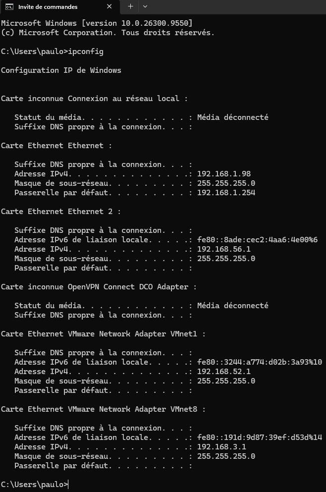

| Information | Valeur relevée | Signification |
| --- | --- | --- |
| Adresse IPv4 du poste | 192.168.1.98 | Donnée automatiquement par la box (DHCP) |
| Masque | 255.255.255.0 (/24) | Réseau 192.168.1.x : adresses utilisables de .1 à .254 |
| Passerelle | 192.168.1.254 | La box, sortie vers Internet |

### Étape 2 · Choisir l'adresse fixe du serveur

🎯 Un serveur a **toujours une IP fixe**, choisie **en dehors** des adresses que la box distribue
toute seule (sinon la box pourrait la donner à un téléphone).

🖱️ Interface de la box (Freebox OS) > **Paramètres** > **DHCP** : la box distribue de **192.168.1.2 à
192.168.1.200**. Les adresses **201 à 253** sont donc libres pour les équipements fixes.

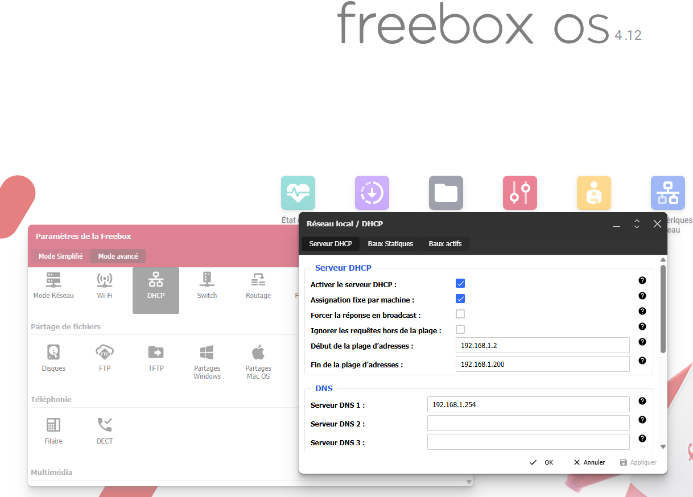

❌ **Piège évité** : l'adresse 192.168.1.200, proposée au départ, est **la dernière de la plage DHCP**.
La box aurait pu la donner à un autre appareil. D'où la règle : **vérifier la plage avant de choisir**.

**Plan des adresses fixes du lab :**

| Adresse | Équipement |
| --- | --- |
| 192.168.1.210 | pve01 (administration de Proxmox) |
| 192.168.1.211 | pfSense, côté Internet (WAN) |
| 192.168.1.212 à .220 | Réserve |

⌨️ **Vérifier que l'adresse est libre** :

```
ping 192.168.1.210
```

✅ « Impossible de joindre l'hôte de destination » : personne ne répond, **l'adresse est libre**.

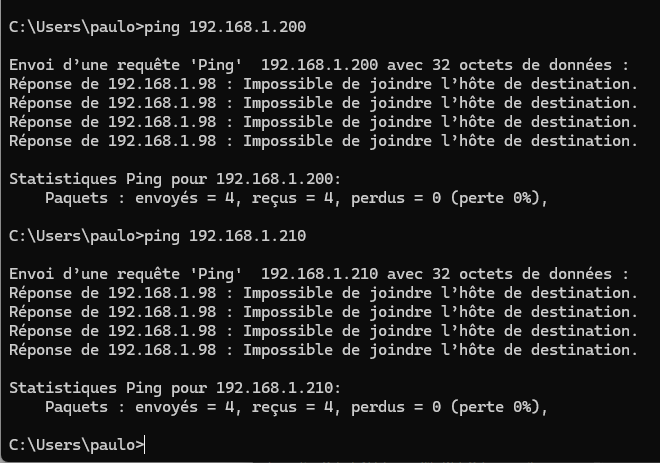

💡 **Piège de lecture** : Windows affiche « Reçus = 4, Perdus = 0 (0 % perte) ». Ce sont les **4 messages
d'erreur** renvoyés **par ton propre PC** (192.168.1.98) : il a demandé sur le réseau « qui a l'adresse
192.168.1.210 ? » (requête **ARP**) et personne n'a répondu. Une adresse occupée répondrait
« Réponse de 192.168.1.210 : octets=32 temps=… ».

**Décision** : pve01 = **192.168.1.210/24**, passerelle **192.168.1.254**, DNS **192.168.1.254**.

### Étape 3 · Télécharger l'image d'installation et vérifier son empreinte

🎯 Récupérer Proxmox depuis le **site officiel**, et prouver que le fichier n'a pas été abîmé ni modifié.

🖱️ `https://www.proxmox.com/en/downloads` > **Proxmox Virtual Environment** :

| Ligne proposée | Décision |
| --- | --- |
| For ARM64: Proxmox VE 9.2 ISO Installer | ❌ Réservée aux processeurs ARM |
| **Proxmox VE 9.2 ISO Installer (9.2-1, 1,71 Go)** | ✅ Notre processeur Intel est un x86_64 |
| Proxmox VE 8.4 ISO Installer | ❌ Ancienne génération |

💡 **x86_64** (aussi appelé **amd64**) et **ARM** sont deux familles de processeurs incompatibles.
« amd64 » ne veut pas dire « réservé à AMD » : Intel l'utilise aussi.

⌨️ Dans le dossier Téléchargements (invite de commandes) :

```
certutil -hashfile proxmox-ve_9.2-1.iso SHA256
```
- `certutil -hashfile` : calcule l'**empreinte** d'un fichier ;
- `SHA256` : l'algorithme utilisé.

✅ Comparaison avec l'empreinte publiée sur le site :

| | Empreinte SHA256 |
| --- | --- |
| Publiée par Proxmox | `4e88fe416df9b527624a175f24c9aa07c714d3332afb1ee3dbf3879573ef2c6c` |
| Calculée sur le fichier | `4e88fe416df9b527624a175f24c9aa07c714d3332afb1ee3dbf3879573ef2c6c` |

**Identiques : l'image est intègre.** 💡 L'empreinte est comme l'**empreinte digitale** du fichier :
si un seul octet change, elle change complètement.

❌ Si elles diffèrent : on supprime le fichier et on retélécharge. **On n'installe jamais une image non vérifiée.**

### Étape 4 · Créer la clé USB d'installation

🎯 Copier l'image sur une clé USB pour démarrer le mini PC dessus.

🖱️ Avec **balenaEtcher** (gratuit, il vérifie la copie à la fin) :

1. Branche une clé de **8 Go minimum**. ⚠️ **Tout son contenu sera effacé.**
2. **Flash from file** > `proxmox-ve_9.2-1.iso`.
3. **Select target** > la clé USB. **Vérifie sa taille** pour ne pas viser un autre disque !
4. **Flash!** > accepte l'autorisation Windows > attends **Flash Completed!**

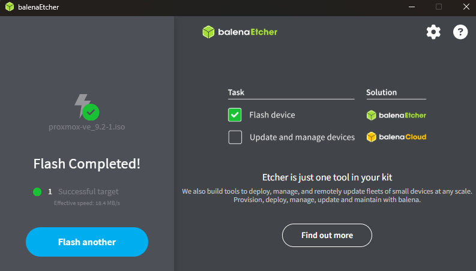

❌ **Windows affiche « Vous devez formater le disque… »** : clique sur **Annuler** (parfois plusieurs
fois, une par partition). Windows ne sait pas lire le format de la clé Proxmox ; **formater détruirait
l'image** qu'on vient de copier.

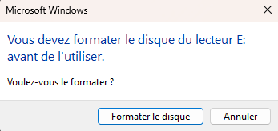

---

## Partie 2 — Le BIOS

### Étape 5 · Entrer dans le BIOS et relever le matériel

🖱️ Branche écran, clavier, câble réseau (vers la box) et clé USB. Allume en appuyant **plusieurs fois
sur Suppr** (Del). Le BIOS est un **AMI Aptio**.

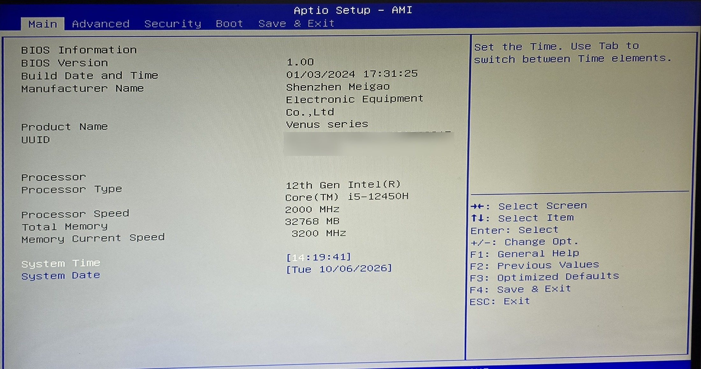

| Élément | Valeur | Remarque |
| --- | --- | --- |
| BIOS | AMI Aptio 1.00 (01/03/2024) | |
| Processeur | Intel Core i5-12450H (12e génération) | x86_64 : c'est la bonne ISO |
| Mémoire | 32 768 Mo à 3 200 MHz | 32 Go confirmés |
| Heure | 14:19 pour 16:19 à Paris | Horloge en **UTC** : c'est ce qu'attend Linux, **ne pas la changer** |

💡 Linux considère que l'horloge de la carte mère est en **temps universel (UTC)** et ajoute lui-même
le fuseau horaire. Si on la réglait à l'heure de Paris, Proxmox serait décalé de 2 heures.

### Étape 6 · Vérifier les réglages (onglet Advanced)

🎯 **Un BIOS se vérifie toujours**, même sur une machine neuve.

🖱️ Flèches du clavier pour naviguer, **Entrée** pour ouvrir, **+ / -** pour changer une valeur :

| Menu | Réglage | Avant | Après | Pourquoi |
| --- | --- | --- | --- | --- |
| Advanced | Active Performance-cores | All | All | Les 4 cœurs performance |
| Advanced | **Active Efficient-cores** | **0** | **All** | Les 4 cœurs « efficaces » étaient **coupés** (voir le dépannage, étape 9) |
| System Devices Configuration | VT-d | Enabled | Enabled | Permet de confier un équipement physique à une VM |
| | SR-IOV Support | Disabled | Disabled | Inutile ici |
| | SATA Controller(s) | Enabled | Enabled | Pour le futur SSD de sauvegarde |
| | Network Stack | Disabled | Disabled | Démarrage par le réseau (PXE) : inutile |
| Power & Performance | Limites de puissance | — | Inchangées | Valeurs du fabricant, adaptées au refroidissement |

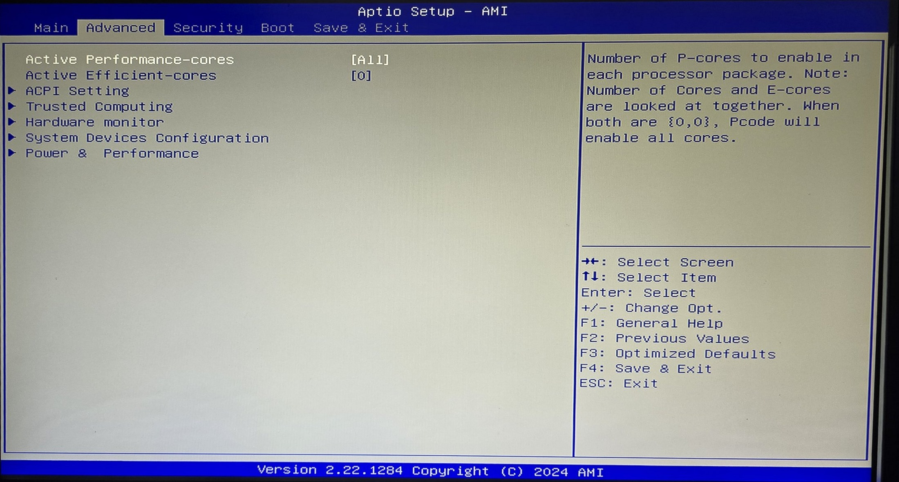
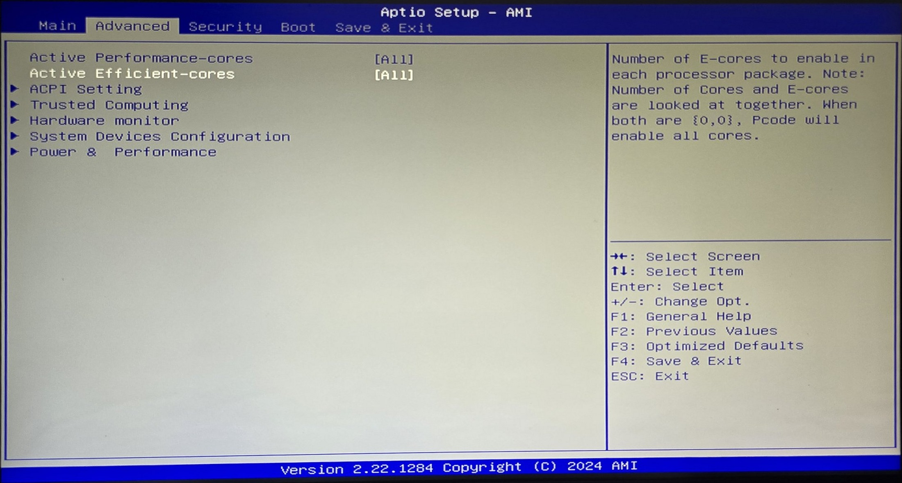
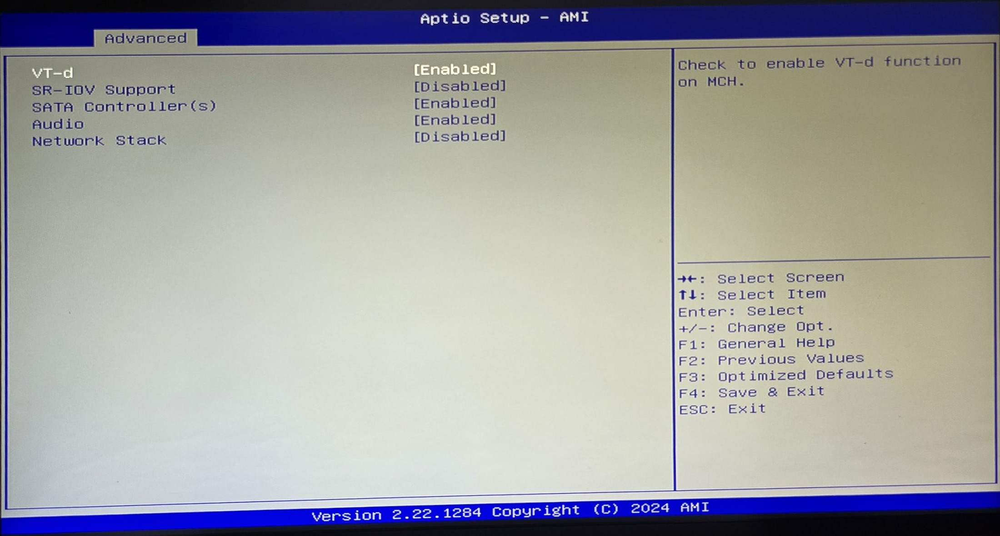
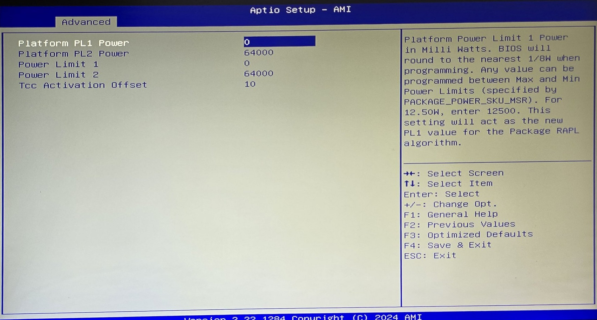

💡 **VT-x** (la virtualisation du processeur, indispensable) n'apparaît pas : sur ce type de mini PC, elle
est activée par défaut et cachée. Si elle était coupée, l'installateur afficherait « No support for KVM
virtualization detected ».

### Étape 7 · Démarrer sur la clé USB

🖱️ Onglet **Boot** : mets **USB Device** en **Boot Option #1**. **F4** (Save & Exit) > **Yes**.

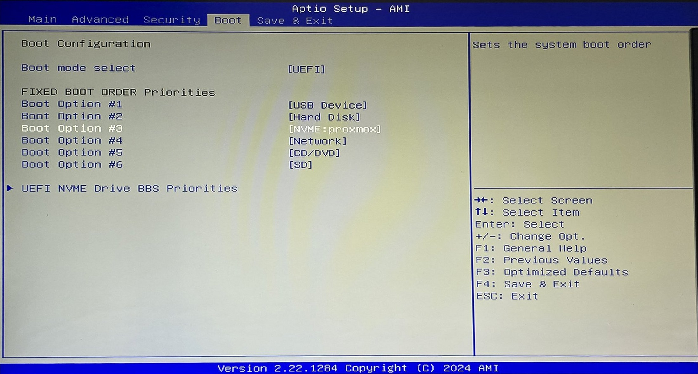

---

## Partie 3 — Installer Proxmox

### Étape 8 · L'installateur, écran par écran

🖱️ Menu de démarrage : **Install Proxmox VE (Graphical)** > **Entrée**. Accepte la licence (**I agree**).

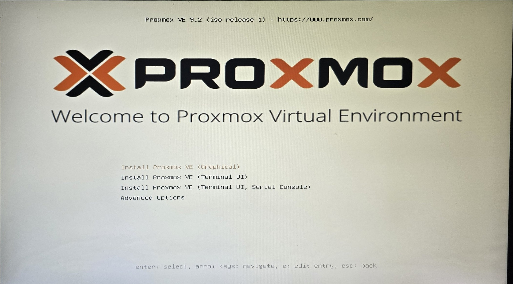

| Écran | Choix | Pourquoi |
| --- | --- | --- |
| **Target Harddisk** | `/dev/nvme0n1` (SSD Kingston, 476,94 GiB) | Le seul disque interne |
| **Options** > Filesystem | **ext4** (tailles laissées vides = automatiques) | Un seul disque : **ZFS** perdrait son intérêt (la redondance) et consommerait la RAM des VM. Proxmox crée tout seul : une partie système en ext4 + un espace **LVM-thin** pour les disques des VM |
| **Location and Time Zone** | Country `France`, Time zone `Europe/Paris`, Keyboard `French` | Heure juste dans les journaux, clavier AZERTY |
| **Administration Password and Email** | Mot de passe root **solide** (12 caractères minimum), **rangé dans un gestionnaire de mots de passe** ; e-mail de l'admin | Le mot de passe n'apparaît **jamais** sur une capture, un document ou dans une conversation. L'e-mail reçoit les alertes (disques, sauvegardes) |
| **Management Network Configuration** | Interface `nic0` (point vert = câble branché), Hostname `pve01.lab.home.arpa`, IP `192.168.1.210` / `24`, Gateway et DNS `192.168.1.254`, ✅ **Pin network interface names** | IP choisie à l'étape 2. `pve01` = rôle + numéro. `home.arpa` est réservé aux réseaux privés (RFC 8375). L'épinglage garde les noms des cartes fixes après les mises à jour |
| **Summary** | ❌ **décoche** « Automatically reboot after successful installation » > **Install** | On doit **retirer la clé** avant le redémarrage, sinon l'installateur se relance |

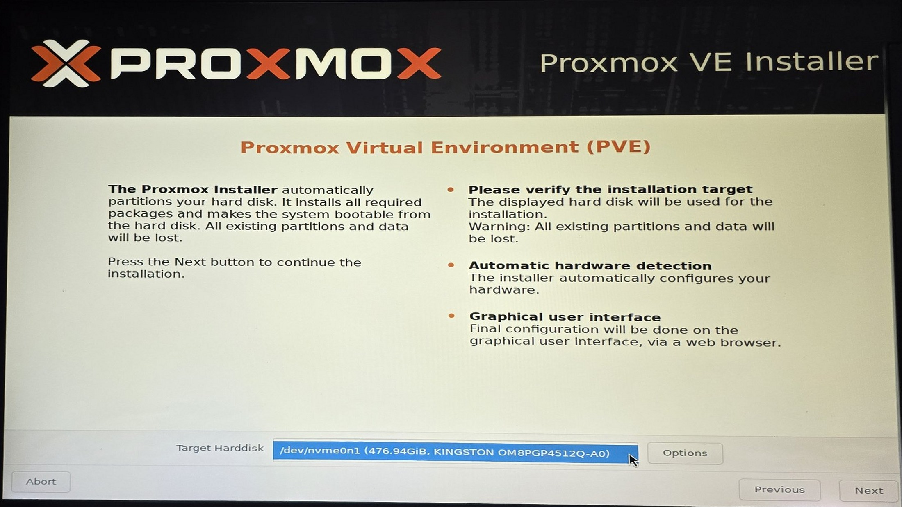
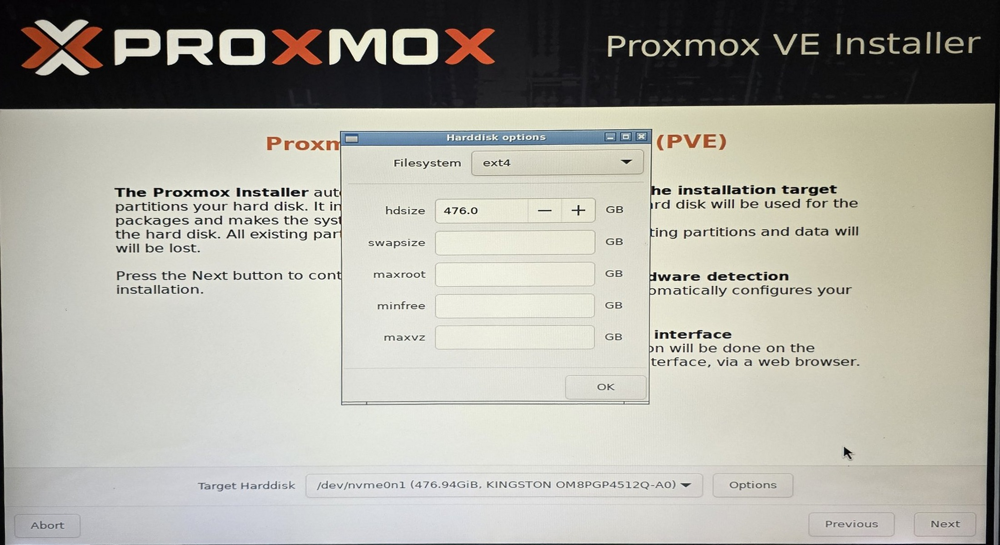
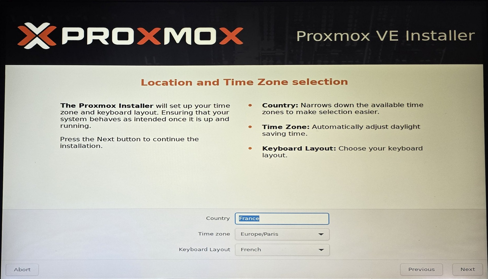
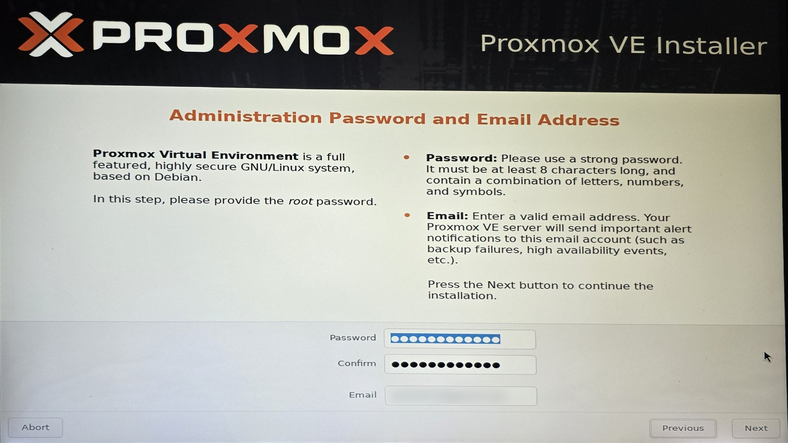
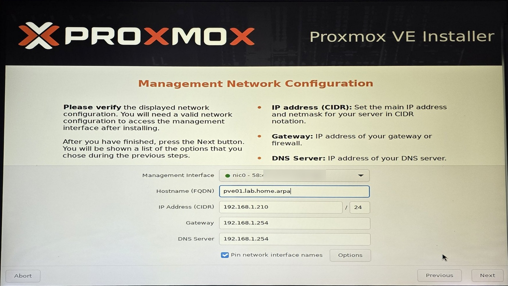
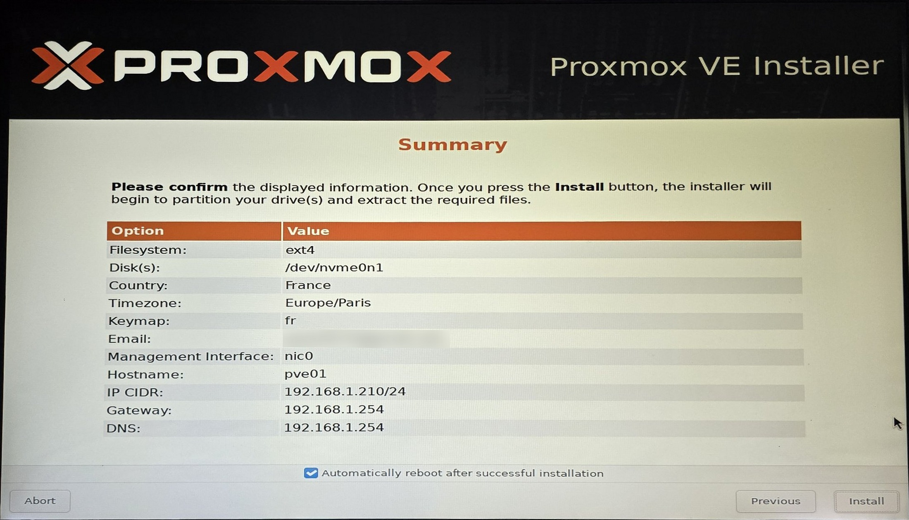

💡 **Formatage** : l'installateur efface le disque et recrée tout. C'est un effacement **rapide** : pour
recycler un disque en entreprise, on fait un effacement **sécurisé** (`blkdiscard`, *secure erase*) et
on le trace.

❌ Au 2e essai, l'installateur avait pré-rempli une **adresse IPv6** donnée par la box. On a remis les
valeurs IPv4 prévues. Les captures montrant l'IPv6 publique ne sont pas publiées (une IP publique ne se
publie jamais).

### Étape 9 · Dépannage : l'installation plante

❌ **Symptômes** :
1. 1er essai : clic sur **Install**, retour immédiat au menu.
2. 2e essai : la barre démarre, puis vers 25 % **écran noir** et **redémarrage brutal**.

💡 **La méthode de diagnostic** :
- Un redémarrage brutal **sans message** = un **plantage matériel**, pas une erreur de Proxmox.
- La machine fonctionnait avant (avec un ancien Proxmox).
- ⭐ **Règle d'or : le dernier changement est le premier suspect.** Le seul changement important :
  l'activation des **cœurs efficaces** (E-cores) dans le BIOS (étape 6).

✅ **Correction** : retour à la configuration stable (**Active Efficient-cores = 0**), et nouvelle
installation **sans rien changer d'autre** (toujours en mode graphique). → **Installation réussie.**
Le mode graphique est mis hors de cause : **le coupable est l'activation des E-cores** sur ce BIOS.

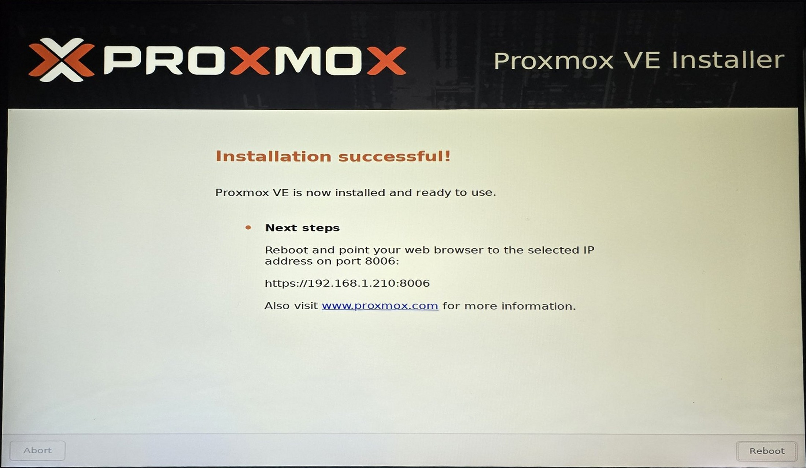

💡 **En entretien** : « Mon installation plantait. J'ai appliqué la règle du dernier changement, je suis
revenu à la configuration stable, l'installation est passée. Un seul changement à la fois. »

**À faire plus tard** : réactiver les E-cores et faire un **test de charge** pour voir si la machine
reste stable.

---

## Partie 4 — Premier démarrage

### Étape 10 · Retirer la clé et démarrer

🖱️ **Retire la clé USB**, puis **Reboot**. La console du serveur affiche l'adresse d'administration :
`https://192.168.1.210:8006/`. À partir de là, **on n'a plus besoin de l'écran du serveur** : tout se
fait à distance, depuis un navigateur.

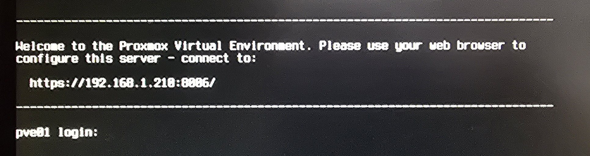

⌨️ Depuis ton PC :

```
ping 192.168.1.210
```
✅ Cette fois, **c'est le serveur qui répond**.

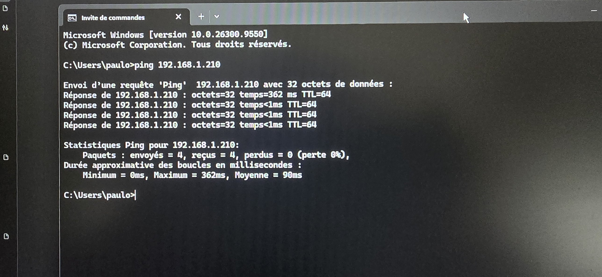

💡 Le 1er ping est plus lent (362 ms) : c'est le temps de la résolution **ARP** (« qui a cette adresse ? »),
ensuite mémorisée. Le **TTL=64** est la valeur de départ typique de **Linux** (Windows : 128) : un simple
ping donne un indice sur le système d'en face.

### Étape 11 · Première connexion à l'interface web

🖱️ Dans le navigateur : `https://192.168.1.210:8006` (8006 = le port de l'interface Proxmox).

| Écran | Action | Explication |
| --- | --- | --- |
| « Votre connexion n'est pas privée » (`NET::ERR_CERT_AUTHORITY_INVALID`) | **Paramètres avancés** > **Continuer** | Certificat **autosigné** : la connexion est chiffrée, mais l'identité n'est vérifiée par aucune autorité. On l'accepte **uniquement** parce qu'on sait pourquoi (il sera remplacé par un certificat de l'entreprise) |
| Connexion | Utilisateur `root`, royaume **Linux PAM standard authentication**, langue **Français** | PAM = les comptes système de Linux |
| « Aucun abonnement en cours de validité » | **OK** | Version gratuite, sans support payant |

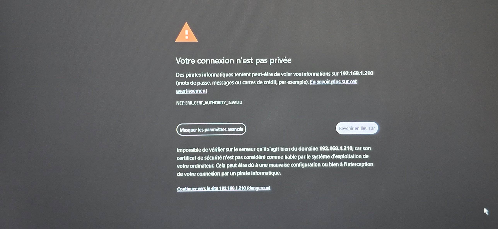
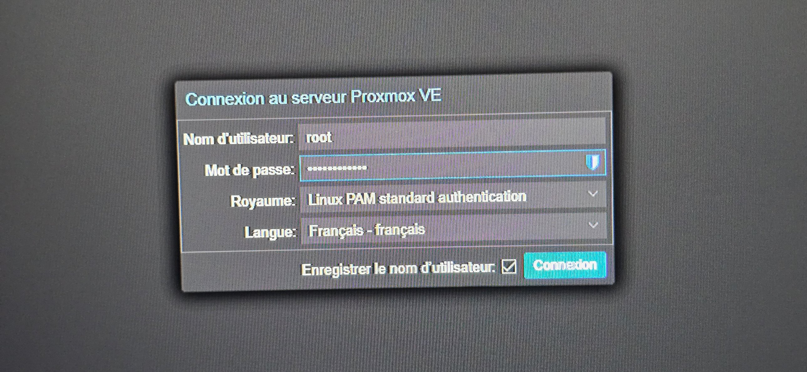
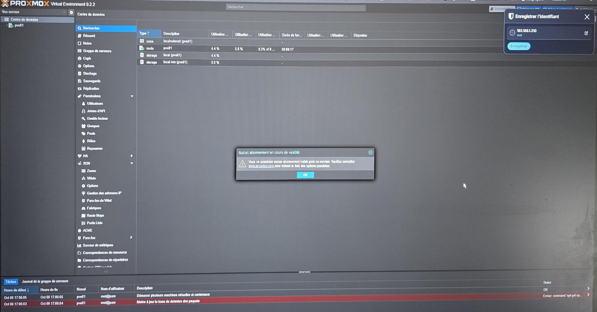

| Élément de l'interface | Rôle |
| --- | --- |
| Centre de données > **pve01** | Le serveur (un seul « nœud ») |
| **local (pve01)** | Les fichiers : ISO, modèles, sauvegardes |
| **local-lvm (pve01)** | Les disques des VM (LVM-thin) |

---

## Partie 5 — Mettre le serveur à jour

### Étape 12 · Corriger les dépôts

❌ **Constat** : une tâche en erreur, « Mettre à jour la base de données des paquets » (`apt-get update`
failed).

💡 **Cause** : Proxmox active par défaut les dépôts **Enterprise** (payants), qui refusent l'accès sans
abonnement. Or **un serveur qui ne peut pas se mettre à jour est un risque de sécurité**.

🖱️ **pve01** > **Mises à jour** > **Dépôts** :

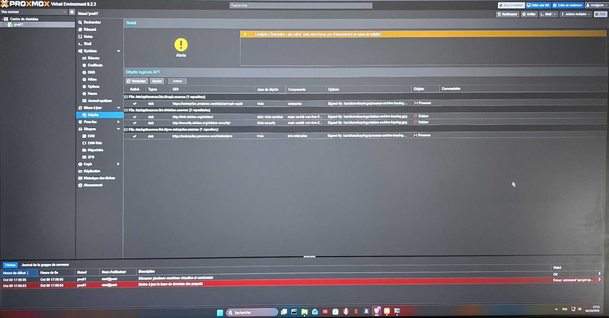

| Dépôt | Origine | Action |
| --- | --- | --- |
| ceph-squid (enterprise) | Proxmox, payant | Sélectionner > **Désactiver** (et Ceph n'est pas utilisé) |
| trixie, trixie-updates | Debian | Garder : la base du système |
| trixie-security | Debian | Garder : les **correctifs de sécurité** |
| pve-enterprise | Proxmox, payant | Sélectionner > **Désactiver** |
| **pve-no-subscription** | Proxmox, gratuit | **Ajouter** > choisir **No-Subscription** > **Ajouter** |

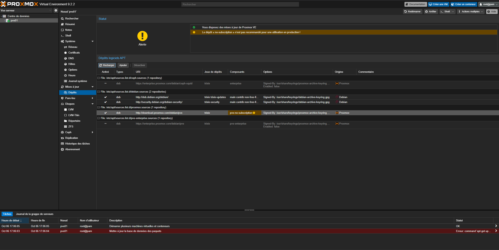

💡 **Enterprise ou No-Subscription** : **mêmes logiciels**. Les paquets Enterprise sont testés plus
longtemps avant publication (c'est ce que paient les entreprises, avec le support). No-Subscription
convient à un lab.

### Étape 13 · Installer les mises à jour

🖱️ **pve01** > **Mises à jour** > **Rafraîchir** (= `apt update` : met à jour le **catalogue**), puis
**Mettre à niveau** (= `apt dist-upgrade` : installe, et peut ajouter ou retirer des paquets, par
exemple un nouveau noyau). Une fenêtre de terminal s'ouvre : tape `y` si on te le demande.

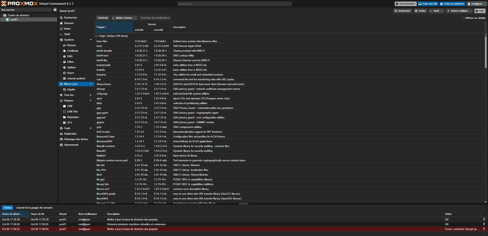

💡 Pendant l'installation, **apt-listchanges** affiche les changements importants (ici : rsync plus strict
sur la sécurité). On **lit**, puis `q` pour continuer. En production, ces notes se lisent vraiment : un
changement de comportement peut casser un script.

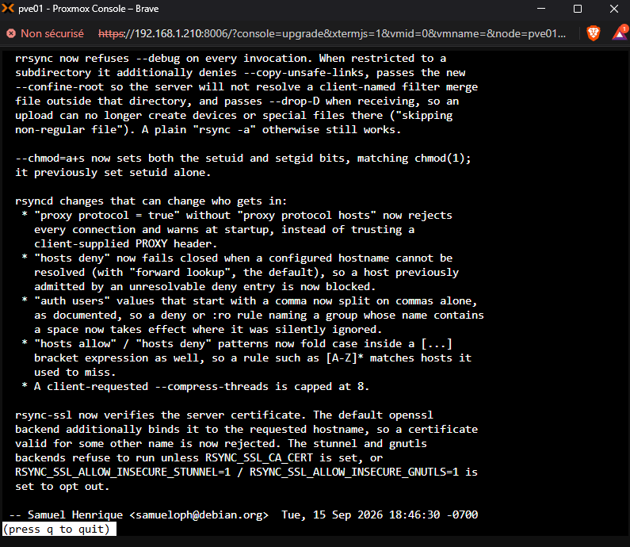

✅ « Your System is up-to-date ». Un **nouveau noyau** a été installé : il faut **redémarrer** pour l'activer.

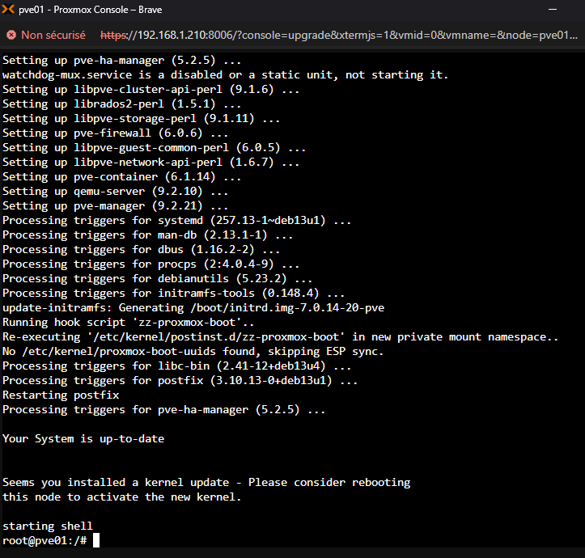

### Étape 14 · Redémarrer et vérifier

1. 🖱️ **pve01** > **Redémarrer**. 🏢 En production : redémarrage **planifié**, utilisateurs prévenus,
   hors heures de travail.
2. 🖱️ Dans le BIOS (Suppr au démarrage) > **Boot** : remets le **NVMe en premier**. Un serveur démarre
   toujours sur **son propre disque**, même si une clé USB est restée branchée.

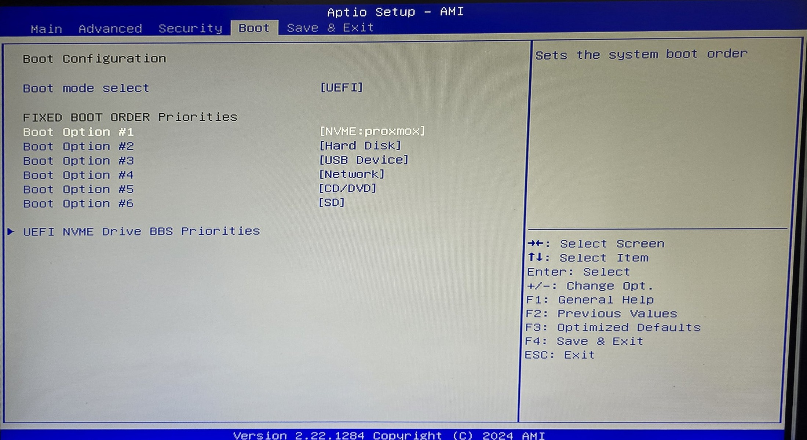

3. 🖱️ **pve01** > **Résumé** :

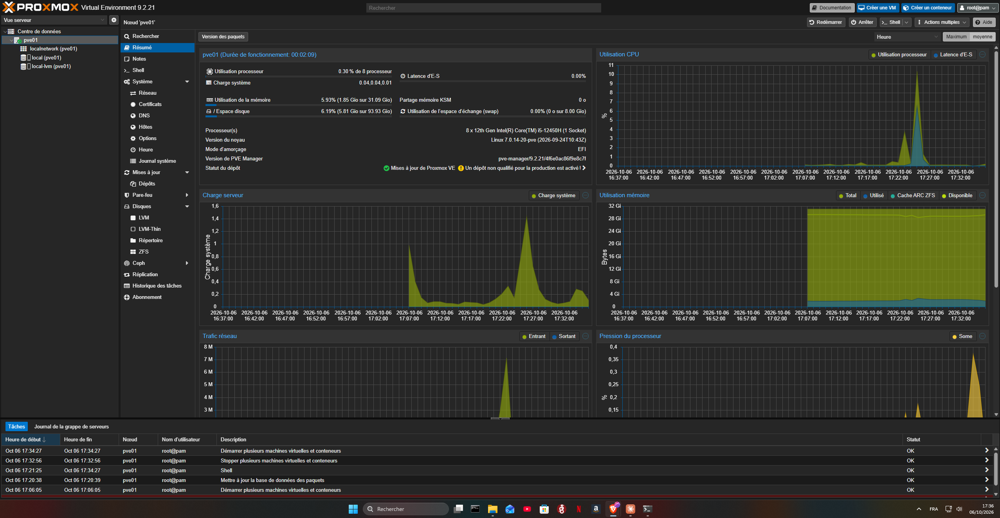

| Contrôle | Valeur | Verdict |
| --- | --- | --- |
| Noyau | Linux 7.0.14-20-pve | ✅ Le nouveau noyau est actif |
| PVE Manager | pve-manager/9.2.21 | ✅ À jour |
| Processeurs | 8 × Intel Core i5-12450H | 4 cœurs performance × 2 (E-cores coupés, étape 9) |
| Mémoire | 31,09 Gio | ✅ 32 Go installés |
| Disque système | 93,93 Gio | Le reste du SSD est dans local-lvm pour les VM |
| Mode d'amorçage | EFI | ✅ Démarrage UEFI moderne |

---

## Partie 6 — Sécuriser les accès

> 💡 **Les 4 principes** :
> 1. **Les droits vont aux groupes, pas aux personnes** (RBAC : contrôle d'accès par **rôles**). Un admin
>    arrive : on l'ajoute au groupe. Il part : on le retire, et tous ses droits partent d'un coup.
> 2. **Moindre privilège** : chacun reçoit le minimum nécessaire.
> 3. **Pas de travail quotidien en root** : chaque admin a **son** compte, pour savoir **qui a fait quoi**.
>    Root devient un compte de **secours** (« break-glass » : on brise la vitre en cas d'urgence).
> 4. **Double authentification** (mot de passe + code du téléphone) sur tous les comptes admin.

### Étape 15 · Créer le groupe admin-infra et lui donner les droits

🖱️ **Centre de données** > **Permissions** > **Groupes** > **Créer** : nom `admin-infra`,
commentaire `Administrateurs de l'infrastructure` > **Créer**.

🖱️ **Centre de données** > **Permissions** > **Ajouter** > **Permission de groupe** :

| Champ | Valeur | Explication |
| --- | --- | --- |
| Chemin | `/` | Tout Proxmox |
| Groupe | `admin-infra` (affiché `@admin-infra` : le `@` désigne un groupe) | |
| Rôle | **Administrator** | Tous les droits |
| Propager | ✅ | Les droits s'appliquent à tout ce qui est en dessous |

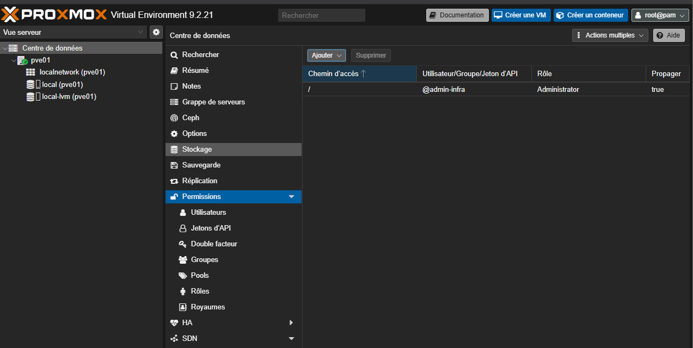

### Étape 16 · Créer le compte nominatif paulo@pve

🖱️ **Permissions** > **Utilisateurs** > **Ajouter** :

| Champ | Valeur |
| --- | --- |
| Nom d'utilisateur | `paulo` |
| Royaume | **Proxmox VE authentication server** |
| Mot de passe | Différent de celui de root, rangé dans le gestionnaire |
| Groupe | `admin-infra` |

L'identifiant complet devient `paulo@pve`.

| Royaume | Nature du compte | Choix |
| --- | --- | --- |
| Linux PAM (`@pam`) | Un vrai compte Linux, qui peut aussi ouvrir une session sur le système | Réservé à root |
| Proxmox VE (`@pve`) | Existe **seulement dans Proxmox**, sans accès direct au système | ✅ Pour les admins |

💡 Les champs « Mot de passe » n'apparaissent qu'avec le royaume Proxmox VE (avec PAM, c'est le mot de
passe du compte Linux qui sert).

🖱️ **Test** dans une **fenêtre de navigation privée** (on garde la session root ouverte à côté) :
connexion en `paulo`, royaume **Proxmox VE authentication server**.

❌ **Erreur du lab** : le compte se connecte, mais le menu est réduit et **Créer une VM** est grisé. Il
n'avait **aucun droit** : il n'avait pas été ajouté au groupe à la création.

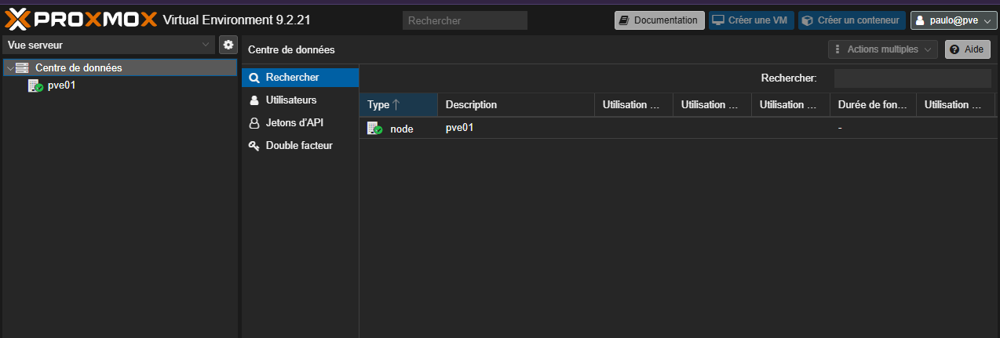

✅ **Correction** : **Utilisateurs** > `paulo@pve` > **Modifier** > **Groupe** = `admin-infra` > **OK**,
puis reconnexion : interface complète.

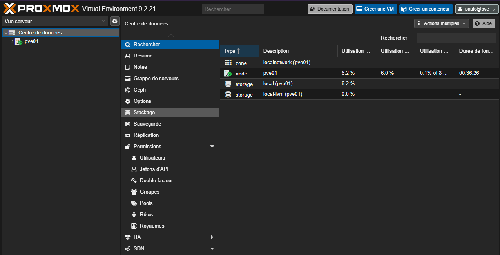

💡 **Bon réflexe** : on **teste toujours** un compte après l'avoir créé, en se connectant **avec lui**.

### Étape 17 · Activer la double authentification (TOTP)

🖱️ Connecté avec le compte concerné : **Permissions** > **Double facteur** > **Ajouter** > **TOTP** :

1. Scanne le **QR code** avec une application d'authentification (sur le téléphone), puis tape le
   **code à 6 chiffres** affiché par l'application > **Ajouter**.
   ⚠️ **Ne fais jamais de capture du QR code** : il contient la **clé secrète**.
2. **Ajouter** > **Recovery Keys** : des **codes de secours** à usage unique, affichés **une seule fois**,
   à ranger dans le gestionnaire de mots de passe (si tu perds ton téléphone).
3. Fais pareil pour **root**.
4. **Teste la reconnexion** (déconnexion / connexion : le code est demandé) **avant** de fermer la
   dernière session admin ouverte.

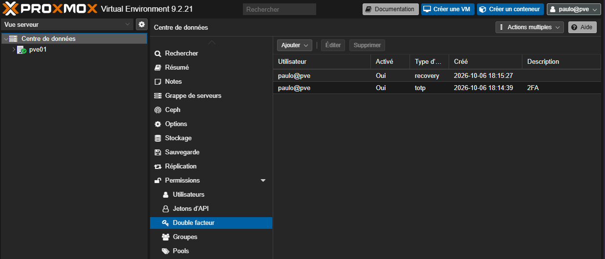
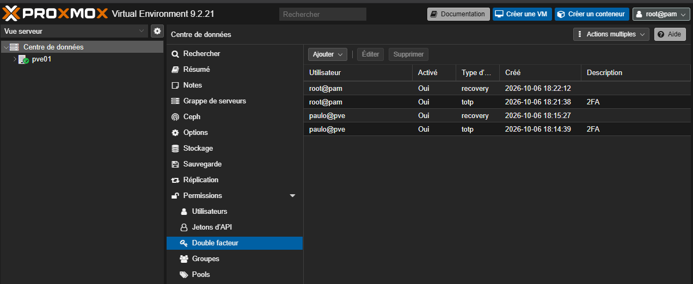

💡 **Accès de dernier recours** : la double authentification protège l'**interface web**. La **console
physique** du serveur (écran + clavier) reste utilisable avec root si on perd téléphone et codes.

---

## Partie 7 — Recette (on vérifie que tout marche)

| # | Test | Résultat attendu | Résultat |
| --- | --- | --- | --- |
| 1 | `ping 192.168.1.210` depuis le poste admin | Le serveur répond | ✅ |
| 2 | `https://192.168.1.210:8006` | Page de connexion Proxmox | ✅ |
| 3 | pve01 > Résumé | Noyau 7.0.14-20-pve, 31 Gio, EFI | ✅ |
| 4 | Mises à jour > Rafraîchir | Tâche OK, aucune erreur de dépôt | ✅ |
| 5 | Redémarrage | Démarre sur le NVMe, la console affiche l'adresse | ✅ |
| 6 | Connexion `paulo@pve` | Interface complète | ✅ (après correction) |
| 7 | Connexion `paulo@pve` puis `root@pam` | Code TOTP demandé | ✅ |

---

## Annexes

### A. Utilisation en entreprise : 3 cas concrets

1. **Un nouvel admin arrive** : création de son compte `@pve`, ajout au groupe `admin-infra`, il
   configure sa double authentification à la 1re connexion. Aucun droit à donner un par un.
2. **Une alerte de sécurité Debian tombe** : Mises à jour > Rafraîchir, lecture des notes de
   changement, mise à niveau ; s'il y a un nouveau noyau, redémarrage planifié hors heures de travail.
3. **Un admin quitte l'entreprise** : désactivation immédiate de son compte (Utilisateurs > Modifier >
   **Activé** décoché), suppression de sa 2FA, puis suppression du compte après vérification. Les
   journaux gardent la trace de ses actions passées.

### B. Questions d'entretien (avec la réponse)

- **Pourquoi Proxmox plutôt que VMware ?** Gratuit, complet, très demandé depuis la hausse des tarifs de
  VMware après le rachat par Broadcom. Je connais aussi le principe d'Hyper-V.
- **ext4 ou ZFS ?** Ça dépend du matériel : ZFS en miroir sur plusieurs disques sans carte RAID ;
  LVM-thin sur un RAID matériel ; Ceph ou stockage partagé en cluster. Sur un seul disque : ext4 +
  LVM-thin, pour garder la RAM pour les VM. Jamais ZFS sur un RAID matériel.
- **Pourquoi pas root au quotidien ?** Traçabilité (qui a fait quoi), moindre privilège, et root est la
  cible n° 1 des attaques.
- **Enterprise ou No-Subscription ?** Mêmes logiciels ; Enterprise est testé plus longtemps et inclut le
  support. No-Subscription pour un lab, abonnement en production.
- **Ton installation a planté, qu'as-tu fait ?** Règle du dernier changement : retour à la
  configuration stable (E-cores désactivés), un seul changement à la fois, cause confirmée.
- **Comment sais-tu qu'une adresse IP est libre ?** Hors de la plage DHCP, et `ping` sans réponse de
  l'appareil (attention à lire **qui** répond).

### C. Écarts entre le lab et l'entreprise

| Dans le lab | En entreprise | Pourquoi l'écart, et le risque |
| --- | --- | --- |
| **Un seul** serveur Proxmox | Cluster d'au moins 3 nœuds (ou 2 + un arbitre) | S'il tombe, **tout** s'arrête (pare-feu compris). Point de panne unique assumé |
| Mini PC grand public, un seul disque | Serveur avec alimentations redondantes, mémoire ECC, disques en RAID ou en miroir | Coût. Une panne de disque = perte de toutes les VM |
| Pas encore de sauvegarde externe | Proxmox Backup Server ou Veeam, avec une copie hors site | Brique 07. Les instantanés ne sont **pas** des sauvegardes |
| Administration depuis le réseau de la box | Réseau d'administration dédié (VLAN 99) | Attend le switch (brique 02) |
| Certificat autosigné | Certificat de l'autorité interne ou public | La PKI existe depuis la brique 05 ; certificat de Proxmox à faire (brique 19) |
| Dépôt « No-Subscription » | Dépôt « Enterprise » avec support | Coût |
| E-cores désactivés | Matériel validé par l'éditeur | Contournement d'un plantage, à retester |

### D. Points en suspens

- Retester l'activation des E-cores sous charge (ou après une mise à jour du BIOS).
- Remplacer le certificat autosigné de Proxmox par un certificat signé par `AEROTRANS-Root-CA`
  (la PKI a été créée à la brique 05).
- Réseau : pont virtuel VLAN-aware pour pfSense et les VLAN → [brique 01](../01-pfsense/).
