# Brique 01 — Le pare-feu pfSense et le découpage du réseau en VLAN

> **Tuto pas à pas, écrit pour quelqu'un qui débute.** Chaque étape dit **pourquoi** on la fait,
> **où cliquer** ou **quoi taper**, **ce qu'on doit voir**, et **quoi faire si ça ne marche pas**.
> Les erreurs faites pendant le lab sont laissées volontairement, avec leur correction.
> Les captures sont dans le dossier [`captures/`](captures/).

## Comment lire ce tuto

| Repère | Sens |
| --- | --- |
| 🎯 | **Le but** de l'étape |
| 🖱️ | Ce qu'on fait **à la souris** ou dans un menu |
| ⌨️ | Ce qu'on **tape**, avec l'explication |
| ✅ | Ce qu'on **doit voir** si tout va bien |
| ❌ | **Si ça ne marche pas** (souvent : l'erreur qu'on a vraiment eue) |
| 🏢 | **En entreprise**, quand on ferait autrement |
| 💡 | Une explication pour bien comprendre |

---

## Résumé pour les pressés

- **pfSense CE 2.9.0** en VM (`fw01`) sur Proxmox, disque en **ZFS**, WAN fixe **192.168.1.211**.
- Pont Proxmox **vmbr1 « VLAN aware »** sur la 2e carte réseau, **trunk 802.1Q** vers le futur switch.
- **5 VLAN** : 10 Serveurs, 20 Postes, 30 Wi-Fi salariés, 40 Wi-Fi invités, 99 Administration ;
  pfSense en `.254` dans chacun.
- **Règles au refus par défaut** sur le VLAN Postes (blocage de l'administration et de l'interface du
  pare-feu), **recette** avec une VM de test : Internet ✅, administration ❌, interface web ❌.
- Dépannages : chevauchement LAN/WAN à l'installation, masque `/32` oublié sur deux VLAN, ping par nom
  en IPv6.

---

## Partie 0 — Comprendre avant de commencer

### 0.1 Le besoin du client

AEROTRANS a besoin :

- d'**une seule porte** entre Internet et son réseau, qui **contrôle** ce qui entre et ce qui sort ;
- de **séparer** ses machines par usage : serveurs, postes, Wi-Fi des salariés, Wi-Fi des invités,
  administration. **Un invité ne doit jamais atteindre un serveur. Un poste infecté ne doit jamais
  toucher aux équipements réseau.**

### 0.2 Les images à retenir

| Notion | Image |
| --- | --- |
| **Pare-feu** | Le **vigile** à l'entrée de l'immeuble : il a une liste de qui a le droit d'aller où |
| **VLAN** (réseau virtuel) | Des **étages séparés** dans le même immeuble : même câblage, mais on ne passe pas d'un étage à l'autre sans passer devant le vigile |
| **Trunk 802.1Q** | Un **ascenseur** qui dessert tous les étages : un seul câble transporte tous les VLAN, chaque paquet porte une **étiquette** (le « tag ») avec son numéro de VLAN |
| **Passerelle** | La **porte de l'étage** : pour sortir de son VLAN, une machine passe par pfSense (`.254`) |
| **Règle « refus par défaut »** | Le vigile refuse **tout le monde**, sauf ceux qui sont **sur la liste** |

### 0.3 Le choix de l'outil

| Critère | pfSense CE | OPNsense | Pare-feu de la box |
| --- | --- | --- | --- |
| Présence en PME et en ESN | Très répandu | En hausse | Inadapté |
| VLAN, VPN, règles fines | Oui | Oui | Non |
| Coût | Gratuit | Gratuit | Inclus |

**Choix : pfSense CE**, le plus rencontré chez les clients et en entretien. Il tourne en **machine
virtuelle** sur Proxmox (brique 00).

### 0.4 L'architecture visée

```
            INTERNET
               |
         [ Freebox ] 192.168.1.254       réseau de la box 192.168.1.0/24
               |
     nic0 -> [ vmbr0 ] -- Proxmox 192.168.1.210
               |
          WAN 192.168.1.211
          [ fw01 : pfSense ]   le seul passage entre la box et l'entreprise
          vtnet1 = trunk 802.1Q (tous les VLAN)
               |
     nic1 -> [ vmbr1 ] (VLAN aware, sans IP)  -> switch Cisco (brique 02)
               |
   VLAN 10       VLAN 20       VLAN 30        VLAN 40        VLAN 99
   Serveurs      Postes        Wi-Fi salariés Wi-Fi invités  Administration
   .10.254       .20.254       .30.254        .40.254        .99.254
```

💡 **Règle mnémotechnique** : dans chaque VLAN, le **3e nombre** de l'adresse est le **numéro du VLAN**
(10.10.**20**.x = VLAN 20) et pfSense est toujours en **.254**. Toutes les adresses :
[plan d'adressage](../docs/plan-adressage.md).

---

## Partie 1 — Préparer

### Étape 1 · Récupérer l'installateur et vérifier son empreinte

🎯 Avoir un installateur **officiel** et **intact**.

🖱️ Depuis la version 2.8, pfSense CE s'installe avec le **Netgate Installer**, récupéré gratuitement
(panier à 0 €) sur la boutique Netgate : version **ISO AMD64**.

⌨️ Le fichier arrive compressé (`.iso.gz`). Sous Linux (ou WSL) :

```bash
gzip -t netgate-installer-*.iso.gz
gunzip netgate-installer-*.iso.gz
sha256sum netgate-installer-*.iso
```
- `gzip -t` : **teste** l'archive (abîmée ou pas) sans la décompresser ;
- `gunzip` : décompresse ;
- `sha256sum` : calcule l'**empreinte** de l'ISO.

💡 Une ISO abîmée pendant un transfert peut faire planter l'installation **au milieu**, et on
chercherait la panne au mauvais endroit.

### Étape 2 · Envoyer l'ISO dans Proxmox avec contrôle

🖱️ Proxmox > **local (pve01)** > **Images ISO** > **Téléverser** > choisis le fichier, ouvre
**Algorithme de hachage** = **SHA-256**, colle l'empreinte calculée > **Téléverser**.

✅ La tâche affiche `checksum verified` puis `TASK OK` : Proxmox a recalculé l'empreinte après
réception (il refuserait le fichier si elle différait).

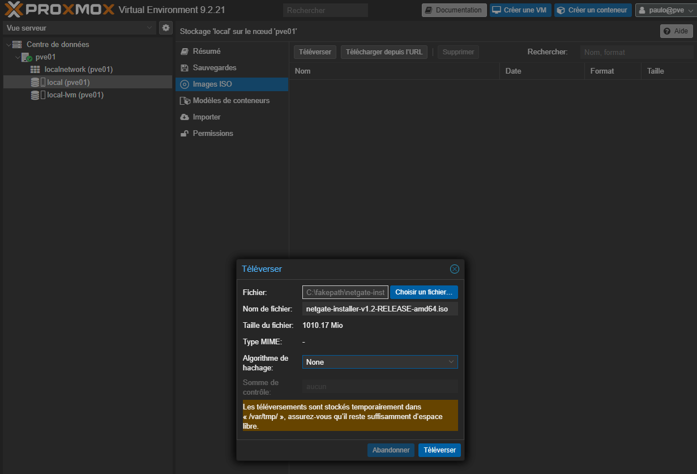
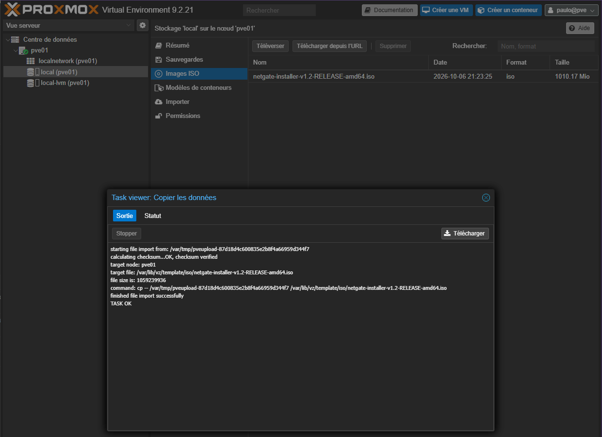

---

## Partie 2 — Le réseau dans Proxmox

### Étape 3 · Créer le pont vmbr1 pour le réseau de l'entreprise

🎯 Le mini PC a **deux cartes réseau** : `nic0` (déjà reliée au pont **vmbr0**, côté box) et `nic1`
(libre). On crée un **pont vmbr1** sur `nic1` : ce sera le réseau **interne** de l'entreprise.

💡 Un **pont** (*bridge*) est un **switch virtuel** à l'intérieur de Proxmox : les VM s'y branchent
comme sur une vraie prise réseau.

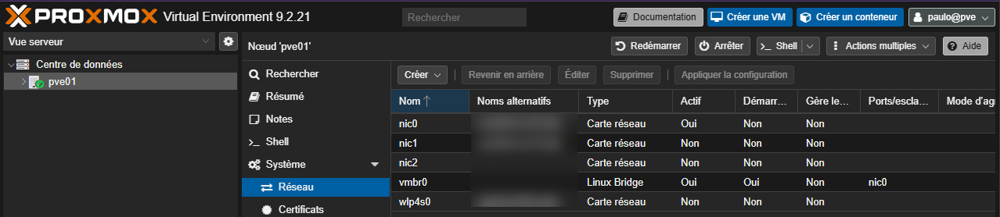

🖱️ **pve01** > **Système** > **Réseau** > **Créer** > **Linux Bridge** :

| Champ | Valeur | Pourquoi |
| --- | --- | --- |
| Nom | `vmbr1` | Suite logique de vmbr0 |
| IPv4/CIDR, Passerelle | **vides** | Proxmox ne doit **pas** être joignable depuis le réseau de l'entreprise |
| **Gère les VLAN** (VLAN aware) | ✅ | Un seul pont pour tous les VLAN : chaque VM reçoit juste un **tag** |
| Ports du pont | `nic1` | Le câble qui partira vers le switch Cisco |
| Commentaire | `LAN entreprise - trunk VLAN` | |

**Créer**, puis **Appliquer la configuration**.

✅ `vmbr1` apparaît, actif, sur `nic1`.

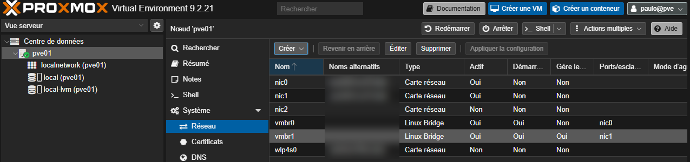

💡 **Alternative écartée** : un pont par VLAN (vmbr10, vmbr20…). Plus lourd : chaque nouveau VLAN
obligerait à modifier le réseau de Proxmox.

---

## Partie 3 — La machine virtuelle du pare-feu

### Étape 4 · Créer la VM 100 · fw01

🖱️ **Créer une VM**, case **Avancé** cochée :

| Onglet | Réglage | Valeur | Pourquoi |
| --- | --- | --- | --- |
| Général | ID / Nom | `100` / `fw01` | La centaine = l'infrastructure réseau |
| | Démarrer au démarrage, ordre, délai | ✅, `1`, `30` s | Le pare-feu démarre **en premier** ; les autres VM attendent 30 s qu'il soit prêt |
| Système d'exploitation | Type | **Other** | pfSense tourne sur **FreeBSD**, pas sur Linux |
| Système | Machine / BIOS | **q35** / SeaBIOS | Modèle récent ; pas besoin d'UEFI |
| | Contrôleur SCSI | VirtIO SCSI single | |
| Disques | Bus / taille | **SCSI**, `16` Gio, ✅ discard, ✅ SSD, ✅ IO thread | Un pare-feu stocke peu |
| Processeur | Cœurs / type | `2`, **host** | Le vrai processeur est transmis, avec ses instructions **AES-NI** (chiffrement rapide pour les VPN) |
| Mémoire | Taille / ballooning | `2048`, ❌ ballooning | Le ballooning fonctionne mal sous FreeBSD |
| Réseau | net0 | **VirtIO** sur **vmbr0**, pare-feu Proxmox ❌ | Le **WAN**, côté box |

❌ **Piège évité** : avec le type « Other », Proxmox propose par défaut un disque **IDE** et une carte
**Intel E1000**, lents. On passe sur **SCSI** et **VirtIO**.

🖱️ Après la création : **Matériel** > **Ajouter** > **Carte réseau** : **vmbr1**, modèle **VirtIO**,
**sans tag VLAN**, pare-feu ❌.

💡 **Sans tag** = cette carte reçoit **tous** les VLAN avec leur étiquette : c'est le **trunk**.
pfSense lira lui-même les étiquettes.

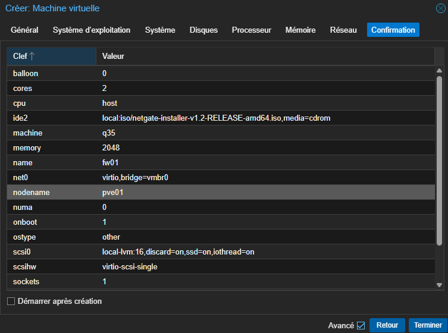
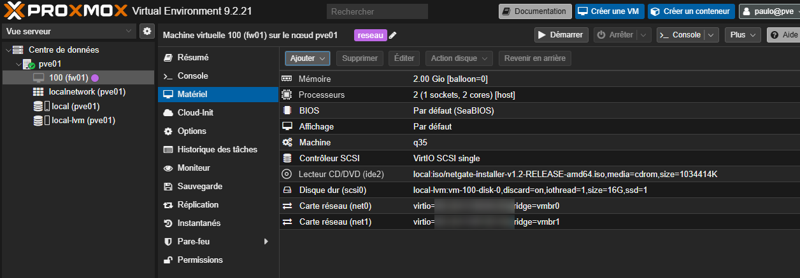

---

## Partie 4 — Installer pfSense

### Étape 5 · L'installateur

🖱️ Démarre la VM, **Console**. Sur l'écran d'accueil : **Install**.

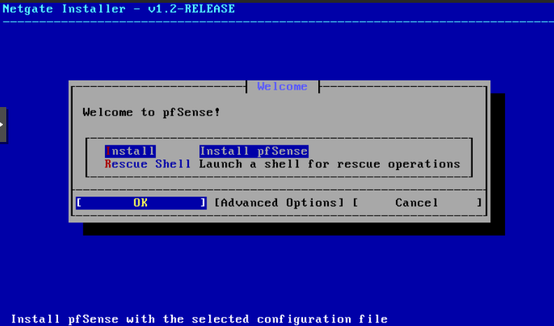

1. **Carte WAN** : `vtnet0`. 💡 On vérifie par l'**adresse MAC** que vtnet0 est bien `net0` (vmbr0) :
   les noms des cartes changent d'un système à l'autre (net0 dans Proxmox, vtnet0 dans FreeBSD),
   la **MAC, jamais**. (Compare avec **Matériel** > net0 dans Proxmox.)

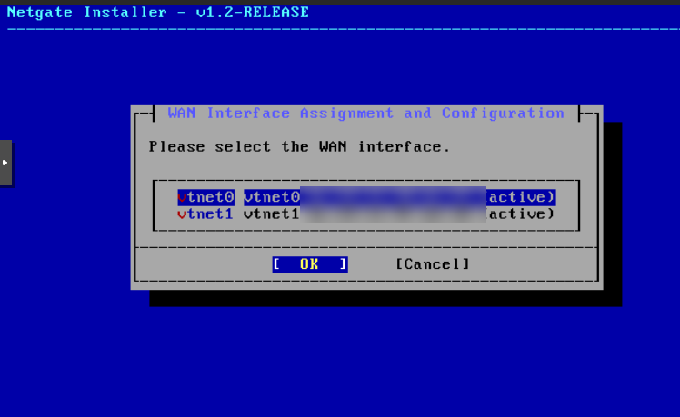

2. Le WAN est proposé en **DHCP** : on le laisse comme ça **pour l'instant** (voir l'étape 6).

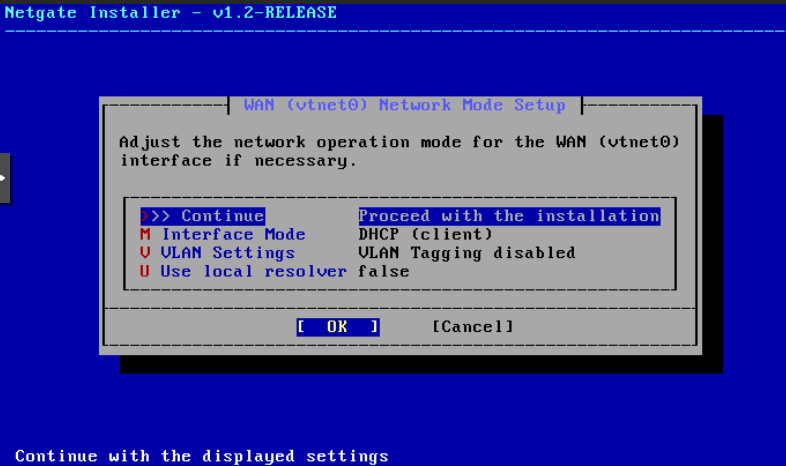

### Étape 6 · Dépannage : « Cannot set WAN interface IP address »

❌ En voulant mettre le WAN en adresse fixe `192.168.1.211/24`, l'installateur **refuse**.

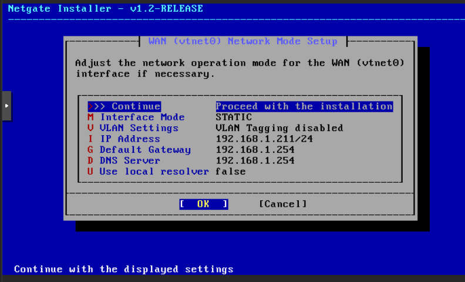
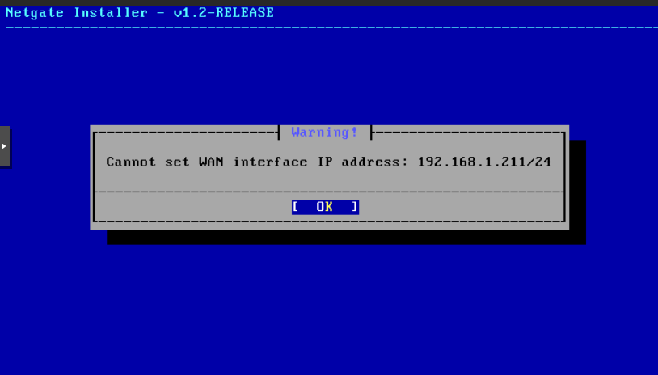

💡 **La méthode** : on liste les hypothèses, et on les teste **une par une** :

| Hypothèse | Test | Résultat |
| --- | --- | --- |
| Conflit d'adresse (quelqu'un a déjà .211) | `ping` + `arp -a` depuis un poste | ❌ Écartée : l'adresse est libre |
| Le format `/24` est refusé | Saisie sans `/24` | ❌ Fausse piste : accepté, mais le masque devient `/32` |
| **Chevauchement de réseaux** | Regarder le LAN proposé par défaut | ✅ **Confirmée** |

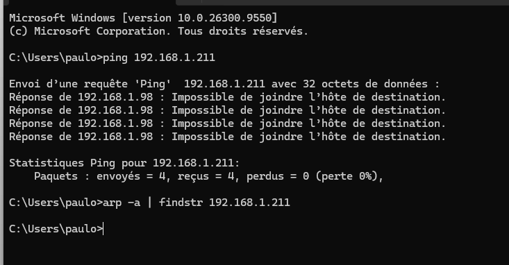

**Cause** : le LAN par défaut de l'installateur est **192.168.1.1/24** : **le même réseau** que le WAN
(192.168.1.x). Un routeur ne peut pas avoir deux portes **dans le même réseau** : il ne saurait pas
par laquelle envoyer les paquets.

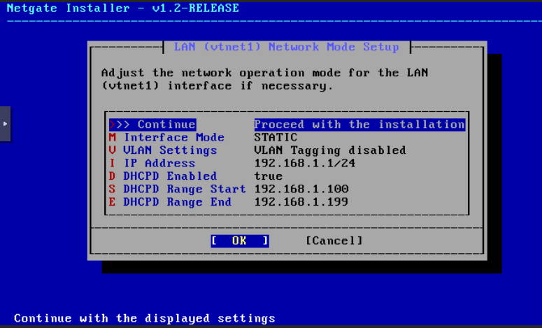

✅ **Correction : configurer le LAN avant le WAN.**

3. **LAN** : carte **vtnet1**, **VLAN 99** (l'administration), adresse `10.10.99.254/24`, DHCP de
   `.100` à `.199`.

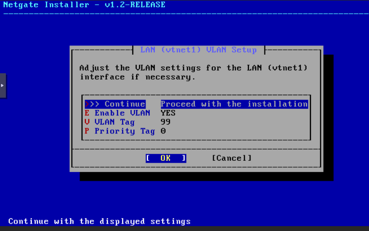
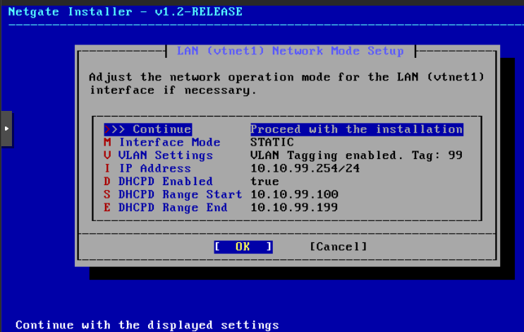
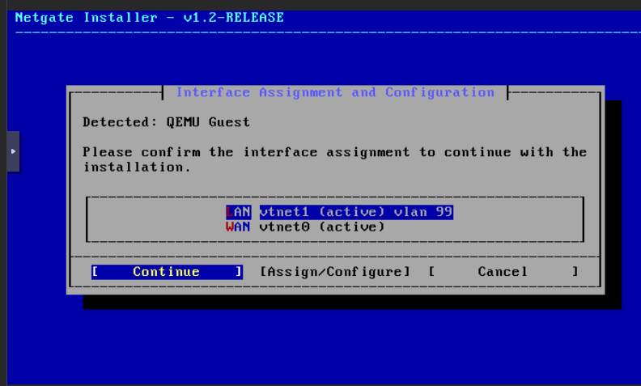

4. **WAN** repassé en **fixe** : `192.168.1.211/24`, passerelle et DNS `192.168.1.254`. Cette fois,
   c'est accepté.

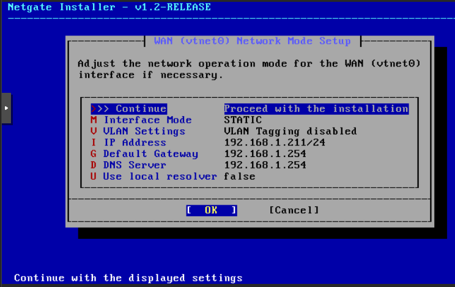

5. **Install CE** (l'édition gratuite), système de fichiers **ZFS**, partitions **GPT**, disque `da0`.
   💡 **Pourquoi ZFS** : il résiste aux **coupures de courant** et permet de **revenir en arrière** après
   une mise à jour ratée. Version **pfSense CE 2.9.0** (la stable actuelle).

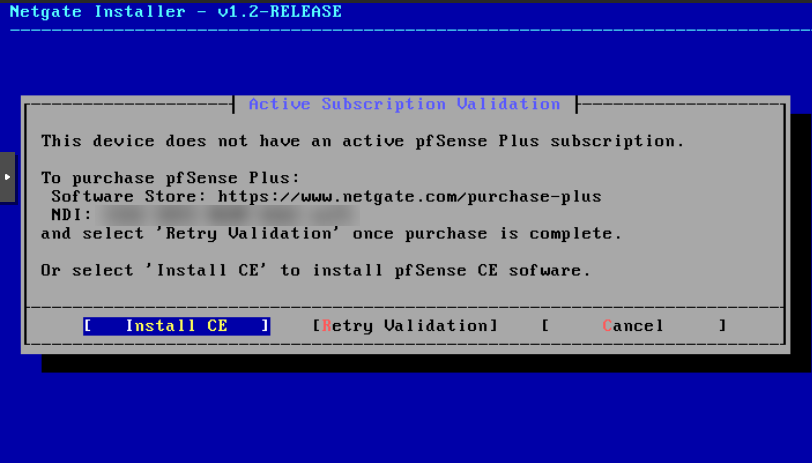

❌ **Le bouton Reboot de l'installateur ouvre un shell et l'affichage se fige.** L'installation était
terminée (« Post Installation setup… done ») : on **retire l'ISO** (Matériel > Lecteur CD > Ne pas
utiliser de média) puis on **réinitialise** la VM depuis Proxmox. ZFS encaisse la coupure.

✅ Au démarrage, le **menu console** affiche :
`WAN (wan) -> vtnet0 -> v4: 192.168.1.211/24` et `LAN (lan) -> vtnet1.99 -> v4: 10.10.99.254/24`.
(`vtnet1.99` = la carte vtnet1, VLAN 99.)

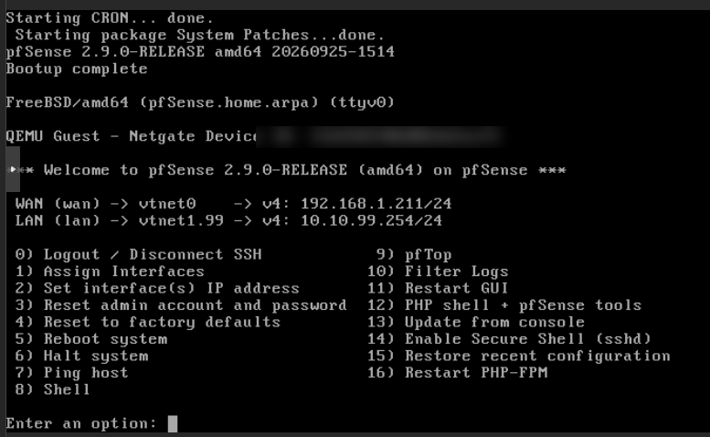

### Étape 7 · Tester le réseau, du plus proche au plus loin

🖱️ Menu console > option **7** (Ping host) :

| Test | Résultat | Ce que ça prouve |
| --- | --- | --- |
| `192.168.1.254` (la box) | ✅ 0 % de perte, 0,7 ms | Le WAN et vmbr0 fonctionnent |
| `1.1.1.1` (Internet) | ✅ 0 % de perte | Le routage vers Internet marche |
| `netgate.com` | ❌ « UDP connect: Invalid argument » | Voir ci-dessous |

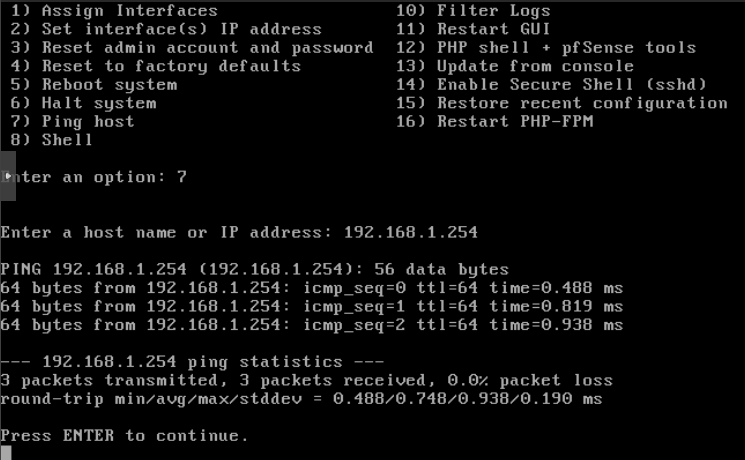
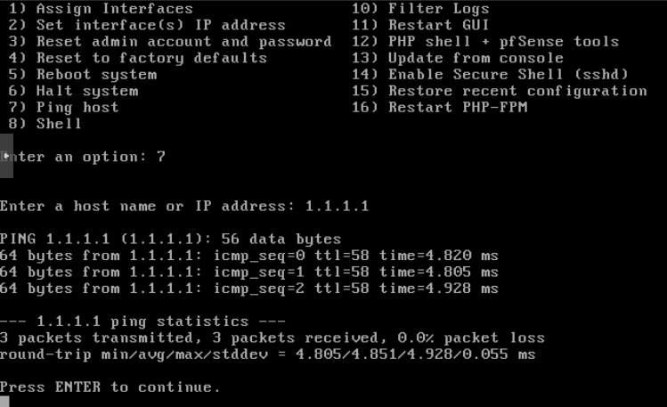
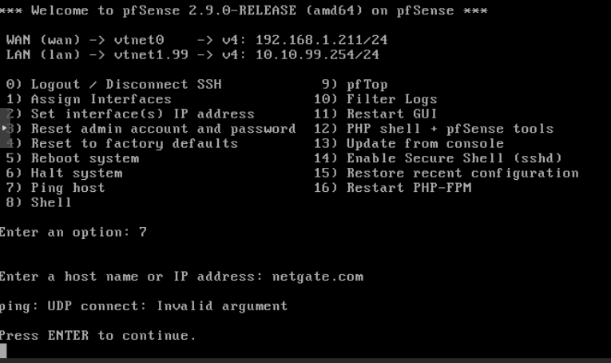

💡 **Pourquoi tester du plus proche au plus loin** : si la box ne répond pas, inutile de tester Internet.
On trouve **où** ça casse.

❌ **Ping par nom en échec, mais le DNS fonctionne** : option **8** (Shell) :

```sh
drill netgate.com A
ping -4 netgate.com
```
- `drill … A` : interroge le DNS pour l'adresse **IPv4** du nom. ✅ `NOERROR`, deux adresses : le DNS répond.
- `ping -4` : force l'IPv4. ✅ 0 % de perte.

**Cause** : le nom était résolu en **IPv6**, alors que pfSense n'a pas d'IPv6 configuré.

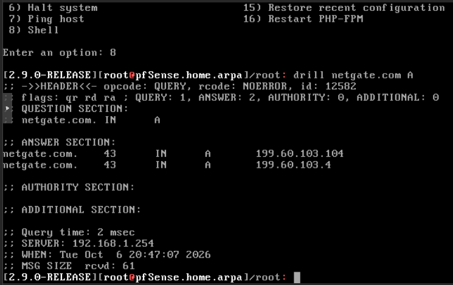
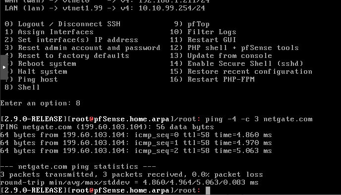

---

## Partie 5 — Accéder à l'interface web

### Étape 8 · Ouvrir un accès temporaire depuis le poste d'administration

💡 **Le problème** : le PC d'administration est sur le réseau de la box, **côté WAN**. Deux obstacles :
**le routage** (la box ne connaît pas les réseaux 10.10.x cachés derrière pfSense) et **le filtrage**
(pfSense bloque **tout** ce qui arrive par le WAN, c'est son rôle).

🎯 Ouvrir **un seul** accès, **pour un seul PC**, **temporairement**.

⌨️ 1. Console de pfSense, option **8** (Shell) :

```sh
pfctl -d
```
`pfctl -d` = « **d**ésactive le filtrage » (`pf disabled`), **juste** le temps de se connecter.

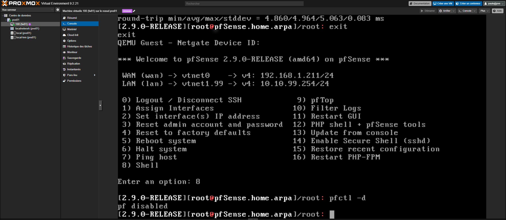

🖱️ 2. Depuis le PC admin : `https://192.168.1.211` → alerte de certificat autosigné acceptée →
connexion `admin` / `pfsense` (mot de passe changé juste après, étape 9).

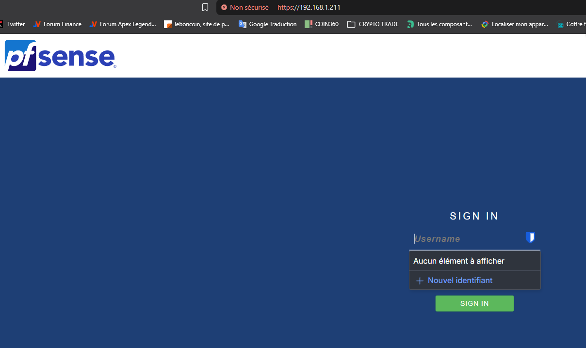

🖱️ 3. **Firewall > Rules** > onglet **WAN** > **Add** :

| Champ | Valeur |
| --- | --- |
| Action | Pass |
| Protocol | TCP |
| Source | Single host : `192.168.1.98` (**le seul** PC admin) |
| Destination | **This Firewall** (self) |
| Destination port | HTTPS (443) |
| Log | ✅ |
| Description | `TEMP webGUI PC admin .98 - suppr. apres switch` |

**Save** > **Apply Changes**. 💡 **Apply réactive le filtrage**, et l'accès reste ouvert grâce à la règle.

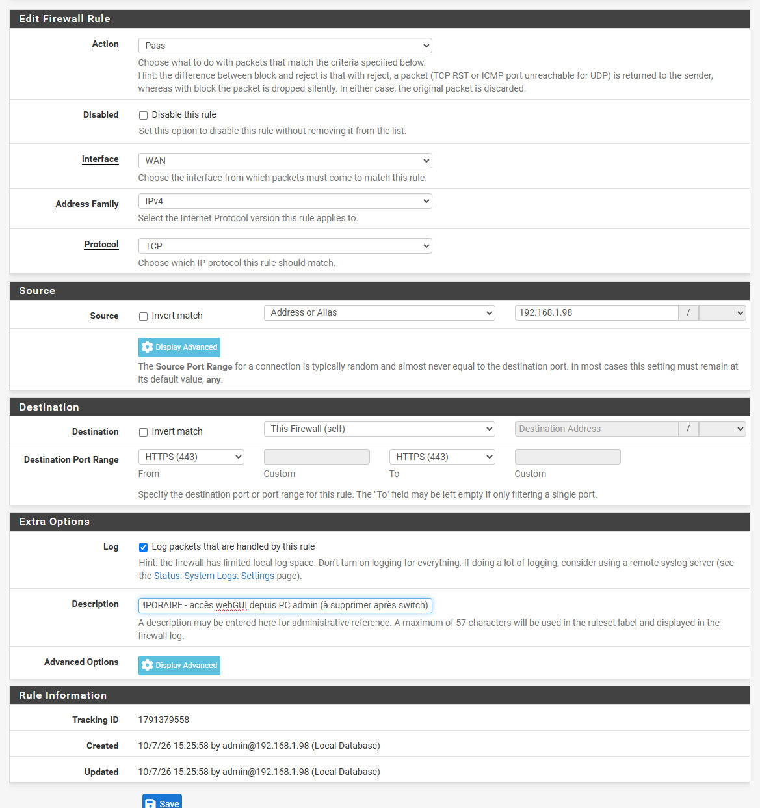
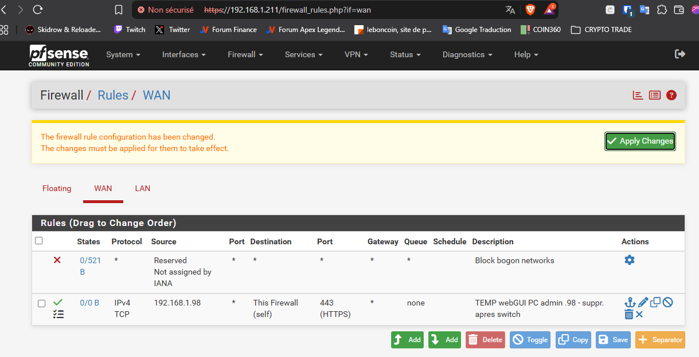
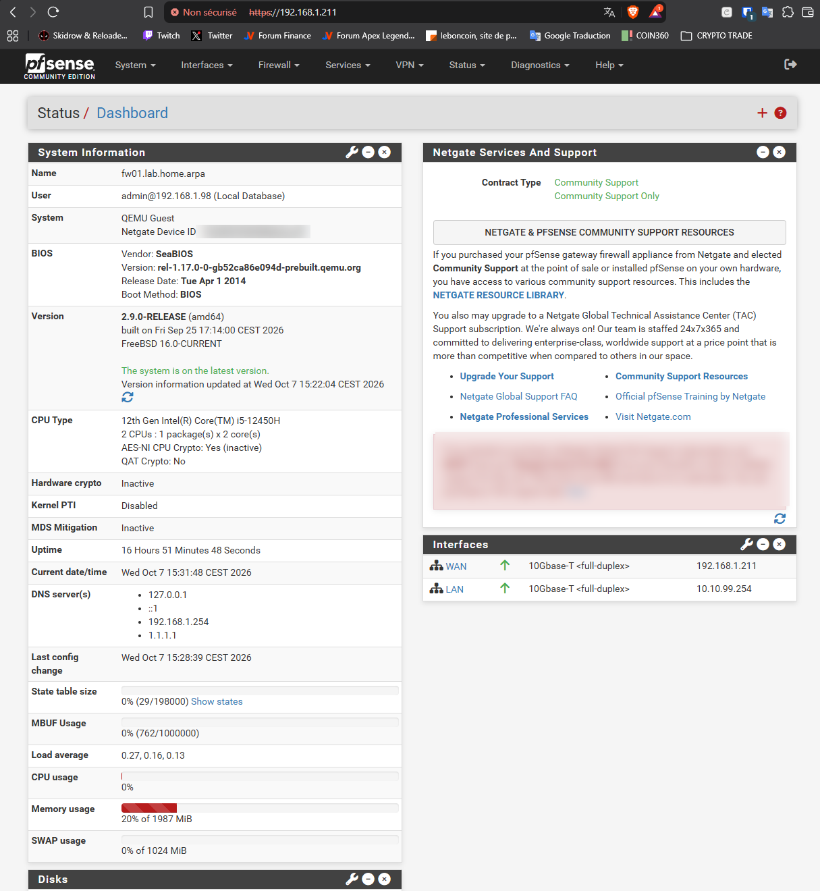

⌨️ 4. **Vérifier sans supposer** que le filtrage est bien actif : **Diagnostics > Command Prompt** :

```sh
pfctl -s info | head -1
```
✅ `Status: Enabled`.

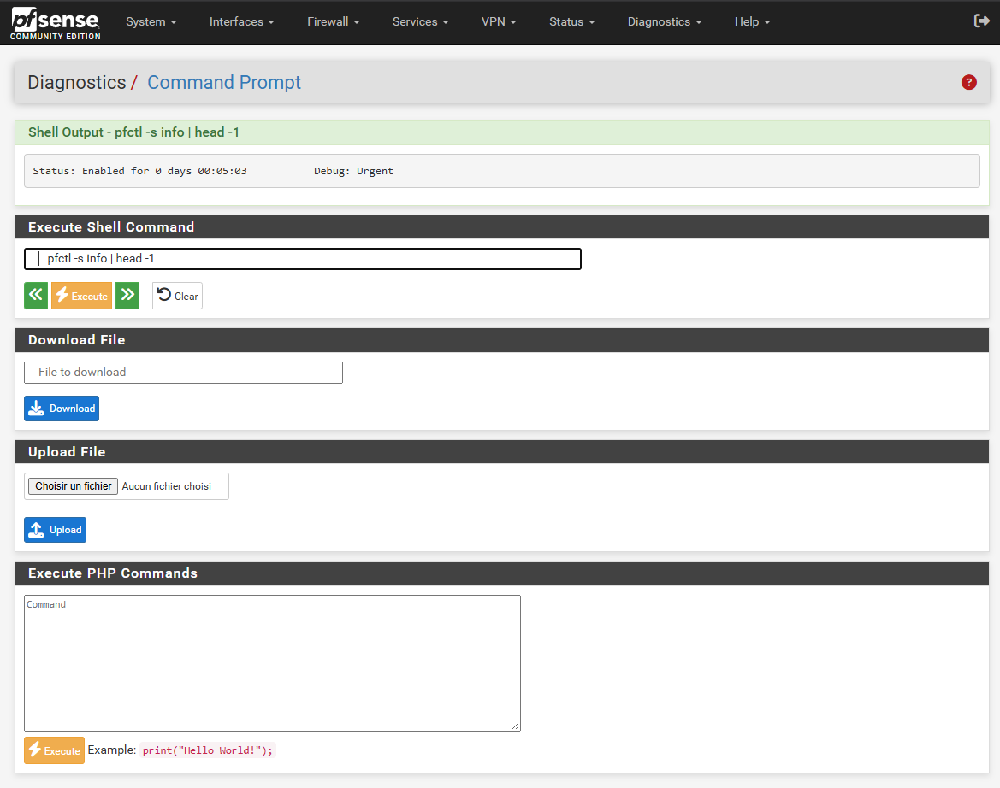

🏢 Cette règle est un **écart** : on l'enlève dès que le PC admin sera branché sur le VLAN 99 (switch,
brique 02). En entreprise, on n'administre jamais un pare-feu par son côté Internet.

### Étape 9 · L'assistant de configuration

🖱️ **System > Setup Wizard** :

| Écran | Valeur | Pourquoi |
| --- | --- | --- |
| Hostname / Domain | `fw01` / `lab.home.arpa` | Nom du rôle ; `home.arpa` est réservé aux réseaux privés (RFC 8375) |
| DNS | `192.168.1.254`, `1.1.1.1` ; Override ❌ | Le résolveur de pfSense interroge lui-même les serveurs racines |
| Fuseau | `Europe/Paris` | Journaux à la bonne heure ; Kerberos (l'AD) refuse plus de 5 min d'écart |
| Passerelle WAN | `192.168.1.254` | La route par défaut (la sortie vers Internet) |
| **Block RFC1918 Private Networks** | ❌ **décoché** sur le WAN | Le WAN est lui-même dans un réseau **privé** (celui de la box) : sinon le PC admin serait bloqué |
| Block bogon networks | ✅ | Bloque les adresses qui ne doivent jamais exister sur Internet |
| Mot de passe admin | **changé** | Le couple `admin` / `pfsense` est **public** |

---

## Partie 6 — Créer les VLAN

### Étape 10 · Déclarer les VLAN sur la carte trunk

🖱️ **Interfaces > Assignments** > onglet **VLANs** > **Add**, une fois par VLAN :

| Parent | VLAN Tag | Description |
| --- | --- | --- |
| vtnet1 | 10 | SERVEURS |
| vtnet1 | 20 | POSTES |
| vtnet1 | 30 | WIFI_SALARIES |
| vtnet1 | 40 | WIFI_INVITES |

(Priorité laissée vide ; type **C-Tag 802.1Q**.) Le VLAN **99** existe déjà depuis l'installation : il
est renommé **ADMINISTRATION**.

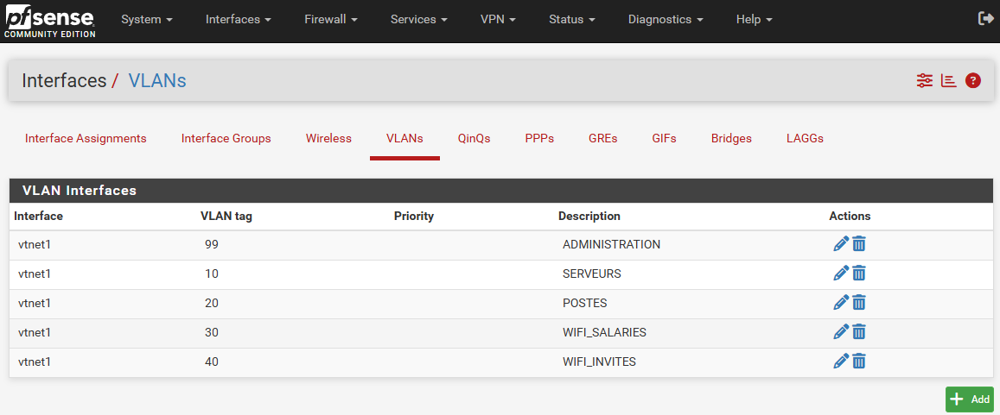

### Étape 11 · Transformer chaque VLAN en interface

🖱️ **Interfaces > Assignments** : dans « Available network ports », choisis chaque VLAN > **Add** →
OPT1 à OPT4 apparaissent.

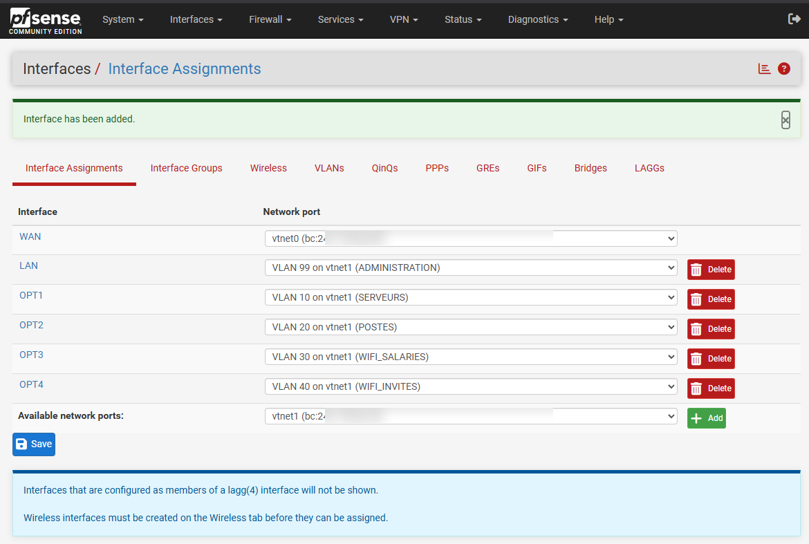

🖱️ Clique sur chaque interface (OPT1…) :

| Champ | Valeur | Pourquoi |
| --- | --- | --- |
| Enable | ✅ | |
| Description | `SERVEURS`, `POSTES`… | Un nom lisible au lieu d'OPT1 |
| IPv4 Configuration Type | **Static IPv4** | |
| IPv6 Configuration Type | None | |
| IPv4 Address | `10.10.10.254` / **24** (puis .20, .30, .40) | pfSense est la passerelle de chaque VLAN |
| IPv4 Upstream gateway | **None** | ⭐ Une interface **interne** n'a jamais de passerelle : **c'est pfSense, la passerelle** de ce réseau |

**Save** > **Apply Changes**.


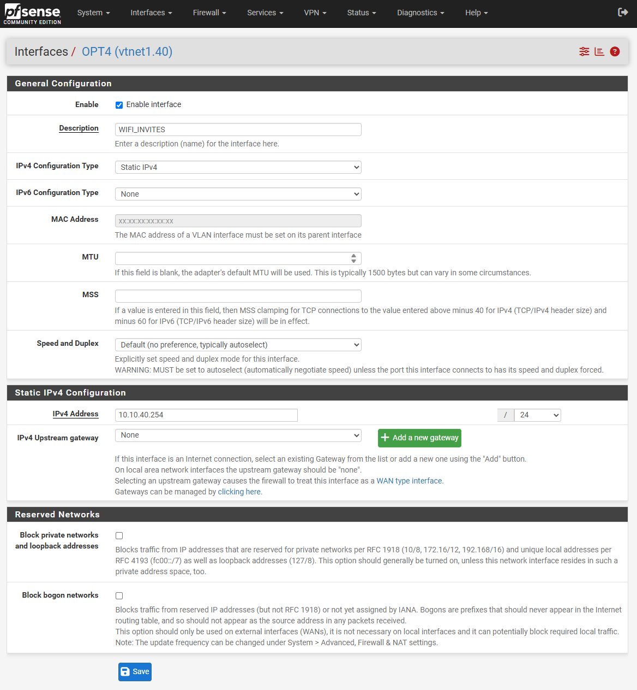

### Étape 12 · Dépannage : un masque /32 oublié

❌ Pour **POSTES** et **WIFI_SALARIES**, le masque est resté sur **/32** (la valeur par défaut de la
liste déroulante, à côté de l'adresse).

💡 **Conséquence** : `/32` = un réseau d'**une seule adresse**. Aucun poste du VLAN n'aurait pu joindre
sa passerelle, et le serveur DHCP aurait refusé de démarrer. Rien ne l'aurait signalé à
l'enregistrement.

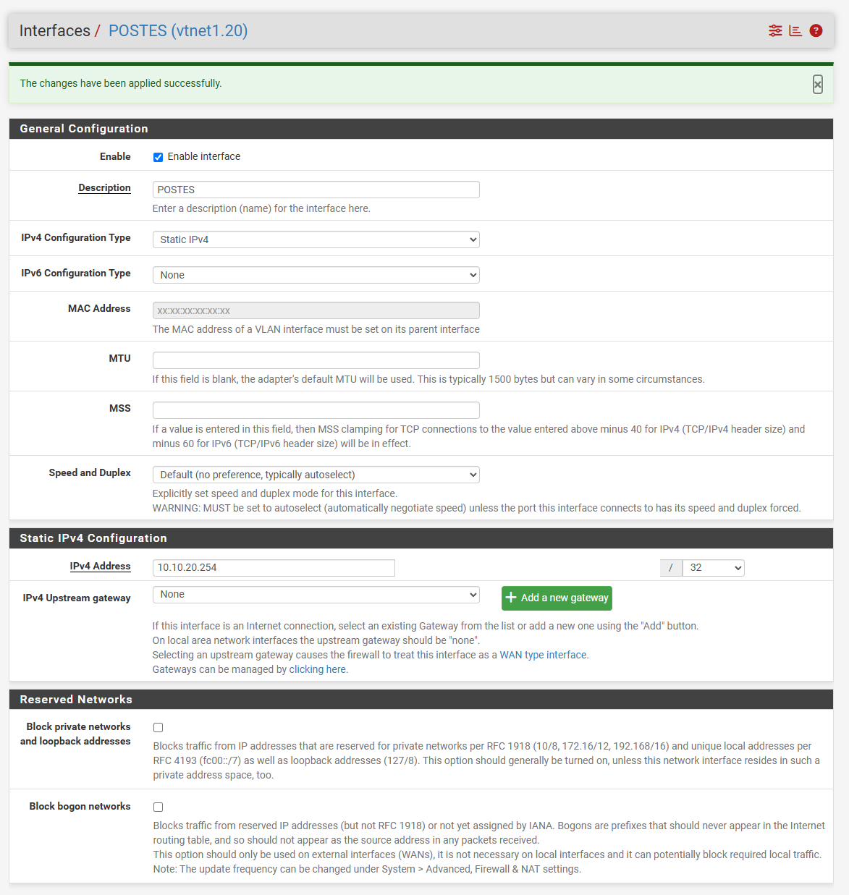

✅ Repéré **en relisant**, corrigé en **/24**, puis **prouvé** (Diagnostics > Command Prompt) :

```sh
ifconfig | grep "inet 10."
```
`inet 10.10.20.254 netmask 0xffffff00` : `0xffffff00` = 255.255.255.0 = **/24**.

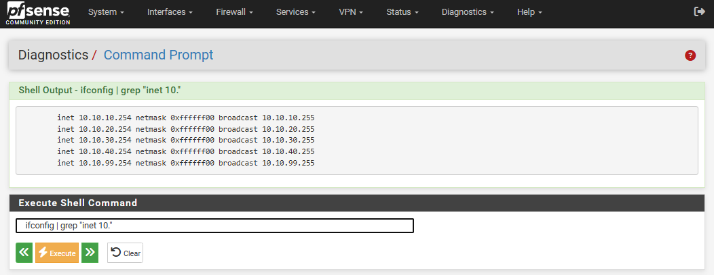
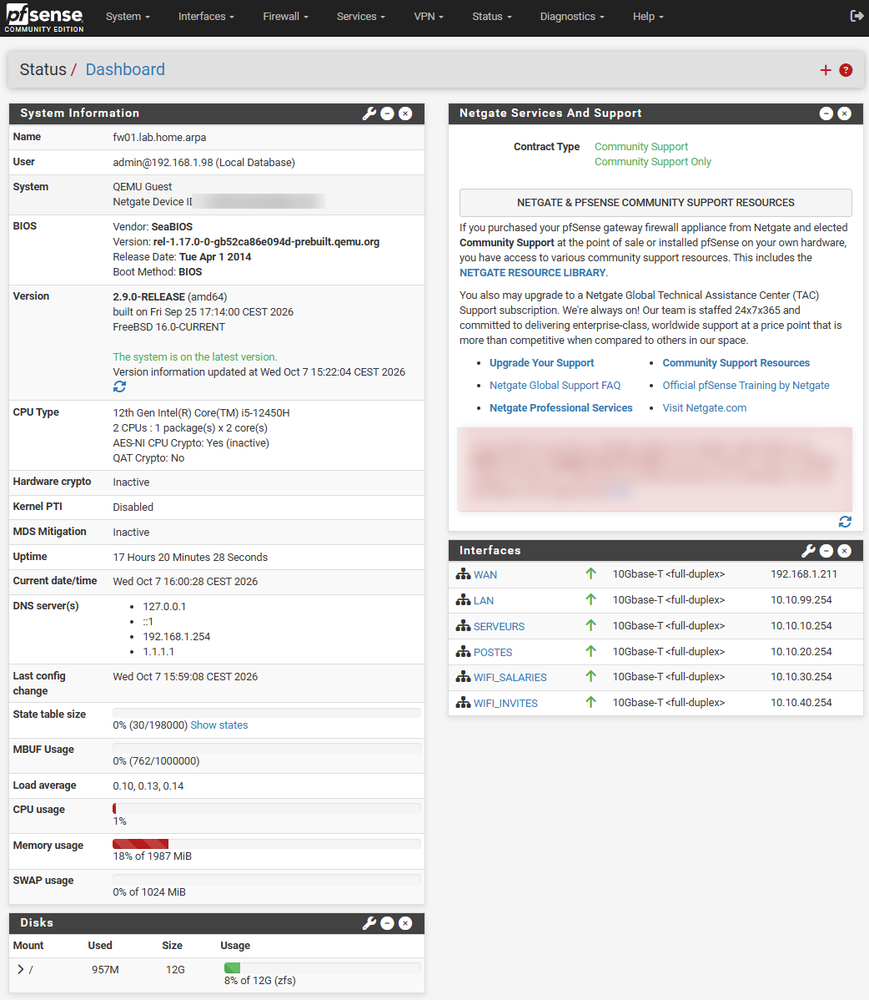

💡 **Leçon** : on **relit** chaque formulaire, et on **prouve** le résultat par une commande.

---

## Partie 7 — DHCP et règles du VLAN Postes

### Étape 13 · Un DHCP temporaire pour les postes

💡 En production, le DHCP des postes sera fait par **Windows Server** (brique 03) : il inscrit les PC
dans le DNS de l'AD. Comme une demande DHCP est un **cri dans la pièce** (broadcast) qui ne sort pas de
son VLAN, pfSense fera **relais** vers le serveur.

🖱️ En attendant : **Services > DHCP Server** > onglet **POSTES** :

| Champ | Valeur | Pourquoi |
| --- | --- | --- |
| Enable | ✅ | |
| Range | `10.10.20.100` à `10.10.20.199` | `.1` à `.99` réservées aux adresses fixes (imprimantes, équipements) |
| Default lease time | `7200` (2 h) | Bail court tant que c'est temporaire |

**Save**.

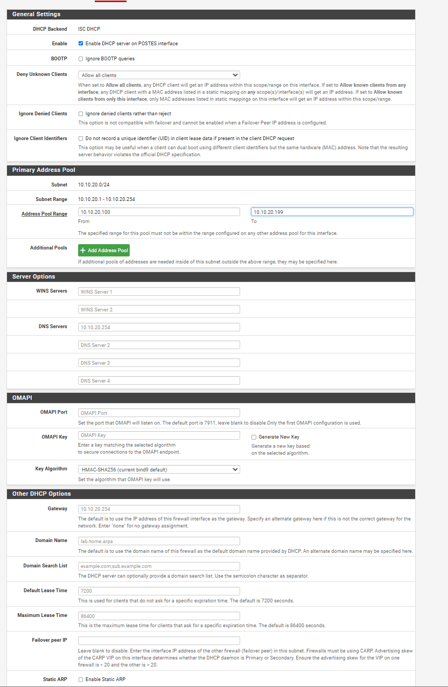

### Étape 14 · Les règles du VLAN Postes

💡 **Comment le vigile lit sa liste** : sans aucune règle, une interface **bloque tout** (refus par
défaut). Les règles sont lues **de haut en bas**, et **la première qui correspond gagne**. Donc : **les
exceptions d'abord, la règle large ensuite.**

🖱️ **Firewall > Rules** > onglet **POSTES** > **Add**, dans cet ordre :

| # | Action | Source | Destination | Port | Log | Pourquoi |
| --- | --- | --- | --- | --- | --- | --- |
| 1 | **Block** | POSTES subnets | LAN subnets (l'administration) | tout | ✅ | Un poste ne touche jamais aux équipements |
| 2 | **Block** | POSTES subnets | **This Firewall** | 443 | ✅ | Un salarié ne doit pas ouvrir l'interface du pare-feu par **sa propre passerelle** (10.10.20.254) |
| 3 | Pass | POSTES subnets | any | tout | ❌ | Le reste (Internet…) : **provisoire**, à affiner |

**Save** > **Apply Changes**. 💡 On **journalise ce qui est bloqué**, pas le trafic normal (sinon les
journaux débordent).

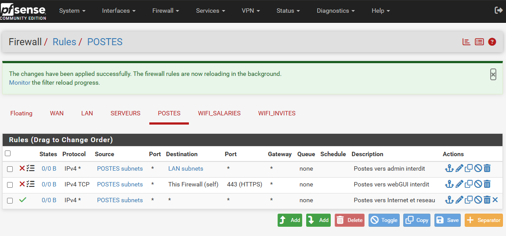

❌ **Piège évité** : une règle se pose sur l'interface **d'où vient** le trafic. Posée sur l'onglet LAN
avec la source POSTES, elle ne bloquerait **jamais rien**, sans aucun message d'erreur.

---

## Partie 8 — La recette (on prouve que la segmentation marche)

### Étape 15 · Une VM de test dans le VLAN Postes

🎯 Se mettre **à la place d'un poste** du VLAN 20 et vérifier ce qu'il peut faire, et surtout ce qu'il
**ne peut pas** faire.

🖱️ Créer une petite VM **Alpine Linux** (live, 67 Mo, sans disque), carte réseau sur **vmbr1**,
**tag 20**.

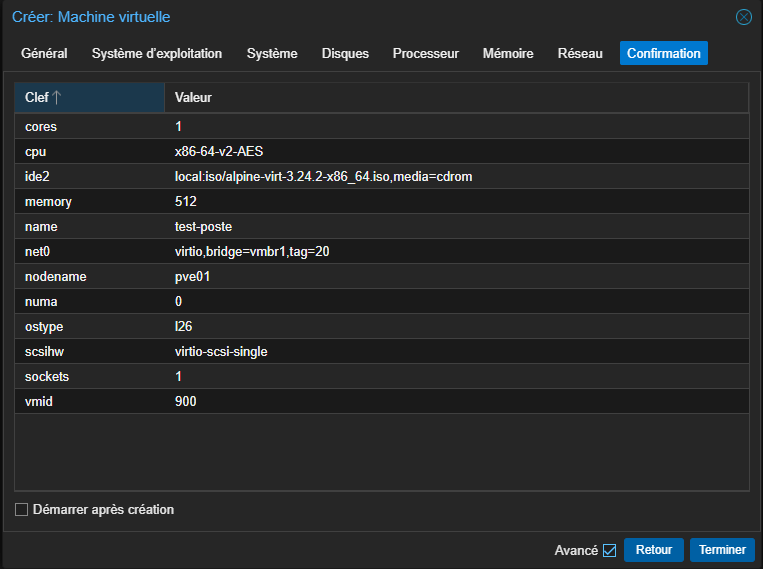

⌨️ Dans la VM (identifiant `root`, sans mot de passe en live) :

| Étape | Commande | Résultat | Explication |
| --- | --- | --- | --- |
| Allumer la carte | `ip link set eth0 up` | — | En live, elle est éteinte (« Network is down ») |
| DHCP **sans** serveur | `udhcpc` | ❌ 5 « discover » sans réponse | Échec **attendu** (avant l'étape 13) |
| DHCP **avec** serveur | `udhcpc` | ✅ bail `10.10.20.100` donné par `10.10.20.254` | Le DHCP marche |
| **Sans** règle | `ping 10.10.20.254` | ❌ 100 % de perte | Refus par défaut (avant l'étape 14) |
| Internet | `ping 1.1.1.1` | ✅ 0 % de perte | |
| Internet par nom | `ping google.com` | ✅ 0 % de perte | Le DNS marche aussi |
| Administration | `ping 10.10.99.254` | ✅ **100 % de perte : bloqué** | Règle 1 |
| Interface du pare-feu | `nc 10.10.20.254 443` | ✅ **pas de réponse : bloqué** | Règle 2 |

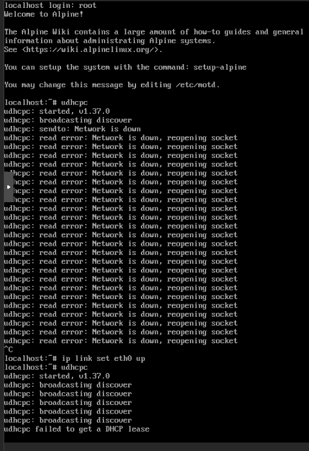
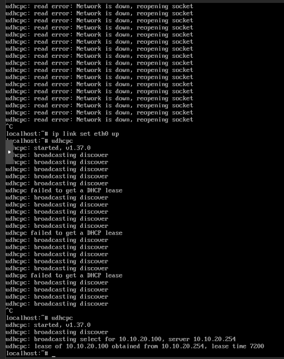
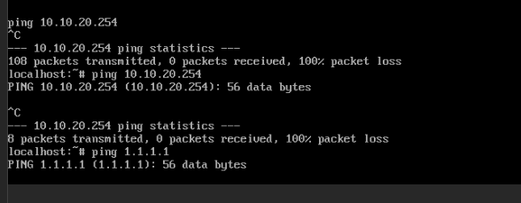
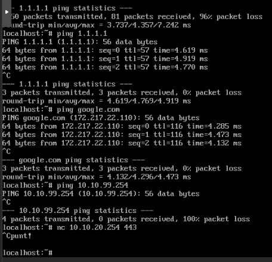

💡 **DORA**, les 4 temps du DHCP : **D**iscover (le poste crie « il y a un serveur DHCP ? »),
**O**ffer (pfSense propose une adresse), **R**equest (le poste l'accepte), **A**ck (pfSense confirme).

💡 Dans une recette, on teste **ce qui doit marcher** ET **ce qui doit être bloqué**. Un pare-feu qui
laisse tout passer « marche » aussi…

---

## Annexes

### A. Utilisation en entreprise : 3 cas concrets

1. **Un poste infecté** essaie de scanner le réseau d'administration : la règle 1 le bloque, et la
   tentative apparaît dans les journaux.
2. **Un invité** se connecte au Wi-Fi : il a Internet, mais ne voit ni les serveurs ni les postes.
3. **Un nouveau salarié** branche son PC dans le VLAN Postes : il reçoit une adresse et hérite des
   règles du VLAN, sans rien configurer sur le poste.

### B. Questions d'entretien (avec la réponse)

- **Pourquoi des VLAN ?** Pour segmenter : chaque groupe de machines a son réseau, et le pare-feu
  contrôle ce qui passe de l'un à l'autre.
- **Qu'est-ce qu'un trunk ?** Un lien qui transporte plusieurs VLAN étiquetés (802.1Q). Avec un routeur
  qui route entre eux sur un seul lien : « router on a stick ».
- **Dans quel ordre sont lues les règles ?** De haut en bas, la première qui correspond gagne ; tout ce
  qui n'est pas autorisé est interdit.
- **Combien d'adresses utilisables dans un /24 ?** 254 : `.0` est le réseau, `.255` le broadcast.
- **Pourquoi le DHCP a-t-il besoin d'un relais entre VLAN ?** La demande est un broadcast, qui reste dans
  son VLAN ; le relais la transmet au serveur.
- **Comment dépanner un « ça ne passe pas » ?** Deux questions : le chemin existe-t-il (routage) ?
  Quelqu'un bloque-t-il (filtrage) ? Et on teste du plus proche au plus loin.
- **Pourquoi une adresse fixe pour un pare-feu ?** Règles, VPN et documentation s'appuient dessus.
- **Que veut dire un masque 0xffffff00 ?** 255.255.255.0, soit /24.

### C. Écarts entre le lab et l'entreprise

| Dans le lab | En entreprise | Pourquoi l'écart, et le risque |
| --- | --- | --- |
| Pare-feu en **VM** sur le même serveur que tout le reste | Boîtier dédié, souvent en paire haute disponibilité (CARP) | Si Proxmox tombe ou est compromis, le pare-feu tombe avec |
| Règles « → tout » (`any`) au départ | Une règle par besoin (moindre privilège) | Serveurs corrigé à la brique 03 ; Postes en cours (règle GLPI ajoutée à la brique 05) |
| Règle WAN temporaire vers l'interface web | Administration depuis le VLAN d'administration seulement | Pas de switch. À supprimer à la brique 02 |
| DHCP temporaire sur pfSense | DHCP Windows (intégré à l'AD) + relais | Remplacé à la brique 03 |
| Blocage RFC1918 décoché sur le WAN | Coché : le WAN est sur Internet | Le WAN est dans le réseau de la box (double NAT de lab) |
| Pas de sauvegarde de configuration au départ | Sauvegarde avant chaque modification | Faite à partir du 11 oct. ([procédure pare-feu](../docs/procedure-pare-feu.md)) ; les fichiers XML ne sont **jamais** publiés (ils contiennent des secrets) |
| Journaux uniquement en local | Envoi vers un serveur central (syslog, SIEM) | Prévu avec Wazuh (brique 11) |
| Fuseau réglé sans redémarrer | Redémarrage planifié après les réglages système | Journaux en UTC jusqu'au redémarrage du 12 oct. |
| Domaine `lab.home.arpa` | `ad.entreprise.fr` | Windows classe les zones `.arpa` en inversées (briques 03 et 05) |

### D. Points en suspens

- Règles des VLAN Wi-Fi (30, 40), avec des groupes d'interfaces : avec la brique 02 (switch, borne Wi-Fi).
- Supprimer la règle WAN temporaire une fois l'accès par le VLAN 99 en place.
- Réserver l'adresse du PC admin dans la box.
- Activer l'accélération AES-NI (System > Advanced) et un SSH sécurisé.
- Remplacer petit à petit la règle provisoire « Postes → tout » par des règles précises
  ([matrice des flux](../docs/matrice-des-flux.md)).
