# Brique 02 — Switch Cisco Catalyst 2960C : remise à zéro, sécurisation, VLAN et SSH

> Procédure d'intervention rédigée comme chez un client : chaque étape indique
> **quoi faire**, **pourquoi**, **comment vérifier** et **quoi faire si ça échoue**.
> Tout se fait en ligne de commande (CLI Cisco IOS) depuis le poste d'administration ADM-001.
> Les erreurs commises pendant le lab sont laissées volontairement, avec leur correction :
> ce sont elles qui apprennent le plus.
>
> **État** : brique terminée le 30 oct. 2026 : le switch est relié au lab par un trunk Gigabit,
> s'administre en SSH depuis ADM-001, est à l'heure (NTP) et affiche une bannière légale.
> Améliorations possibles : section 22. Questions d’entretien : section 21.

## En bref (pour les lecteurs pressés)

- **Point de départ** : un switch Cisco Catalyst 2960C d'occasion, verrouillé par le mot de passe de son ancien propriétaire.
- **Remise à zéro** : récupération par le bouton MODE, suppression de `config.text`, `private-config.text` et `vlan.dat`.
- **Sécurisation** : `enable secret` et compte nominatif hachés en **scrypt**, mots de passe générés et rangés dans **KeePassXC**, console protégée, déconnexion automatique, Telnet et interface web coupés, **bannière légale**.
- **Segmentation** : 6 VLAN (serveurs, postes, Wi-Fi salariés, Wi-Fi invités, administration, parking), ports en mode access avec **portfast + bpduguard**, ports inutilisés **éteints** dans un VLAN parking.
- **Raccordement** : **trunk 802.1Q** vers Proxmox/pfSense (VLAN autorisés limités, VLAN natif non utilisé, DTP coupé).
- **Administration** : **SSH v2** uniquement, depuis le VLAN 99 et le poste d'administration dédié ; **NTP** vers pfSense.
- **4 vraies pannes résolues** : poste en 169.254 (DHCP), SSH refusé par des algorithmes trop anciens, fichier `config.txt`, câble défectueux bloquant le lien à 100 Mb/s.

## Sommaire

1. [Besoin du client](#1-besoin-du-client)
2. [Le matériel et les choix](#2-le-matériel-et-les-choix)
3. [Les 5 notions à comprendre avant de commencer](#3-les-5-notions-à-comprendre-avant-de-commencer)
4. [Se brancher en console](#4-se-brancher-en-console)
5. [Reprendre la main : récupération du mot de passe](#5-reprendre-la-main--récupération-du-mot-de-passe)
6. [Effacer la config de l'ancien propriétaire](#6-effacer-la-config-de-lancien-propriétaire)
7. [Fiche d'identité du switch (inventaire)](#7-fiche-didentité-du-switch-inventaire)
8. [Le coffre-fort à mots de passe (KeePassXC)](#8-le-coffre-fort-à-mots-de-passe-keepassxc)
9. [Sécurité de base : nom, enable secret, compte admin, console](#9-sécurité-de-base--nom-enable-secret-compte-admin-console)
10. [Les VLAN de l'entreprise](#10-les-vlan-de-lentreprise)
11. [Répartir les ports](#11-répartir-les-ports)
12. [Adresse d'administration et SSH](#12-adresse-dadministration-et-ssh)
13. [Le trunk vers Proxmox](#13-le-trunk-vers-proxmox)
14. [Brancher le poste d'administration (et le piège du DHCP)](#14-brancher-le-poste-dadministration-et-le-piège-du-dhcp)
15. [Administrer le switch en SSH depuis ADM-001](#15-administrer-le-switch-en-ssh-depuis-adm-001)
16. [Heure (NTP) et bannière légale](#16-heure-ntp-et-bannière-légale)
17. [La config complète](#17-la-config-complète)
18. [Écarts entre le lab et une vraie entreprise](#18-écarts-entre-le-lab-et-une-vraie-entreprise)
19. [Erreurs rencontrées pendant le lab](#19-erreurs-rencontrées-pendant-le-lab)
20. [Antisèche des commandes](#20-antisèche-des-commandes)
21. [Questions d'entretien](#21-questions-dentretien)
22. [Améliorations possibles](#22-améliorations-possibles)

---

## 1. Besoin du client

AEROTRANS (25 salariés) a des VLAN sur son pare-feu pfSense (brique 01), mais tout passe encore
par le réseau virtuel de Proxmox. Il faut maintenant un **vrai switch physique** pour brancher
les postes, le poste d'administration et, plus tard, la borne Wi-Fi. Le switch a été acheté
**d'occasion** : il contient encore la configuration de son ancien propriétaire.

Le client veut :

- un switch **remis à zéro** : on ne garde jamais la config de quelqu'un d'autre ;
- un switch **sécurisé** : mots de passe forts, comptes nominatifs, pas de Telnet, pas d'interface web ;
- les **VLAN de l'entreprise** sur les bons ports, et les ports inutilisés **éteints** ;
- une **administration à distance chiffrée** (SSH), uniquement depuis le VLAN d'administration.

## 2. Le matériel et les choix

| Élément | Choix | Pourquoi |
| --- | --- | --- |
| Switch | **Cisco Catalyst WS-C2960C-8PC-L** (occasion) | Compact, silencieux (sans ventilateur), 8 ports PoE : parfait pour un lab et pour la pratique CCNA |
| Système | IOS 15.0(2)SE5 (2013), licence **LAN Base** | Fait la commutation (couche 2) : VLAN, trunk, STP, SSH. **Ne route pas entre les VLAN** : c'est pfSense qui s'en charge (« router-on-a-stick »), comme prévu à la brique 01 |
| Poste d'admin | **ADM-001** (Acer, Windows 11 Pro) | Poste dédié à l'administration (recommandation ANSSI) |
| Logiciel de console | **PuTTY 0.85** (site officiel, empreinte SHA-256 vérifiée) | Standard, gratuit, gère le port série |
| Câble | Câble console **USB vers RJ45** | Les PC n'ont plus de port série : l'adaptateur crée un port COM virtuel |
| Coffre à mots de passe | **KeePassXC** | Libre, local, chiffré. Recommandé par l'ANSSI |

## 3. Les 5 notions à comprendre avant de commencer

**1. Les modes de la CLI Cisco.** L'invite te dit où tu es :

| Invite | Mode | Ce qu'on peut faire | Pour y aller |
| --- | --- | --- | --- |
| `Switch>` | Utilisateur | Regarder un peu, rien modifier | (au démarrage) |
| `Switch#` | Privilégié (« enable ») | Tout voir, sauvegarder, redémarrer | `enable` |
| `Switch(config)#` | Configuration globale | Modifier la config | `configure terminal` |
| `Switch(config-if)#` | Configuration d'un port | Régler ce port | `interface fa0/2` |
| `Switch(config-line)#` | Configuration des accès (console, à distance) | Mot de passe, timeout | `line console 0` |

`exit` remonte d'un niveau, `end` (ou Ctrl+Z) revient directement à `#`.

**2. running-config et startup-config.**

- La **running-config** est la configuration **en cours**, en mémoire vive (RAM). Toute commande
  tapée la modifie **immédiatement**, mais elle **disparaît** si on coupe le courant.
- La **startup-config** est le fichier `flash:config.text`, lu au démarrage.
- `copy running-config startup-config` copie l'une dans l'autre. **Oublier cette commande = tout
  perdre au prochain redémarrage.**
- Les **VLAN** sont rangés à part, dans `flash:vlan.dat`.

**3. Le VLAN.** Un VLAN découpe un switch en plusieurs switchs « virtuels » qui ne se parlent pas.
Les postes (VLAN 20) ne voient pas les serveurs (VLAN 10) directement : ils doivent passer par
pfSense, qui applique les règles du pare-feu.

**4. Port access ou trunk.**

- Un port **access** appartient à **un seul VLAN** : c'est là qu'on branche un PC.
- Un port **trunk** transporte **plusieurs VLAN** sur un même câble, en ajoutant à chaque trame
  une étiquette (802.1Q) qui dit de quel VLAN elle vient : c'est le lien vers Proxmox/pfSense
  ou vers un autre switch.

**5. Le STP (Spanning Tree).** Si deux câbles relient deux switchs, les trames tournent en rond
à l'infini (une « boucle ») et le réseau s'effondre en quelques secondes. Le STP détecte les
boucles et bloque les liens en trop. Contrepartie : un port met environ 30 secondes à s'activer.
`portfast` saute cette attente sur les ports où l'on branche un seul PC.

## 4. Se brancher en console

**Quoi faire**

1. Câble console entre ADM-001 (USB) et le port **CONSOLE** du switch.
2. Gestionnaire de périphériques → **Ports (COM et LPT)** → noter le numéro : `USB Serial Port (COM3)`.
   Chaque PC attribue son propre numéro (c'était COM5 sur le PC principal).
3. PuTTY → **Serial**, Serial line `COM3`, Speed **9600**.
4. **Session → Logging** → *Printable output*, fichier `console-&Y&M&D-&T.log` : on garde une trace
   de l'intervention (preuve + documentation).
5. Enregistrer la session : nom `SW-console-COM3` → **Save**, puis **Open**.

**Pourquoi 9600 ?** C'est la vitesse par défaut du port console de tous les équipements Cisco.

**Si ça échoue**

- Écran noir qui ne réagit pas : mauvais port COM, ou vitesse différente de 9600.
- Le câble apparaît avec un triangle jaune : pilote manquant (Prolific/FTDI selon le câble).
- Caractères bizarres : mauvaise vitesse.

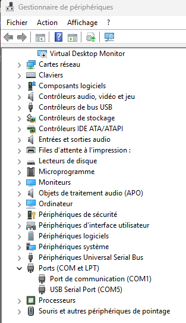
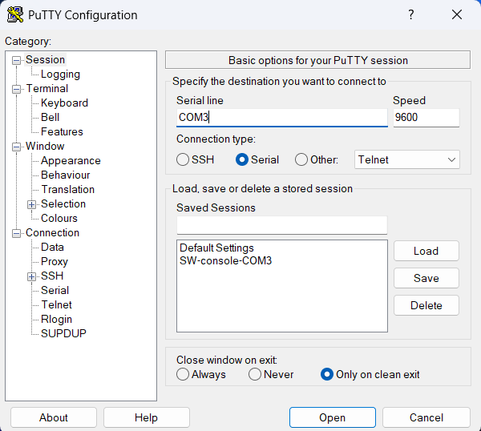

## 5. Reprendre la main : récupération du mot de passe

Au premier démarrage, le switch demandait un **Username** : on ne connaissait pas le mot de passe
de l'ancien propriétaire.

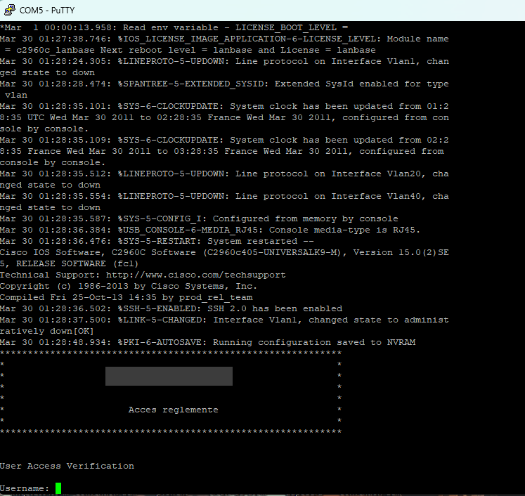

**Quoi faire**

1. Débrancher l'alimentation.
2. **Maintenir le bouton MODE** (face avant, à gauche) et rebrancher l'alimentation.
3. Garder le doigt environ **15 secondes**, jusqu'à ce que le voyant **SYST** passe au **vert fixe**,
   puis relâcher.
4. L'invite `switch:` apparaît : c'est le **bootloader**.

**Pourquoi ça marche ?** Au lieu de lancer IOS (qui lirait l'ancienne config et son mot de passe),
le switch s'arrête dans son mini-système de démarrage, qui donne accès aux fichiers de la flash.
Il faut donc un **accès physique** au switch : c'est pour ça qu'en entreprise les switchs sont
dans des **baies fermées à clé**.

**À noter** : le message `The password-recovery mechanism is enabled` indique que l'ancien
propriétaire n'avait pas désactivé cette récupération. En environnement sensible, on peut la
désactiver avec `no service password-recovery` (un voleur ne pourrait alors plus récupérer la config,
mais un oubli de mot de passe obligerait à tout effacer).

**Différence avec un routeur Cisco** (question classique de certification) : sur un **routeur**,
la récupération passe par le **registre de configuration** (`0x2142`) ; sur un **switch** Catalyst,
par le **bouton MODE**.

**Si ça échoue** : le switch démarre normalement et redemande `Username:` → le bouton a été relâché
trop tôt. Recommencer.

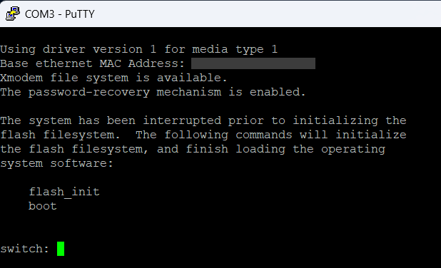

## 6. Effacer la config de l'ancien propriétaire

**Quoi faire**

```
switch: flash_init
switch: dir flash:
```

`flash_init` « monte » la mémoire flash (comme brancher une clé USB). `dir flash:` liste son contenu.

| Fichier trouvé | Rôle | Décision |
| --- | --- | --- |
| `multiple-fs` | Fichier technique d'IOS | **Garder** |
| `c2960c405-universalk9-mz.150-2.SE5` (dossier) | **IOS, le système** | **Ne jamais toucher** : sans lui, le switch ne démarre plus |
| `config.text` | Config de démarrage de l'ancien propriétaire | Supprimer |
| `private-config.text` | Partie sensible de la config (clés SSH, secrets) | Supprimer — **le plus important**, souvent oublié |
| `vlan.dat` | VLAN de l'ancien propriétaire | Supprimer — sinon les anciens VLAN reviennent |
| `express_setup.debug` | Journal de l'assistant web « Express Setup » | Supprimer |

```
switch: delete flash:config.text
switch: delete flash:private-config.text
switch: delete flash:vlan.dat
switch: delete flash:express_setup.debug
switch: dir flash:
switch: boot
```

Chaque `delete` demande confirmation : `y`.

Au démarrage : `Would you like to enter the initial configuration dialog? [yes/no]:` → **`no`**.
L'assistant pose des questions une par une ; en entreprise, on tape la config soi-même pour savoir
exactement ce qu'on met.

**Comment vérifier**

```
Switch> enable
Switch# show startup-config
Switch# show vlan brief
```

| Résultat attendu | Ce que ça prouve |
| --- | --- |
| `enable` ne demande aucun mot de passe | L'ancien mot de passe a disparu |
| `startup-config is not present` | `config.text` est bien supprimé |
| Seulement VLAN 1 et 1002-1005 | `vlan.dat` est bien supprimé (les VLAN 1002-1005 existent sur tous les Cisco et ne se suppriment pas) |

**Pourquoi tout effacer ?** Pour repartir propre, et surtout pour la **sécurité** : une config
inconnue peut cacher un compte de l'ancien propriétaire, un accès à distance, une redirection
de trafic.

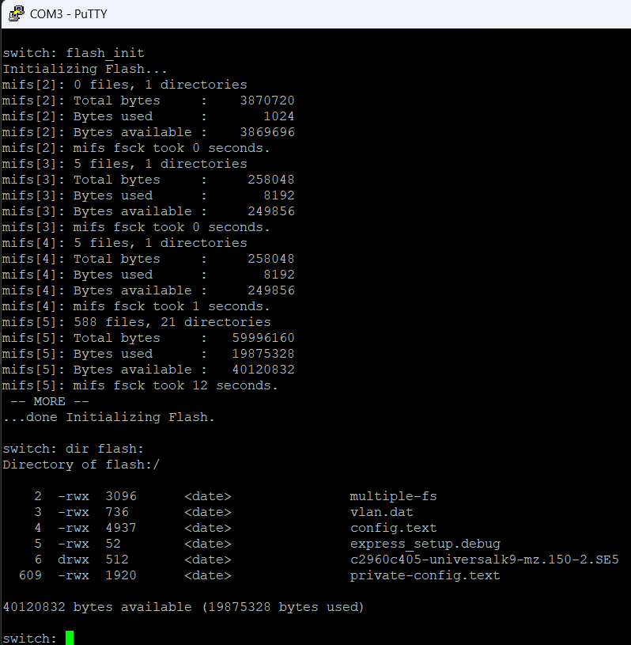
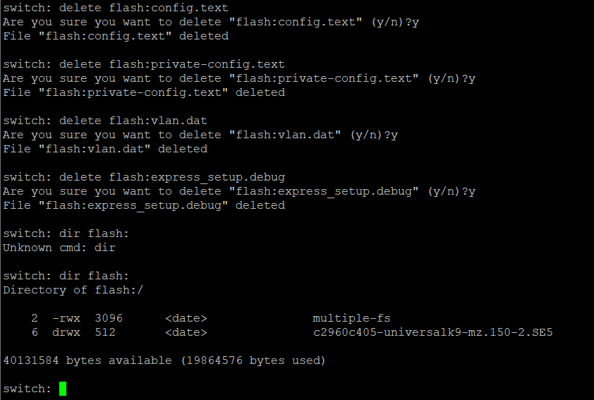
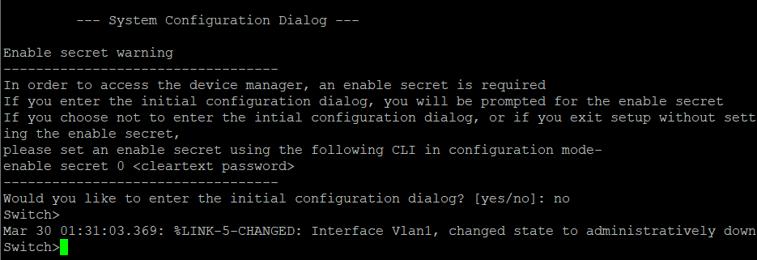
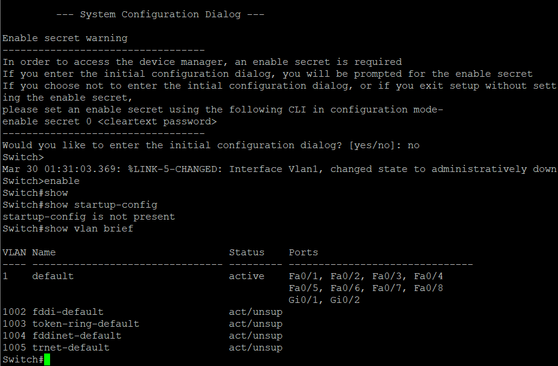

## 7. Fiche d'identité du switch (inventaire)

En entreprise, on fait l'inventaire d'un équipement **avant** de le mettre en service.

```
show version
show inventory
show env all
show power inline
show interfaces status
```

| Élément | Valeur relevée | Interprétation |
| --- | --- | --- |
| Modèle | WS-C2960C-8PC-L | 8 ports FastEthernet PoE + 2 uplinks Gigabit |
| IOS | 15.0(2)SE5, compilé en octobre 2013 | Ancien : vérifier s'il existe une version plus récente (voir écarts) |
| Licence | LAN Base, permanente | Commutation seule, pas de routage entre VLAN |
| Mémoire | 128 Mo | Normal pour ce modèle |
| Température | 32 °C, état GREEN (alerte à 76 °C) | En bonne santé |
| Alimentation | Good | OK |
| Budget PoE | 124 W au total, 15,4 W max par port (802.3af) | Suffisant pour la future borne Wi-Fi (~10 W) |
| Gi0/1, Gi0/2 | `Not Present` | Emplacements **SFP** (fibre) vides ; ports « combo » : la prise cuivre RJ45 reste utilisable |
| Config register | 0xF | Valeur normale sur ce modèle |
| Horloge | 30 mars 2011 | Pas de pile : il faudra le NTP (partie 3) |
| N° de série, MAC, CLEI | relevés | **Masqués** sur toutes les captures publiées. À saisir dans GLPI (brique 05) |

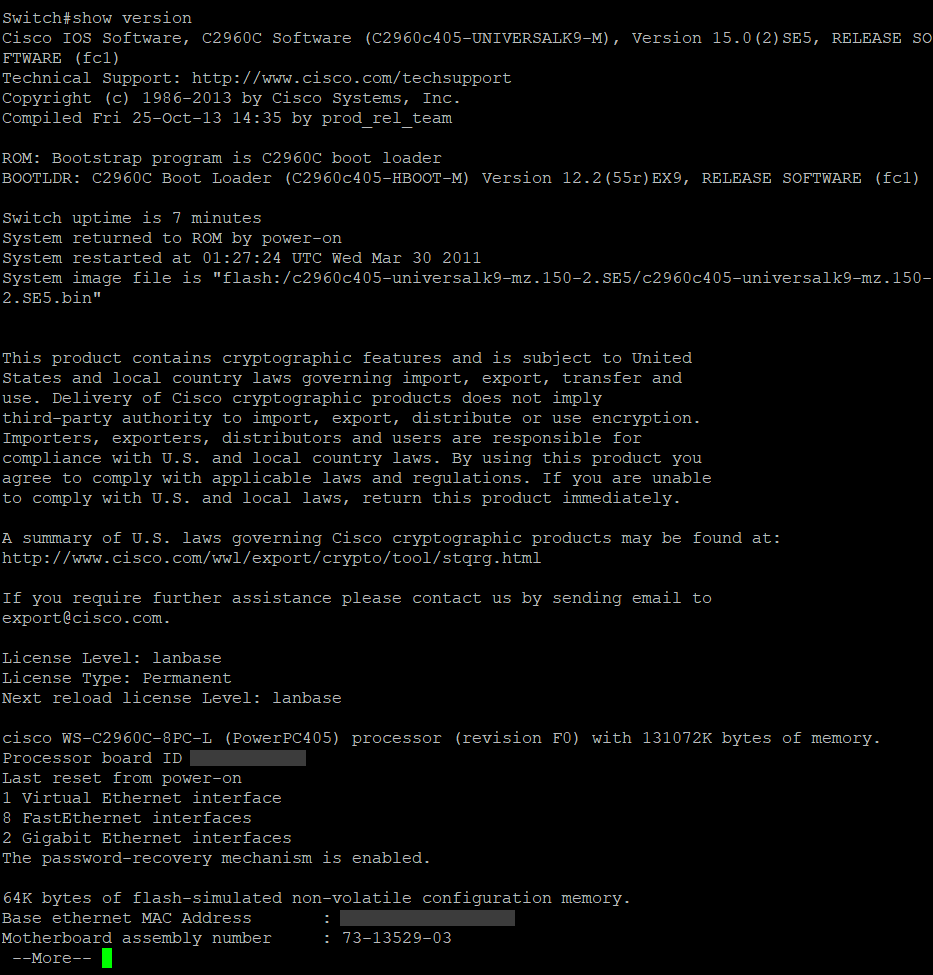
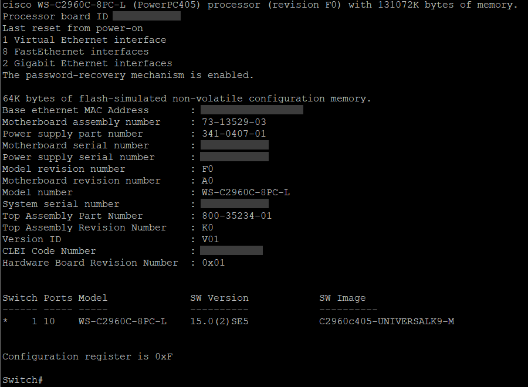
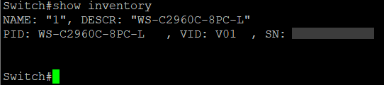
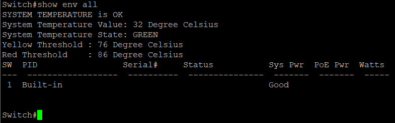
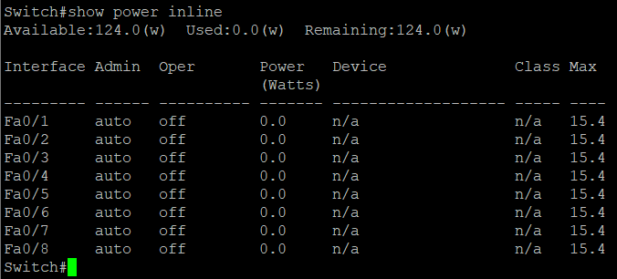
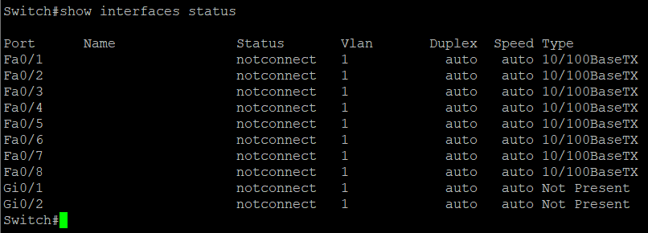

## 8. Le coffre-fort à mots de passe (KeePassXC)

On va créer deux mots de passe. En entreprise, on ne les écrit **jamais** sur un papier, dans un
fichier texte ou dans un mail : on les **génère** et on les range dans un **coffre-fort**.

**Quoi faire**

1. Télécharger KeePassXC sur **keepassxc.org** (adresse tapée à la main, pas via un moteur de recherche).
2. Nouvelle base `AEROTRANS-admin`, description : *Coffre des comptes d'administration du lab
   AEROTRANS. Accès réservé à l'administrateur.* Mot de passe maître long, jamais écrit nulle part.
3. Groupe `Reseau` (notes : *Switch, pare-feu, borne Wi-Fi*).
4. Entrée `SW-CORE01 - enable secret` : mot de passe **généré** (icône dé), **24 caractères**,
   A-Z + a-z + 0-9, **sans symboles**.
5. Entrée `SW-CORE01 - compte admin`, utilisateur `adm.paulo.rosa`, même générateur.
6. **Ctrl+S**.

**Pourquoi sans symboles ?** Sur la CLI Cisco, `?` affiche l'aide au lieu de s'écrire, et certains
caractères posent problème au collage. 24 caractères alphanumériques = environ 140 bits d'entropie :
impossible à deviner.

**Avant de coller un mot de passe dans PuTTY** : couper le journal (clic droit sur la barre de titre →
*Change Settings* → *Logging* → *None* → *Apply*), sinon le mot de passe finit en clair dans le fichier
`.log`. Et **aucune capture d'écran** pendant ce temps. Le rallumer après.

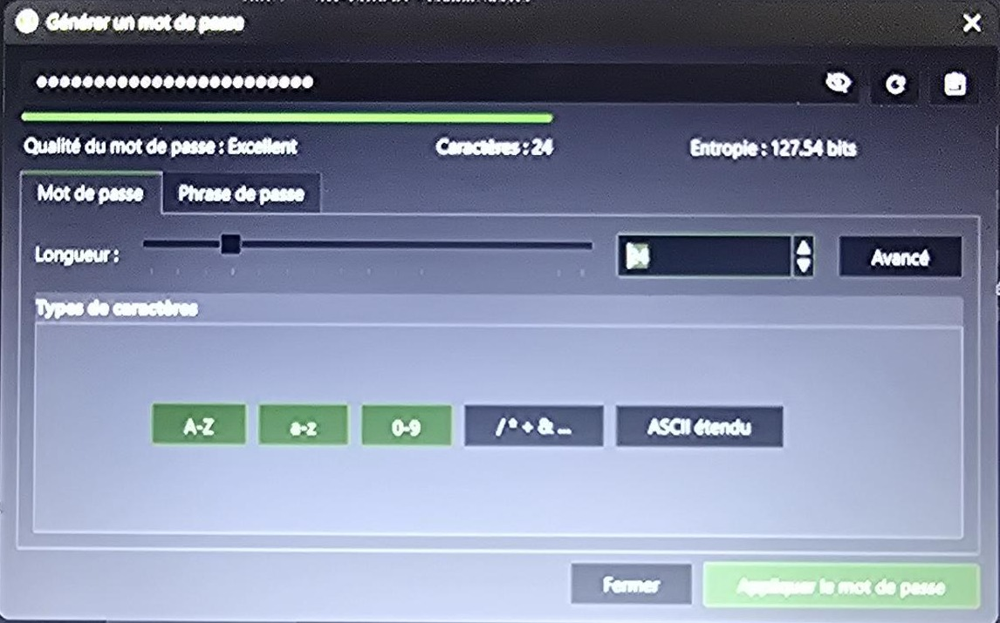
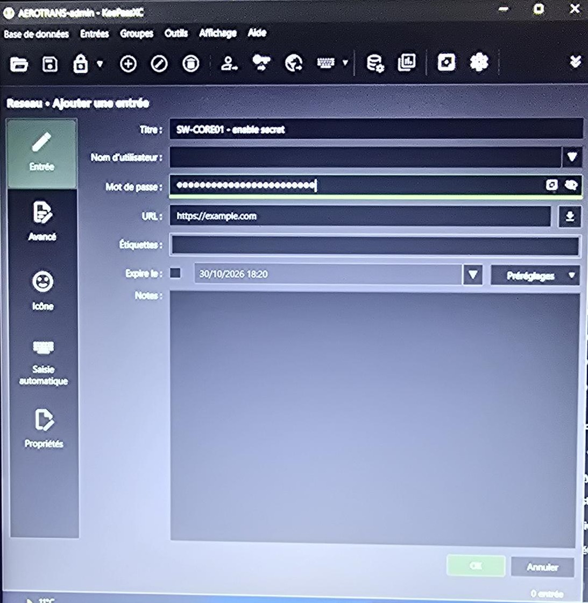
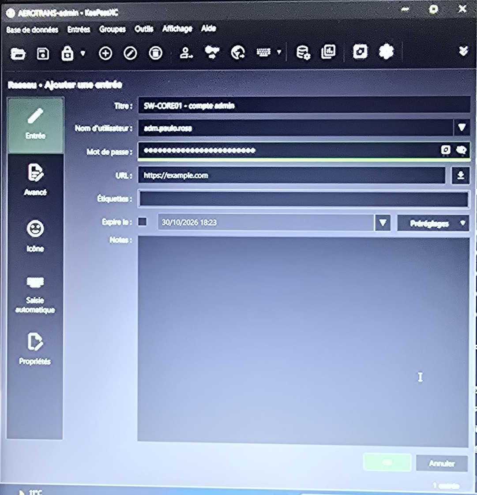
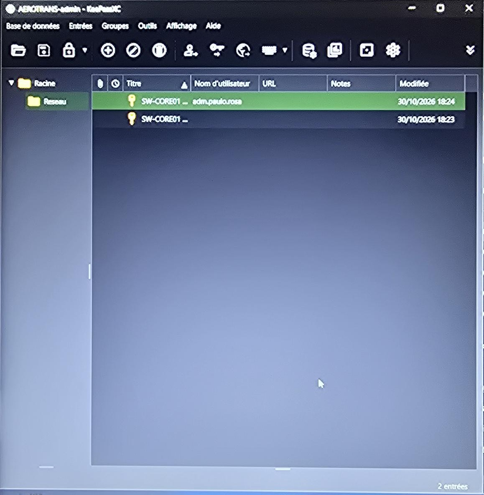

## 9. Sécurité de base : nom, enable secret, compte admin, console

```
configure terminal
hostname SW-CORE01
no ip domain-lookup
enable algorithm-type scrypt secret <collé depuis KeePassXC>
username adm.paulo.rosa privilege 15 algorithm-type scrypt secret <collé depuis KeePassXC>
service password-encryption
line console 0
 login local
 exec-timeout 10 0
 logging synchronous
end
copy running-config startup-config
```

| Commande | Ce qu'elle fait | Pourquoi |
| --- | --- | --- |
| `hostname SW-CORE01` | Nomme le switch | Convention du lab : TYPE-RÔLE + numéro (comme `SRV-AD01`). L'invite affiche le nom : on sait toujours sur quel équipement on tape |
| `no ip domain-lookup` | Désactive la recherche DNS des commandes inconnues | Sans ça, une faute de frappe bloque la console ~30 s pendant que le switch cherche un « nom de machine » |
| `enable algorithm-type scrypt secret` | Mot de passe du mode `#`, **haché en scrypt** (type 9) | Voir le tableau ci-dessous |
| `username … privilege 15 …secret` | Compte admin **nominatif** | On sait **qui** a fait quoi (journal : `Configured from console by adm.paulo.rosa`). Privilège 15 = arrive directement en mode `#` |
| `service password-encryption` | Masque les mots de passe restés en clair | Filet de sécurité (chiffrement faible, type 7) ; nos secrets sont déjà en scrypt |
| `login local` (console) | La console demande `Username` / `Password` | Plus d'accès libre au port console |
| `exec-timeout 10 0` | Déconnexion après 10 min d'inactivité | Évite une session admin oubliée ouverte |
| `logging synchronous` | Les messages du switch n'interrompent plus la frappe | Confort, et moins d'erreurs |
| `copy running-config startup-config` | Sauvegarde | Sinon tout est perdu au redémarrage |

**`enable password` ou `enable secret` ?** (question classique)

| Commande | Stockage dans la config | Verdict |
| --- | --- | --- |
| `enable password` | En clair (ou type 7, réversible en 2 secondes) | ❌ Jamais |
| `enable secret` | Haché : type 5 (MD5), 8 (PBKDF2) ou **9 (scrypt)** | ✅ Toujours, le plus fort possible |

IOS 15.0(2)SE5 accepte `algorithm-type scrypt` : on l'utilise. Sur un IOS plus ancien qui
refuse la commande (`% Invalid input`), utiliser `enable secret` seul (type 5).

**Comment vérifier**

```
exit
```
Puis Entrée : le switch demande `Username:` → `adm.paulo.rosa` → mot de passe collé (rien ne
s'affiche, c'est normal) → on arrive directement sur `SW-CORE01#`.

**Si ça échoue** : `% Password: timeout expired!` → on a mis plus de 30 secondes à saisir le mot
de passe. Recommencer, en ayant copié le mot de passe dans KeePassXC **avant** de taper le nom.

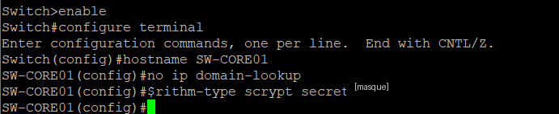
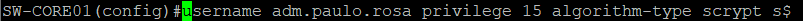
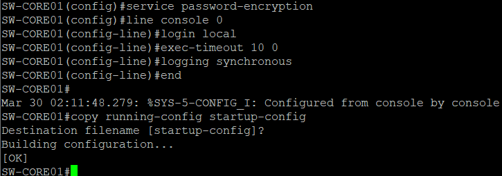
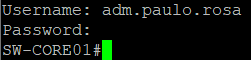

## 10. Les VLAN de l'entreprise

```
configure terminal
vlan 10
 name SERVEURS
vlan 20
 name POSTES
vlan 30
 name WIFI_SALARIES
vlan 40
 name WIFI_INVITES
vlan 99
 name ADMINISTRATION
vlan 999
 name PARKING
end
show vlan brief
```

Les numéros et les rôles viennent du [plan d'adressage](../docs/plan-adressage.md) (brique 01).
Noms **sans accent ni espace** (conventions).

**Le VLAN 999 « PARKING »** : un VLAN qui ne mène nulle part (aucune interface sur pfSense).
Les ports inutilisés y sont placés **et éteints**. Quelqu'un qui branche un PC sur une prise libre
n'arrive sur rien. Recommandation ANSSI et Cisco : **ne jamais laisser des ports dans le VLAN 1**.

**Corriger une faute** : `name POSTES*` tapé par erreur → retaper `vlan 20` puis `name POSTES` :
le nouveau nom remplace l'ancien.

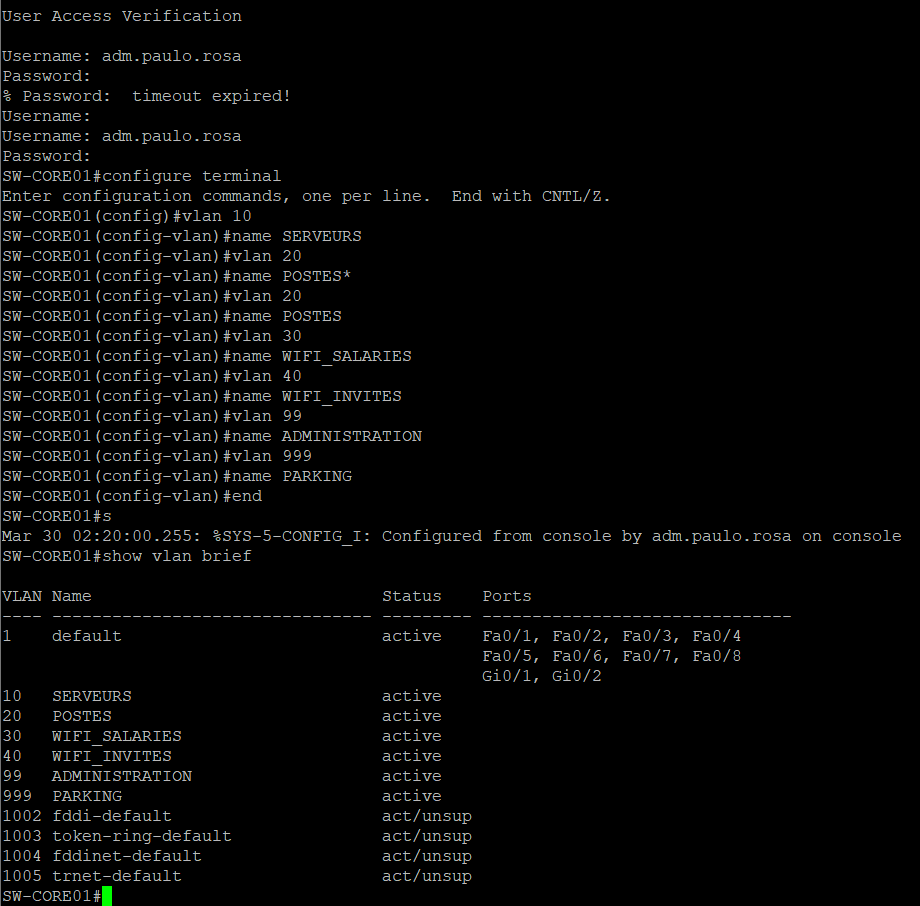

## 11. Répartir les ports

**Le plan des ports, écrit avant de configurer :**

| Port | Branché | Mode | VLAN | État |
| --- | --- | --- | --- | --- |
| Gi0/1 | Proxmox (pfSense) | trunk | 10, 20, 30, 40, 99 | Partie 3 |
| Fa0/1 | Future borne Wi-Fi EAP225 | access (provisoire) | 999 | Éteint |
| Fa0/2 | ADM-001 | access | 99 | Actif |
| Fa0/3 – Fa0/6 | Postes de travail | access | 20 | Actifs |
| Fa0/7, Fa0/8, Gi0/2 | — | access | 999 | Éteints |

```
configure terminal
interface fa0/2
 description ADM-001 poste d'administration
 switchport mode access
 switchport access vlan 99
 spanning-tree portfast
 spanning-tree bpduguard enable
 exit
interface range fa0/3 - 6
 description Postes de travail
 switchport mode access
 switchport access vlan 20
 spanning-tree portfast
 spanning-tree bpduguard enable
 exit
interface range fa0/1 , fa0/7 - 8 , gi0/2
 description NON UTILISE - parking
 switchport mode access
 switchport access vlan 999
 shutdown
end
show interfaces status
show vlan brief
```

| Commande | Pourquoi |
| --- | --- |
| `description` | Étiquette visible dans `show interfaces status` : le technicien suivant sait ce qui est branché |
| `switchport mode access` | Le port reste dans **un seul VLAN** et ne peut pas devenir trunk tout seul (protection contre le « VLAN hopping ») |
| `switchport access vlan 20` | Range le port dans le VLAN |
| `spanning-tree portfast` | Le port s'active tout de suite (pas d'attente STP de ~30 s) |
| `spanning-tree bpduguard enable` | Si un **switch** est branché sur une prise prévue pour un PC, le port se coupe (`err-disabled`) : protection contre les boucles |
| `shutdown` | Éteint le port |
| `interface range` | Configure plusieurs ports en une fois |

Les messages `%Warning: portfast should only be enabled on ports connected to a single host`
ne sont **pas des erreurs** : c'est un rappel. bpduguard est justement là pour couvrir ce risque.

**Comment vérifier** : dans `show interfaces status`, Fa0/2 en VLAN 99, Fa0/3-6 en VLAN 20,
les ports parking en `disabled` / VLAN 999, Gi0/1 seul encore en VLAN 1.

**Si un port est en `err-disabled`** : bpduguard a détecté un switch. Débrancher l'équipement,
puis `shutdown` / `no shutdown` sur le port.

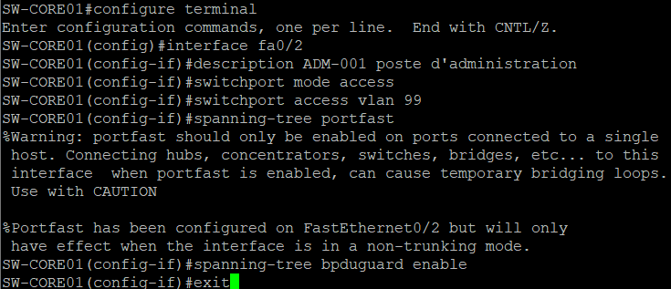
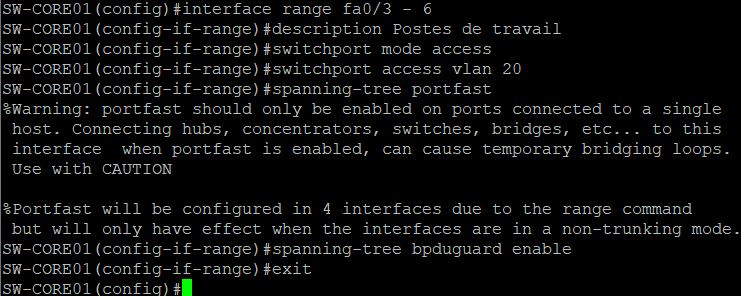
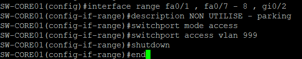
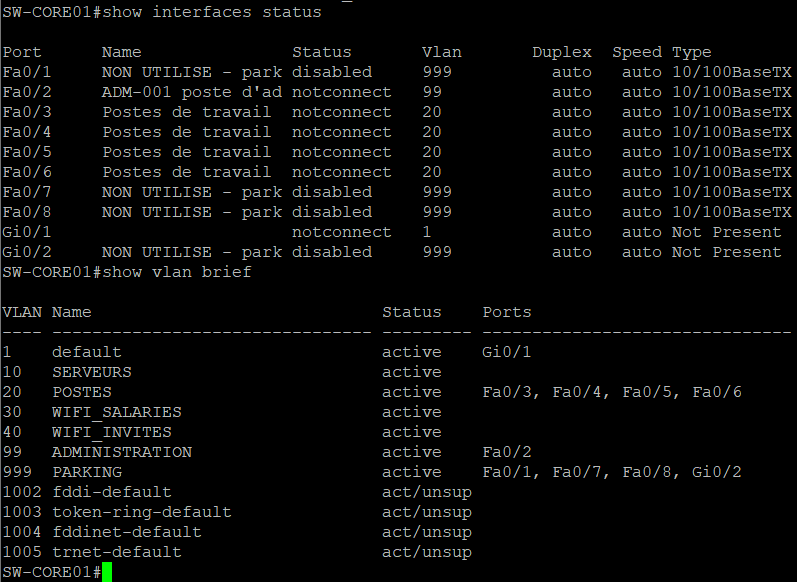

## 12. Adresse d'administration et SSH

Un switch n'a pas d'adresse IP sur ses ports : il en reçoit une sur une **interface virtuelle de
VLAN** (SVI). On la met dans le **VLAN 99 (Administration)** : seul ce VLAN pourra administrer le switch.

```
configure terminal
interface vlan 99
 description Administration SW-CORE01
 ip address 10.10.99.1 255.255.255.0
 no shutdown
 exit
interface vlan 1
 shutdown
 exit
ip default-gateway 10.10.99.254
ip domain-name lab.home.arpa
crypto key generate rsa modulus 2048
ip ssh version 2
ip ssh time-out 60
ip ssh authentication-retries 3
line vty 0 15
 login local
 transport input ssh
 exec-timeout 10 0
 exit
no ip http server
no ip http secure-server
end
copy running-config startup-config
show ip interface brief
show ip ssh
```

| Commande | Pourquoi |
| --- | --- |
| `interface vlan 99` + `ip address 10.10.99.1` | Adresse d'administration. Plage fixe .1-.99 du plan d'adressage |
| `interface vlan 1` + `shutdown` | Le VLAN 1 ne sert à rien ici : on éteint son interface |
| `ip default-gateway 10.10.99.254` | pfSense : permet au switch de répondre aux machines des autres VLAN |
| `ip domain-name lab.home.arpa` | Obligatoire pour générer la clé SSH. On reprend le domaine de l'AD |
| `crypto key generate rsa modulus 2048` | Crée la paire de clés qui chiffre le SSH. 2048 bits = minimum sérieux aujourd'hui (26 s de calcul sur ce switch) |
| `ip ssh version 2` | La version 1 est cassée. Le message `SSH 1.99 has been enabled` (= compatible v1 et v2) apparaît à la création de la clé ; `ip ssh version 2` force la v2 |
| `ip ssh time-out 60` / `authentication-retries 3` | 60 s pour se connecter, 3 essais : freine la force brute |
| `line vty 0 15` | Les 16 « lignes » de connexion à distance |
| `login local` | Connexion avec le compte `adm.paulo.rosa` |
| `transport input ssh` | **SSH seulement, pas Telnet** (Telnet envoie tout en clair, mots de passe compris) |
| `no ip http server` / `secure-server` | Coupe l'interface web (celle de l'Express Setup) : une porte d'entrée en moins |

**Comment vérifier**

- `show ip ssh` → `SSH Enabled - version 2.0`, `Authentication timeout: 60 secs; Authentication retries: 3`.
- `show ip interface brief` → `Vlan99  10.10.99.1  … up  down`.

**Pourquoi Vlan99 est « down » ?** Une SVI ne passe en `up/up` que si **au moins un port actif**
appartient à son VLAN (ou si un trunk le transporte). Rien n'est encore branché sur Fa0/2 et le
trunk est pour la partie 3 : c'est normal.

**La clé publique affichée par `show ip ssh`** n'est pas un secret (c'est la partie publique,
envoyée à tous ceux qui se connectent). Seule la clé privée doit rester sur le switch, et elle
est `non-exportable`.

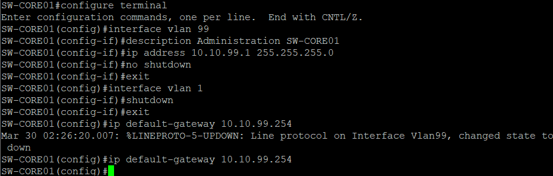
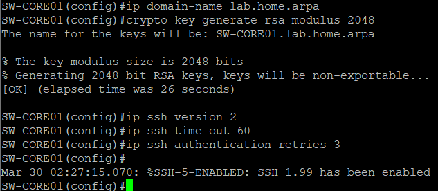
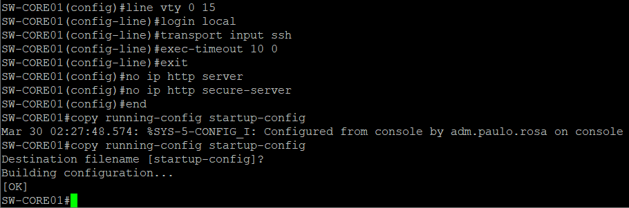
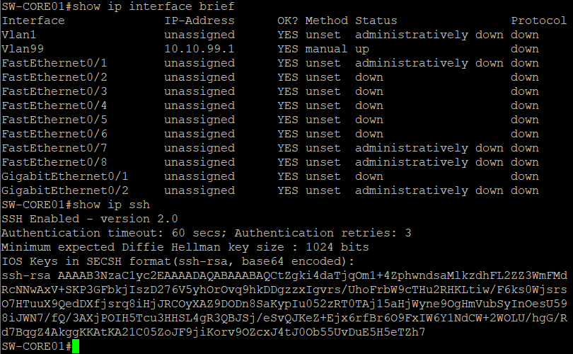

## 13. Le trunk vers Proxmox

**L'état des lieux d'abord** (on ne modifie jamais un réseau sans l'avoir regardé) : dans Proxmox,
*pve01 → Système → Réseau* :

| Interface | Rôle |
| --- | --- |
| `nic0` → `vmbr0` (192.168.1.210) | Prise de gauche du mini PC, reliée à la box : accès à Proxmox. **On n'y touche pas** |
| `nic1` → `vmbr1`, **« Gère les VLAN » coché** | Prise de droite, libre : pont du LAN de l'entreprise, prévu dès la brique 01 comme « trunk vers le switch » |

Les VM sont déjà sur `vmbr1` avec leur numéro de VLAN (« tag 10 », « tag 20 »…). Un pont « VLAN aware »
transmet ces étiquettes telles quelles sur `nic1` : **côté Proxmox, il n'y a rien à modifier**.

**Côté switch :**

```
configure terminal
interface gi0/1
 description TRUNK vers PVE01 nic1 (vmbr1)
 switchport trunk native vlan 999
 switchport trunk allowed vlan 10,20,30,40,99
 switchport mode trunk
 switchport nonegotiate
 no shutdown
end
copy running-config startup-config
```

| Commande | Pourquoi |
| --- | --- |
| `switchport mode trunk` | Le port transporte plusieurs VLAN, chaque trame étiquetée 802.1Q (le 2960 ne connaît que 802.1Q : pas besoin de `encapsulation`) |
| `allowed vlan 10,20,30,40,99` | Seuls les VLAN de l'entreprise passent : moindre privilège |
| `native vlan 999` | Le VLAN natif passe **sans étiquette**. Laissé sur le VLAN 1, il permet l'attaque par « double étiquetage » (double tagging). On le place sur le VLAN parking |
| `nonegotiate` | Coupe DTP, le protocole qui négocie automatiquement le mode trunk : une porte d'attaque de moins |

Puis câble entre **Gi0/1** et la **prise libre (nic1)** du mini PC.

**Comment vérifier**

```
show interfaces trunk
show ip interface brief
ping 10.10.99.254
```

- `show interfaces trunk` : Gi0/1 `on`, `802.1q`, `trunking`, native `999`, VLAN 10,20,30,40,99 autorisés et actifs.
- `Vlan99` passe en `up/up` : le trunk apporte le VLAN 99, l'interface s'allume.
- `ping 10.10.99.254` → `!!!!!` : **pfSense répond au switch à travers le trunk**.

**Problème constaté** : `show interfaces status` affiche Gi0/1 en `a-100` (100 Mb/s) alors que les deux
côtés savent faire 1 Gb/s, avec un câble Cat 5e. Le Gigabit a besoin des **4 paires** du câble ; s'il
en manque une, les cartes se replient sur 100 Mb/s. Pistes : câble abîmé ou mal serti, connecteur mal
enfoncé, carte Intel i226 du mini PC et économie d'énergie EEE.

**Diagnostic par échange** (méthode du technicien quand on n'a pas de testeur) : on intervertit le
câble du trunk et celui d'ADM-001. Le port Fa0/2 de l'Acer est en FastEthernet : il plafonne à
100 Mb/s et n'utilise que 2 paires, un câble fatigué y passe inaperçu. Résultat : Gi0/1 passe
immédiatement en **a-1000**. **C'était le câble.** Il reste sur le poste d'admin (100 Mb/s suffit)
et sera remplacé ; en entreprise, il serait passé au testeur puis jeté.

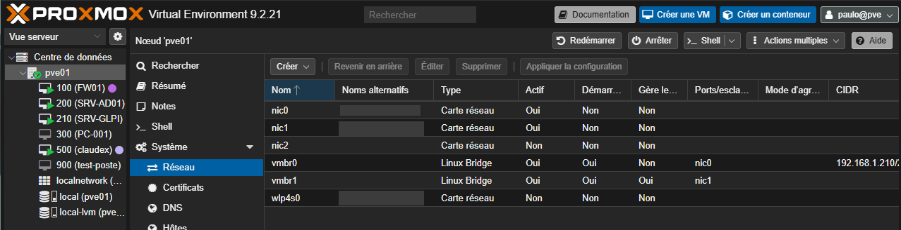
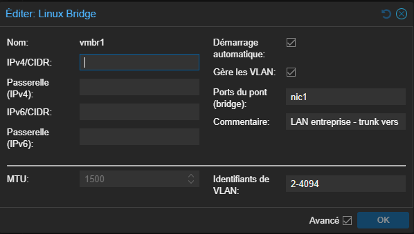
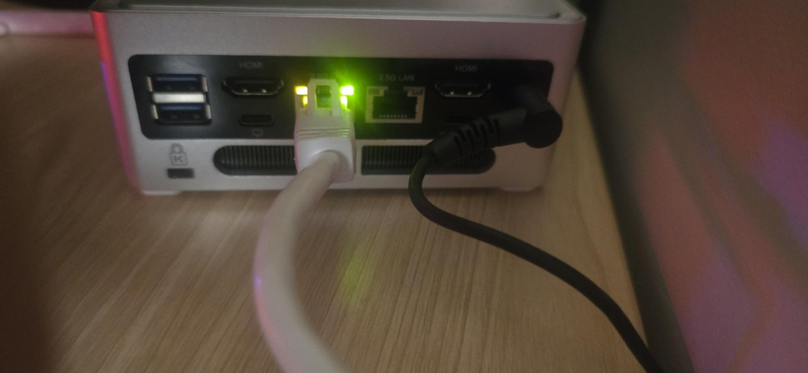
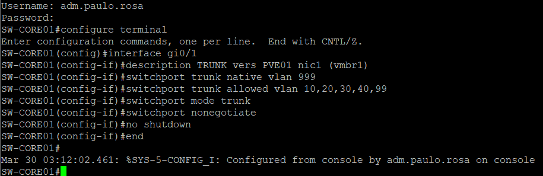
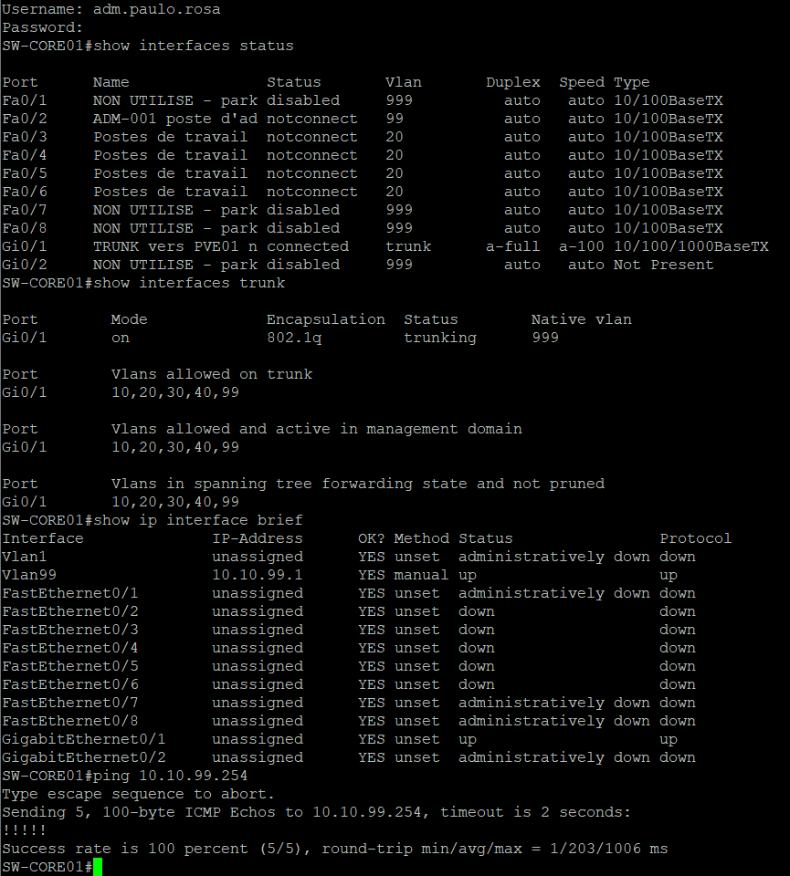
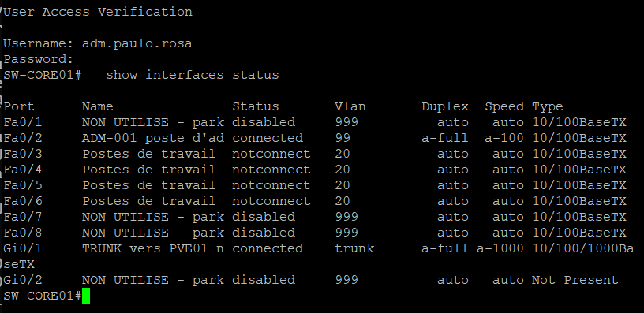

## 14. Brancher le poste d'administration (et le piège du DHCP)

ADM-001 est branché sur **Fa0/2** (VLAN 99). `ipconfig` affiche **169.254.21.244** sur la carte Ethernet.

**Une adresse en 169.254.x.x (APIPA) = Windows n'a reçu de réponse d'aucun serveur DHCP** et s'est
donné une adresse de secours. Le lien, lui, fonctionne (sinon : « Média déconnecté »).

**Démarche de diagnostic, de bas en haut :**

1. Le switch voit-il le PC ? `show interfaces status` → Fa0/2 `connected`, VLAN 99.
   `show mac address-table vlan 99` → l'adresse MAC de l'Acer apparaît sur `Fa0/2`. ✅
   (La table MAC est l'annuaire du switch : quelle machine derrière quel port. Une entrée inutilisée
   disparaît au bout de 5 minutes, d'où l'absence de pfSense sur Gi0/1 à ce moment-là.)
2. Le serveur DHCP répond-il ? pfSense → *Services → DHCP Server* :
   **« DHCP Relay is currently enabled. DHCP Server cannot be enabled… »**

**Cause** : depuis la brique 03, c'est **SRV-AD01** qui distribue les adresses, pfSense **relaie** les
demandes. pfSense ne peut pas être relais et serveur en même temps. Le plan d'adressage annonçait par
erreur « DHCP pfSense » pour le VLAN 99.

**Décision** : **pas de DHCP dans le VLAN 99**. Comme en entreprise, le VLAN d'administration ne
contient que de l'infrastructure (switch, borne Wi-Fi, poste d'admin), toujours en **adresse fixe** :
un intrus qui se branche sur une prise du VLAN 99 ne reçoit rien, et le pare-feu peut viser précisément
le poste d'admin.

**Adresse fixe d'ADM-001** (Paramètres → Réseau et Internet → Ethernet → Attribution d'adresse IP →
Modifier → Manuel → IPv4) :

| Champ | Valeur | Pourquoi |
| --- | --- | --- |
| Adresse IP | 10.10.99.10 | Plage fixe .1-.99 : .1 = switch, .10 = postes d'admin |
| Masque | 255.255.255.0 (/24) | |
| Passerelle | **vide** | ADM-001 a déjà une passerelle par le Wi-Fi (box). Deux passerelles = Windows ne sait plus par où sortir et Internet peut se couper |
| DNS | vide | |

**Comment vérifier** : `ping 10.10.99.1` répond. Le **premier** paquet est perdu : le temps qu'**ARP**
trouve l'adresse MAC du switch (« qui a 10.10.99.1 ? »). C'est normal.

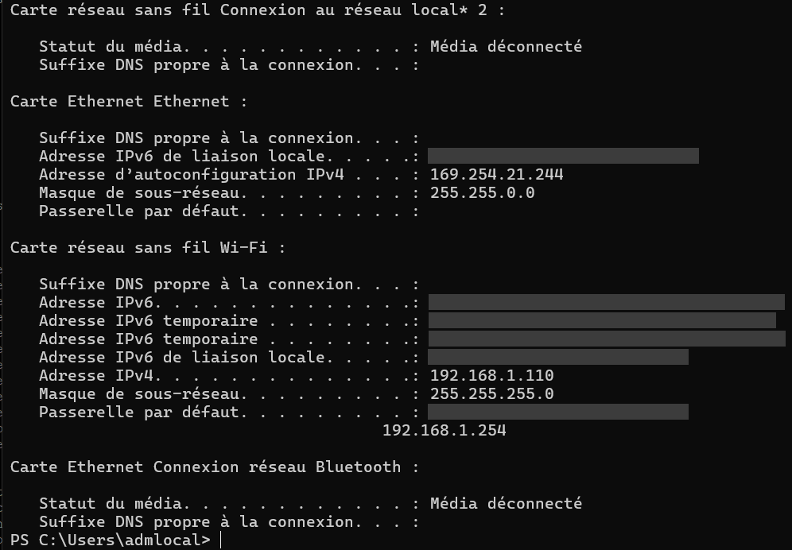
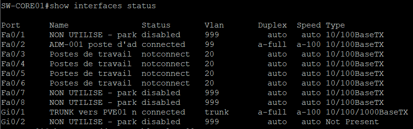
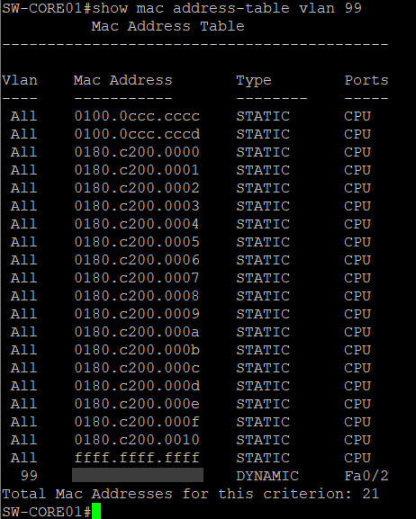
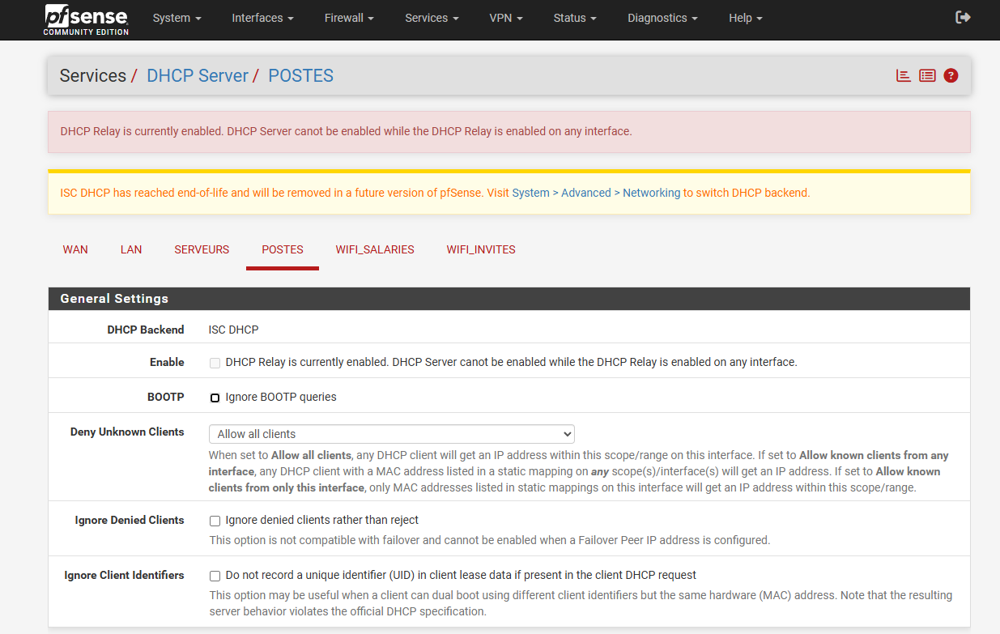
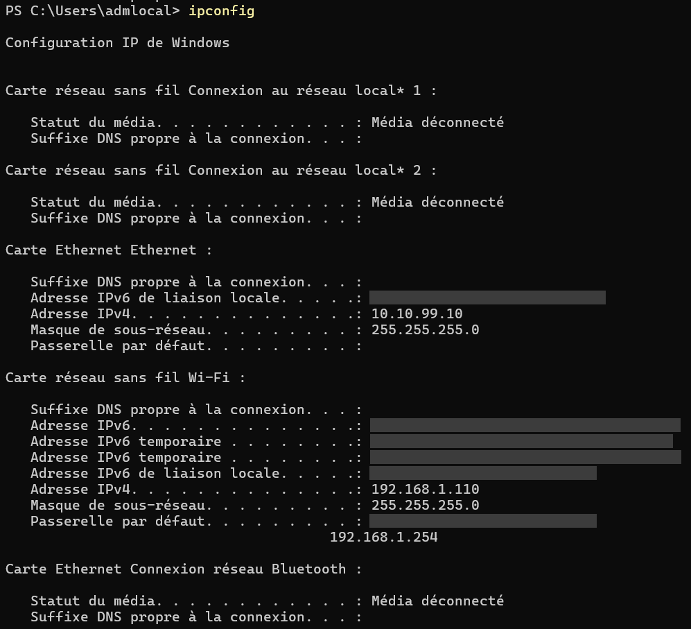
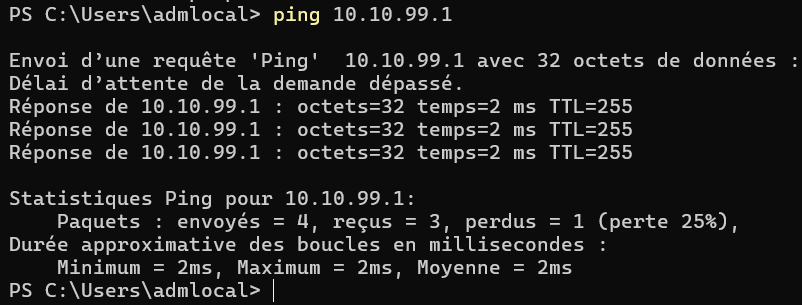

## 15. Administrer le switch en SSH depuis ADM-001

```
ssh adm.paulo.rosa@10.10.99.1
```

Le switch de 2013 et Windows 11 ne trouvent pas d'algorithme commun. Une connexion SSH, c'est
**4 négociations successives** ; on les a vues échouer une par une :

| N° | Négociation | Question | Message d'erreur | Choix retenu (le moins faible proposé par le switch) |
| --- | --- | --- | --- | --- |
| 1 | KEX (échange de clés) | Comment fabriquer une clé secrète commune sans qu'elle soit interceptée ? | `no matching key exchange method` | `diffie-hellman-group14-sha1` |
| 2 | HostKey | Comment être sûr de parler au vrai switch ? | `no matching host key type` | `ssh-rsa` (la clé RSA 2048 générée à la section 12) |
| 3 | Cipher (chiffrement) | Avec quoi chiffrer ? | `no matching cipher` | `aes256-cbc` (pas `3des-cbc`, trop faible) |
| 4 | MAC (intégrité) | Comment prouver qu'un paquet n'a pas été modifié ? | `no matching MAC` | `hmac-sha1` (pas `hmac-md5`, cassé). Ici MAC = *Message Authentication Code*, rien à voir avec l'adresse MAC |

```
ssh -o KexAlgorithms=+diffie-hellman-group14-sha1 -o HostKeyAlgorithms=+ssh-rsa -o Ciphers=+aes256-cbc -o MACs=+hmac-sha1 adm.paulo.rosa@10.10.99.1
```

Le `+` **ajoute** l'algorithme à la liste par défaut sans retirer les modernes.

À la première connexion, `yes` pour accepter l'**empreinte** (fingerprint) du switch : Windows la
garde dans `known_hosts`. Si un jour un autre appareil se fait passer pour 10.10.99.1, SSH refusera
(« HOST IDENTIFICATION HAS CHANGED ») : c'est la protection contre l'**homme du milieu**.

**Ne plus retaper tout ça** : fichier `C:\Users\admlocal\.ssh\config` (sans extension) :

```
Host sw-core01
    HostName 10.10.99.1
    User adm.paulo.rosa
    KexAlgorithms +diffie-hellman-group14-sha1
    HostKeyAlgorithms +ssh-rsa
    Ciphers +aes256-cbc
    MACs +hmac-sha1
```

Puis simplement : `ssh sw-core01`. Les réglages anciens ne s'appliquent **qu'à ce switch**, pas aux
autres serveurs.

**Piège** : le Bloc-notes enregistre `config.txt` → `Could not resolve hostname sw-core01`. Correction :
`Rename-Item $HOME\.ssh\config.txt config`. Réflexe : afficher les extensions dans l'Explorateur
(Affichage → Afficher → Extensions de noms de fichiers).

**Comment vérifier** : `show users` sur le switch montre la console (`con 0`) **et** la session SSH
(`vty 0`, depuis 10.10.99.10).

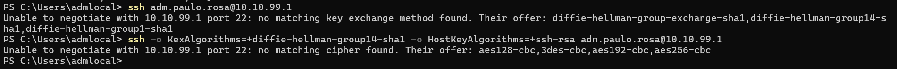
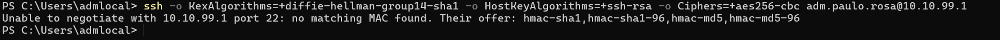
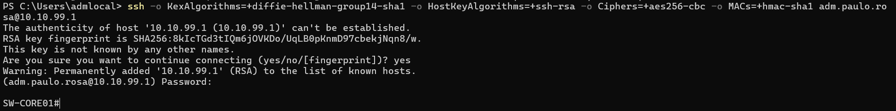
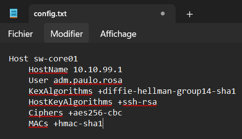
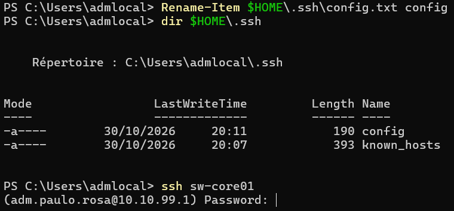

## 16. Heure (NTP) et bannière légale

**L'heure.** Le switch n'a pas de pile : il croyait être le 30 mars 2011. Des journaux à la mauvaise heure
rendent impossible l'enquête après un incident (on compare les journaux de plusieurs équipements).

```
configure terminal
clock timezone CET 1 0
clock summer-time CEST recurring last Sun Mar 2:00 last Sun Oct 3:00
ntp server 10.10.99.254
service timestamps log datetime msec localtime show-timezone
end
```

| Commande | Pourquoi |
| --- | --- |
| `clock timezone CET 1 0` | Fuseau de Paris, heure d'hiver UTC+1 |
| `clock summer-time CEST recurring …` | Heure d'été automatique (dernier dimanche de mars → dernier dimanche d'octobre) |
| `ntp server 10.10.99.254` | pfSense donne l'heure (lui-même la prend sur Internet) |
| `service timestamps log … localtime show-timezone` | Journaux datés à la milliseconde, en heure locale |

**Vérification** (2 à 5 minutes après) : `show clock` → date et heure du jour en CET ;
`show ntp status` → `Clock is synchronized, stratum 3, reference is 10.10.99.254`.
(Stratum 3 : le switch est à 3 « étages » d'une horloge de référence : horloge atomique → serveur
Internet → pfSense → switch.) Les journaux passent de `Mar 30 …` 2011 à `Oct 30 20:19:56.630 CET`.

**La bannière.** Un message « accès réservé » affiché **avant** la connexion a une valeur juridique :
un intrus ne peut pas prétendre ignorer que l'accès était interdit (recommandation ANSSI).

```
configure terminal
banner login #
Acces reserve aux administrateurs AEROTRANS.
Toute connexion est enregistree.
Tout acces non autorise est puni par la loi (art. 323-1 du Code penal).
#
end
copy running-config startup-config
```

Le `#` est le **délimiteur** de début et de fin (un caractère absent du texte). Pas d'accents :
la console Cisco les affiche mal.

**Vérification** : `ssh sw-core01` affiche la bannière avant `Password:`.

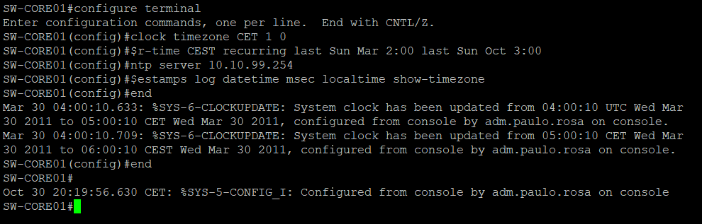
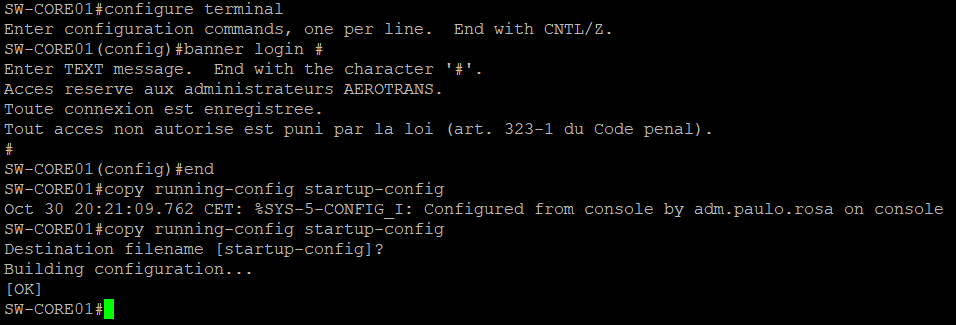


## 17. La config complète

Après les parties 1 et 2 (les secrets sont remplacés par `<haché>`) :

```
hostname SW-CORE01
!
enable secret 9 <haché>
username adm.paulo.rosa privilege 15 secret 9 <haché>
service password-encryption
no ip domain-lookup
ip domain-name lab.home.arpa
!
vlan 10
 name SERVEURS
vlan 20
 name POSTES
vlan 30
 name WIFI_SALARIES
vlan 40
 name WIFI_INVITES
vlan 99
 name ADMINISTRATION
vlan 999
 name PARKING
!
interface FastEthernet0/1
 description NON UTILISE - parking
 switchport access vlan 999
 switchport mode access
 shutdown
interface FastEthernet0/2
 description ADM-001 poste d'administration
 switchport access vlan 99
 switchport mode access
 spanning-tree portfast
 spanning-tree bpduguard enable
interface range FastEthernet0/3 - 6
 description Postes de travail
 switchport access vlan 20
 switchport mode access
 spanning-tree portfast
 spanning-tree bpduguard enable
interface range FastEthernet0/7 - 8 , GigabitEthernet0/2
 description NON UTILISE - parking
 switchport access vlan 999
 switchport mode access
 shutdown
!
interface Vlan1
 shutdown
interface Vlan99
 description Administration SW-CORE01
 ip address 10.10.99.1 255.255.255.0
!
ip default-gateway 10.10.99.254
no ip http server
no ip http secure-server
ip ssh version 2
ip ssh time-out 60
ip ssh authentication-retries 3
!
clock timezone CET 1 0
clock summer-time CEST recurring last Sun Mar 2:00 last Sun Oct 3:00
service timestamps log datetime msec localtime show-timezone
ntp server 10.10.99.254
!
banner login #
Acces reserve aux administrateurs AEROTRANS.
Toute connexion est enregistree.
Tout acces non autorise est puni par la loi (art. 323-1 du Code penal).
#
!
line con 0
 exec-timeout 10 0
 logging synchronous
 login local
line vty 0 15
 exec-timeout 10 0
 login local
 transport input ssh
```

(Présentation simplifiée : IOS affiche chaque interface séparément, sans `range`.)

## 18. Écarts entre le lab et une vraie entreprise

| Sujet | Dans le lab | En entreprise | Pourquoi l'écart |
| --- | --- | --- | --- |
| Mot de passe exposé | Le mot de passe enable est apparu en clair sur une capture partagée pendant la séance ; **choix assumé : pas changé** | Un mot de passe vu, même une seconde, est **compromis** : on le régénère et on le remplace immédiatement | Lab personnel, sans enjeu réel. La règle est connue et documentée ici |
| Authentification | Un compte local unique (`adm.paulo.rosa`) | Comptes des admins dans l'**AD**, vérifiés par **RADIUS ou TACACS+** (NPS) ; un seul compte local « de secours » dans un coffre partagé | Un seul admin dans la PME fictive. RADIUS est prévu avec la brique Wi-Fi (NPS) |
| Coffre à mots de passe | Fichier KeePassXC local sur ADM-001 | Coffre d'équipe (Vaultwarden, Bitwarden Entreprise, CyberArk…) avec sauvegarde et partage contrôlé | À faire : **sauvegarder le fichier `.kdbx`** (brique 07), sinon une panne de l'Acer = mots de passe perdus |
| Version d'IOS | 15.0(2)SE5 (2013) | Dernière version recommandée par Cisco, matériel encore supporté | Matériel d'occasion. À vérifier : dernière version disponible et date de fin de support du 2960C |
| Heure | NTP vers pfSense (section 16) | NTP vers 2 sources minimum | Une seule source dans le lab |
| Redondance | Un seul switch, une seule alimentation | Souvent deux switchs empilés, alimentations redondantes, onduleur | Budget lab ; onduleur prévu (brique 23) |
| Sauvegarde de la config | `copy running-config startup-config` uniquement | Copie automatique de la config hors du switch (TFTP/SCP, Oxidized, RANCID) à chaque modification | À voir avec la brique 07 |
| Récupération de mot de passe | Laissée active | Parfois désactivée (`no service password-recovery`) en environnement sensible | Utile en lab, et risque de perte faible |
| Algorithmes SSH | IOS 15.0(2)SE5 ne propose que des algorithmes anciens (DH SHA-1, AES-CBC, HMAC-SHA1) : il faut les réautoriser côté client | Signal d'alerte : mettre IOS à jour ou remplacer le matériel s'il n'est plus supporté | Matériel d'occasion de 2013 |
| Poste d'admin | ADM-001 est relié à la fois au Wi-Fi de la box (Internet) et au VLAN 99 | Le poste d'admin n'est relié **qu'au** réseau d'administration ; Internet (mises à jour) passe par le pare-feu, filtré | Lab à la maison ; à corriger quand ADM-001 rejoindra le domaine |
| Pont vmbr1 | Laisse passer tous les VLAN (2-4094) | Limité aux VLAN utilisés (10, 20, 30, 40, 99) | Amélioration à faire |
| Câblage | Câble Cat 5e défectueux (trunk bloqué à 100 Mb/s) identifié par échange de câbles, laissé sur le poste d'admin | Câbles testés et certifiés, câble défectueux jeté et étiquetage des cordons | Pas d'autre câble ni de testeur à la maison |
| Bannière légale | En place (section 16) | Texte validé par le service juridique | — |

## 19. Erreurs rencontrées pendant le lab

| Erreur | Cause | Correction |
| --- | --- | --- |
| Quiz : « la config de démarrage, c'est la running-config » | Confusion RAM / flash | running-config = RAM (en cours) ; startup-config = `flash:config.text` ; VLAN = `flash:vlan.dat` |
| `Unknown cmd: dir` dans le bootloader | Faute de frappe ou caractère invisible ; le bootloader ne corrige rien | Retaper la commande proprement |
| `% Password: timeout expired!` | Plus de 30 s pour saisir le mot de passe | Copier le mot de passe dans KeePassXC avant de taper le nom d'utilisateur |
| `name POSTES*` | Faute de frappe | `vlan 20` puis `name POSTES` |
| ADM-001 reçoit 169.254.x.x | Aucun serveur DHCP dans le VLAN 99 : pfSense fait du **relais DHCP** vers SRV-AD01 (brique 03) et ne peut pas être serveur en même temps. Le plan d'adressage annonçait à tort « DHCP pfSense » pour le VLAN 99 | Adresse fixe 10.10.99.10 sur ADM-001 ; plan d'adressage corrigé (VLAN 99 = adresses fixes uniquement) |
| `ssh: no matching key exchange method / cipher / MAC` | Le switch de 2013 ne propose que des algorithmes que Windows 11 a désactivés | Les réautoriser un par un (section 15) |
| Trunk Gi0/1 en `a-100` | Câble Cat 5e défectueux (une paire HS) | Échange avec le câble du poste d'admin → `a-1000` |
| `ssh sw-core01` : `Could not resolve hostname` | Le Bloc-notes a enregistré `config.txt` | `Rename-Item $HOME\.ssh\config.txt config` ; afficher les extensions dans l'Explorateur |
| Mot de passe enable visible sur une capture | Capture prise juste après le collage | Écart documenté (section 18). Règle : couper le journal PuTTY et **ne faire aucune capture** pendant la saisie de secrets |

## 20. Antisèche des commandes

| Commande | Utilité |
| --- | --- |
| `show running-config` | Config en cours |
| `show startup-config` | Config sauvegardée |
| `show vlan brief` | VLAN et leurs ports |
| `show interfaces status` | État, VLAN, vitesse de chaque port |
| `show ip interface brief` | Adresses IP et état des interfaces |
| `show ip ssh` | État du SSH |
| `show version` | Modèle, IOS, licence, uptime |
| `show inventory` | Numéro de série |
| `show env all` | Température, alimentation |
| `show power inline` | Budget PoE |
| `show users` | Qui est connecté |
| `copy running-config startup-config` | **Sauvegarder** |
| `?` | Aide contextuelle (`show ?`, `interface ?`) |
| Tab | Complète une commande |

## 21. Questions d'entretien

| Question | Réponse courte |
| --- | --- |
| Différence entre running-config et startup-config ? | running = en RAM, appliquée tout de suite, perdue à l'extinction ; startup = `flash:config.text`, lue au démarrage. `copy running-config startup-config` pour sauvegarder |
| Où sont stockés les VLAN sur un Catalyst ? | Dans `flash:vlan.dat`, pas dans la config : à effacer aussi pour une remise à zéro |
| Comment récupérer un switch Catalyst dont on n'a pas le mot de passe ? | Bouton MODE au démarrage → bootloader → `flash_init` → renommer/supprimer `config.text`. Sur un routeur : registre 0x2142 |
| `enable password` ou `enable secret` ? | Toujours `enable secret` (haché, idéalement type 9 scrypt). `enable password` est en clair ou en type 7, réversible |
| Access ou trunk ? | Access : un seul VLAN (un PC). Trunk : plusieurs VLAN étiquetés 802.1Q (vers un switch, un hyperviseur, un pare-feu) |
| Pourquoi changer le VLAN natif d'un trunk ? | Le VLAN natif passe sans étiquette ; laissé sur le VLAN 1, il permet l'attaque par double étiquetage |
| À quoi servent portfast et bpduguard ? | portfast : le port d'un PC s'active sans attendre le STP ; bpduguard : coupe le port si on y branche un switch |
| Pourquoi un VLAN parking ? | Les prises libres ne mènent nulle part et sont éteintes : un intrus qui se branche n'obtient rien |
| Un PC obtient une adresse en 169.254.x.x : que se passe-t-il ? | Aucun serveur DHCP n'a répondu (serveur arrêté, relais absent, mauvais VLAN). Le lien physique, lui, fonctionne |
| Pourquoi le premier ping est-il souvent perdu ? | Le temps de la résolution ARP (adresse IP → adresse MAC) |
| SSH refusé avec « no matching key exchange method » ? | Client et serveur n'ont pas d'algorithme commun : réautoriser l'ancien côté client (temporaire) et planifier la mise à jour de l'équipement |
| Un lien Gigabit négocie à 100 Mb/s : causes ? | Le plus souvent le câble (une des 4 paires HS) ; sinon connecteur, carte réseau, économie d'énergie EEE. Diagnostic par échange ou testeur |

## 22. Améliorations possibles

- [x] Vitesse du trunk : réglée par échange de câbles (Gi0/1 en a-1000, capture `48`).
- [x] NTP et bannière (section 16).
- [ ] Remplacer le câble défectueux (actuellement sur ADM-001 ↔ Fa0/2).
- [ ] Limiter `vmbr1` aux VLAN 10, 20, 30, 40, 99.
- [ ] Journal du switch vers un serveur (syslog) — avec la brique 11 Wazuh.
- [ ] Authentification des admins par l'AD (RADIUS / NPS) — avec la brique Wi-Fi.
- [ ] Ajouter SW-CORE01 au DNS (`sw-core01.lab.home.arpa`) et dans GLPI.
- [ ] Vérifier la dernière version d'IOS et la fin de support du WS-C2960C-8PC-L.
- [ ] Règle pfSense ADMIN → SERVEURS:3389 (RDP depuis ADM-001) et suppression de la règle WAN temporaire.
- [ ] Sauvegarde automatique de la config hors du switch (brique 07).
