# Brique 03 — Active Directory, DNS et DHCP sous Windows Server 2025

> Procédure d'intervention rédigée comme chez un client : chaque étape indique
> **quoi faire**, **pourquoi**, **comment vérifier** et **quoi faire si ça échoue**.
> Les étapes ont été faites à l'interface graphique ; la commande PowerShell équivalente
> est donnée à chaque fois (section 20).

## 1. Besoin du client

AEROTRANS (25 salariés) veut :

- **un compte par personne**, géré à un seul endroit, avec des règles de mot de passe ;
- des **droits par service** (la compta ne voit pas les dossiers RH) ;
- des **postes qui s'appliquent tout seuls les règles de sécurité** (verrouillage, etc.) ;
- des **adresses IP distribuées automatiquement** aux postes ;
- de la **traçabilité** : savoir qui a fait quoi.

C'est le rôle d'un **annuaire Active Directory**, avec son DNS et son DHCP.

## 2. Choix de la techno

| Critère | Windows Server 2025 (AD DS) | Samba AD (Linux) | Entra ID seul (cloud) |
| --- | --- | --- | --- |
| Présence en PME et ESN | Standard du marché | Rare | En hausse, souvent en complément |
| GPO complètes | Oui | Partielles | Non (Intune à la place) |
| Postes sans Internet | Oui | Oui | Non |
| Coût | Licence (évaluation 180 j ici) | Gratuit | Abonnement |

**Choix retenu : Windows Server 2025 Standard**, avec l'expérience utilisateur (interface
graphique) pour apprendre. En production, l'installation **Core** (sans interface) réduit
la surface d'attaque et le nombre de mises à jour.

## 3. Architecture cible

```
                     pfSense (fw01)
     relais DHCP · NTP · résolveur DNS · refus par défaut
        |                                   |
   VLAN 10 Serveurs                    VLAN 20 Postes
   10.10.10.0/24                       10.10.20.0/24
        |                                   |
   SRV-AD01  10.10.10.10               PC (DHCP .100 → .199)
   AD DS · DNS · DHCP                  test-poste (VM 900)
   domaine lab.home.arpa
```

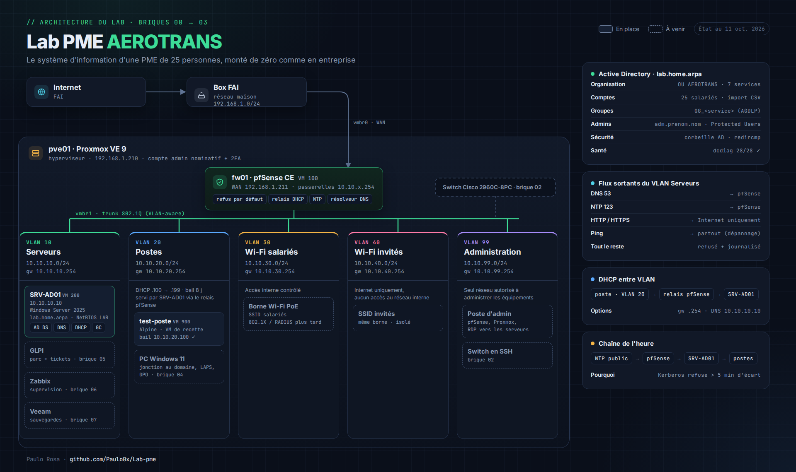

Adresses : [plan d'adressage](../docs/plan-adressage.md) · Flux : [matrice des flux](../docs/matrice-des-flux.md) ·
Noms : [conventions](../docs/conventions.md).

## 4. Préparation

- ISO **Windows Server 2025 Evaluation (français)**, empreinte SHA-256 vérifiée à l'envoi dans Proxmox.
- ISO **virtio-win** (pilotes Red Hat pour les disques et cartes réseau virtuels).

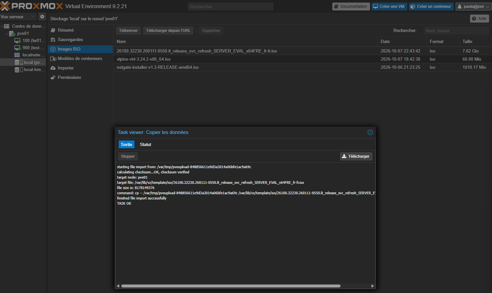

### Machine virtuelle 200 · SRV-AD01

| Paramètre | Valeur | Pourquoi |
| --- | --- | --- |
| Machine | q35, BIOS **OVMF (UEFI)** + disque EFI, **TPM 2.0** | Exigences de Windows Server 2025, démarrage sécurisé |
| Contrôleur | VirtIO SCSI single | Meilleures performances |
| Disque | 60 Go, discard, IO thread, **SSD** coché | « SSD » : Windows optimise pour un SSD (TRIM) |
| Processeur | 2 cœurs, type **host** | Toutes les instructions du vrai processeur |
| Mémoire | 4 Go, **sans ballooning** | Un DC ne doit pas voir sa RAM changer en cours de route |
| Réseau | VirtIO, vmbr1, **tag 10** | Directement dans le VLAN Serveurs |
| Démarrage | automatique, ordre 2 | Après le pare-feu (ordre 1) |

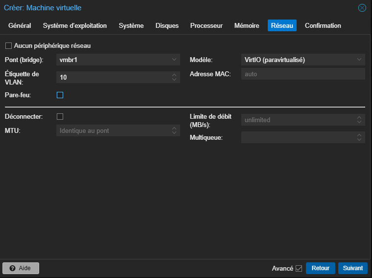

**Erreurs corrigées en relisant le récapitulatif :** case SSD oubliée, démarrage automatique
oublié. Toujours relire avant de valider.

## 5. Installation

1. Édition **Standard Evaluation (expérience de bureau)**.
2. **Aucun disque visible** : normal, Windows ne connaît pas le contrôleur VirtIO.
   « Charger un pilote » → lecteur virtio-win → `vioscsi\2k25\amd64`. Le disque de 60 Go apparaît.
3. Mot de passe `Administrateur` long (14 caractères), tapé à la main, rangé au coffre.
4. Après l'installation : **virtio-win-guest-tools** (pilotes réseau + agent QEMU).

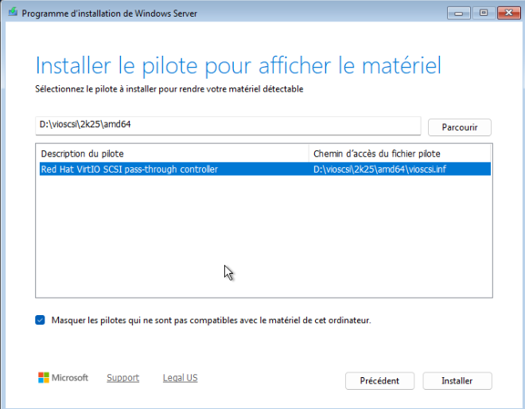

## 6. Réseau du serveur et premières règles du VLAN 10

Sans DHCP dans le VLAN 10, Windows se donne une adresse **APIPA** (169.254.x.x) : il ne
peut parler à personne. On fixe l'adresse :

| Paramètre | Valeur |
| --- | --- |
| Nom | SRV-AD01 (renommé **avant** la promotion) |
| IP | 10.10.10.10/24 |
| Passerelle | 10.10.10.254 (pfSense) |
| DNS | 10.10.10.10 (lui-même : il sera le DNS du domaine) |

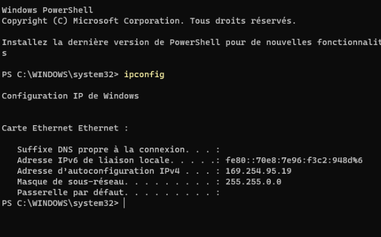
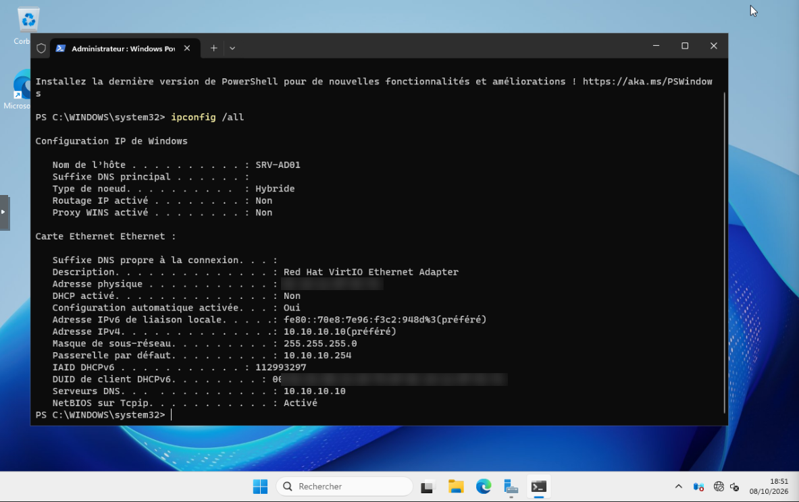

Sans règle sur l'interface SERVEURS, pfSense bloque tout (refus par défaut) : premier ping à
100 % de perte. Trois règles provisoires sont posées (blocage vers l'admin, blocage de
l'interface web, puis « vers Internet »), resserrées en section 14.

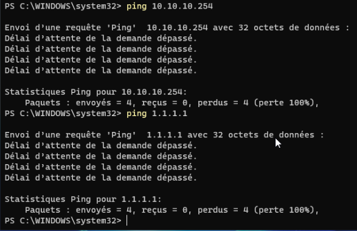

## 7. Mises à jour et instantané

**Dépannage : « pas d'Internet » alors que `ping 1.1.1.1` répond.** Le DNS préféré est le
serveur lui-même, mais le rôle DNS n'est pas encore installé : personne ne répond sur le port 53.
Contournement le temps des mises à jour : DNS temporaire `10.10.10.254`, puis retour à
`10.10.10.10` **juste avant** la promotion.

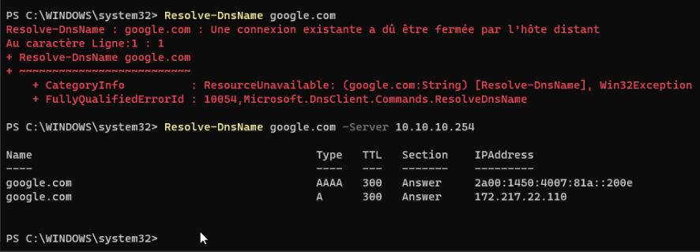

Instantané Proxmox **« avant_promotion »**, VM éteinte (état cohérent, sans RAM).

> ⚠️ En production, on ne restaure **jamais** un instantané de contrôleur de domaine :
> l'annuaire « reviendrait dans le passé » et se désynchroniserait des autres DC (*USN rollback*).
> On utilise une vraie sauvegarde de l'état système (brique 07).

## 8. Rôle AD DS et promotion

Rôle **Services AD DS** + outils (GPMC, Centre d'administration AD, module PowerShell).
DNS et DHCP ne sont pas cochés : le DNS est installé par la promotion, le DHCP vient après.

Promotion : **nouvelle forêt** `lab.home.arpa`.

| Option | Valeur | Pourquoi |
| --- | --- | --- |
| Niveaux fonctionnels | Windows Server 2025 | Pas d'ancien DC à prendre en compte |
| DNS + catalogue global | oui | Premier DC de la forêt |
| Mot de passe DSRM | **distinct** de l'Administrateur | Mode de restauration de l'annuaire |
| NetBIOS | LAB | Ancien format `LAB\compte` |

L'avertissement sur la délégation DNS est normal : il n'existe pas de zone parente `home.arpa` à déléguer.

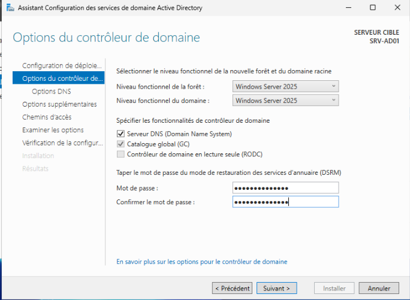
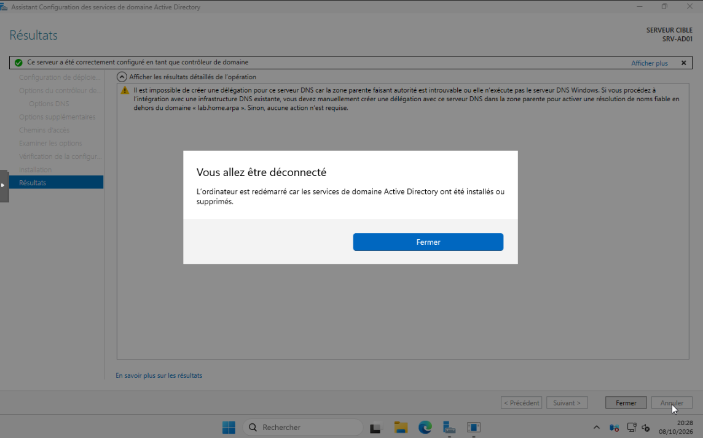

## 9. Vérifications après promotion

| Vérification | Commande | Résultat |
| --- | --- | --- |
| Domaine | `Get-ADDomain` | lab / lab.home.arpa / LAB / Windows2025Domain |
| Le DC est trouvable | `Resolve-DnsName _ldap._tcp.dc._msdcs.lab.home.arpa -Type SRV` | srv-ad01, port 389 |
| Internet par nom | `Resolve-DnsName google.com` | OK après le redirecteur |

Premier essai en échec : faute de frappe `_mcdcs` au lieu de `_msdcs`.

**Redirecteur DNS** vers `10.10.10.254` : ce que le DC ne connaît pas (google.com), il le
demande au résolveur de pfSense.

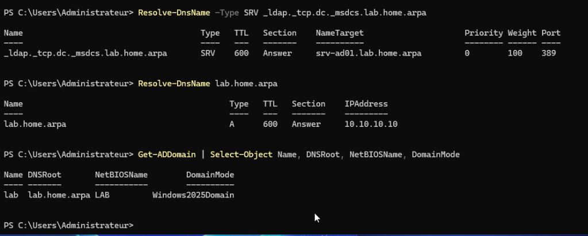

## 10. DNS : zones inversées et piège `home.arpa`

**Zones inversées** (IP → nom), une par VLAN, intégrées à l'AD, réplication « dans ce
domaine », **mises à jour dynamiques sécurisées uniquement** (seule une machine membre du
domaine peut inscrire son nom : un intrus ne peut pas se déclarer `srv-ad01`).

La première à l'assistant, les quatre autres en PowerShell. Les chiffres sont à l'envers :
le VLAN 20 donne la zone `20.10.10.in-addr.arpa`.

Test : `nslookup 10.10.10.10` → « Non-existent domain » (zone vide) ; `ipconfig /registerdns` ;
une minute plus tard → `SRV-AD01.lab.home.arpa`.

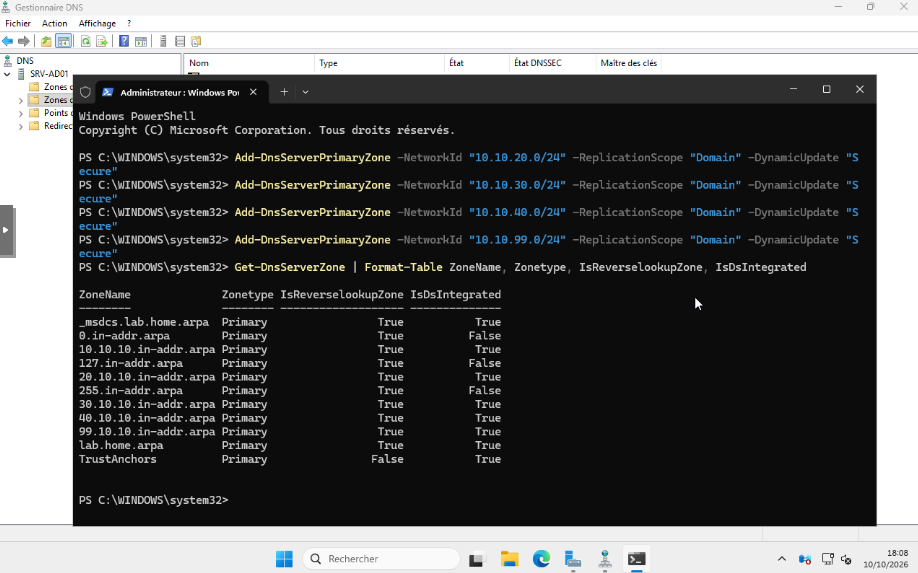
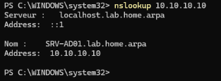

> 🪤 **Piège repéré :** Windows range `lab.home.arpa` dans « Zones de recherche **inversées** »
> (`IsReverseLookupZone = True`) : il considère toute zone qui finit par `.arpa` comme inversée.
> La résolution fonctionne, seul le classement est faux. **En entreprise**, on choisit un
> sous-domaine d'un nom qu'on possède : `ad.entreprise.fr`. Domaine conservé pour le lab.

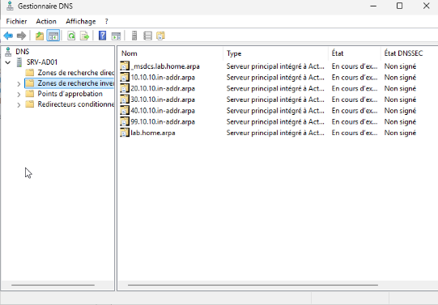

## 11. Santé du contrôleur de domaine

`dcdiag /q` (mode silencieux : n'affiche que les erreurs) → **rien**, donc aucune erreur.
Pour le prouver : `dcdiag | Select-String "ussi|chou"` → **28 tests réussis, 0 échec**.
(Le filtre `"test"` ne suffit pas : en français, le verdict est écrit sur la ligne suivante.)

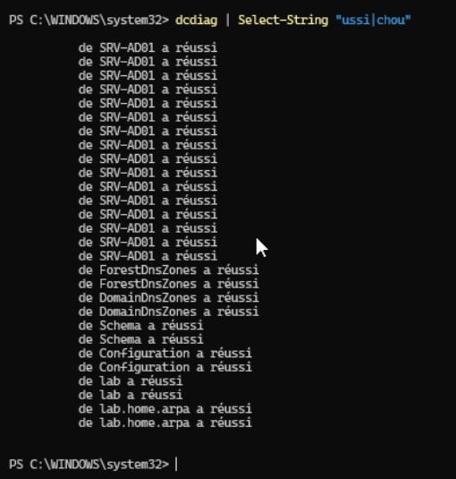

## 12. Organisation AEROTRANS

**Conventions écrites d'abord** ([conventions.md](../docs/conventions.md)), puis :

- OU racine `AEROTRANS`, protégée contre la suppression (un admin du domaine lui-même ne
  peut pas la supprimer sans décocher la protection) ;
- 16 sous-OU en PowerShell (protection activée par défaut), avec une variable `$base` et
  une boucle ;
- **Corbeille AD** activée (irréversible, donc Windows demande confirmation) : un objet
  supprimé par erreur revient avec ses groupes et attributs ;
- **`redircmp`** → OU Ordinateurs, **`redirusr`** → OU Utilisateurs : sans ça, un nouveau PC
  arrive dans le conteneur `Computers`, où **aucune GPO ne s'applique**.

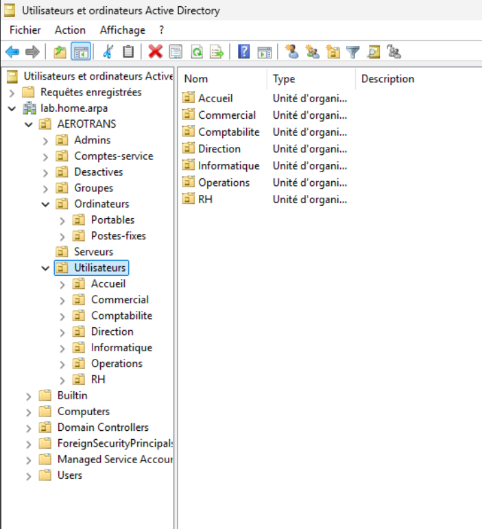

Erreurs corrigées **avant** d'appuyer sur Entrée : variable `$base` écrasée (chemin sans
AEROTRANS), accent, `Operation` sans « s », `Acceuil`, guillemet non fermé.

## 13. Comptes d'administration

| Compte | Où | Groupes | Usage |
| --- | --- | --- | --- |
| `Administrateur` | Users | (intégré) | **Secours** uniquement, mot de passe au coffre |
| `adm.paulo.rosa` | AEROTRANS/Admins | Admins du domaine, **Protected Users** | Administration uniquement |
| `paulo.rosa` | Utilisateurs/Informatique | GG_Informatique | Quotidien (mails, Internet), sans droit d'admin |

- **Pourquoi pas `Administrateur` au quotidien ?** Traçabilité (un compte = une personne)
  et le nom est connu de tous les attaquants.
- **Admins du domaine** plutôt que `Builtin\Administrateurs` : ce dernier ne donne des droits
  que sur les DC, pas sur les postes et serveurs membres.
- **Protected Users** : pas d'identifiants gardés en mémoire sur les machines, pas de NTLM,
  ticket Kerberos limité à 4 h.
- **« Compte sensible, ne peut pas être délégué »** : aucun serveur ne peut emprunter l'identité de l'admin.
- Administrateurs de l'entreprise et du schéma : **vides** (moindre privilège).

Test : connexion `LAB\adm.paulo.rosa`, `whoami /groups` → Admins du domaine et Protected Users actifs.

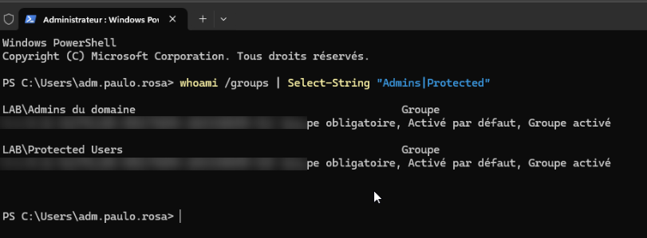

## 14. Heure du contrôleur de domaine

Kerberos refuse toute connexion si l'horloge a **plus de 5 minutes** d'écart.

- Constat : `w32tm /query /source` → **Free-running System Clock** (aucune source).
- Test avant réglage : `w32tm /stripchart /computer:10.10.10.254` → pfSense répond, écart **+21,5 s**
  après 3 jours (≈ 7 s/jour : la limite Kerberos serait atteinte en 6 à 7 semaines).
- Réglage : source = pfSense (un seul flux NTP vers Internet, celui du pare-feu).
- Résultat : source `10.10.10.254`, couche 3, écart 21,5 s → 8 s → 2 s → quelques ms.
  La correction est **progressive** (pas de saut d'heure) : voulu.

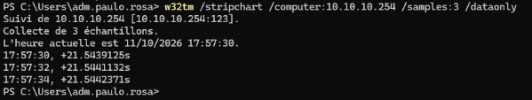
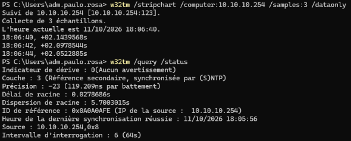

## 15. Pare-feu du VLAN Serveurs en moindre privilège

« Serveurs → tout » remplacé par les flux strictement nécessaires
([procédure](../docs/procedure-pare-feu.md), [matrice](../docs/matrice-des-flux.md)) :

| # | Action | Destination | Port | Raison |
| --- | --- | --- | --- | --- |
| 1 | Bloquer | Réseau d'administration | tout | |
| 2 | Bloquer | pfSense | TCP 443 | Interface web |
| 3 | Autoriser | pfSense | TCP/UDP 53 | Redirecteur DNS (TCP pour les grosses réponses) |
| 4 | Autoriser | pfSense | UDP 123 | Heure |
| 5 | Autoriser | `! RESEAUX_PRIVES` | `PORTS_WEB` (80, 443) | Mises à jour, **Internet uniquement** |
| 6 | Autoriser | tout | ICMP echo | Dépannage |

Méthode : sauvegarde de la config, photo de l'état initial, alias, nouvelles règles,
ancienne règle **désactivée** (retour arrière), tests, journaux, suppression le lendemain.

**Erreur rencontrée :** premier « Apply » avec l'ancienne règle « any » encore **au-dessus** :
les nouvelles règles restaient à 0 octet. La première règle qui correspond gagne.

| Test | Attendu | Résultat |
| --- | --- | --- |
| `Resolve-DnsName google.fr` | réponse | ✅ |
| `Test-NetConnection www.microsoft.com -Port 443` | True | ✅ |
| `ping 1.1.1.1` | réponses | ✅ |
| `Test-NetConnection 1.1.1.1 -Port 53` (DNS direct) | False | ✅ bloqué |
| `Test-NetConnection 192.168.1.254 -Port 80` (réseau privé) | False | ✅ bloqué |

Les blocages apparaissent dans le journal (« Default deny rule »), avec 5 tentatives TCP
chacune (retransmissions, d'où ~20 s par test bloqué).

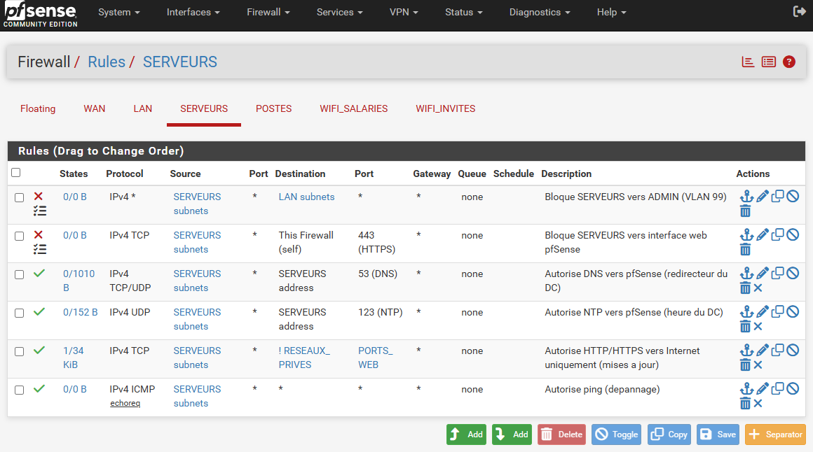
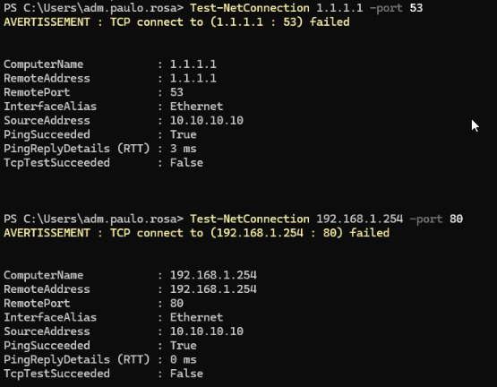
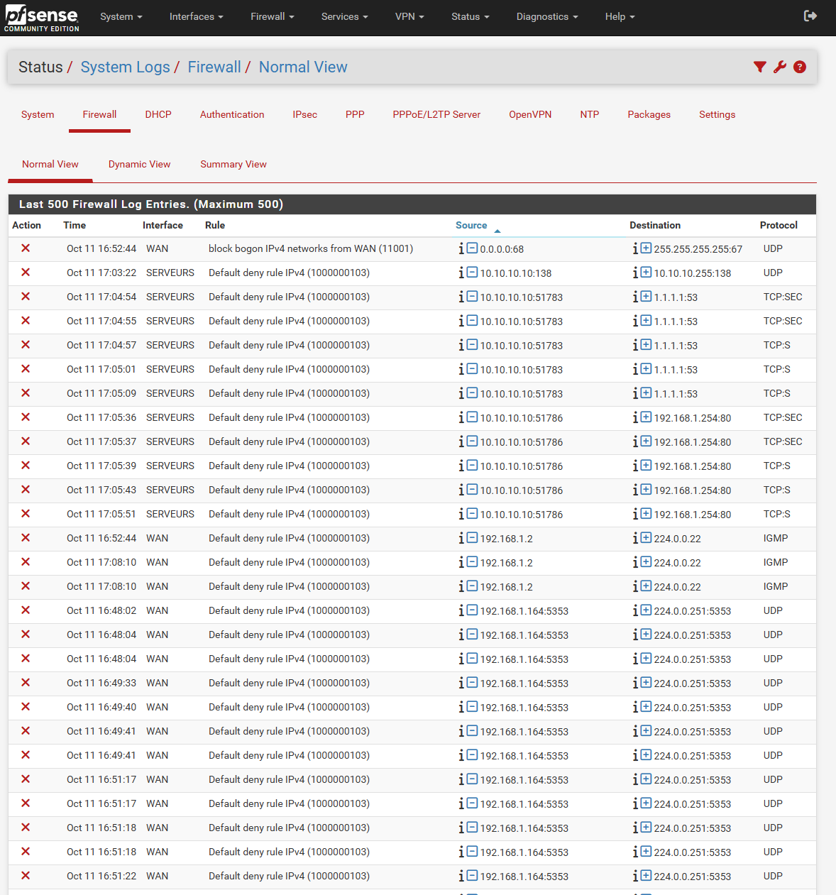

## 16. DHCP Windows et relais pfSense

Pourquoi sur Windows : le serveur doit être **autorisé dans l'AD** (protection contre un faux
DHCP) et il inscrit les postes dans le DNS.

1. Rôle **Serveur DHCP**, puis « Terminer la configuration DHCP » (groupes de sécurité +
   autorisation dans l'AD).
2. Étendue **POSTES-VLAN20** : 10.10.20.100 – .199, bail 8 jours, routeur 10.10.20.254,
   **DNS 10.10.10.10**, domaine lab.home.arpa.
3. pfSense : DHCP temporaire du VLAN 20 **désactivé d'abord** (le relais refuse de démarrer
   sinon), puis **relais DHCP** sur POSTES vers 10.10.10.10.

Le DHCP fonctionne par broadcast, qui ne traverse pas les VLAN : le relais transmet la demande.

Test depuis `test-poste` (redémarrée pour partir sans ancien bail) :

```
udhcpc: broadcasting discover
udhcpc: broadcasting select for 10.10.20.100, server 10.10.10.10
udhcpc: lease of 10.10.20.100 obtained from 10.10.10.10, lease time 691200
```

691 200 s = 8 jours. Le bail apparaît dans la console DHCP.

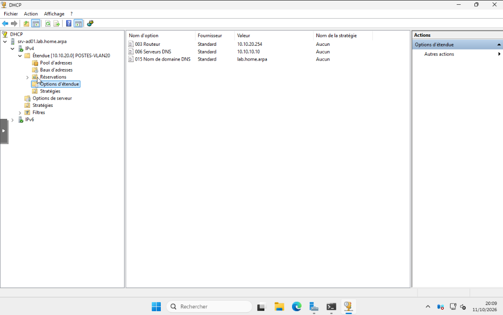
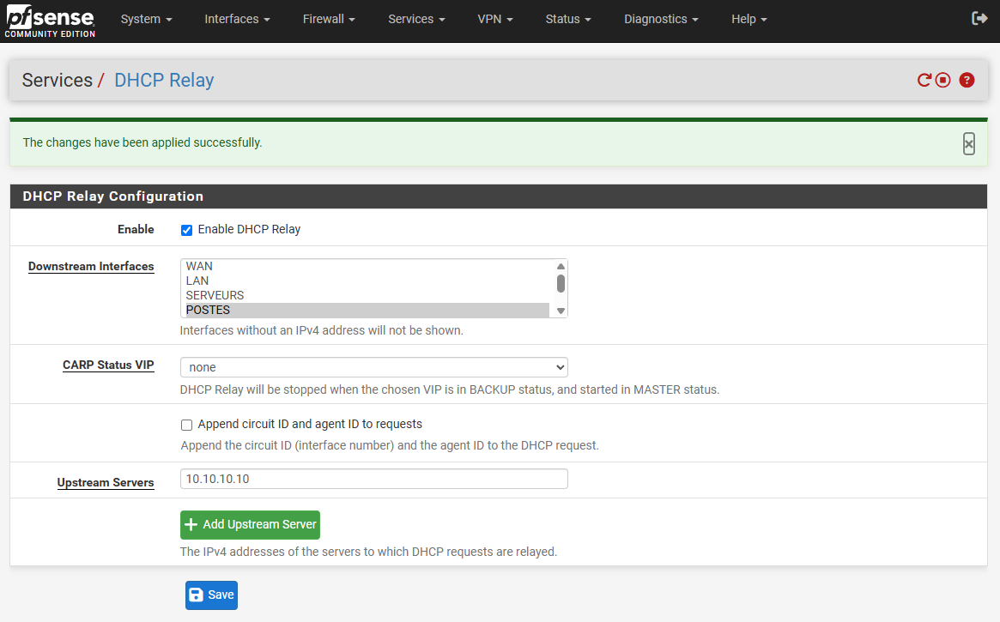
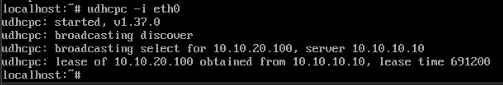

**Observation honnête :** j'avais prédit un blocage de la réponse du serveur par les nouvelles
règles. Il n'a pas eu lieu. pfSense crée des règles **automatiques** quand le relais est actif
(trouvées dans `/tmp/rules.debug`, ligne « allow access to DHCP relay »), ce qui explique
l'aller ; le retour reste à confirmer par une capture de paquets.

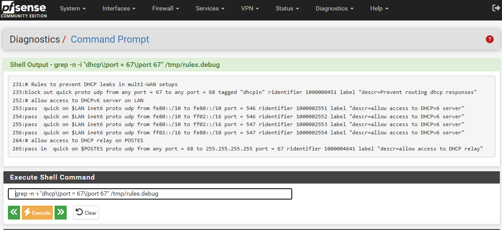

Effet de bord de `redirusr` : les groupes « Administrateurs DHCP » et « Utilisateurs DHCP »
sont arrivés dans AEROTRANS/Utilisateurs ; déplacés dans Groupes.

## 17. Groupes et import des salariés

- 7 groupes `GG_<Service>` (globaux, sécurité, avec description) à l'interface.
- 24 salariés depuis un **CSV** (comme un fichier envoyé par les RH) avec le script
  [`Import-AerotransUsers.ps1`](scripts/Import-AerotransUsers.ps1) : identifiant
  `prenom.nom` sans accent, bonne OU, bon groupe, mot de passe provisoire à changer à la
  première connexion. Script relançable sans risque (un compte existant est ignoré).
- Apport des fichiers dans la VM par une **ISO** (pas de copier-coller dans la console Proxmox).
- **Simulation d'abord** (`-WhatIf`) : 24 à créer, 0 erreur.

**Incident :** première exécution avec un mot de passe vide → 24 comptes créés **désactivés,
sans mot de passe ni groupe** ; à la relance, le script les a ignorés (« déjà présents »).

| Étape | Action |
| --- | --- |
| Constat | `Get-ADUser -Filter "Company -eq 'AEROTRANS'"` → 24 comptes, `Enabled = False` |
| Ciblage | Seuls les comptes marqués « AEROTRANS » par le script (le compte `paulo.rosa` n'est pas touché) |
| Correction | Suppression (ils passent par la corbeille AD), relance avec un mot de passe conforme |
| Contrôle | 24 comptes `Enabled = True`, `GG_Operations` = 14 membres |
| Prévention | Script v2 : supprime un compte créé à moitié et **s'arrête** au premier mot de passe refusé |

La simulation ne pouvait pas détecter ce problème : elle ne teste pas le mot de passe.

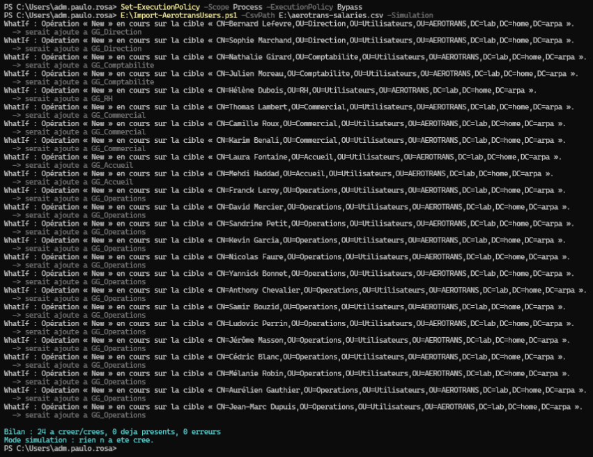
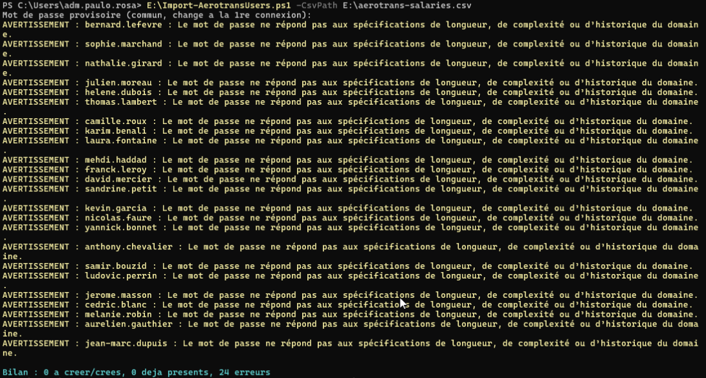
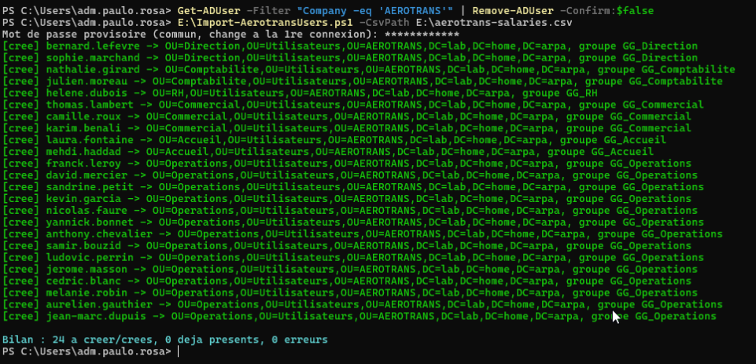

## 18. Politique de mots de passe

**Domaine** (Default Domain Policy, la seule modification faite dans cette GPO) :

| Paramètre | Valeur |
| --- | --- |
| Longueur minimale | 12 (7 par défaut) |
| Complexité | activée |
| Historique | 24 |
| Durée de vie | 1 à 365 jours |
| Verrouillage | 10 essais, 15 min, compteur 15 min |

365 jours : il n'y a pas de consensus. Les recommandations récentes déconseillent le
renouvellement forcé d'un mot de passe long, surtout avec double authentification ; sans
elle, beaucoup de PME gardent un renouvellement annuel.

**Admins** : stratégie affinée **PSO-Admins** (15 caractères, 180 jours), appliquée à
« Admins du domaine ». Vérification avec `Get-ADUserResultantPasswordPolicy` : `adm.paulo.rosa`
→ PSO-Admins ; `paulo.rosa` → rien (politique du domaine).

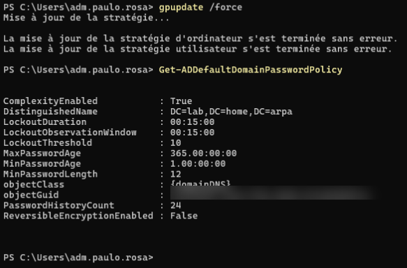
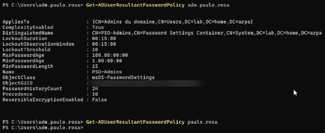

## 19. Première GPO : verrouillage après inactivité

`C_Securite_Verrouillage_Inactivite` : Configuration ordinateur → Options de sécurité →
« Ouverture de session interactive : **limite d'inactivité** de l'ordinateur » = **600 s**.

- Créée dans « Objets de stratégie de groupe », configurée, **puis** liée (jamais à moitié prête).
- Liée à **AEROTRANS/Ordinateurs** : un paramètre de *configuration ordinateur* ne s'applique
  qu'aux objets ordinateurs. Liée à une OU d'utilisateurs, elle ne ferait **rien**, sans erreur.
- Héritée par Postes-fixes et Portables.
- Piège évité : « seuil de verrouillage du **compte d'ordinateur** » (en *tentatives*) ouvert
  par erreur. Vérifier l'**unité** et l'onglet **Expliquer** avant de valider.
- Test réel avec le premier poste Windows 11 (brique 04).

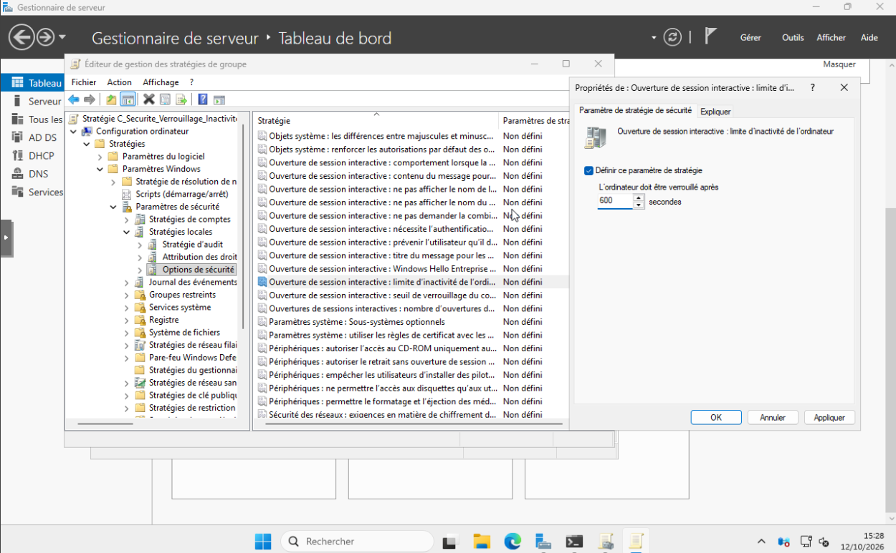
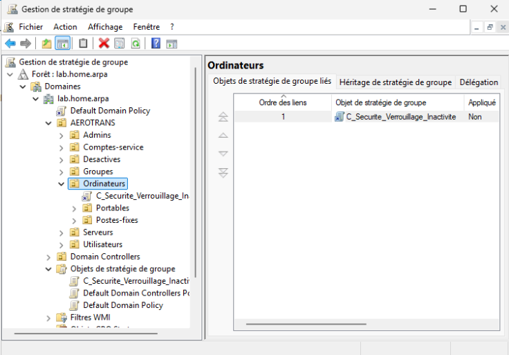

## 20. Équivalents PowerShell

```powershell
# Réseau et nom
Rename-Computer -NewName SRV-AD01 -Restart
New-NetIPAddress -InterfaceAlias Ethernet -IPAddress 10.10.10.10 -PrefixLength 24 -DefaultGateway 10.10.10.254
Set-DnsClientServerAddress -InterfaceAlias Ethernet -ServerAddresses 10.10.10.10

# Rôle et promotion (le mot de passe DSRM est demandé, jamais écrit dans le script)
# Valeurs acceptées pour les niveaux : Get-Help Install-ADDSForest -Parameter ForestMode
Install-WindowsFeature AD-Domain-Services -IncludeManagementTools
Install-ADDSForest -DomainName lab.home.arpa -DomainNetbiosName LAB `
  -ForestMode Win2025 -DomainMode Win2025 -InstallDns `
  -SafeModeAdministratorPassword (Read-Host "DSRM" -AsSecureString)

# DNS
Add-DnsServerForwarder -IPAddress 10.10.10.254
10,20,30,40,99 | % { Add-DnsServerPrimaryZone -NetworkId "10.10.$_.0/24" -ReplicationScope Domain -DynamicUpdate Secure }

# OU, corbeille, redirections
$base = "OU=AEROTRANS,DC=lab,DC=home,DC=arpa"
New-ADOrganizationalUnit -Name AEROTRANS -Path "DC=lab,DC=home,DC=arpa"
"Utilisateurs","Ordinateurs","Serveurs","Groupes","Admins","Comptes-service","Desactives" | % { New-ADOrganizationalUnit -Name $_ -Path $base }
"Direction","Comptabilite","RH","Commercial","Operations","Accueil","Informatique" | % { New-ADOrganizationalUnit -Name $_ -Path "OU=Utilisateurs,$base" }
"Postes-fixes","Portables" | % { New-ADOrganizationalUnit -Name $_ -Path "OU=Ordinateurs,$base" }
Enable-ADOptionalFeature -Identity "Recycle Bin Feature" -Scope ForestOrConfigurationSet -Target lab.home.arpa
redircmp "OU=Ordinateurs,$base"
redirusr "OU=Utilisateurs,$base"

# Compte admin
New-ADUser -Name "Paulo Rosa (admin)" -GivenName Paulo -Surname Rosa -SamAccountName adm.paulo.rosa `
  -UserPrincipalName adm.paulo.rosa@lab.home.arpa -Path "OU=Admins,$base" `
  -AccountPassword (Read-Host -AsSecureString) -Enabled $true -AccountNotDelegated $true
Add-ADGroupMember "Admins du domaine" -Members adm.paulo.rosa
Add-ADGroupMember "Protected Users" -Members adm.paulo.rosa

# Heure
w32tm /config /manualpeerlist:"10.10.10.254,0x8" /syncfromflags:manual /reliable:yes /update
Restart-Service w32time ; w32tm /resync /rediscover

# DHCP
Install-WindowsFeature DHCP -IncludeManagementTools
Add-DhcpServerSecurityGroup
Add-DhcpServerInDC -DnsName srv-ad01.lab.home.arpa -IPAddress 10.10.10.10
Add-DhcpServerv4Scope -Name POSTES-VLAN20 -StartRange 10.10.20.100 -EndRange 10.10.20.199 -SubnetMask 255.255.255.0 -LeaseDuration 8.00:00:00 -State Active
Set-DhcpServerv4OptionValue -ScopeId 10.10.20.0 -Router 10.10.20.254 -DnsServer 10.10.10.10 -DnsDomain lab.home.arpa

# Groupes et salariés
"Direction","Comptabilite","RH","Commercial","Operations","Accueil","Informatique" | % {
  New-ADGroup -Name "GG_$_" -GroupScope Global -GroupCategory Security -Path "OU=Groupes,$base" -Description "Salariés du service $_" }
.\Import-AerotransUsers.ps1 -CsvPath .\aerotrans-salaries.csv -Simulation
.\Import-AerotransUsers.ps1 -CsvPath .\aerotrans-salaries.csv

# Mots de passe
Set-ADDefaultDomainPasswordPolicy -Identity lab.home.arpa -MinPasswordLength 12 -ComplexityEnabled $true `
  -PasswordHistoryCount 24 -MinPasswordAge 1.00:00:00 -MaxPasswordAge 365.00:00:00 `
  -LockoutThreshold 10 -LockoutDuration 00:15:00 -LockoutObservationWindow 00:15:00
New-ADFineGrainedPasswordPolicy -Name PSO-Admins -Precedence 10 -MinPasswordLength 15 -ComplexityEnabled $true `
  -PasswordHistoryCount 24 -MinPasswordAge 1.00:00:00 -MaxPasswordAge 180.00:00:00 `
  -LockoutThreshold 10 -LockoutDuration 00:15:00 -LockoutObservationWindow 00:15:00 -ProtectedFromAccidentalDeletion $true
Add-ADFineGrainedPasswordPolicySubject PSO-Admins -Subjects "Admins du domaine"

# GPO (le paramètre « limite d'inactivité » correspond à la valeur de registre InactivityTimeoutSecs)
New-GPO -Name C_Securite_Verrouillage_Inactivite
Set-GPRegistryValue -Name C_Securite_Verrouillage_Inactivite -Key "HKLM\Software\Microsoft\Windows\CurrentVersion\Policies\System" `
  -ValueName InactivityTimeoutSecs -Type DWord -Value 600
New-GPLink -Name C_Securite_Verrouillage_Inactivite -Target "OU=Ordinateurs,$base"
```

## 21. Dépannages rencontrés

| Symptôme | Cause | Solution |
| --- | --- | --- |
| Aucun disque à l'installation | Pilote VirtIO SCSI absent | `vioscsi\2k25\amd64` |
| Adresse 169.254.x.x | Pas de DHCP dans le VLAN 10 | IP fixe |
| Ping OK mais « pas d'Internet » | DNS = lui-même, rôle DNS pas encore installé | DNS temporaire pfSense |
| Enregistrement SRV introuvable | Faute de frappe `_mcdcs` | `_msdcs` |
| `lab.home.arpa` dans les zones inversées | Windows classe tout `.arpa` en inversé | Sans effet ; en entreprise `ad.entreprise.fr` |
| `dcdiag \| Select-String "test"` sans verdict | Verdict sur la ligne suivante en français | Filtre `"ussi\|chou"` |
| Nouvelles règles à 0 octet | Règle « any » encore au-dessus | Ordre des règles, désactivation |
| 24 comptes désactivés | Mot de passe provisoire vide | Suppression ciblée, relance, script v2 |
| Journal pfSense décalé de 2 h | Journalisation démarrée en UTC avant le réglage du fuseau | Redémarrage de pfSense |
| 2 alertes rouges « Services » | `spice-agent` (sans affichage SPICE) et `InventorySvc` (s'arrête après sa tâche) en automatique | Démarrage manuel |

## 22. Écarts lab / entreprise

| Lab | Entreprise | Pourquoi l'écart |
| --- | --- | --- |
| Domaine `lab.home.arpa` | `ad.entreprise.fr` | Choix fait avant de connaître le piège `.arpa` ; renommer un domaine est lourd |
| **Un seul** contrôleur de domaine | **Au moins deux** | Si l'unique DC tombe, plus personne ne se connecte. SRV-AD02 prévu |
| DHCP sur un seul serveur | Basculement (failover) entre 2 serveurs | Même raison |
| Administration depuis la console Proxmox | Bureau à distance depuis le VLAN d'administration | Attend le switch (brique 02) |
| Mot de passe provisoire commun | Unique par salarié, remis en main propre | Simplification du lab |
| Interface graphique | Installation Core pour réduire la surface d'attaque | Apprentissage |
| Licence d'évaluation | Licence Standard + licences d'accès client (CAL) | Lab |

## 23. Utilisation en entreprise : 3 cas concrets

1. **Arrivée d'un salarié** : une ligne dans le CSV, le script crée le compte au bon endroit,
   dans le bon groupe ; le salarié change son mot de passe à sa première connexion.
2. **Départ d'un salarié** : compte désactivé et déplacé dans `Desactives` le jour même ;
   suppression après quelques mois. En cas d'erreur, la corbeille AD le restaure.
3. **Un serveur est compromis** : il ne peut joindre ni le réseau d'administration, ni un DNS
   extérieur, ni les autres VLAN ; ses tentatives apparaissent dans les journaux du pare-feu.

## 24. Questions d'entretien

- **Différence entre une OU et un groupe ?** L'OU range les objets et reçoit les GPO ; le
  groupe sert à donner des droits.
- **Pourquoi le DNS du DC pointe-t-il vers lui-même ?** C'est lui qui connaît la zone du
  domaine et les enregistrements SRV qui permettent aux postes de trouver un DC.
- **À quoi sert une zone inversée ?** IP → nom : journaux lisibles, certains outils l'exigent.
- **Pourquoi l'heure est-elle critique dans un domaine ?** Kerberos refuse plus de 5 minutes d'écart.
- **Pourquoi deux comptes par admin ?** Un clic sur un lien piégé avec un compte admin
  compromet tout le domaine.
- **Que fait Protected Users ?** Pas d'identifiants en mémoire, pas de NTLM, ticket de 4 h.
- **Pourquoi ne pas restaurer un instantané de DC ?** *USN rollback* : l'annuaire se
  désynchronise des autres DC.
- **Une GPO ne s'applique pas, que vérifies-tu ?** Liée à la bonne OU (ordinateur ou
  utilisateur selon la partie configurée), objet bien dans l'OU (pas dans `Computers`),
  filtrage de sécurité, puis `gpresult /r` et `gpupdate /force`.
- **Qu'est-ce qu'une FGPP ?** Une politique de mot de passe appliquée à un groupe, qui
  remplace celle du domaine (ici : 15 caractères pour les admins).
- **Pourquoi un relais DHCP ?** La demande DHCP est un broadcast qui ne sort pas de son VLAN.

## 25. Points en suspens

- 2e contrôleur de domaine (SRV-AD02) et basculement DHCP.
- Étendues DHCP des VLAN Wi-Fi (30, 40).
- Règles précises du VLAN Postes (ports AD) avec la brique 04.
- Test de la GPO de verrouillage sur un poste Windows 11 (brique 04).
- Confirmer le retour du relais DHCP par capture de paquets.
- Compte dédié pour les mises à jour DNS du serveur DHCP (`Set-DhcpServerDnsCredential`).
- Mot de passe du compte `Administrateur` dans un gestionnaire de mots de passe.
