# Brique 03 — Active Directory, DNS et DHCP sur Windows Server 2025

> **Tuto pas à pas pour quelqu'un qui débute complètement.**  
> Chaque action a son numéro. Chaque capture est placée **juste sous l'action qu'elle montre**, avec  
> une légende qui dit **ce que tu dois voir** et **quoi faire si ce n'est pas pareil**.  
> Les vraies erreurs faites pendant le lab sont gardées, avec leur correction.

---

## 🧾 Fiche de la brique

| | |
| --- | --- |
| **Objectif** | Créer **l'annuaire de l'entreprise** : un compte par salarié, des groupes par service, des règles de mot de passe, le **DNS** et le **DHCP** des postes |
| **Durée** | Environ **12 h** (en 4 ou 5 séances) |
| **Niveau** | Débutant, après les briques [00](../00-proxmox/) et [01](../01-pfsense/) |
| **Résultat** | `SRV-AD01` (10.10.10.10) contrôleur du domaine `lab.home.arpa`, DNS + DHCP, 16 OU, 7 groupes, 24 salariés importés, compte admin nominatif, politique de mots de passe, première GPO, pare-feu du VLAN Serveurs au moindre privilège |
| **Brique précédente** | [02 · switch](../02-switch-cisco/) — **brique suivante** : [04 · postes et GPO](../04-postes-gpo/) |

### Ce qu'il faut avant de commencer

| Élément | Détail |
| --- | --- |
| Proxmox + pfSense | Briques 00 et 01 (VLAN 10 Serveurs et 20 Postes créés) |
| ISO **Windows Server 2025** (évaluation, français) | Gratuite 180 jours : centre d'évaluation Microsoft (`https://www.microsoft.com/evalcenter`) |
| ISO **virtio-win** | Les pilotes Red Hat pour Proxmox : `https://fedorapeople.org/groups/virt/virtio-win/direct-downloads/stable-virtio/virtio-win.iso` |
| Ressources libres | 2 cœurs, **4 Go de RAM**, 60 Go de disque |
| Un coffre à mots de passe | Pour Administrateur, DSRM, adm.paulo.rosa |

### Ce que tu sauras faire à la fin

- Installer **Windows Server** dans Proxmox (pilotes VirtIO, UEFI, TPM).
- Créer un **domaine Active Directory** et vérifier qu'il est **en bonne santé**.
- Configurer le **DNS** (redirecteur, zones inversées) et le **DHCP** (étendue + relais).
- Ranger l'annuaire (**OU**, **groupes**), créer un **compte admin nominatif** bien protégé.
- **Importer des salariés** par script, et réparer proprement quand ça casse.
- Écrire une **politique de mot de passe** et une première **GPO**.
- Resserrer un **pare-feu** au **moindre privilège**, sans tout casser.

---

## 📖 Comment lire ce tuto

| Repère | Sens |
| --- | --- |
| 🎯 | **Le but** de l'étape, en une phrase |
| 💡 | **Pourquoi** on le fait, ou une explication pour comprendre |
| **3.2** | Une **action** à faire (étape 3, action 2) |
| 📸 | **La capture** de ce que tu dois voir, avec sa légende |
| ✅ | **Vérification** : comment savoir que c'est réussi |
| ❌ | **Si ça ne marche pas** (souvent l'erreur que j'ai vraiment eue) |
| 🏢 | **En entreprise**, ce qu'on ferait autrement |
| ⚠️ | Attention, piège ou risque |
| ⌨️ | L'**équivalent PowerShell** (tout est fait à l'interface ; les commandes sont aussi en annexe B) |

**Ouvrir PowerShell en administrateur** sur le serveur : clic droit sur **Démarrer** >
**Terminal (administrateur)**.

---

## 🗂️ Sommaire

- [Partie 0 — Comprendre avant de commencer](#partie-0--comprendre-avant-de-commencer)
- [Partie 1 — La machine virtuelle](#partie-1--la-machine-virtuelle) (étapes 1 et 2)
- [Partie 2 — Installer Windows Server](#partie-2--installer-windows-server) (étape 3)
- [Partie 3 — Le réseau du serveur](#partie-3--le-réseau-du-serveur) (étapes 4 à 7)
- [Partie 4 — Créer le domaine](#partie-4--créer-le-domaine) (étapes 8 à 11)
- [Partie 5 — Le DNS en détail](#partie-5--le-dns-en-détail) (étapes 12 à 14)
- [Partie 6 — L'organisation dans l'annuaire](#partie-6--lorganisation-aerotrans-dans-lannuaire) (étapes 15 et 16)
- [Partie 7 — Les comptes d'administration](#partie-7--les-comptes-dadministration) (étape 17)
- [Partie 8 — L'heure du contrôleur de domaine](#partie-8--lheure-du-contrôleur-de-domaine) (étape 18)
- [Partie 9 — Le pare-feu du VLAN Serveurs](#partie-9--le-pare-feu-du-vlan-serveurs-au-moindre-privilège) (étape 19)
- [Partie 10 — Le DHCP Windows et le relais](#partie-10--le-dhcp-windows-et-le-relais-pfsense) (étapes 20 à 22)
- [Partie 11 — Les groupes et les salariés](#partie-11--les-groupes-et-les-salariés) (étapes 23 et 24)
- [Partie 12 — Mots de passe et première GPO](#partie-12--les-mots-de-passe-et-la-première-gpo) (étapes 25 à 28)
- [Annexes](#annexes) : dépannage, PowerShell, écarts, entreprise, entretien, lexique

---

## Partie 0 — Comprendre avant de commencer

### 0.1 Le besoin

AEROTRANS (25 salariés) veut :

- **un compte par personne**, géré à **un seul endroit**, avec des règles de mot de passe ;
- des **droits par service** (la compta ne voit pas les dossiers RH) ;
- des **postes qui appliquent tout seuls** les règles de sécurité ;
- des **adresses IP distribuées automatiquement** aux postes ;
- de la **traçabilité** : savoir qui a fait quoi.

C'est le rôle d'un **annuaire Active Directory** (AD), avec son **DNS** et son **DHCP**.

### 0.2 Les mots à connaître, avec des images

| Mot | Ce que c'est | Image |
| --- | --- | --- |
| **Active Directory (AD)** | L'annuaire de l'entreprise : comptes, groupes, ordinateurs, règles | Le **registre du personnel** + le **règlement intérieur** |
| **Domaine** (`lab.home.arpa`) | L'ensemble géré par l'AD | L'**entreprise** elle-même |
| **Contrôleur de domaine (DC)** | Le serveur qui héberge l'AD et vérifie les mots de passe | L'**accueil** qui vérifie les badges |
| **OU** (unité d'organisation) | Un dossier pour **ranger** les objets et leur appliquer des règles | Les **services** sur l'organigramme |
| **Groupe** | Un ensemble de comptes, pour **donner des droits** | Une **liste de diffusion** : on donne l'accès à la liste, pas à chaque personne |
| **GPO** (stratégie de groupe) | Un paquet de réglages appliqué automatiquement aux PC ou aux utilisateurs d'une OU | Une **note de service** affichée dans un service |
| **DNS** | Traduit les **noms** en **adresses IP** | L'**annuaire téléphonique** |
| **DHCP** | Distribue automatiquement les adresses IP aux PC | Le **guichet** qui attribue les places de parking |
| **Kerberos** | Le système de « tickets » de connexion de l'AD | Un **bracelet** donné à l'entrée, valable quelques heures |

### 0.3 Pourquoi Windows Server

| Critère | Windows Server 2025 (AD DS) | Samba AD (Linux) | Entra ID seul (cloud) |
| --- | --- | --- | --- |
| Présence en PME et ESN | Standard du marché | Rare | En hausse, souvent en complément |
| GPO complètes | Oui | Partielles | Non (Intune à la place) |
| Postes sans Internet | Oui | Oui | Non |
| Coût | Licence (évaluation 180 j ici) | Gratuit | Abonnement |

**Choix : Windows Server 2025 Standard**, **avec l'interface graphique** pour apprendre.
🏢 En production, l'installation **Core** (sans interface) réduit la surface d'attaque et les mises à jour.

### 0.4 Le schéma de ce qu'on construit

```
                     pfSense (fw01)
     relais DHCP · NTP · résolveur DNS · refus par défaut
        |                                   |
   VLAN 10 Serveurs                    VLAN 20 Postes
   10.10.10.0/24                       10.10.20.0/24
        |                                   |
   SRV-AD01  10.10.10.10               PC (DHCP .100 → .199)
   AD DS · DNS · DHCP                  test-poste (VM 900)
   domaine lab.home.arpa
```


Adresses : [plan d'adressage](../docs/plan-adressage.md) · Flux : [matrice des flux](../docs/matrice-des-flux.md) ·
Noms : [conventions](../docs/conventions.md).

---

## Partie 1 — La machine virtuelle

### Étape 1 · Mettre les ISO dans Proxmox

🎯 Avoir dans Proxmox l'installateur de Windows **vérifié**, et les **pilotes** VirtIO.

**1.1** Proxmox > **local (pve01)** > **Images ISO** > **Téléverser** : choisis l'ISO **Windows Server
2025** (français), **Algorithme de hachage = SHA-256**, colle l'empreinte publiée par Microsoft >
**Téléverser**.


> 📸 **Ce que tu dois voir** : **Task viewer: Copier les données** avec **`checksum verified`** puis  
> **`TASK OK`**. L'ISO `26100.32230…SERVER_EVAL_x64FRE_fr-fr.iso` (7,62 Gio) apparaît dans la liste.

**1.2** Clique sur **Télécharger depuis une URL**, colle l'adresse de **virtio-win.iso** (voir
« Ce qu'il faut avant de commencer »), puis **Interroger l'URL** > **Télécharger**.

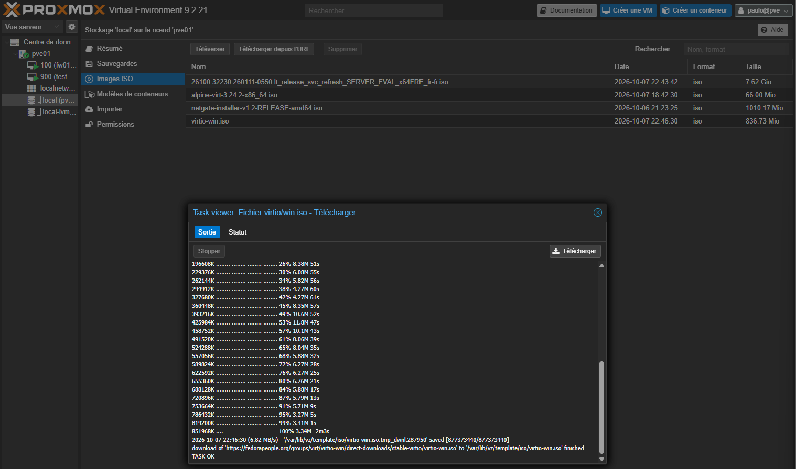

> 📸 **Ce que tu dois voir** : **Task viewer: Fichier virtio-win.iso - Télécharger**, la progression  
> jusqu'à **100 %**, puis **TASK OK**. `virtio-win.iso` (836 Mio) est dans la liste.

💡 **virtio-win** = les **pilotes** Red Hat pour les disques et cartes réseau virtuels de Proxmox.
Windows ne les connaît pas d'origine : sans eux, **il ne verra pas le disque** (étape 3.4).

---

### Étape 2 · Créer la VM 200 · SRV-AD01

🎯 Créer une VM conforme aux exigences de Windows Server 2025, directement dans le **VLAN 10**.

**2.1** **Créer une VM**, case **Avancé** cochée. Onglet **Général** :

| Champ | Valeur | Pourquoi |
| --- | --- | --- |
| ID de la VM | `200` | 2xx = serveurs |
| Nom | `SRV-AD01` | Convention `SRV-ROLENN` |
| Démarrer à l'amorçage | ✅ | ⚠️ **J'avais oublié** (voir 2.9) |
| Ordre de démarrage | `2` | Après le pare-feu (ordre 1) |

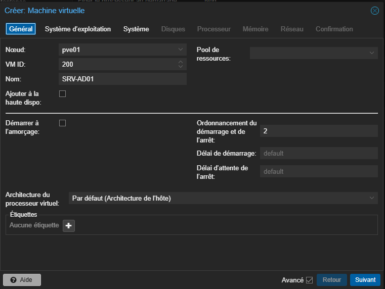

> 📸 **Ce que tu vois** : Nœud **pve01**, VM ID **200**, Nom **SRV-AD01**, ordre **2**.  
> ⚠️ Sur la capture, **Démarrer à l'amorçage n'est pas coché** : c'est l'oubli corrigé à 2.9.

**2.2** Onglet **Système d'exploitation** :

| Champ | Valeur |
| --- | --- |
| Utiliser une image de média (ISO) | l'ISO Windows Server 2025 |
| Type / Version | **Microsoft Windows** / **11/2022/2025** |
| ✅ Ajouter un périphérique contenant les pilotes VirtIO | Image ISO : `virtio-win.iso` |

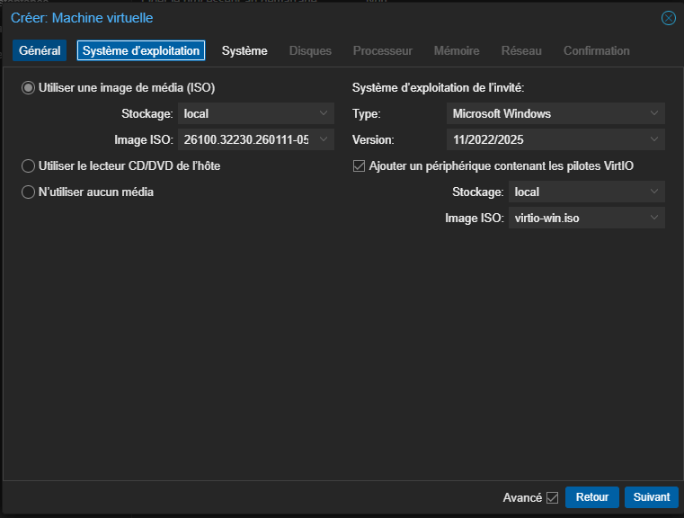

> 📸 **Ce que tu dois voir** : Type **Microsoft Windows**, version **11/2022/2025**, et la case  
> **Ajouter un périphérique contenant les pilotes VirtIO** cochée avec **virtio-win.iso**.  
> 💡 Proxmox ajoute ainsi un **2e lecteur CD** avec les pilotes, et adapte ses réglages à Windows.

**2.3** Onglet **Système** :

| Champ | Valeur | Pourquoi |
| --- | --- | --- |
| Machine | **q35** | Carte mère virtuelle moderne |
| BIOS | **OVMF (UEFI)** + ✅ Ajouter un disque EFI (stockage `local-lvm`) | Windows Server 2025 exige l'UEFI |
| ✅ Clefs de préinscription | | Démarrage **sécurisé** (*Secure Boot*) |
| Contrôleur SCSI | VirtIO SCSI single | |
| Agent QEMU | ✅ | Proxmox pourra éteindre proprement la VM et lire son IP |
| ✅ Ajouter un module TPM | `local-lvm`, version **v2.0** | Exigé par Windows Server 2025 (puce de sécurité virtuelle) |

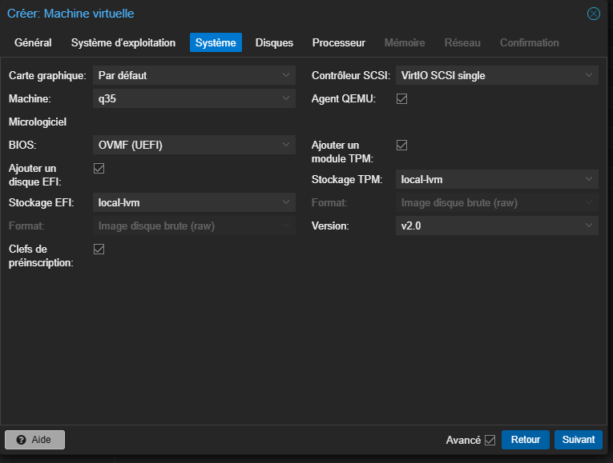

> 📸 **Ce que tu dois voir** : Machine **q35**, BIOS **OVMF (UEFI)**, disque EFI sur **local-lvm**,  
> clefs de préinscription ✅, contrôleur **VirtIO SCSI single**, Agent QEMU ✅, module TPM ✅ **v2.0**.

**2.4** Onglet **Disques** : bus **SCSI**, taille **60** Gio, ✅ **Abandonner** (*discard*), ✅ **IO
thread**, ✅ **Émulation de SSD**.

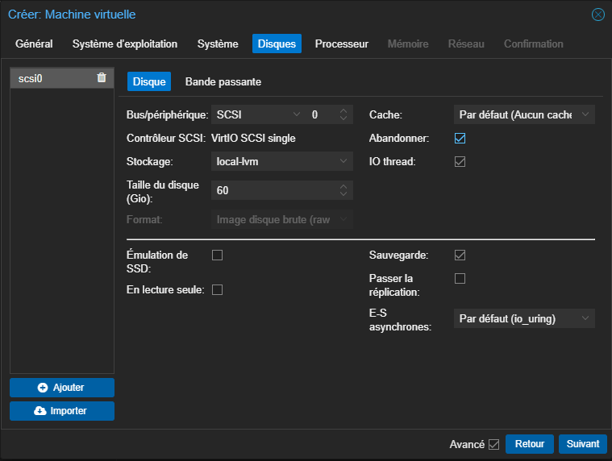

> 📸 **Ce que tu vois** : scsi0, **60** Gio, **Abandonner** ✅, **IO thread** ✅.  
> ⚠️ **Émulation de SSD n'est pas cochée** sur la capture : 2e oubli, corrigé à 2.9.  
> 💡 Avec « SSD », Windows sait qu'il est sur un SSD et optimise (TRIM au lieu de défragmentation).

**2.5** Onglet **Processeur** : **1** support, **2** cœurs, type **host**.

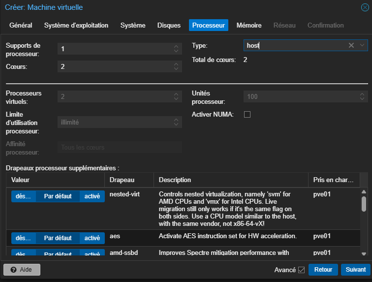

> 📸 **Ce que tu dois voir** : Cœurs **2**, Type **host** (le vrai processeur est transmis à la VM).

**2.6** Onglet **Mémoire** : **4096** Mio, ❌ **Élasticité mémoire (ballooning)** décochée.

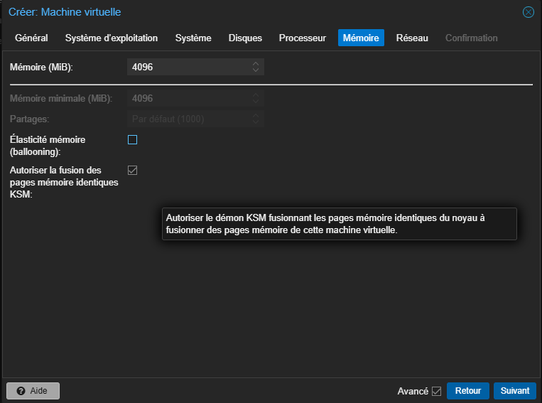

> 📸 **Ce que tu dois voir** : Mémoire **4096**, ballooning **décoché**.  
> 💡 Un contrôleur de domaine ne doit pas voir sa mémoire changer en cours de route.

**2.7** Onglet **Réseau** : pont **vmbr1**, **Étiquette de VLAN = 10**, modèle **VirtIO**,
❌ Pare-feu.


> 📸 **Ce que tu dois voir** : Pont **vmbr1**, Étiquette de VLAN **10**, Modèle **VirtIO  
> (paravirtualisé)**.  
> 💡 Avec le tag 10, le serveur est **directement dans le VLAN Serveurs**.

**2.8** Onglet **Confirmation** : **relis tout** avant de cliquer sur **Terminer**.

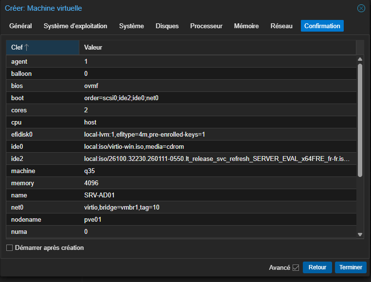

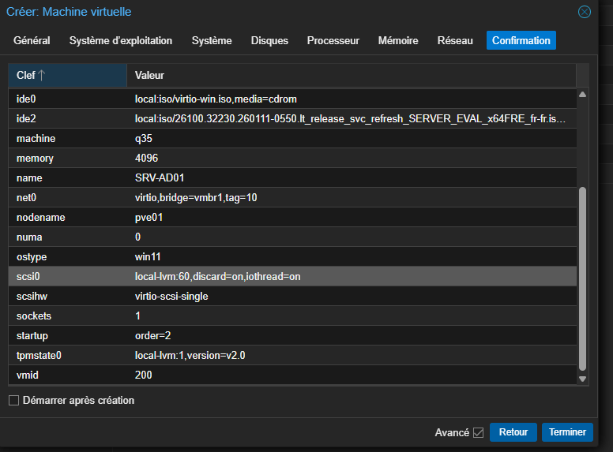

> 📸 **Ce que tu dois voir** (en 2 parties) : `agent 1`, `balloon 0`, `bios ovmf`, `cores 2`,  
> `cpu host`, `efidisk0 …pre-enrolled-keys=1`, `ide0 virtio-win.iso`, `ide2` l'ISO Windows,  
> `machine q35`, `memory 4096`, `name SRV-AD01`, **`net0 virtio,bridge=vmbr1,tag=10`**,  
> `ostype win11`, `scsi0 local-lvm:60,discard=on,iothread=on`, `startup order=2`,  
> `tpmstate0 …version=v2.0`, `vmid 200`.  
> ❌ **C'est en relisant ici** que j'ai vu les 2 oublis : pas de `ssd=1` sur scsi0, et pas de  
> `onboot 1`.

**2.9** Corrige après la création : **Matériel** > double-clic sur le disque > ✅ **Émulation de
SSD** ; **Options** > **Démarrer au démarrage** > Oui.

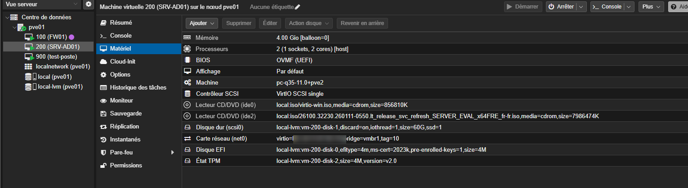

> 📸 **Ce que tu dois voir** : dans **Matériel**, la ligne **Disque dur (scsi0)** se termine par  
> **`ssd=1`**. On voit aussi le disque EFI, l'état TPM, les 2 lecteurs CD et la carte réseau `tag=10`.

👉 **Leçon** : **toujours relire le récapitulatif avant Terminer.**

---

## Partie 2 — Installer Windows Server

### Étape 3 · L'installation

**3.1** Démarre la VM, ouvre la **Console**. Si « Press any key to boot from CD » s'affiche, appuie
vite sur une touche.

**3.2** Langue **Français (France)**, format **Français (France)**, clavier **Français** > **Suivant** >
**Installer Windows Server**.

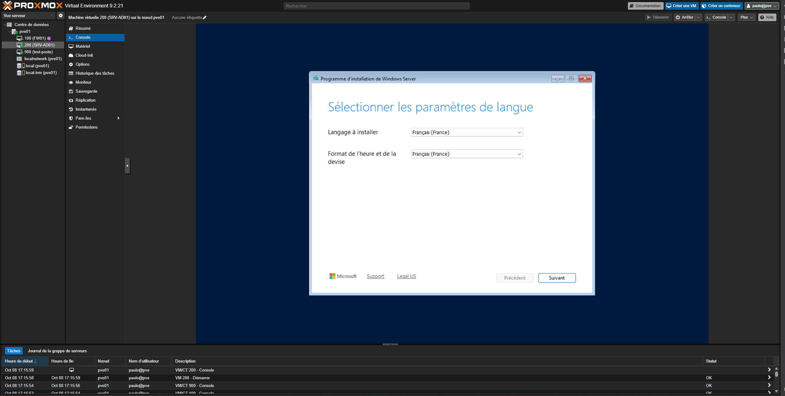

> 📸 **Ce que tu dois voir** : dans la console Proxmox, la fenêtre **Sélectionner les paramètres de  
> langue** avec **Français (France)**.

**3.3** Choisis l'édition **Windows Server 2025 Standard Evaluation (expérience utilisateur)** >
**Suivant**, puis accepte la licence.

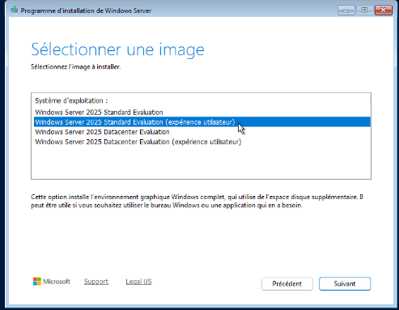

> 📸 **Ce que tu dois voir** : 4 éditions. La sélection est sur **Standard Evaluation (expérience  
> utilisateur)**.  
> 💡 « Expérience utilisateur » = **avec l'interface graphique**. Sans cette mention = version Core  
> (en ligne de commande uniquement).

**3.4** ❌ **Aucun disque n'est proposé** : normal, Windows ne connaît pas le contrôleur **VirtIO**.
Clique sur **Charger le pilote** > **Parcourir** > lecteur **virtio-win** > dossier
**`vioscsi\2k25\amd64`** > **OK**.


> 📸 **Ce que tu dois voir** : **Installer le pilote pour afficher le matériel**, chemin  
> `D:\vioscsi\2k25\amd64`, et le pilote **Red Hat VirtIO SCSI pass-through controller** sélectionné.  
> 💡 `2k25` = Windows Server 2025, `amd64` = 64 bits.

**3.5** Clique sur **Installer** (le pilote).

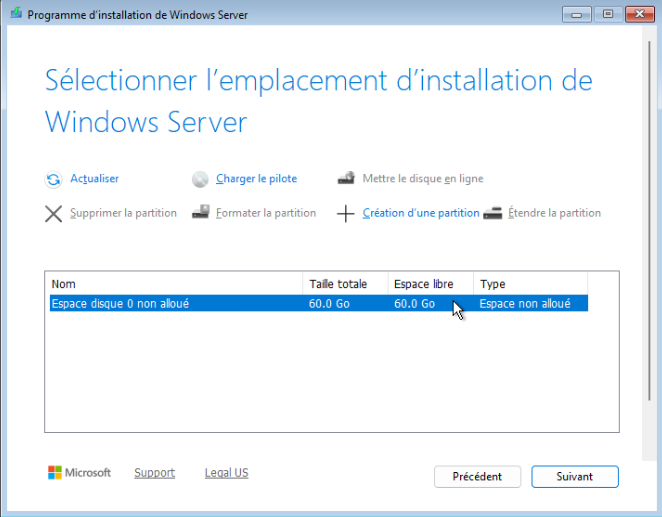

> 📸 **Ce que tu dois voir** : **Espace disque 0 non alloué**, **60.0 Go**. Le disque est visible ✅.  
> Sélectionne-le > **Suivant**.

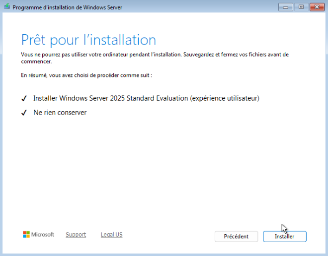

> 📸 **Ce que tu dois voir** : **Prêt pour l'installation** : Installer Windows Server 2025 Standard  
> Evaluation (expérience utilisateur), **Ne rien conserver**. Clique sur **Installer**.

**3.6** À la fin, Windows demande le mot de passe du compte **Administrateur** : génère-le dans le
coffre (14 caractères minimum), tape-le deux fois > **Terminer**.

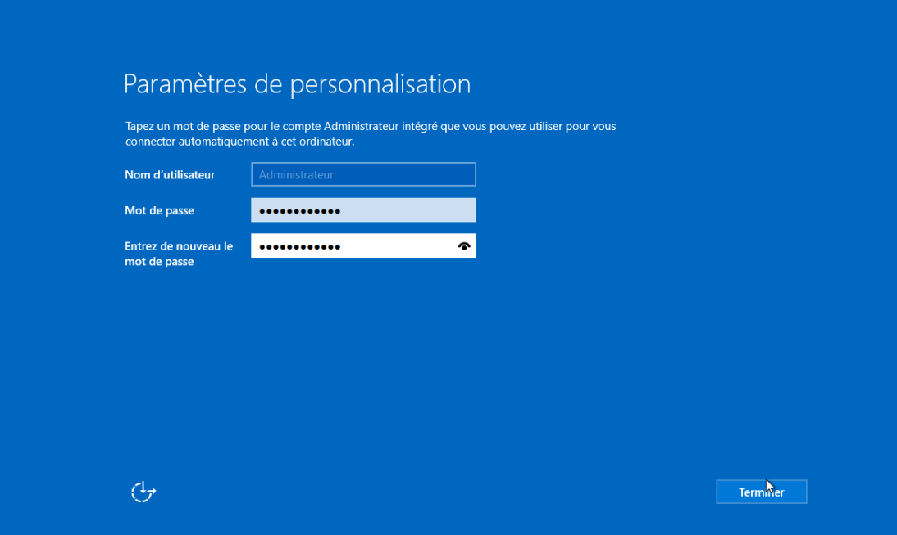

> 📸 **Ce que tu dois voir** : **Paramètres de personnalisation**, Nom d'utilisateur  
> **Administrateur**, mot de passe en points.

**3.7** Connecte-toi : **Ctrl + Alt + Suppr** n'arrive pas dans la VM si tu le tapes sur ton PC. Dans
la console Proxmox, utilise le **menu des touches** à gauche (bouton **A** ou **Ctrl-Alt-Del**).

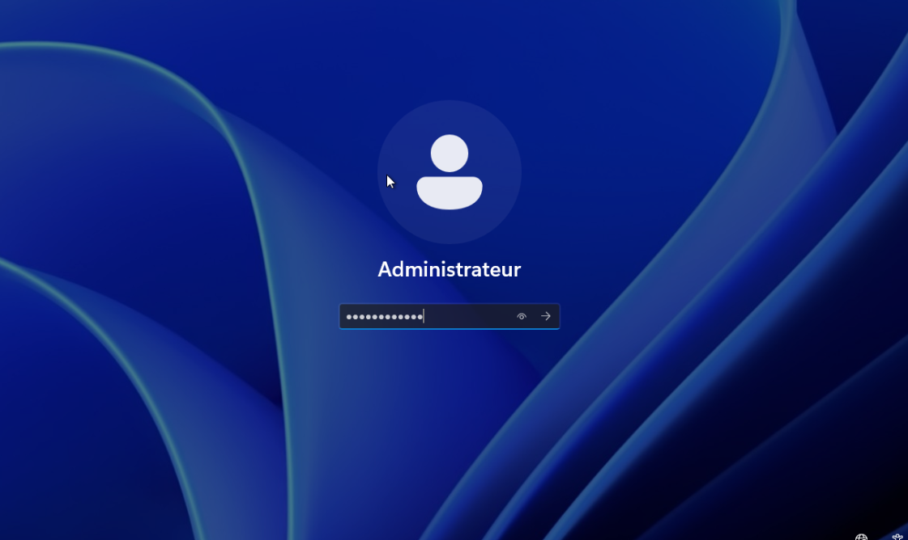

> 📸 **Ce que tu dois voir** : l'écran de connexion **Administrateur**.

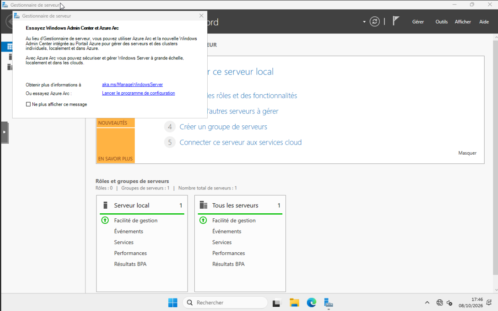

> 📸 **Ce que tu dois voir** : le **Gestionnaire de serveur** s'ouvre tout seul (une fenêtre propose  
> Windows Admin Center / Azure Arc : ferme-la).

**3.8** Ouvre le lecteur **virtio-win** dans l'Explorateur, double-clique sur
**virtio-win-guest-tools** et installe : tous les pilotes (réseau…) + l'**agent QEMU**.

> 📷 **Capture manquante** : l'installation de virtio-win-guest-tools.

✅ **Vérification** : Windows Server démarre, le Gestionnaire de serveur s'affiche.

---

## Partie 3 — Le réseau du serveur

### Étape 4 · Donner une IP fixe et un nom

🎯 Un serveur a **toujours** une adresse fixe et un nom définitif **avant** de devenir contrôleur de
domaine.

**4.1** Ouvre PowerShell et tape `ipconfig`.


> 📸 **❌ Ce que tu vois** : **Adresse d'autoconfiguration IPv4 169.254.95.19**, masque 255.255.0.0,  
> pas de passerelle.  
> 💡 C'est une adresse **APIPA** : Windows se la donne **tout seul** quand aucun serveur DHCP ne  
> répond. Normal : il n'y a pas de DHCP dans le VLAN 10, et **un serveur a de toute façon une IP  
> fixe**.

**4.2** **Gestionnaire de serveur** > **Serveur local** > clique sur le lien bleu à côté
d'**Ethernet** > clic droit sur la carte > **Propriétés** > **Protocole Internet version 4
(TCP/IPv4)** > **Propriétés** > **Utiliser l'adresse IP suivante** :

| Champ | Valeur | Pourquoi |
| --- | --- | --- |
| Adresse IP | `10.10.10.10` | Plan d'adressage |
| Masque | `255.255.255.0` | /24 |
| Passerelle | `10.10.10.254` | pfSense |
| DNS préféré | `10.10.10.10` | **Lui-même** : il sera le DNS du domaine (piège à l'étape 6) |

**OK** > **OK**.

**4.3** **Serveur local** > clic sur le **Nom de l'ordinateur** > **Modifier** > `SRV-AD01` > **OK** >
redémarrer.

💡 **Renommer avant la promotion** en DC : après, c'est beaucoup plus compliqué.

**4.4** Vérifie : `ipconfig /all`


> 📸 **Ce que tu dois voir** : **Nom de l'hôte SRV-AD01**, carte **Red Hat VirtIO Ethernet Adapter**,  
> **DHCP activé : Non**, **Adresse IPv4 10.10.10.10**, masque 255.255.255.0, **passerelle  
> 10.10.10.254**, **Serveurs DNS 10.10.10.10**.

---

### Étape 5 · Les premières règles pfSense du VLAN Serveurs

**5.1** Teste : `ping 10.10.10.254` puis `ping 1.1.1.1`.


> 📸 **❌ Ce que tu vois** : **Délai d'attente de la demande dépassé** ×4, **perte 100 %**, pour les  
> deux.  
> 💡 Sans règle sur l'interface SERVEURS, pfSense **bloque tout** (refus par défaut, brique 01).

**5.2** Dans pfSense : **Firewall** > **Rules** > onglet **SERVEURS** > **Add**. Règle 1 :

| Champ | Valeur |
| --- | --- |
| Action | **Block** |
| Protocol | Any |
| Source | SERVEURS subnets |
| Destination | **LAN subnets** (l'administration, VLAN 99) |
| Log | ✅ |
| Description | `Bloque SERVEURS vers ADMIN (VLAN 99)` |

**Save**.

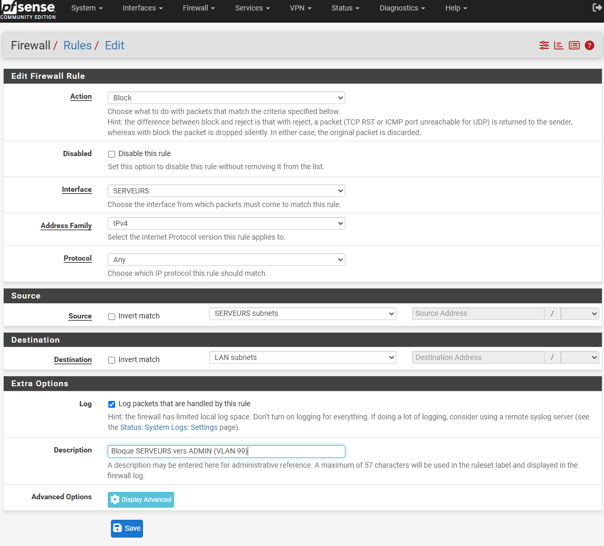

> 📸 **Ce que tu dois voir** : Action **Block**, Interface **SERVEURS**, Source **SERVEURS subnets**,  
> Destination **LAN subnets**, Log ✅, la description.

**5.3** Règle 2 (**Add** flèche vers le bas, pour la mettre en dessous) : **Block**, **TCP**, source
SERVEURS subnets, destination **This Firewall (self)**, port **HTTPS (443)**, Log ✅,
description `Bloque SERVEURS vers interface web pfSense`. **Save**.

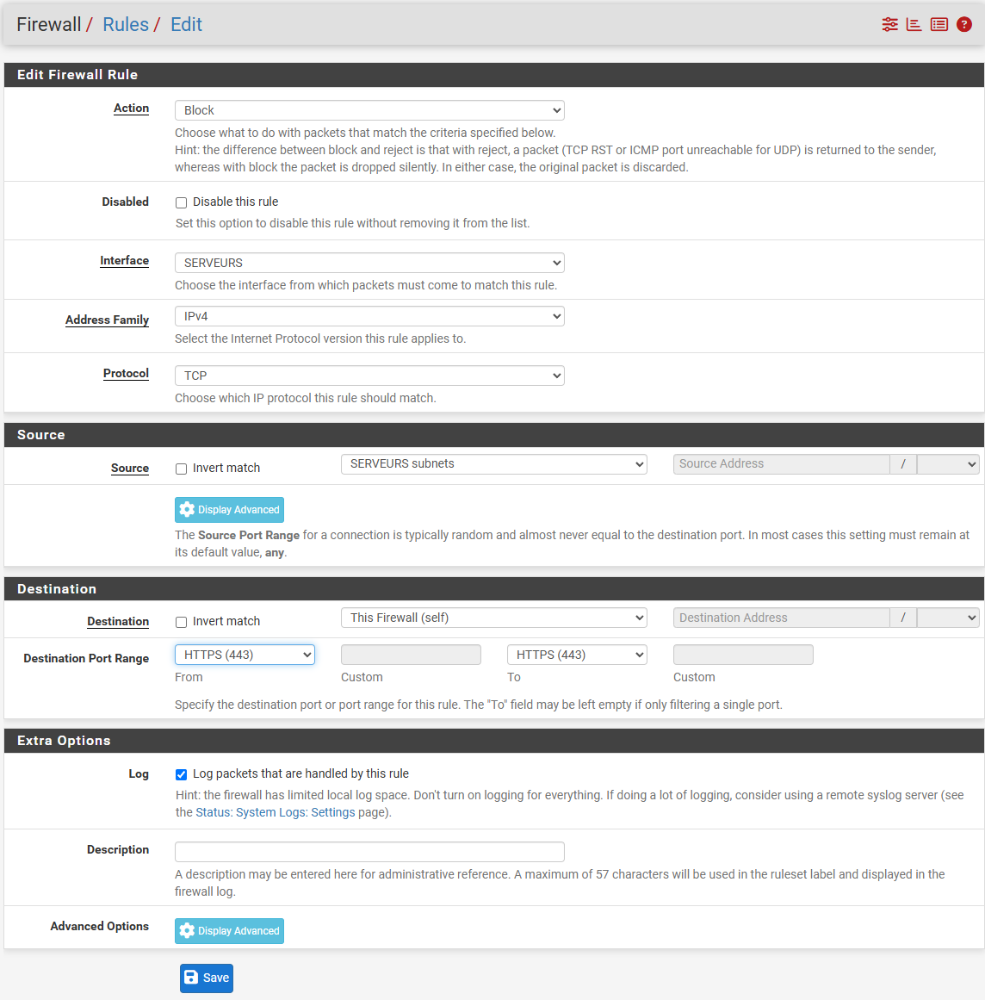

> 📸 **Ce que tu dois voir** : Block, **TCP**, destination **This Firewall (self)**, ports  
> **HTTPS (443)** à **HTTPS (443)**.

**5.4** Règle 3 : **Pass**, Any, source SERVEURS subnets, destination **Any**, Log ❌,
description `Autorise SERVEURS vers Internet`. **Save**.

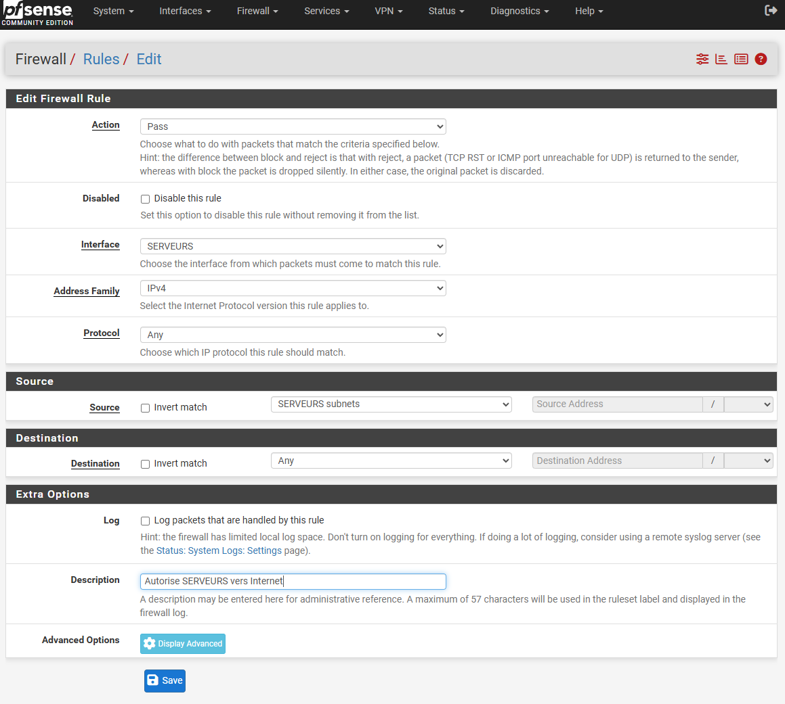

> 📸 **Ce que tu dois voir** : Action **Pass**, destination **Any**.  
> ⚠️ C'est une règle **provisoire** (le temps des mises à jour) : elle sera remplacée à l'étape 19.

**5.5** Clique sur **Apply Changes**.

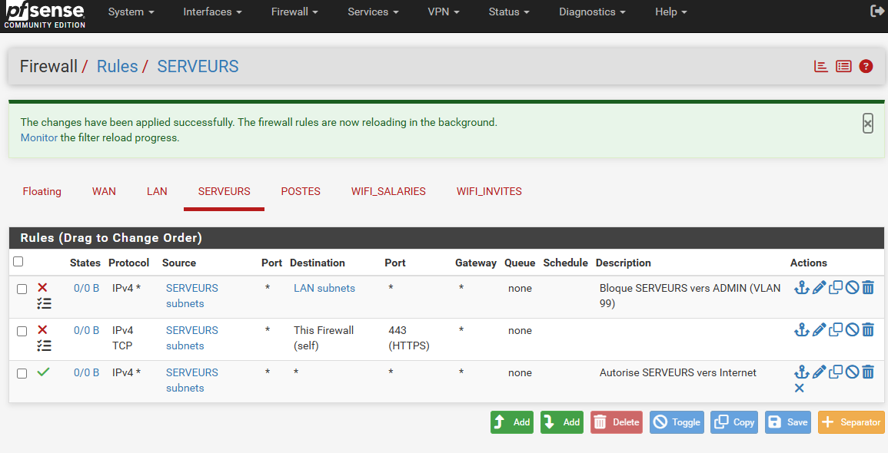

> 📸 **Ce que tu dois voir** : « The changes have been applied successfully », et les 3 règles dans  
> l'ordre : 2 **croix rouges** (Block) puis 1 **coche verte** (Pass).

| # | Action | Destination | Pourquoi |
| --- | --- | --- | --- |
| 1 | Block | LAN subnets (administration) | Un serveur compromis ne touche jamais aux équipements |
| 2 | Block | This Firewall, TCP 443 | Pas d'accès à l'interface web du pare-feu |
| 3 | Pass | any | Provisoire : mises à jour |

**5.6** Reteste depuis SRV-AD01.

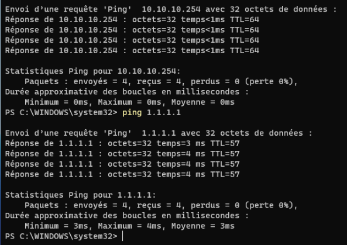

> 📸 **Ce que tu dois voir** : `ping 10.10.10.254` → 4 réponses **TTL=64** ; `ping 1.1.1.1` →  
> 4 réponses **TTL=57**. ✅

**5.7** Vérifie aussi que **les blocages marchent** :

```powershell
ping 10.10.99.254
Test-NetConnection 10.10.10.254 -Port 443
```

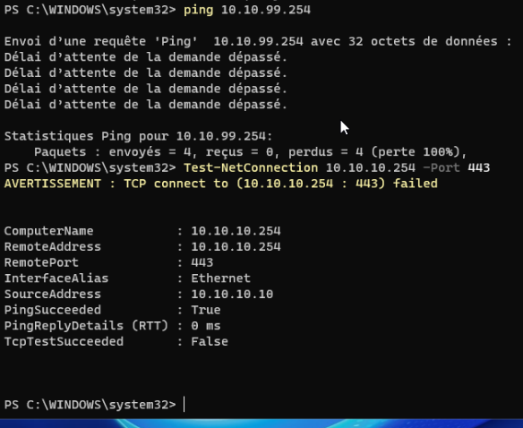

> 📸 **Ce que tu dois voir** : `ping 10.10.99.254` → **perte 100 %** (règle 1) ;  
> `Test-NetConnection … -Port 443` → **TcpTestSucceeded : False** (règle 2). ✅ Bloqué comme prévu.

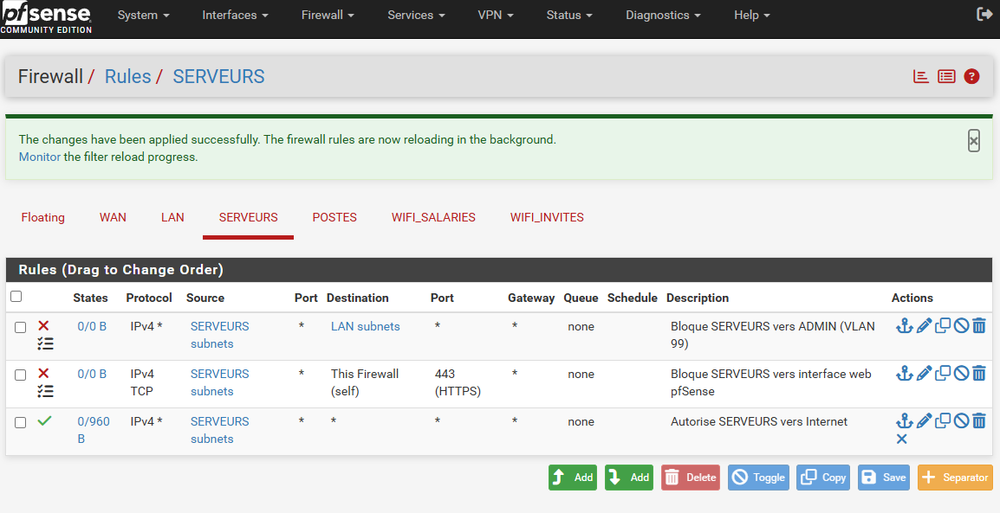

> 📸 **Ce que tu vois** : les 3 règles avec leurs **descriptions** ; la 3e montre déjà du trafic  
> (**0/960 B**).

---

### Étape 6 · Dépannage : « pas d'Internet » alors que le ping marche

❌ **Constat** : `ping 1.1.1.1` répond, mais Windows Update dit « pas d'Internet ».

**6.1** Teste la résolution de noms :

```powershell
Resolve-DnsName google.com
Resolve-DnsName google.com -Server 10.10.10.254
```


> 📸 **Ce que tu vois** : la 1re commande échoue en **rouge** (« Une connexion existante a dû être  
> fermée par l'hôte distant ») ; la 2e, qui interroge **pfSense**, répond (`google.com` A  
> 172.217.22.110).

💡 **Cause** : le DNS préféré est le serveur **lui-même**… mais le rôle DNS **n'est pas encore
installé**. Personne ne répond sur le port 53 (le port du DNS). Les **adresses** marchent, les
**noms** non.

**6.2** **Contournement** le temps des mises à jour : remets **DNS préféré = `10.10.10.254`**
(pfSense) dans les propriétés IPv4.

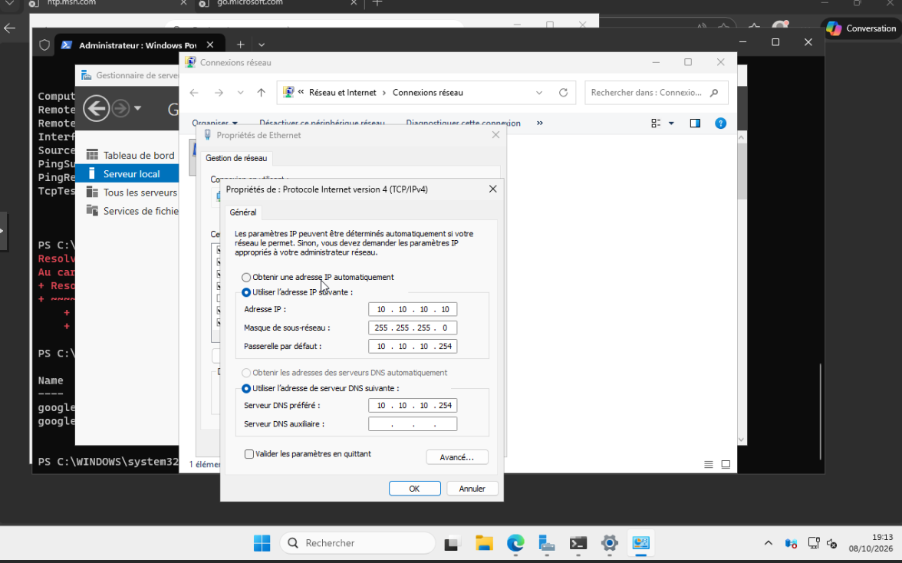

> 📸 **Ce que tu dois voir** : Propriétés IPv4 avec IP 10.10.10.10, passerelle 10.10.10.254, et  
> **Serveur DNS préféré 10.10.10.254**.

---

### Étape 7 · Mises à jour et instantané

**7.1** **Paramètres** > **Windows Update** > **Rechercher des mises à jour** > installer >
redémarrer, **jusqu'à** « Vous êtes à jour ».

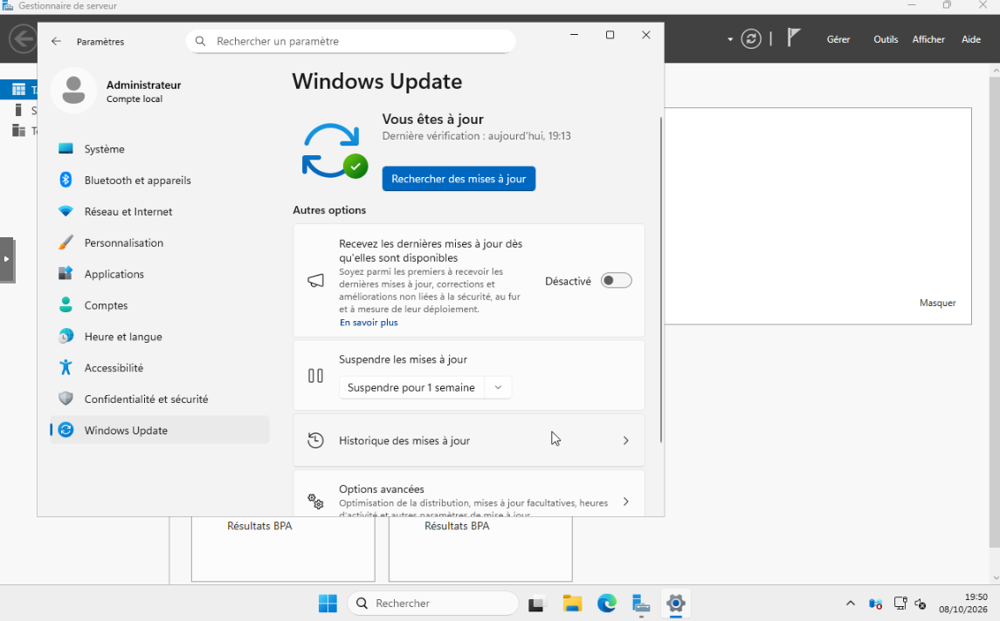

> 📸 **Ce que tu dois voir** : **Vous êtes à jour**, avec la date de la dernière vérification.

**7.2** **Remets le DNS préféré sur `10.10.10.10`** (lui-même), juste avant la promotion.

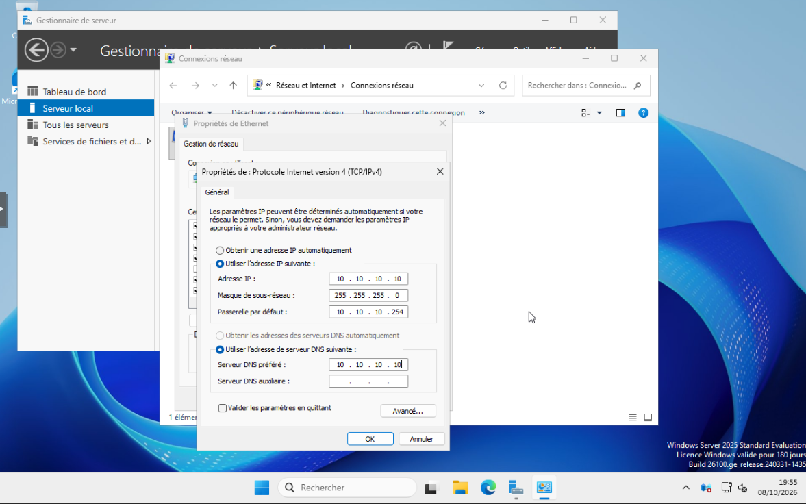

> 📸 **Ce que tu dois voir** : **Serveur DNS préféré 10.10.10.10**.

**7.3** **Éteins** la VM, puis Proxmox > **Instantanés** > **Prendre un instantané** :
nom `avant_promotion`, ❌ inclure la RAM.

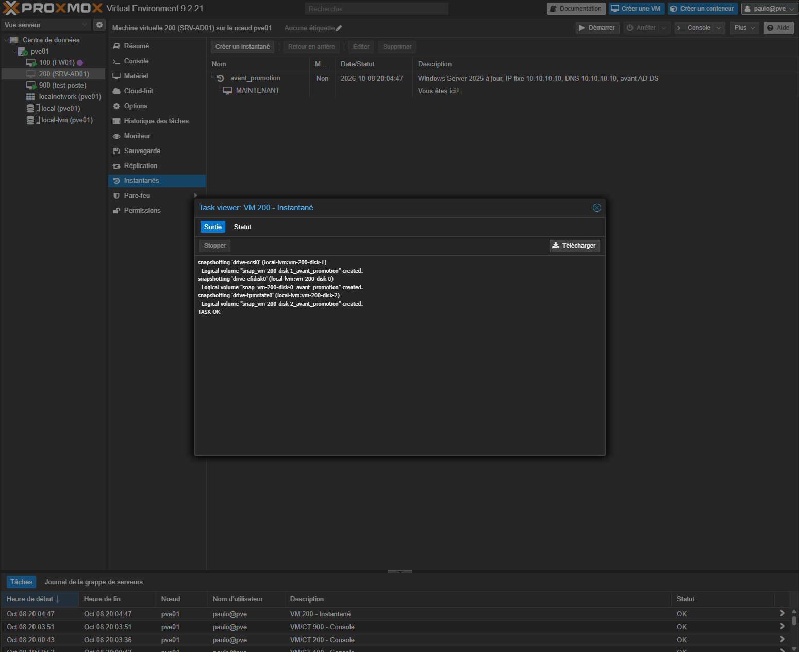

> 📸 **Ce que tu dois voir** : l'instantané **avant_promotion** dans la liste, et la tâche **TASK OK**.  
> 💡 VM éteinte = état cohérent, et l'instantané est plus léger sans la RAM.

⚠️ 🏢 En production, on ne restaure **jamais** un instantané de contrôleur de domaine : l'annuaire
« reviendrait dans le passé » et se désynchroniserait des autres DC (*USN rollback*). On utilise une
vraie **sauvegarde de l'état système** (brique 07). Ici, c'est un filet **avant** la promotion
seulement.

---

## Partie 4 — Créer le domaine

### Étape 8 · Installer le rôle AD DS

**8.1** **Gestionnaire de serveur** > **Gérer** > **Ajouter des rôles et fonctionnalités** >
**Suivant** ×3 (installation basée sur un rôle, serveur SRV-AD01).

**8.2** Coche **Services AD DS** (*Services de domaine Active Directory*). Une fenêtre propose les
outils : clique sur **Ajouter des fonctionnalités**.

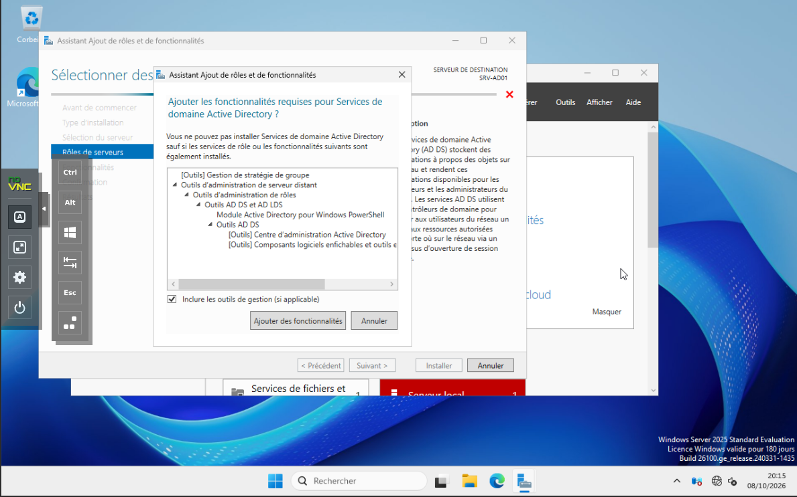

> 📸 **Ce que tu dois voir** : « Ajouter les fonctionnalités requises pour Services de domaine Active  
> Directory ? » avec la liste : Gestion de stratégie de groupe, module Active Directory pour  
> PowerShell, Centre d'administration Active Directory… et ✅ **Inclure les outils de gestion**.

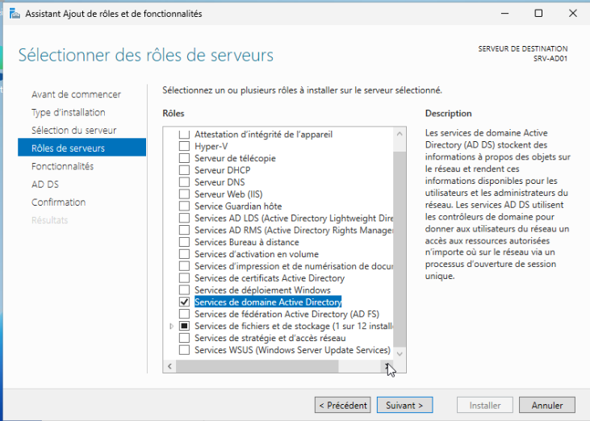

> 📸 **Ce que tu dois voir** : **Services de domaine Active Directory** coché dans la liste des rôles.  
> 💡 On ne coche **ni DNS ni DHCP** ici : le DNS est installé par la promotion, le DHCP vient plus tard.

**8.3** **Suivant** jusqu'à **Confirmation**, coche **Redémarrer automatiquement si nécessaire** >
**Installer**.

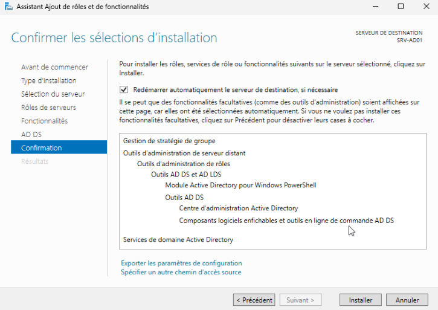

> 📸 **Ce que tu dois voir** : **Confirmer les sélections d'installation** avec Gestion de stratégie  
> de groupe, Outils AD DS, Centre d'administration AD et **Services de domaine Active Directory**.

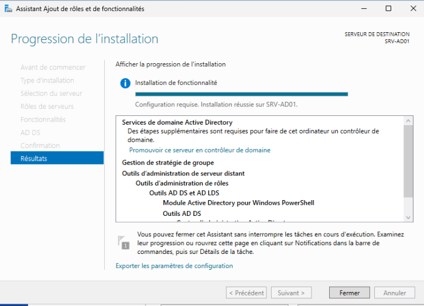

> 📸 **Ce que tu dois voir** : **Configuration requise. Installation réussie sur SRV-AD01**, et le  
> lien bleu **Promouvoir ce serveur en contrôleur de domaine**.

---

### Étape 9 · Promouvoir le serveur en contrôleur de domaine

**9.1** En haut du Gestionnaire de serveur, clique sur le **drapeau jaune** ⚠️.

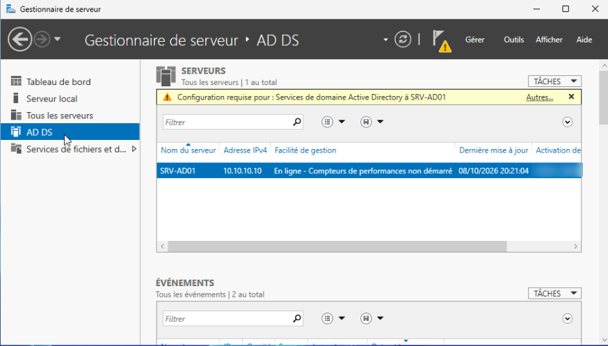

> 📸 **Ce que tu vois** : dans **AD DS**, le bandeau jaune « Configuration requise pour : Services de  
> domaine Active Directory à SRV-AD01 ».

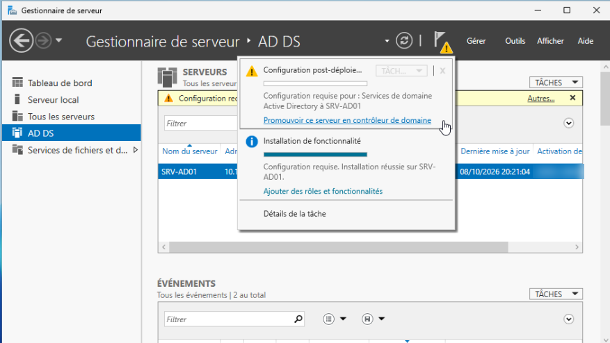

> 📸 **Ce que tu dois voir** : sous le drapeau, **Configuration post-déploiement** et le lien  
> **Promouvoir ce serveur en contrôleur de domaine**. Clique dessus.

**9.2** **Configuration de déploiement** : **Ajouter une nouvelle forêt**, nom de domaine racine
`lab.home.arpa` > **Suivant**.

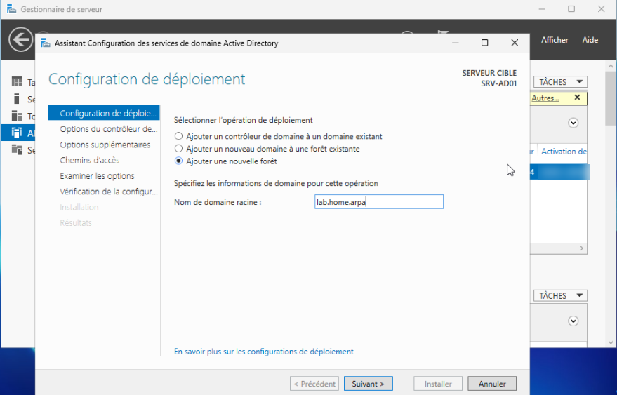

> 📸 **Ce que tu dois voir** : ⦿ **Ajouter une nouvelle forêt** et **Nom de domaine racine :  
> lab.home.arpa**.  
> 💡 Une **forêt** contient un ou plusieurs domaines. Ici c'est le tout premier : on crée la forêt.

**9.3** **Options du contrôleur de domaine** :

| Réglage | Valeur | Pourquoi |
| --- | --- | --- |
| Niveaux fonctionnels forêt / domaine | **Windows Server 2025** | Pas d'ancien DC à gérer : on prend le plus récent |
| Serveur DNS | ✅ | Le DC sera aussi le DNS |
| Catalogue global (GC) | ✅ | Index de toute la forêt, obligatoire sur le 1er DC |
| Contrôleur en lecture seule (RODC) | ❌ | Pour les agences peu sûres |
| Mot de passe **DSRM** | généré, rangé au coffre | Le mot de passe du **mode de restauration** de l'annuaire : **différent** de celui de l'Administrateur |


> 📸 **Ce que tu dois voir** : niveaux **Windows Server 2025**, **Serveur DNS** ✅, **Catalogue  
> global** ✅, RODC ❌, mot de passe DSRM en points.

**9.4** **Options DNS** : un avertissement dit qu'on ne peut pas créer de délégation. **Normal** : il
n'existe pas de zone parente `home.arpa` à qui déléguer. **Suivant**.

**9.5** **Options supplémentaires** : nom NetBIOS **`LAB`** > **Suivant**.

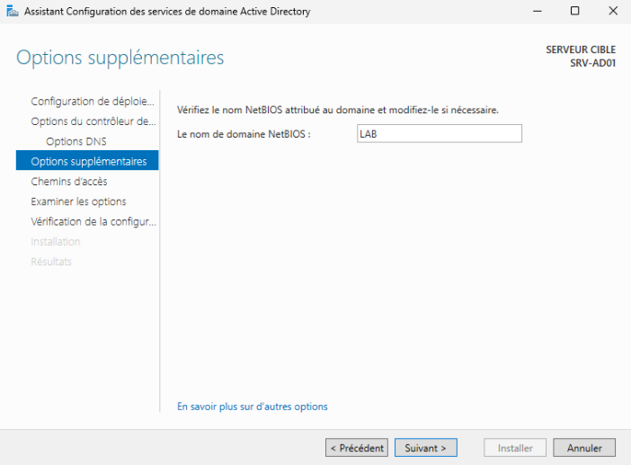

> 📸 **Ce que tu dois voir** : **Le nom de domaine NetBIOS : LAB**.  
> 💡 NetBIOS = l'ancien format de nom, celui de `LAB\compte`.

**9.6** **Chemins d'accès** : laisse par défaut (`C:\WINDOWS\NTDS`, `C:\WINDOWS\SYSVOL`).

**9.7** **Examiner les options** : relis tout > **Suivant**.

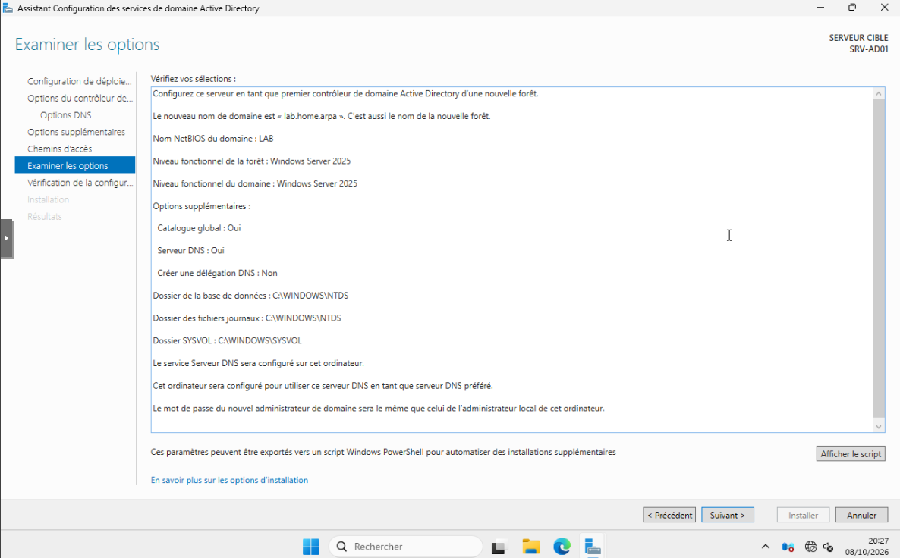

> 📸 **Ce que tu dois voir** : « premier contrôleur de domaine d'une nouvelle forêt »,  
> `lab.home.arpa`, NetBIOS `LAB`, niveaux 2025, Catalogue global : Oui, Serveur DNS : Oui, Créer une  
> délégation DNS : Non.  
> 💡 Le bouton **Afficher le script** donne la commande PowerShell équivalente (voir annexe B).

**9.8** **Vérification de la configuration requise** : clique sur **Installer**. Le serveur
redémarre tout seul.


> 📸 **Ce que tu dois voir** : **Ce serveur a été correctement configuré en tant que contrôleur de  
> domaine**, puis « Vous allez être déconnecté » > **Fermer**.

**9.9** Après le redémarrage, connecte-toi.

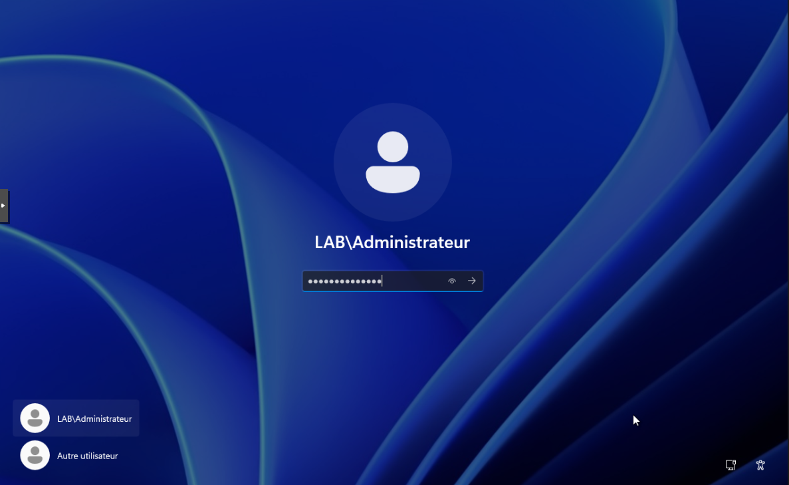

> 📸 **Ce que tu dois voir** : l'écran de connexion affiche **LAB\Administrateur** : le serveur est  
> contrôleur du domaine `LAB` ✅.

---

### Étape 10 · Vérifier le domaine

**10.1** Dans PowerShell :

```powershell
Get-ADDomain | Select-Object Name, DNSRoot, NetBIOSName, DomainMode
Resolve-DnsName -Type SRV _ldap._tcp.dc._msdcs.lab.home.arpa
```

- `Get-ADDomain` : les informations du domaine ;
- `Resolve-DnsName … -Type SRV` : cherche l'enregistrement **SRV** qui permet aux PC de **trouver un
  DC** (« où est le service LDAP du domaine ? »).

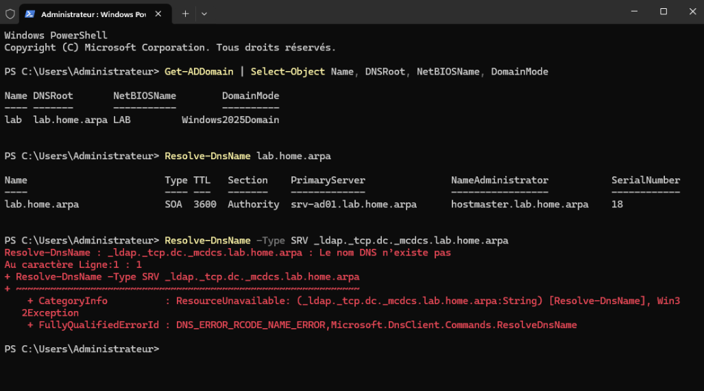

> 📸 **❌ Ce que j'ai eu** : `Get-ADDomain` répond bien (**lab, lab.home.arpa, LAB,  
> Windows2025Domain**), mais la recherche SRV échoue en rouge : **« Le nom DNS n'existe pas »**.  
> Regarde bien : j'avais tapé **`_mcdcs`** au lieu de **`_msdcs`**. Une lettre suffit.


> 📸 **Ce que tu dois voir** (bien tapé) : **`_ldap._tcp.dc._msdcs.lab.home.arpa  SRV`** →  
> **`srv-ad01.lab.home.arpa`**, port **389** ; et `lab.home.arpa` → **10.10.10.10**.  
> ✅ Un PC du domaine saura **trouver le contrôleur de domaine**.

---

### Étape 11 · Le redirecteur DNS (pour Internet)

💡 Le DC connaît `lab.home.arpa`, mais pas `google.com`. On lui dit : « ce que tu ne connais pas,
demande-le à pfSense ».

**11.1** **Outils** > **DNS** > clic droit sur **SRV-AD01** > **Propriétés** > onglet
**Redirecteurs** > **Modifier**.

**11.2** Tape `10.10.10.254` > **Entrée** (Windows vérifie l'adresse) > **OK** > **OK**.

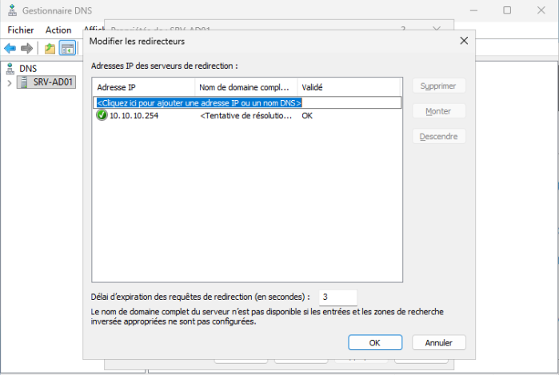

> 📸 **Ce que tu dois voir** : **Modifier les redirecteurs**, ligne **10.10.10.254** avec une coche  
> verte, Validé **OK**.  
> 💡 « Tentative de résolution… » : Windows cherche le **nom** de pfSense ; il ne le trouvera pas  
> (pas de zone inversée encore), ce n'est pas grave.

**11.3** Teste : `Resolve-DnsName google.com`

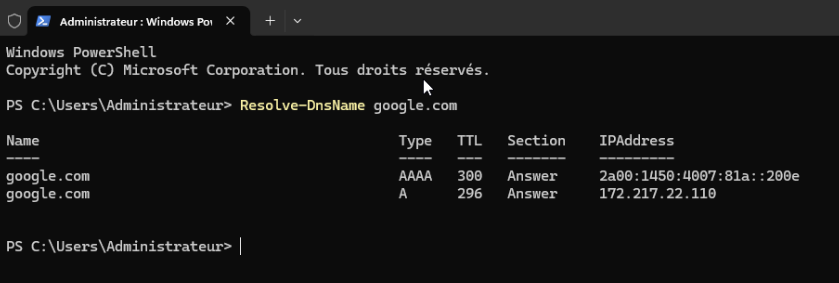

> 📸 **Ce que tu dois voir** : `google.com` **AAAA** et **A 172.217.22.110**. ✅ Le DC sait résoudre  
> Internet.

---

## Partie 5 — Le DNS en détail

### Étape 12 · Les zones inversées (IP → nom)

💡 Une zone **directe** traduit `srv-ad01` → `10.10.10.10`. Une zone **inversée** fait l'inverse
(`10.10.10.10` → `srv-ad01`) : journaux lisibles, et certains outils l'exigent. **Une par VLAN.**

**12.1** **Outils** > **DNS**. Déplie **SRV-AD01**.

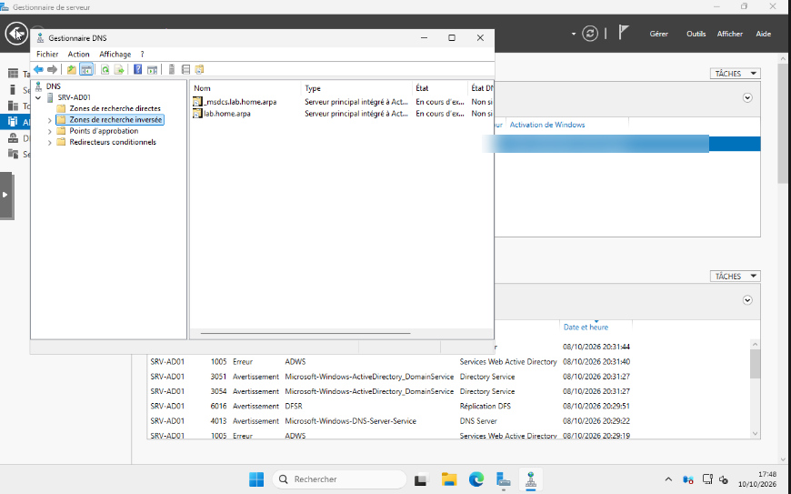

> 📸 **Ce que tu vois** : le **Gestionnaire DNS** avec Zones de recherche directes / inversées,  
> Points d'approbation, Redirecteurs conditionnels. ⚠️ Les zones `_msdcs.lab.home.arpa` et  
> `lab.home.arpa` sont rangées… dans **inversées** : c'est le piège de l'étape 13.

**12.2** Clic droit sur **Zones de recherche inversée** > **Nouvelle zone** :

| Écran | Choix | Pourquoi |
| --- | --- | --- |
| Type | **Zone principale**, ✅ Enregistrer dans Active Directory | Répliquée avec l'AD, sécurisée |
| Réplication | Tous les serveurs DNS de **ce domaine** | |
| Type de recherche | IPv4 | |
| ID réseau | `10.10.10` | La zone s'appellera `10.10.10.in-addr.arpa` : les chiffres sont **à l'envers** |
| Mise à jour dynamique | ⭐ **N'autoriser que les mises à jour dynamiques sécurisées** | Seule une machine **membre du domaine** peut inscrire son nom : un intrus ne peut pas se déclarer `srv-ad01` |

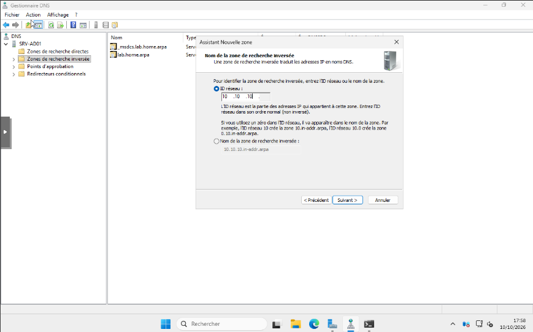

> 📸 **Ce que tu dois voir** : **Nom de la zone de recherche inversée**, ⦿ ID réseau **10 . 10 . 10**,  
> et en dessous le nom calculé **10.10.10.in-addr.arpa**.

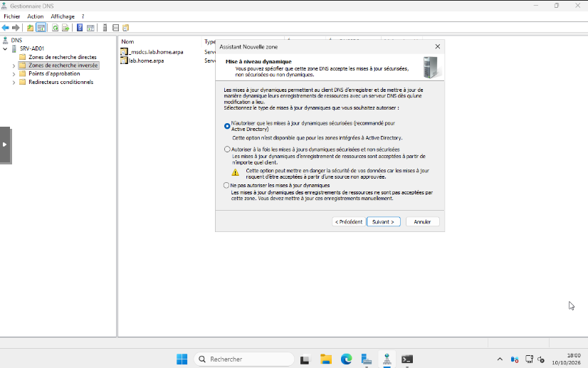

> 📸 **Ce que tu dois voir** : **Mise à niveau dynamique**, ⦿ **N'autoriser que les mises à jour  
> dynamiques sécurisées (recommandé pour Active Directory)**.

**12.3** **Suivant** > **Terminer**.

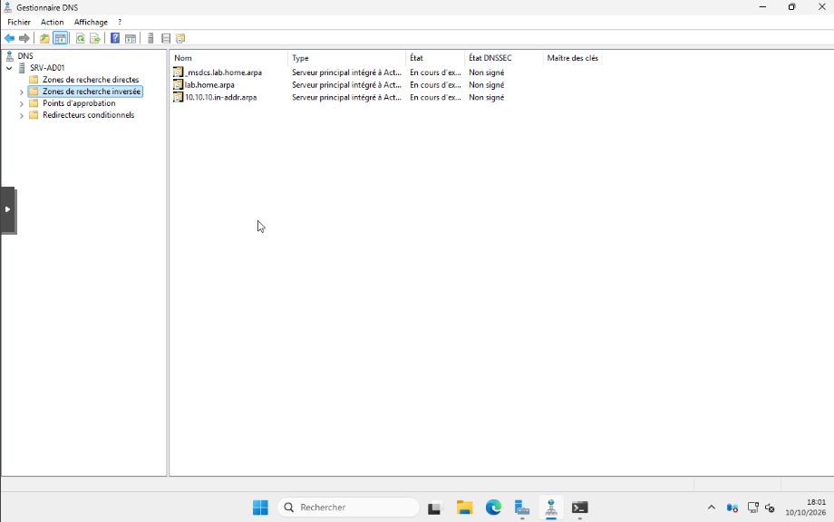

> 📸 **Ce que tu dois voir** : la zone **10.10.10.in-addr.arpa** dans la liste, « Serveur principal  
> intégré à Active Directory ».

**12.4** ⌨️ Les 4 autres zones (20, 30, 40, 99) en PowerShell, une par ligne :

```powershell
Add-DnsServerPrimaryZone -NetworkId "10.10.20.0/24" -ReplicationScope "Domain" -DynamicUpdate "Secure"
Add-DnsServerPrimaryZone -NetworkId "10.10.30.0/24" -ReplicationScope "Domain" -DynamicUpdate "Secure"
Add-DnsServerPrimaryZone -NetworkId "10.10.40.0/24" -ReplicationScope "Domain" -DynamicUpdate "Secure"
Add-DnsServerPrimaryZone -NetworkId "10.10.99.0/24" -ReplicationScope "Domain" -DynamicUpdate "Secure"
Get-DnsServerZone | Format-Table ZoneName, ZoneType, IsReverseLookupZone, IsDsIntegrated
```

💡 `Add-DnsServerPrimaryZone` crée la zone avec **les mêmes options** qu'à l'interface (domaine,
mises à jour sécurisées). Plus rapide et sans erreur de clic pour 4 zones identiques.


> 📸 **Ce que tu dois voir** : les 4 commandes sans erreur, puis la liste avec **10.10.10, 20.10.10,  
> 30.10.10, 40.10.10, 99.10.10.in-addr.arpa**, toutes **IsDsIntegrated = True**.

**12.5** **Teste** :

```powershell
nslookup 10.10.10.10
```

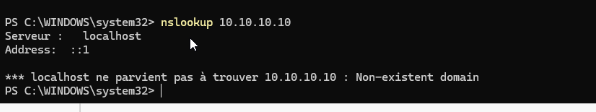

> 📸 **Ce que tu vois** : **« localhost ne parvient pas à trouver 10.10.10.10 : Non-existent  
> domain »**. Normal : la zone est **vide**, le serveur ne s'y est pas encore inscrit.

**12.6** Demande au serveur de s'inscrire dans le DNS, attends une minute, et reteste :

```powershell
ipconfig /registerdns
nslookup 10.10.10.10
```

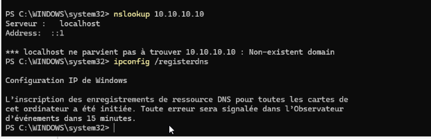

> 📸 **Ce que tu dois voir** : « L'inscription des enregistrements de ressource DNS pour toutes les  
> cartes de cet ordinateur a été initiée ».


> 📸 **Ce que tu dois voir** : **Nom : SRV-AD01.lab.home.arpa**, **Address : 10.10.10.10** ✅.

---

### Étape 13 · 🪤 Le piège de `home.arpa`

❌ **Constat** : la zone `lab.home.arpa` est rangée dans **Zones de recherche inversée**, et la zone
directe paraît vide.

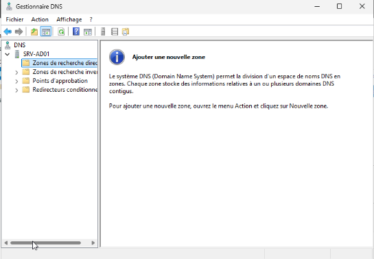

> 📸 **Ce que tu vois** : **Zones de recherche directes** sélectionné, et à droite seulement  
> « Ajouter une nouvelle zone » : aucune zone affichée.


> 📸 **Ce que tu vois** : dans **Zones de recherche inversée** : `_msdcs.lab.home.arpa`, les 5 zones  
> `…in-addr.arpa` **et** `lab.home.arpa`.

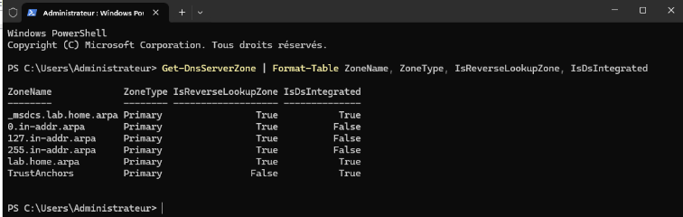

> 📸 **La preuve en PowerShell** (`Get-DnsServerZone`) : `lab.home.arpa` et `_msdcs.lab.home.arpa` ont  
> **IsReverseLookupZone = True**.

💡 **Cause** : Windows considère que **toute zone qui finit par `.arpa` est inversée** (parce que les
zones inversées s'appellent `….in-addr.arpa`). **La résolution fonctionne** (étape 10 et 12) ; seul
le **classement** (et certains menus) est faux.

🏢 En entreprise, on choisit un **sous-domaine d'un nom qu'on possède** : `ad.aerotrans.fr`. Ni
`.local`, ni `home.arpa`. Renommer un domaine existant est trop lourd : on garde pour le lab, et on
documente.

---

### Étape 14 · La santé du contrôleur de domaine

**14.1** Lance le bilan de santé en mode silencieux :

```powershell
dcdiag /q
```

💡 `dcdiag` fait une trentaine de tests du DC ; `/q` = n'affiche **que les erreurs**.

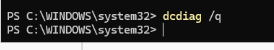

> 📸 **Ce que tu dois voir** : **rien** entre la commande et l'invite suivante = **aucune erreur** ✅.

**14.2** Pour le **prouver** (rien affiché pourrait aussi vouloir dire « la commande n'a pas
tourné »), liste les verdicts :

```powershell
dcdiag | Select-String "ussi|chou"
```


> 📸 **❌ Mon 1er essai** avec le filtre `"test"` : on voit les noms des tests (« Le test  
> Connectivity »…), mais **pas le verdict**. En français, le verdict est écrit sur la **ligne  
> suivante**.


> 📸 **Ce que tu dois voir** avec `"ussi|chou"` (garde les lignes contenant « ré**ussi** » ou  
> « é**chou**é ») : **28 lignes « … a réussi »** et **aucune** « a échoué » ✅.

---

## Partie 6 — L'organisation AEROTRANS dans l'annuaire

### Étape 15 · Les conventions d'abord, puis les OU

🎯 Avant de créer quoi que ce soit, on **écrit les règles de nommage** ([conventions.md](../docs/conventions.md)) :
n'importe quel admin qui arrivera après doit s'y retrouver.

**15.1** **Outils** > **Utilisateurs et ordinateurs Active Directory**. Regarde le dossier **Users**.


> 📸 **Ce que tu vois** : `lab.home.arpa` avec Builtin, **Computers**, Domain Controllers,  
> ForeignSecurityPrincipals, Managed Service Accounts, **Users** (et dedans les groupes intégrés :  
> Admins du domaine, Protected Users…).  
> 💡 `Users` et `Computers` ont une icône de **dossier simple** : ce ne sont **pas des OU**. On ne  
> peut pas y lier de GPO. On crée donc notre propre arborescence.

**15.2** Clic droit sur `lab.home.arpa` > **Nouveau** > **Unité d'organisation** > nom `AEROTRANS`,
✅ **Protéger le conteneur contre une suppression accidentelle** > **OK**.


> 📸 **Ce que tu dois voir** : **Nouvel objet - Unité d'organisation**, Créer dans  
> `lab.home.arpa/`, Nom **AEROTRANS**, case de protection ✅.  
> 💡 Avec la protection, même un admin du domaine ne peut pas supprimer l'OU sans décocher la case  
> d'abord.

**15.3** ⌨️ Les 16 sous-OU en PowerShell (protection activée par défaut) :

```powershell
$base = "OU=AEROTRANS,DC=lab,DC=home,DC=arpa"
"Utilisateurs","Ordinateurs","Serveurs","Groupes","Admins","Comptes-service","Desactives" | % { New-ADOrganizationalUnit -Name $_ -Path $base }
"Direction","Comptabilite","RH","Commercial","Operations","Accueil","Informatique" | % { New-ADOrganizationalUnit -Name $_ -Path "OU=Utilisateurs,$base" }
"Postes-fixes","Portables" | % { New-ADOrganizationalUnit -Name $_ -Path "OU=Ordinateurs,$base" }
```

| Morceau | Sens |
| --- | --- |
| `$base = "…"` | Une **variable** qui garde l'adresse de l'OU AEROTRANS, pour ne pas la retaper |
| `"A","B" \| % { … }` | « Pour chaque nom de la liste, fais… » (`%` = `ForEach-Object`, `$_` = le nom en cours) |
| `New-ADOrganizationalUnit -Name $_ -Path …` | Crée l'OU à cet endroit |


> 📸 **Ce que tu vois** : la définition de `$base` puis la ligne des 7 OU de services, sans erreur.


> 📸 **Ce que tu vois** : la ligne `Postes-fixes`, `Portables` dans `OU=Ordinateurs`.

❌ **Erreurs repérées avant d'appuyer sur Entrée** : variable `$base` écrasée (chemin sans
AEROTRANS), un accent, `Operation` sans « s », `Acceuil`, un guillemet non fermé.
👉 **On relit une commande avant de la lancer**, surtout quand elle crée 16 objets.

**15.4** Dans la console, **F5** (actualiser).


> 📸 **Ce que tu dois voir** : **AEROTRANS** > Admins, Comptes-service, Desactives, Groupes,  
> **Ordinateurs** (Portables, Postes-fixes), Serveurs, **Utilisateurs** (Accueil, Commercial,  
> Comptabilite, Direction, Informatique, Operations, RH).

---

### Étape 16 · La corbeille AD et les redirections

**16.1** Active la **corbeille AD** (PowerShell) :

```powershell
Enable-ADOptionalFeature -Identity "Recycle Bin Feature" -Scope ForestOrConfigurationSet -Target "lab.home.arpa"
```

Réponds **`O`** (Oui) à la confirmation.


> 📸 **Ce que tu dois voir** : l'**AVERTISSEMENT** « l'activation de Recycle Bin Feature … est une  
> action **irréversible** », puis **Confirmer** et ta réponse `O`.  
> 💡 Équivalent à l'interface : **Centre d'administration Active Directory** > `lab (local)` >  
> **Activer la corbeille**.  
> 💡 Sans corbeille, un compte supprimé par erreur est perdu avec ses groupes. Avec, il **revient  
> tel quel**.

**16.2** Les **redirections** : où arrivent les nouveaux PC et comptes.

```powershell
redircmp "OU=Ordinateurs,OU=AEROTRANS,DC=lab,DC=home,DC=arpa"
redirusr "OU=Utilisateurs,OU=AEROTRANS,DC=lab,DC=home,DC=arpa"
```


> 📸 **Ce que tu vois** : `redircmp` → **La redirection a réussi**. Puis `redirusr` tapé **sans  
> argument** : il affiche son aide (« Utilisation : redirusr CONTAINER-DN »).


> 📸 **Ce que tu dois voir** : `redirusr "OU=Utilisateurs,…"` → **La redirection a réussi**.

💡 Sans `redircmp`, un nouveau PC joint au domaine arrive dans `Computers`, où **aucune GPO ne
s'applique**. Avec, il arrive directement dans notre OU `Ordinateurs`. Idem pour les comptes avec
`redirusr` (effet de bord à l'étape 22).

---

## Partie 7 — Les comptes d'administration

### Étape 17 · Créer le compte admin nominatif adm.paulo.rosa

💡 **Pourquoi pas `Administrateur` au quotidien ?** Un compte = une personne (traçabilité), et le nom
`Administrateur` est connu de **tous** les attaquants. Et pourquoi **deux** comptes pour un admin ?
Si on clique sur un lien piégé avec un compte admin, **tout le domaine** est compromis.

| Compte | Où | Groupes | Usage |
| --- | --- | --- | --- |
| `Administrateur` | Users | (intégré) | **Secours** uniquement, mot de passe au coffre |
| `adm.paulo.rosa` | AEROTRANS/Admins | Admins du domaine, **Protected Users** | Administration uniquement |
| `paulo.rosa` | Utilisateurs/Informatique | GG_Informatique | Quotidien (mails, Internet), sans droit d'admin |

**17.1** Clic droit sur **AEROTRANS** > **Admins** > **Nouveau** > **Utilisateur** :

| Champ | Valeur |
| --- | --- |
| Prénom / Nom | `Paulo` / `Rosa` |
| Nom complet | `Paulo Rosa (admin)` |
| Nom d'ouverture de session | `adm.paulo.rosa` @lab.home.arpa |


> 📸 **Ce que tu dois voir** : Créer dans **lab.home.arpa/AEROTRANS/Admins**, Paulo / Rosa,  
> **Paulo Rosa (admin)**, **adm.paulo.rosa** @lab.home.arpa, et en dessous `LAB\adm.paulo.rosa`.

**17.2** **Suivant** : mot de passe (15 caractères minimum, généré, rangé au coffre), **aucune case
cochée** > **Suivant** > **Terminer**.


> 📸 **Ce que tu dois voir** : les 2 mots de passe en points et les **4 cases décochées**.  
> 💡 Pas « doit changer à la prochaine ouverture » : c'est moi qui ai créé le mot de passe, dans mon  
> coffre.


> 📸 **Ce que tu dois voir** : **Paulo Rosa (admin)**, type Utilisateur, dans l'OU **Admins**.

**17.3** Double-clic sur le compte > onglet **Membre de** > **Ajouter** > tape `Admins du domaine` >
**Vérifier les noms** > **OK**. Recommence avec `Protected Users`.


> 📸 **Ce que tu dois voir** : **Admins du domaine**, **Protected Users** et **Utilisateurs du  
> domaine**.

**17.4** Onglet **Compte** > dans les options, coche **Le compte est sensible et ne peut pas être
délégué** > **OK**.


> 📸 **Ce que tu dois voir** : la case **Le compte est sensible et ne peut pas être délégué** ✅.

| Réglage | Effet |
| --- | --- |
| **Admins du domaine** (et pas `Builtin\Administrateurs`) | Droits sur **tout** le domaine, postes compris. `Builtin\Administrateurs` ne donne des droits que sur les DC |
| **Protected Users** | Pas d'identifiants gardés en mémoire sur les machines, pas de NTLM, ticket Kerberos limité à 4 h |
| **Compte sensible** | Aucun serveur ne peut « emprunter » l'identité de l'admin |

Les groupes **Administrateurs de l'entreprise** et **Administrateurs du schéma** restent **vides**
(moindre privilège : on y entre seulement le temps d'une opération, voir briques 04 et 05).

**17.5** **Teste** : déconnexion, connexion en `LAB\adm.paulo.rosa`, puis :

```powershell
whoami /groups | Select-String "Admins|Protected"
```


> 📸 **Ce que tu dois voir** : **LAB\Admins du domaine** et **LAB\Protected Users**, « Groupe  
> obligatoire, Activé par défaut, **Groupe activé** » (les identifiants SID sont masqués).

**17.6** Crée aussi le compte du quotidien **`paulo.rosa`** dans **Utilisateurs/Informatique**
(même méthode, **sans aucun** groupe d'admin).


> 📸 **Ce que tu dois voir** : **Paulo Rosa** dans **AEROTRANS > Utilisateurs > Informatique**.

---

## Partie 8 — L'heure du contrôleur de domaine

### Étape 18 · Synchroniser l'heure sur pfSense

💡 **Kerberos refuse toute connexion si l'horloge a plus de 5 minutes d'écart.** Un DC à la mauvaise
heure = plus personne ne se connecte.

**18.1** **Constat** : d'où le DC prend-il son heure ?

```powershell
w32tm /query /source
```


> 📸 **❌ Ce que tu vois** : **Free-running System Clock** = **aucune source**, il compte tout seul.

**18.2** Compare avec pfSense :

```powershell
w32tm /stripchart /computer:10.10.10.254 /samples:3 /dataonly
```


> 📸 **Ce que tu vois** : pfSense répond, et l'écart est de **+21,5 s** (en 3 jours, soit environ  
> 7 s par jour : la limite de 5 min serait atteinte en 6 à 7 semaines).

**18.3** **Réglage** : pfSense devient la source (c'est le **seul** à prendre l'heure sur Internet) :

```powershell
w32tm /config /manualpeerlist:"10.10.10.254,0x8" /syncfromflags:manual /reliable:yes /update
Restart-Service w32time
w32tm /resync /rediscover
w32tm /query /source
```

| Option | Sens |
| --- | --- |
| `/manualpeerlist:"10.10.10.254,0x8"` | La source d'heure (le `0x8` = mode client) |
| `/syncfromflags:manual` | Utiliser cette liste |
| `/reliable:yes` | Le DC devient **la** référence d'heure pour les PC du domaine |
| `Restart-Service w32time` puis `/resync` | Appliquer et se synchroniser maintenant |


> 📸 **Ce que tu dois voir** : « La commande s'est terminée correctement », source **10.10.10.254,0x8**,  
> et un nouveau `stripchart` : l'écart descend à **+8 s**.

**18.4** Attends quelques minutes et vérifie :

```powershell
w32tm /stripchart /computer:10.10.10.254 /samples:3 /dataonly
w32tm /query /status
```


> 📸 **Ce que tu dois voir** : l'écart tombe à **+2 s** puis quelques millisecondes ; `/status` :  
> **Couche : 3**, **Source : 10.10.10.254,0x8**, dernière synchronisation réussie.  
> 💡 La correction est **progressive** (pas de saut d'heure brutal, qui perturberait les journaux) :  
> c'est voulu.

---

## Partie 9 — Le pare-feu du VLAN Serveurs au moindre privilège

### Étape 19 · Remplacer « Serveurs → tout » par les seuls flux utiles

🎯 Un serveur compromis ne doit pouvoir joindre **que** ce dont il a besoin.

💡 **La méthode** (détaillée dans la [procédure pare-feu](../docs/procedure-pare-feu.md)) :
1. sauvegarder la configuration de pfSense ;
2. photographier l'état initial ;
3. créer des alias ;
4. ajouter les nouvelles règles ;
5. **désactiver** l'ancienne règle (pour pouvoir revenir en arrière) ;
6. tester ce qui passe **et** ce qui est bloqué ;
7. lire les journaux ;
8. supprimer l'ancienne règle le lendemain.

**19.1** Photographie l'état de départ : **Firewall** > **Rules** > **SERVEURS**.


> 📸 **Ce que tu vois** : les 3 règles de l'étape 5, la 3e (« Autorise SERVEURS vers Internet ») a  
> déjà fait passer **2,60 GiB** (les mises à jour).

**19.2** **Firewall** > **Aliases** > **Ports** > **Add** :

| Champ | Valeur |
| --- | --- |
| Name | `PORTS_WEB` |
| Description | `Ports web HTTP/HTTPS - mises a jour et verification des certificats` |
| Type | **Port(s)** |
| Ports | `80` (HTTP) et `443` (HTTPS), avec **Add Port** entre les deux |

**Save**.


> 📸 **Ce que tu dois voir** : **PORTS_WEB**, type **Port(s)**, ports **80** (HTTP) et **443** (HTTPS).

**19.3** **Aliases** > **IP** > **Add** :

| Champ | Valeur |
| --- | --- |
| Name | `RESEAUX_PRIVES` |
| Description | `Plages IP privees RFC 1918 - pour autoriser Internet uniquement` |
| Type | **Network(s)** |
| Réseaux | `10.0.0.0/8`, `172.16.0.0/12`, `192.168.0.0/16` |

**Save** > **Apply Changes**.


> 📸 **Ce que tu dois voir** : **RESEAUX_PRIVES**, type **Network(s)**, les 3 plages privées.

**19.4** **Rules** > **SERVEURS** : ajoute les nouvelles règles **sous** les deux Block :

| # | Action | Protocole | Destination | Port | Description |
| --- | --- | --- | --- | --- | --- |
| A | Pass | **TCP/UDP** | **SERVEURS address** (pfSense) | **DNS (53)** | `Autorise DNS vers pfSense (redirecteur du DC)` |
| B | Pass | UDP | SERVEURS address | **NTP (123)** | `Autorise NTP vers pfSense (heure du DC)` |
| C | Pass | TCP | **Invert match ✅** + `RESEAUX_PRIVES` | `PORTS_WEB` | `Autorise HTTP/HTTPS vers Internet uniquement (mises a jour)` |
| D | Pass | ICMP, sous-type **Echo request** | any | — | `Autorise ping (depannage)` |


> 📸 **Règle A (1er essai)** : Pass, **TCP/UDP**, destination **SERVEURS address**, port **DNS (53)**.


> 📸 **Règle A corrigée** : même règle, description corrigée (`Autorise DNS vers pfSense (redirecteur  
> du DC)`).  
> 💡 **TCP aussi** : les grosses réponses DNS passent en TCP.


> 📸 **Règle B** : Pass, **UDP**, destination SERVEURS address, port **NTP (123)**.


> 📸 **Règle C** : Pass, **TCP**, destination **Invert match ✅** **RESEAUX_PRIVES**, port  
> **PORTS_WEB**.  
> 💡 **Invert match** = « **tout sauf** ». Ici : « vers tout **sauf** les réseaux privés » = **Internet  
> uniquement**. Un serveur ne peut pas utiliser le web pour aller dans les autres VLAN.


> 📸 **Règle D** : Pass, protocole **ICMP**, sous-type **Echo request** sélectionné, destination  
> **Any**.

**19.5** **Save** > **Apply Changes**.


> 📸 **❌ Ce que j'ai vu** : les 4 nouvelles règles sont là, mais **sous** l'ancienne règle « Autorise  
> SERVEURS vers Internet » (encore active, 1,26 GiB) : elles restent à **0 B**.  
> 💡 **La première règle qui correspond gagne** : tout passait encore par l'ancienne.

**19.6** Désactive l'ancienne règle : clique sur son icône **⊘** (*Disable*) > **Apply Changes**.


> 📸 **Ce que tu dois voir** : la règle « Autorise SERVEURS vers Internet » est **grisée** (désactivée)  
> en bas de la liste, et les nouvelles règles commencent à compter (**0/1010 B**, **1/34 KiB**…).  
> 💡 **Désactivée, pas supprimée** : si quelque chose casse, un clic suffit pour revenir en arrière.

**19.7** **Teste** depuis SRV-AD01 ce qui doit passer :

```powershell
Resolve-DnsName google.fr
Test-NetConnection www.microsoft.com -Port 443
ping 1.1.1.1
```


> 📸 **Ce que tu dois voir** : `google.fr` résolu, **TcpTestSucceeded : True** vers Microsoft:443,  
> et 4 réponses de 1.1.1.1 ✅.

**19.8** Et ce qui doit être **bloqué** :

```powershell
Test-NetConnection 1.1.1.1 -Port 53
Test-NetConnection 192.168.1.254 -Port 80
```


> 📸 **Ce que tu dois voir** : les deux en **AVERTISSEMENT : TCP connect … failed**,  
> **TcpTestSucceeded : False** ✅.  
> 💡 1.1.1.1:53 = un DNS **extérieur** en direct (interdit : le serveur doit passer par pfSense).  
> 192.168.1.254:80 = un **réseau privé** (interdit par l'Invert match).  
> 💡 Un test bloqué prend ~20 s (5 tentatives TCP avant d'abandonner).

**19.9** Lis les journaux : **Status** > **System Logs** > **Firewall**.


> 📸 **Ce que tu dois voir** : des lignes ✖ **SERVEURS** « **Default deny rule IPv4** » depuis  
> `10.10.10.10` vers `1.1.1.1:53` et `192.168.1.254:80` : **les blocages sont tracés** ✅.

**19.10** Le lendemain, si rien n'a cassé : supprime l'ancienne règle (icône 🗑️) > **Apply Changes**.


> 📸 **Ce que tu dois voir (état final)** : 2 Block (admin, interface web) + 4 Pass (DNS, NTP, web  
> Internet, ping). Les compteurs montrent le trafic réel de chaque règle.

**19.11** ❌ **Le journal de pfSense avait 2 h de décalage.** Vérifie **System** > **General Setup** >
**Timezone**.


> 📸 **Ce que tu vois** : **Timezone : Europe/Paris** : le réglage était bon. Mais la journalisation  
> avait **démarré en UTC**, avant ce réglage. Il faut **redémarrer** pfSense.


> 📸 **Avant le redémarrage** : le Dashboard (Uptime de plusieurs jours).


> 📸 **Après** : **Uptime 00 Hour 01 Minute** : pfSense vient de redémarrer.


> 📸 **Ce que tu dois voir** : les lignes du journal à la **bonne heure** (Oct 12 15:4x) ✅.

---

## Partie 10 — Le DHCP Windows et le relais pfSense

### Étape 20 · Installer et autoriser le DHCP

💡 **Pourquoi le DHCP sur Windows plutôt que sur pfSense ?** Le serveur DHCP doit être **autorisé dans
l'AD** (protection contre un faux serveur DHCP branché par quelqu'un), et il **inscrit les postes dans
le DNS** du domaine.

**20.1** **Gérer** > **Ajouter des rôles et fonctionnalités** > coche **Serveur DHCP** > **Ajouter des
fonctionnalités** > **Suivant**… > **Installer**.


> 📸 **Ce que tu dois voir** : **Serveur DHCP** coché (et Serveur DNS / AD DS « Installé »).


> 📸 **Pendant** : « Installation démarrée sur SRV-AD01.lab.home.arpa ».


> 📸 **Ce que tu vois** : la progression, avec Outils du serveur DHCP et **Serveur DHCP**. **Fermer**.

**20.2** Drapeau ⚠️ > **Terminer la configuration DHCP**.


> 📸 **Ce que tu vois** : **Configuration post-déploiement** : « Configuration requise pour : Serveur  
> DHCP à SRV-AD01 » et le lien **Terminer la configuration DHCP**.

**20.3** **Suivant** > **Valider** (avec les identifiants de `adm.paulo.rosa`) > **Fermer**.

💡 Cette étape crée les groupes de sécurité DHCP et **autorise** le serveur dans l'AD.


> 📸 **Ce que tu dois voir** : « Configuration terminée pour Serveur DHCP à SRV-AD01 », et la tuile  
> **DHCP** au vert dans le tableau de bord.

---

### Étape 21 · L'étendue du VLAN Postes

**21.1** **Outils** > **DHCP** > déplie `srv-ad01.lab.home.arpa` > clic droit sur **IPv4** >
**Nouvelle étendue**, et remplis :

| Écran | Valeur | Pourquoi |
| --- | --- | --- |
| Nom / description | `POSTES-VLAN20` / `Postes fixes et portables - VLAN 20` | |
| Plage | `10.10.20.100` à `10.10.20.199`, masque /24 | `.1` à `.99` gardées pour les adresses fixes |
| Exclusions | aucune | |
| Durée du bail | **8 jours** | Un PC de bureau garde son adresse longtemps |
| Routeur | `10.10.20.254` | pfSense, la passerelle du VLAN |
| Serveur DNS | `10.10.10.10` | ⭐ Le DC : sinon les PC ne trouveraient pas le domaine |
| Domaine parent | `lab.home.arpa` | |
| Serveurs WINS | aucun | Ancien, inutile |
| Activer l'étendue | **Oui** | |


> 📸 **Ce que tu dois voir** : **Étendue [10.10.20.0] POSTES-VLAN20**, État **Actif**.


> 📸 **Ce que tu dois voir** dans **Options d'étendue** : **003 Routeur 10.10.20.254**, **006 Serveurs  
> DNS 10.10.10.10**, **015 Nom de domaine DNS lab.home.arpa**.


> 📸 **Ce que tu dois voir** dans **Pool d'adresses** : de **10.10.20.100** à **10.10.20.199**.

---

### Étape 22 · Le relais DHCP sur pfSense

💡 Une demande DHCP est un **cri dans la pièce** (*broadcast*) : elle ne sort pas de son VLAN. Le
serveur est dans le VLAN 10, les postes dans le VLAN 20. Le **relais** (pfSense) entend le cri et le
**transmet** au serveur.

**22.1** pfSense, **d'abord** : **Services** > **DHCP Server** > onglet **POSTES** > **décoche**
**Enable** > **Save** > **Apply Changes**.


> 📸 **Ce que tu dois voir** : onglet **POSTES**, **Enable DHCP server on POSTES interface** décoché,  
> et le bandeau « The DHCP Server configuration has changed » avec **Apply Changes**.  
> 💡 C'était le DHCP **temporaire** de la brique 01. Tant qu'il est actif, **le relais refuse de  
> démarrer**.

**22.2** **Services** > **DHCP Relay** :

| Champ | Valeur |
| --- | --- |
| Enable | ✅ **Enable DHCP Relay** |
| Downstream Interfaces | **POSTES** (là où sont les clients) |
| Upstream Servers | `10.10.10.10` (le serveur DHCP Windows) |

**Save**.


> 📸 **Ce que tu dois voir** : « The changes have been applied successfully », **Enable** ✅,  
> **POSTES** sélectionné, **Upstream Servers 10.10.10.10**.

**22.3** **Teste** depuis la VM de test du VLAN 20 (redémarrée pour partir sans ancien bail) :

```sh
ip link set eth0 up
udhcpc -i eth0
```


> 📸 **❌ Mon 1er essai** : `udhcp -i eth0` → **`-sh: udhcp: not found`**. Faute de frappe : il manque  
> le **c** final (`udhcpc` = *udhcp client*).


> 📸 **Ce que tu dois voir** : `broadcasting discover`, `broadcasting select for 10.10.20.100,  
> **server 10.10.10.10**`, puis **`lease of 10.10.20.100 obtained from 10.10.10.10, lease time  
> 691200`** ✅.  
> 💡 Le bail vient bien de **10.10.10.10** (Windows), pour 691 200 s = **8 jours**.

**22.4** Dans la console DHCP : **Étendue** > **Baux d'adresses**.


> 📸 **Ce que tu dois voir** : un bail **10.10.20.100**, expiration dans 8 jours, type **DHCP**.

💡 **Observation honnête** : on s'attendait à ce que les règles resserrées du VLAN Serveurs bloquent la
réponse du serveur. Ça n'a pas été le cas : pfSense crée des **règles automatiques** quand le relais
est actif.


> 📸 **La preuve** : **Diagnostics** > **Command Prompt** :  
> `grep -n -i "dhcp\|port = 67\|port 67" /tmp/rules.debug` → ligne **« allow access to DHCP relay on  
> POSTES »** (`pass in quick on $POSTES proto udp … port = 67`). Le retour reste à confirmer par une  
> capture de paquets.

**22.5** ❌ **Effet de bord de `redirusr`** : les groupes « Administrateurs DHCP » et « Utilisateurs
DHCP » créés à l'étape 20 sont arrivés dans **AEROTRANS/Utilisateurs**.


> 📸 **Ce que tu vois** : dans **Utilisateurs**, à côté des OU de services : **Administrateurs DHCP**  
> et **Utilisateurs DHCP**.

**22.6** Sélectionne les 2 groupes > clic droit > **Déplacer** > **Groupes** > **OK**.


> 📸 **Ce que tu dois voir** : dans **Groupes** : les GG_ + **Utilisateurs DHCP** et  
> **Administrateurs DHCP** ✅.

---

## Partie 11 — Les groupes et les salariés

### Étape 23 · Les groupes par service

**23.1** OU **Groupes** > clic droit > **Nouveau** > **Groupe**, 7 fois :

| Nom | Étendue | Type | Description |
| --- | --- | --- | --- |
| `GG_Direction` | **Globale** | **Sécurité** | `Salariés du service Direction` |
| `GG_Comptabilite` | Globale | Sécurité | `Salariés du service Comptabilité` |
| `GG_RH` | Globale | Sécurité | `Salariés du service RH` |
| `GG_Commercial` | Globale | Sécurité | `Salariés du service Commercial` |
| `GG_Operations` | Globale | Sécurité | `Salariés du service Opérations` |
| `GG_Accueil` | Globale | Sécurité | `Salariés du service Accueil` |
| `GG_Informatique` | Globale | Sécurité | `Salariés du service Informatique` |


> 📸 **Ce que tu dois voir** : les **7 groupes GG_** dans l'OU **Groupes**, avec leur description.

💡 **GG** = groupe **global** : il contient des **comptes**. Plus tard, on donnera les droits à des
groupes **domaine local** (`DL_…`) qui contiendront les `GG_` : c'est la méthode **AGDLP** (voir
[conventions](../docs/conventions.md)).

**23.2** Double-clic sur **GG_Informatique** > **Membres** > **Ajouter** > `paulo.rosa` > **OK**.


> 📸 **Ce que tu dois voir** : membre **Paulo Rosa**, dossier `lab.home.arpa/AEROTRANS/Utilisateurs/Informatique`.

---

### Étape 24 · Importer 24 salariés depuis un fichier CSV

🎯 Comme en vrai : les RH envoient un **fichier** avec les nouveaux salariés ; on ne crée pas 24
comptes à la main.

💡 Le script [`Import-AerotransUsers.ps1`](scripts/Import-AerotransUsers.ps1) lit
[`aerotrans-salaries.csv`](scripts/aerotrans-salaries.csv) et, pour chaque ligne :
- identifiant `prenom.nom` sans accent ;
- la bonne OU, le bon groupe ;
- un mot de passe **provisoire** à changer à la première connexion.

Il est **relançable** sans risque (un compte existant est ignoré).

**24.1** **Apporter les fichiers dans la VM** : pas de copier-coller dans la console Proxmox. On
fabrique une petite **ISO** contenant les 2 fichiers (avec `genisoimage` sous Linux, ou un outil
comme ImgBurn sous Windows), puis Proxmox > **local** > **Images ISO** > **Téléverser**.


> 📸 **Ce que tu dois voir** : **TASK OK** et **aerotrans-scripts.iso** dans la liste des ISO.

**24.2** VM 200 > **Matériel** > **Lecteur CD/DVD** > **Éditer** > **Utiliser une image de média** >
`aerotrans-scripts.iso` > **OK**.


> 📸 **Ce que tu dois voir** : **Éditer : CD/DVD Drive**, Image ISO **aerotrans-scripts.iso**.


> 📸 **Ce que tu dois voir** dans l'Explorateur de SRV-AD01 : **Lecteur de CD (E:) AEROTRANS**.

**24.3** **Simulation d'abord** (rien n'est créé, le script dit ce qu'il **ferait**) :

```powershell
Set-ExecutionPolicy -Scope Process -ExecutionPolicy Bypass
E:\Import-AerotransUsers.ps1 -CsvPath E:\aerotrans-salaries.csv -Simulation
```

💡 `Set-ExecutionPolicy -Scope Process` autorise les scripts **dans cette fenêtre seulement**.


> 📸 **Ce que tu dois voir** : une ligne **WhatIf : Opération « New » en cours sur la cible  
> « CN=… »** par salarié, avec **serait ajouté à GG_…**, puis le bilan **24 a creer/crees, 0 deja  
> presents, 0 erreurs** et « Mode simulation : rien n'a été créé ».

**24.4** ❌ **L'incident** : 1re exécution réelle, en tapant un mot de passe provisoire **vide**.

```powershell
E:\Import-AerotransUsers.ps1 -CsvPath E:\aerotrans-salaries.csv
```


> 📸 **❌ Ce que j'ai eu** : 24 × **AVERTISSEMENT : … Le mot de passe ne répond pas aux spécifications  
> de longueur, de complexité ou d'historique du domaine**. Bilan : **0 créés, 0 déjà présents,  
> 24 erreurs**.


> 📸 **❌ À la relance** : 24 × **[deja present]**. Bilan : 0 créé, **24 déjà présents**, 0 erreur.  
> 💡 Le script avait quand même créé les comptes **à moitié** (sans mot de passe valide, donc  
> désactivés), et la relance les a **ignorés**.


> 📸 **Ce que tu vois** : dans **Operations**, les 14 comptes avec une **flèche vers le bas** sur  
> l'icône = **désactivés**.

**24.5** **Constat précis** :

```powershell
Get-ADUser -Filter "Company -eq 'AEROTRANS'" | Format-Table Name, Enabled
```


> 📸 **Ce que tu vois** : les **24** salariés, tous **Enabled = False**.

**24.6** ✅ **Correction propre** : suppression **ciblée** (seuls les comptes marqués « AEROTRANS »
par le script : `paulo.rosa` n'est pas touché), puis relance avec un mot de passe conforme :

```powershell
Get-ADUser -Filter "Company -eq 'AEROTRANS'" | Remove-ADUser -Confirm:$false
E:\Import-AerotransUsers.ps1 -CsvPath E:\aerotrans-salaries.csv
```


> 📸 **Ce que tu dois voir** : 24 lignes vertes **[cree] prenom.nom -> OU=…, groupe GG_…**, puis  
> **Bilan : 24 a creer/crees, 0 deja presents, 0 erreurs** ✅.  
> 💡 Les comptes supprimés sont passés par la **corbeille AD** (étape 16) : on aurait pu les récupérer.

**24.7** **Contrôle** :

```powershell
Get-ADUser -Filter "Company -eq 'AEROTRANS'" | Format-Table Name, Enabled
(Get-ADGroupMember GG_Operations).Count
```


> 📸 **Ce que tu dois voir** : les 24 comptes **Enabled = True** ✅.


> 📸 **Ce que tu dois voir** : **14** membres dans GG_Operations ✅.

| Étape | Action |
| --- | --- |
| Constat | 24 comptes `Enabled = False` |
| Ciblage | **Seuls** les comptes marqués « AEROTRANS » par le script |
| Correction | Suppression (corbeille AD), relance avec un mot de passe conforme |
| Contrôle | 24 comptes actifs, `GG_Operations` = 14 membres |
| Prévention | **Script v2** : supprime un compte créé à moitié et **s'arrête** au premier mot de passe refusé |

💡 **Leçon** : la simulation ne pouvait pas détecter ce problème (elle ne teste pas le mot de
passe). Un script doit **s'arrêter** à la première erreur grave plutôt que de continuer à moitié.

---

## Partie 12 — Les mots de passe et la première GPO

### Étape 25 · La politique de mot de passe du domaine

**25.1** **Outils** > **Gestion des stratégies de groupe** > Forêt > Domaines > `lab.home.arpa` >
clic droit sur **Default Domain Policy** > **Modifier**.

**25.2** Va dans : Configuration ordinateur > Stratégies > Paramètres Windows > Paramètres de
sécurité > **Stratégies de comptes** > **Stratégie de mot de passe**, et double-clique sur chaque
paramètre :

| Paramètre | Valeur | Défaut |
| --- | --- | --- |
| Longueur minimale du mot de passe | **12** caractères | 7 |
| Le mot de passe doit respecter des exigences de complexité | Activé | |
| Conserver l'historique des mots de passe | 24 | |
| Durée de vie maximale | 365 jours | |
| Durée de vie minimale | 1 jour | |


> 📸 **Ce que tu dois voir** : **Stratégie de mot de passe** sélectionnée, et à droite : historique  
> **24**, durée max **365 jours**, durée min **1 jour**, complexité **Activé**, longueur minimale  
> **12 caractère(s)**.

**25.3** **Stratégie de verrouillage du compte** :

| Paramètre | Valeur |
| --- | --- |
| Seuil de verrouillage du compte | **10** tentatives |
| Durée de verrouillage | 15 minutes |
| Réinitialiser le compteur après | 15 minutes |


> 📸 **Ce que tu dois voir** : **10 tentatives d'ouvertures de session non valides**, **15 minutes**,  
> **15 minutes**.

**25.4** Applique et vérifie :

```powershell
gpupdate /force
Get-ADDefaultDomainPasswordPolicy
```


> 📸 **Ce que tu dois voir** : « La mise à jour de la stratégie … s'est terminée sans erreur », puis  
> **MinPasswordLength 12**, **LockoutThreshold 10**, **MaxPasswordAge 365**, **PasswordHistoryCount 24**.

💡 C'est **la seule** modification faite dans la Default Domain Policy (les autres réglages vont dans
nos propres GPO). **365 jours** : il n'y a pas de consensus. Les recommandations récentes déconseillent
de forcer le changement d'un mot de passe long (surtout avec double authentification) ; beaucoup de
PME gardent un renouvellement annuel.

---

### Étape 26 · Une règle plus stricte pour les admins (PSO-Admins)

💡 Une **FGPP** (stratégie de mot de passe affinée, ou *PSO*) s'applique à un **groupe** et remplace
celle du domaine.

**26.1** **Outils** > **Centre d'administration Active Directory** > `lab (local)` > **System** >
**Password Settings Container** > à droite **Nouveau** > **Paramètres de mot de passe** :

| Champ | Valeur |
| --- | --- |
| Nom | `PSO-Admins` |
| Priorité | `10` |
| Longueur minimale | **15** |
| Historique | 24 |
| Complexité | ✅ |
| Âge minimal / maximal | 1 jour / **180** jours |
| Verrouillage | 10 tentatives, 15 min, 15 min |
| Protéger contre la suppression accidentelle | ✅ |
| Description | `Politique renforcée pour les comptes administrateurs (15 caractères, 180 jours)` |

**26.2** Dans **S'applique directement à** > **Ajouter** > `Admins du domaine` > **OK**.


> 📸 **Ce que tu dois voir** : **Créer Paramètres de mot de passe : PSO-Admins**, priorité 10,  
> longueur 15, 180 jours, et **S'applique directement à : Admins du domaine**.


> 📸 **Ce que tu dois voir** (après création) : la PSO **PSO-Admins** avec sa description.

**26.3** **Vérifie** quelle politique s'applique à qui :

```powershell
Get-ADUserResultantPasswordPolicy adm.paulo.rosa
Get-ADUserResultantPasswordPolicy paulo.rosa
```


> 📸 **Ce que tu dois voir** : pour `adm.paulo.rosa` → **Name PSO-Admins**, **MinPasswordLength 15**,  
> **MaxPasswordAge 180** ; pour `paulo.rosa` → **rien** (donc la politique du domaine, 12 caractères) ✅.

---

### Étape 27 · La première GPO : verrouiller la session après 10 minutes

🎯 Un PC laissé ouvert à l'accueil se **verrouille tout seul**.

**27.1** **Gestion des stratégies de groupe** > `lab.home.arpa` > **Objets de stratégie de groupe** >
clic droit > **Nouveau** > `C_Securite_Verrouillage_Inactivite` > **OK**.


> 📸 **Ce que tu dois voir** : la GPO **C_Securite_Verrouillage_Inactivite** dans **Objets de  
> stratégie de groupe**, et dans **Liaisons** : **aucune**.  
> 💡 On la **crée d'abord sans la lier** : on la configure, **puis** on la lie. Jamais une GPO à  
> moitié prête appliquée aux PC.

**27.2** Clic droit > **Modifier** > Configuration ordinateur > Stratégies > Paramètres Windows >
Paramètres de sécurité > Stratégies locales > **Options de sécurité**.

**27.3** Double-clic sur **« Ouverture de session interactive : limite d'inactivité de
l'ordinateur »** > ✅ **Définir ce paramètre de stratégie** > **600** secondes > **OK**.


> 📸 **❌ Piège évité** : j'avais d'abord ouvert le paramètre **voisin**, « Ouverture de session  
> interactive : **seuil de verrouillage du compte d'ordinateur** », et tapé 600… mais il se compte en  
> **tentatives** d'ouverture de session, pas en secondes !  
> 👉 Vérifie l'**unité** et lis l'onglet **Expliquer** avant de valider.


> 📸 **Le bon paramètre** : « L'ordinateur doit être verrouillé après **600** secondes ».


> 📸 **Ce que tu dois voir** : **Ouverture de session interactive : limite d'inactivité de  
> l'ordinateur → 600 secondes**, tous les autres « Non défini ».

**27.4** Clic droit sur l'OU **AEROTRANS > Ordinateurs** > **Lier un objet de stratégie de groupe
existant** > `C_Securite_Verrouillage_Inactivite` > **OK**.


> 📸 **Ce que tu dois voir** : **Sélectionner un objet GPO**, avec **C_Securite_Verrouillage_Inactivite**  
> sélectionnée.


> 📸 **Ce que tu dois voir** : sous **Ordinateurs**, la GPO liée (ordre 1) ; elle est **héritée** par  
> Portables et Postes-fixes.

💡 Liée à **Ordinateurs** parce que c'est un paramètre de **configuration ordinateur** : il ne
s'applique qu'aux objets **ordinateurs**. Liée à une OU d'utilisateurs, elle ne ferait **rien**, sans
aucune erreur. Test réel sur un poste Windows 11 : brique 04.

---

### Étape 28 · Les alertes rouges du Gestionnaire de serveur

❌ **Constat** : deux tuiles rouges dans le tableau de bord.


> 📸 **Ce que tu vois** : **Serveur local** et **Tous les serveurs** en **rouge**, avec **2** sur la  
> ligne **Services**.

**28.1** Clique sur **Services** (le 2 en rouge).


> 📸 **Ce que tu vois** : 2 services **Arrêtés** alors qu'ils sont en démarrage **Automatique** :  
> **InventorySvc** (Service d'Appraisal inventaire et compatibilité) et **spice-agent** (Spice Agent).

💡 `spice-agent` est inutile sans affichage SPICE dans Proxmox ; `InventorySvc` s'arrête tout seul
après sa tâche. Ce ne sont **pas des pannes** : ils sont juste mal réglés.

**28.2** **Outils** > **Services** > double-clic sur **Spice Agent** > **Type de démarrage : Manuel** >
**OK**. Pareil pour **InventorySvc**.


> 📸 **Ce que tu dois voir** : **Propriétés de Spice Agent**, nom du service `spice-agent`, **Type de  
> démarrage : Manuel**.


> 📸 **Ce que tu dois voir** : **InventorySvc**, **Type de démarrage : Manuel**.


> 📸 **Ce que tu dois voir** : toutes les tuiles **vertes** (AD DS, DHCP, DNS, Services de fichiers,  
> Serveur local, Tous les serveurs) ✅.

**28.3** Fin : éjecte les ISO du lecteur de la VM (**Matériel** > lecteur CD > **Ne pas utiliser de
média**).


> 📸 **Ce que tu dois voir** : les 2 lecteurs CD/DVD en **none,media=cdrom**.

---

## Annexes

### A. Dépannages rencontrés

| Symptôme | Cause | Solution |
| --- | --- | --- |
| Aucun disque à l'installation | Pilote VirtIO SCSI absent | Charger `vioscsi\2k25\amd64` |
| Adresse 169.254.x.x | Pas de DHCP dans le VLAN 10 | IP fixe |
| Ping 100 % perte vers pfSense | Refus par défaut, aucune règle | Règles du VLAN Serveurs |
| Ping OK mais « pas d'Internet » | DNS = lui-même, rôle DNS pas installé | DNS temporaire pfSense |
| SRV introuvable | Faute de frappe `_mcdcs` | `_msdcs` |
| `lab.home.arpa` dans les zones inversées | Windows classe tout `.arpa` en inversé | Sans effet ; en entreprise `ad.entreprise.fr` |
| `dcdiag \| Select-String "test"` sans verdict | Verdict sur la ligne suivante en français | Filtre `"ussi\|chou"` |
| Nouvelles règles à 0 octet | Règle « any » encore au-dessus | Ordre des règles, désactivation |
| `udhcp: not found` | Faute de frappe | `udhcpc` |
| 24 comptes désactivés | Mot de passe provisoire vide | Suppression ciblée, relance, script v2 |
| Groupes DHCP dans Utilisateurs | Effet de `redirusr` | Déplacés dans Groupes |
| Journal pfSense décalé de 2 h | Journalisation démarrée en UTC | Redémarrage de pfSense |
| 2 alertes rouges « Services » | Services en automatique qui s'arrêtent seuls | Démarrage manuel |
| Paramètre GPO en « tentatives » au lieu de secondes | Paramètre voisin ouvert par erreur | Lire l'onglet Expliquer |

### B. Équivalents PowerShell

```powershell
# Réseau et nom
Rename-Computer -NewName SRV-AD01 -Restart
New-NetIPAddress -InterfaceAlias Ethernet -IPAddress 10.10.10.10 -PrefixLength 24 -DefaultGateway 10.10.10.254
Set-DnsClientServerAddress -InterfaceAlias Ethernet -ServerAddresses 10.10.10.10

# Rôle et promotion (le mot de passe DSRM est demandé, jamais écrit dans le script)
Install-WindowsFeature AD-Domain-Services -IncludeManagementTools
Install-ADDSForest -DomainName lab.home.arpa -DomainNetbiosName LAB `
  -ForestMode Win2025 -DomainMode Win2025 -InstallDns `
  -SafeModeAdministratorPassword (Read-Host "DSRM" -AsSecureString)

# DNS
Add-DnsServerForwarder -IPAddress 10.10.10.254
10,20,30,40,99 | % { Add-DnsServerPrimaryZone -NetworkId "10.10.$_.0/24" -ReplicationScope Domain -DynamicUpdate Secure }

# OU, corbeille, redirections
$base = "OU=AEROTRANS,DC=lab,DC=home,DC=arpa"
New-ADOrganizationalUnit -Name AEROTRANS -Path "DC=lab,DC=home,DC=arpa"
"Utilisateurs","Ordinateurs","Serveurs","Groupes","Admins","Comptes-service","Desactives" | % { New-ADOrganizationalUnit -Name $_ -Path $base }
"Direction","Comptabilite","RH","Commercial","Operations","Accueil","Informatique" | % { New-ADOrganizationalUnit -Name $_ -Path "OU=Utilisateurs,$base" }
"Postes-fixes","Portables" | % { New-ADOrganizationalUnit -Name $_ -Path "OU=Ordinateurs,$base" }
Enable-ADOptionalFeature -Identity "Recycle Bin Feature" -Scope ForestOrConfigurationSet -Target lab.home.arpa
redircmp "OU=Ordinateurs,$base"
redirusr "OU=Utilisateurs,$base"

# Compte admin
New-ADUser -Name "Paulo Rosa (admin)" -GivenName Paulo -Surname Rosa -SamAccountName adm.paulo.rosa `
  -UserPrincipalName adm.paulo.rosa@lab.home.arpa -Path "OU=Admins,$base" `
  -AccountPassword (Read-Host -AsSecureString) -Enabled $true -AccountNotDelegated $true
Add-ADGroupMember "Admins du domaine" -Members adm.paulo.rosa
Add-ADGroupMember "Protected Users" -Members adm.paulo.rosa

# Heure
w32tm /config /manualpeerlist:"10.10.10.254,0x8" /syncfromflags:manual /reliable:yes /update
Restart-Service w32time ; w32tm /resync /rediscover

# DHCP
Install-WindowsFeature DHCP -IncludeManagementTools
Add-DhcpServerSecurityGroup
Add-DhcpServerInDC -DnsName srv-ad01.lab.home.arpa -IPAddress 10.10.10.10
Add-DhcpServerv4Scope -Name POSTES-VLAN20 -StartRange 10.10.20.100 -EndRange 10.10.20.199 -SubnetMask 255.255.255.0 -LeaseDuration 8.00:00:00 -State Active
Set-DhcpServerv4OptionValue -ScopeId 10.10.20.0 -Router 10.10.20.254 -DnsServer 10.10.10.10 -DnsDomain lab.home.arpa

# Groupes et salariés
"Direction","Comptabilite","RH","Commercial","Operations","Accueil","Informatique" | % {
  New-ADGroup -Name "GG_$_" -GroupScope Global -GroupCategory Security -Path "OU=Groupes,$base" -Description "Salariés du service $_" }
.\Import-AerotransUsers.ps1 -CsvPath .\aerotrans-salaries.csv -Simulation
.\Import-AerotransUsers.ps1 -CsvPath .\aerotrans-salaries.csv

# Mots de passe
Set-ADDefaultDomainPasswordPolicy -Identity lab.home.arpa -MinPasswordLength 12 -ComplexityEnabled $true `
  -PasswordHistoryCount 24 -MinPasswordAge 1.00:00:00 -MaxPasswordAge 365.00:00:00 `
  -LockoutThreshold 10 -LockoutDuration 00:15:00 -LockoutObservationWindow 00:15:00
New-ADFineGrainedPasswordPolicy -Name PSO-Admins -Precedence 10 -MinPasswordLength 15 -ComplexityEnabled $true `
  -PasswordHistoryCount 24 -MinPasswordAge 1.00:00:00 -MaxPasswordAge 180.00:00:00 `
  -LockoutThreshold 10 -LockoutDuration 00:15:00 -LockoutObservationWindow 00:15:00 -ProtectedFromAccidentalDeletion $true
Add-ADFineGrainedPasswordPolicySubject PSO-Admins -Subjects "Admins du domaine"

# GPO (le paramètre « limite d'inactivité » = la valeur de registre InactivityTimeoutSecs)
New-GPO -Name C_Securite_Verrouillage_Inactivite
Set-GPRegistryValue -Name C_Securite_Verrouillage_Inactivite -Key "HKLM\Software\Microsoft\Windows\CurrentVersion\Policies\System" `
  -ValueName InactivityTimeoutSecs -Type DWord -Value 600
New-GPLink -Name C_Securite_Verrouillage_Inactivite -Target "OU=Ordinateurs,$base"
```

### C. Écarts entre le lab et l'entreprise

| Dans le lab | En entreprise | Pourquoi l'écart |
| --- | --- | --- |
| Domaine `lab.home.arpa` | `ad.entreprise.fr` | Choix fait avant de connaître le piège `.arpa` ; renommer un domaine est lourd |
| **Un seul** contrôleur de domaine | **Au moins deux** | Si l'unique DC tombe, plus personne ne se connecte. SRV-AD02 prévu |
| DHCP sur un seul serveur | Basculement (failover) entre deux serveurs | Même raison |
| Instantané avant la promotion | Sauvegarde de l'état système | Un seul DC |
| Administration depuis la console Proxmox | Bureau à distance depuis le VLAN d'administration | Attendait le switch (brique 02) |
| Mot de passe provisoire commun | Unique par salarié, remis en main propre | Simplification du lab |
| Interface graphique | Installation Core | Apprentissage |
| Licence d'évaluation | Licence Standard + licences d'accès client (CAL) | Lab |

### D. Utilisation en entreprise : 3 cas concrets

1. **Arrivée d'un salarié** : une ligne dans le CSV, le script crée le compte au bon endroit, dans le
   bon groupe ; le salarié change son mot de passe à sa première connexion.
2. **Départ d'un salarié** : compte désactivé et déplacé dans `Desactives` le jour même ; suppression
   après quelques mois. En cas d'erreur, la corbeille AD le restaure.
3. **Un serveur est compromis** : il ne peut joindre ni le réseau d'administration, ni un DNS
   extérieur, ni les autres VLAN ; ses tentatives apparaissent dans les journaux du pare-feu.

### E. Questions d'entretien (avec la réponse)

- **Différence entre une OU et un groupe ?** L'OU **range** les objets et reçoit les GPO ; le groupe
  sert à **donner des droits**.
- **Pourquoi le DNS du DC pointe-t-il vers lui-même ?** C'est lui qui connaît la zone du domaine et les
  enregistrements SRV qui permettent aux postes de trouver un DC.
- **À quoi sert une zone inversée ?** IP → nom : journaux lisibles, certains outils l'exigent.
- **Pourquoi l'heure est-elle critique dans un domaine ?** Kerberos refuse plus de 5 minutes d'écart.
- **Pourquoi deux comptes par admin ?** Un clic sur un lien piégé avec un compte admin compromet tout
  le domaine.
- **Que fait Protected Users ?** Pas d'identifiants en mémoire, pas de NTLM, ticket de 4 h.
- **Pourquoi ne pas restaurer un instantané de DC ?** *USN rollback* : l'annuaire se désynchronise
  des autres DC.
- **Une GPO ne s'applique pas, que vérifies-tu ?** Liée à la bonne OU (ordinateur ou utilisateur selon
  la partie configurée), objet bien dans l'OU (pas dans `Computers`), filtrage de sécurité, puis
  `gpresult /r` et `gpupdate /force`.
- **Qu'est-ce qu'une FGPP ?** Une politique de mot de passe appliquée à un groupe, qui remplace celle
  du domaine.
- **Pourquoi un relais DHCP ?** La demande DHCP est un broadcast qui ne sort pas de son VLAN.
- **À quoi sert la corbeille AD ?** Restaurer un objet supprimé avec tous ses attributs et groupes.

### F. Points en suspens

- 2e contrôleur de domaine (SRV-AD02) et basculement DHCP.
- Étendues DHCP des VLAN Wi-Fi (30, 40).
- Règles précises du VLAN Postes (ports AD) : en cours (voir [matrice des flux](../docs/matrice-des-flux.md)).
- Confirmer le retour du relais DHCP par une capture de paquets.
- Compte dédié pour les mises à jour DNS du serveur DHCP (`Set-DhcpServerDnsCredential`).
- Mot de passe du compte `Administrateur` dans un gestionnaire de mots de passe.

### G. Captures manquantes

| Étape | Écran à photographier |
| --- | --- |
| 3.8 | Installation de virtio-win-guest-tools |
| 4.2 | Propriétés IPv4 avec l'adresse fixe et le DNS 10.10.10.10 (avant la mise à jour) |
| 9.4 / 9.6 | Écrans « Options DNS » et « Chemins d'accès » de la promotion |
| 20.3 | Fenêtre « Autorisation » de l'assistant post-installation DHCP |
| 21.1 | Écrans de l'assistant « Nouvelle étendue » |

### H. Lexique

| Mot | Sens |
| --- | --- |
| **AGDLP** | Méthode de droits : comptes (A) dans des groupes globaux (G), dans des groupes domaine local (DL), qui reçoivent les permissions (P) |
| **APIPA** | Adresse 169.254.x.x que Windows se donne sans DHCP |
| **Catalogue global** | Index de tous les objets de la forêt, utilisé pour les recherches |
| **DSRM** | Mode de restauration des services d'annuaire, avec son propre mot de passe |
| **FGPP / PSO** | Stratégie de mot de passe affinée, appliquée à un groupe |
| **Forêt** | L'ensemble d'un ou plusieurs domaines AD |
| **NetBIOS** | Ancien format de nom (`LAB\compte`) |
| **Redirecteur** | Serveur DNS à qui on transmet les questions qu'on ne sait pas résoudre |
| **SRV** | Enregistrement DNS qui dit où trouver un **service** (ici : le DC) |
| **USN rollback** | Corruption d'un DC restauré depuis un instantané |
| **VirtIO** | Matériel virtuel rapide de Proxmox, qui demande des pilotes sous Windows |
| **Zone inversée** | Zone DNS qui traduit une adresse IP en nom |
