# Brique 04 — Postes de travail Windows 11, GPO et LAPS

> Procédure d'intervention rédigée comme chez un client : chaque étape indique
> **quoi faire**, **pourquoi**, **comment vérifier** et **quoi faire si ça échoue**.
> Les étapes ont été faites à l'interface graphique ; la commande PowerShell équivalente
> est donnée à la fin (section 18). Les erreurs commises pendant le lab sont laissées
> volontairement, avec leur correction : ce sont elles qui apprennent le plus.

## 1. Besoin du client

AEROTRANS (25 salariés) veut des postes de travail :

- **intégrés au domaine** : un salarié se connecte avec son compte, sur n'importe quel PC ;
- qui **appliquent tout seuls** les règles de l'entreprise (verrouillage de l'écran, alimentation) ;
- que l'informatique peut **administrer à distance**, sans se déplacer ;
- **durcis** : un pirate qui prend la main sur un PC ne doit pas pouvoir rebondir sur les autres.

## 2. Choix de la techno

| Besoin | Choix retenu | Alternatives | Pourquoi |
| --- | --- | --- | --- |
| Système des postes | **Windows 11 Entreprise** (évaluation 90 j) | Windows 11 Pro | Édition des grandes entreprises : toutes les fonctions de sécurité et de gestion. La Pro suffit en PME, mais l'Entreprise est celle qu'on gère en ESN |
| Réglages des postes | **GPO** Active Directory | Intune (cloud) | Les postes sont joints à l'AD local (brique 03). Intune : brique 08 |
| Mot de passe admin local | **Windows LAPS** (intégré à Windows) | LAPS « historique » (MSI, abandonné), mot de passe identique partout | Unique par PC, changé tout seul, chiffré dans l'AD, sans logiciel à installer |
| Compte géré par LAPS | **Gestion automatique** (compte `secours.local`) | Compte Administrateur intégré réactivé | Possible car tous les postes sont en Windows 11 24H2 ou plus (section 16.5) |

## 3. Architecture

```
          VLAN 10 Serveurs                         VLAN 20 Postes
          10.10.10.0/24                            10.10.20.0/24
   SRV-AD01 10.10.10.10                        PC-001 10.10.20.101 (DHCP)
   AD DS · DNS · DHCP · GPO · LAPS             Windows 11 Entreprise 25H2
          |                                          |
          +-------------- pfSense (fw01) ------------+
            relais DHCP · refus par défaut · règle 7 :
            SRV-AD01 → Postes en RPC/WMI uniquement
```

Adresses : [plan d'adressage](../docs/plan-adressage.md) · Flux : [matrice des flux](../docs/matrice-des-flux.md) ·
Noms : [conventions](../docs/conventions.md).

### GPO en place à la fin de la brique

| GPO | Liée à | Rôle |
| --- | --- | --- |
| `C_Securite_Verrouillage_Inactivite` | Ordinateurs | Verrouille la session après 600 s d'inactivité (brique 03, testée ici) |
| `C_Securite_PareFeu_Administration` | Ordinateurs | Ouvre WMI dans le pare-feu Windows, **depuis SRV-AD01 seulement**, profil Domaine |
| `C_Config_Alimentation` | **Postes-fixes** | Écran éteint après 15 min, jamais de veille sur secteur |
| `C_Securite_LAPS` | Ordinateurs | Mot de passe du compte local de secours, unique, chiffré, changé tous les 30 jours |

## 4. Préparation

- ISO **Windows 11 Entreprise Évaluation (français)**, empreinte **SHA-256 vérifiée** à l'envoi
  dans Proxmox. Une ISO « grand public » envoyée par erreur a été supprimée.

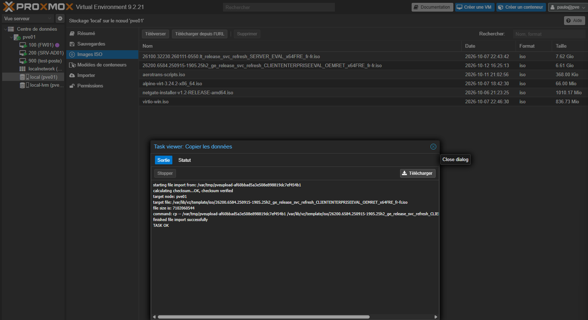

### Machine virtuelle 300 · PC-001

| Paramètre | Valeur | Pourquoi |
| --- | --- | --- |
| Machine | q35, **UEFI (OVMF)** + disque EFI, **TPM 2.0** | Exigences de Windows 11 (démarrage sécurisé, TPM) |
| Disque | 64 Go, VirtIO SCSI, **discard**, **SSD** | Discard : l'espace libéré par Windows est rendu à Proxmox (ajouté en relisant le récapitulatif) |
| Processeur | 2 cœurs, type **host** | Toutes les instructions du vrai processeur |
| Mémoire | 4 Go | Minimum de Windows 11 |
| Réseau | VirtIO, vmbr1, **tag 20** | Directement dans le VLAN Postes |

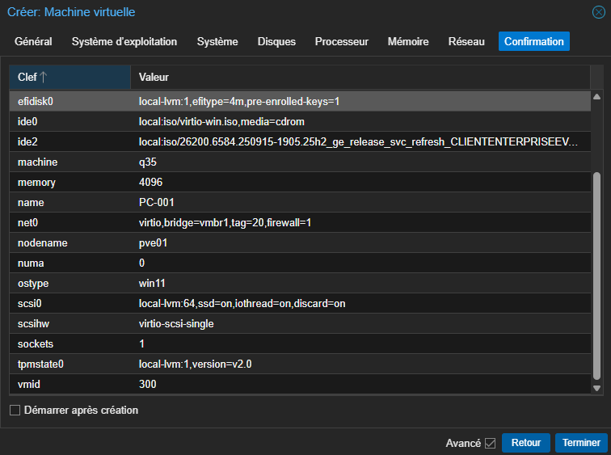

## 5. Installation

1. **Aucun disque visible** : « Charger un pilote » → ISO virtio-win → `vioscsi\w11\amd64`.
2. Pendant la configuration (OOBE), **pas de réseau** : la carte VirtIO n'a pas encore de pilote.
   « Je n'ai pas Internet » → **compte local temporaire `tech.install`** (désactivé en section 14).
3. Après l'installation : **virtio-win-guest-tools** (tous les pilotes VirtIO + agent QEMU).

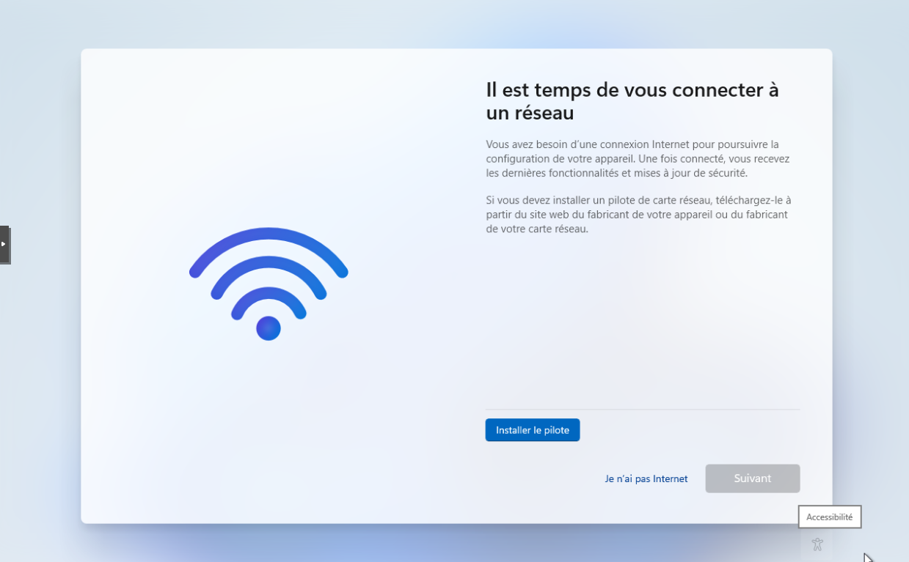
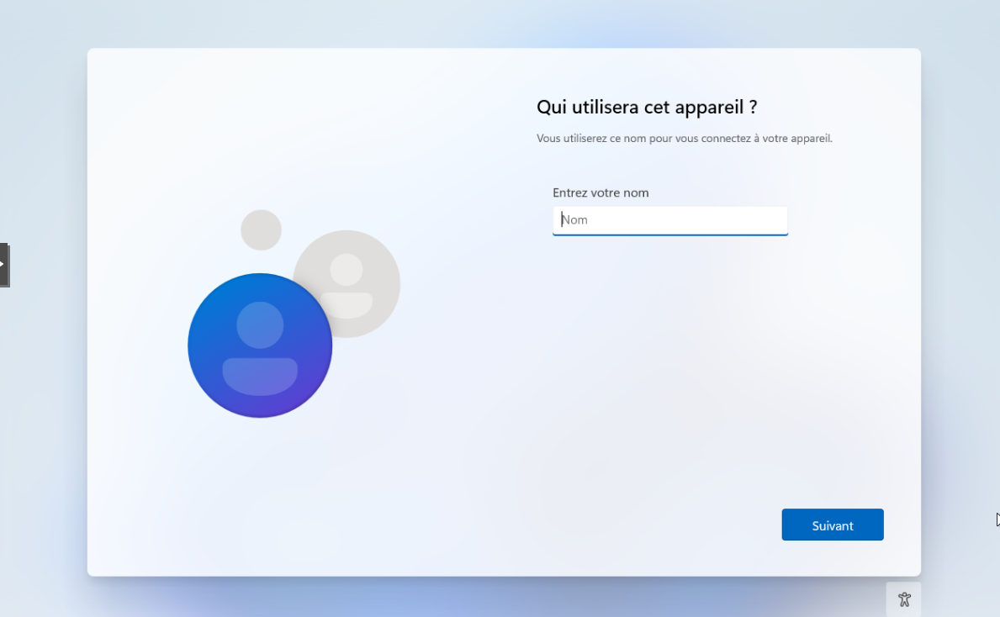

## 6. Licence : diagnostic sans réinstaller

**Symptôme** : « La licence Windows a expiré » sur le bureau, dès la première connexion.

| Commande | Résultat | Sens |
| --- | --- | --- |
| `slmgr /dlv` | EnterpriseEval, TIMEBASED_EVAL, erreur `0xC004F009` | Période de grâce expirée : l'évaluation **n'a jamais été activée** (installée hors ligne) |
| `slmgr /ato` | Produit activé | Activation en ligne, une fois le pilote réseau installé |
| `slmgr /xpr` | Expire le 11/01/2027 | 90 jours d'évaluation à partir de l'activation |

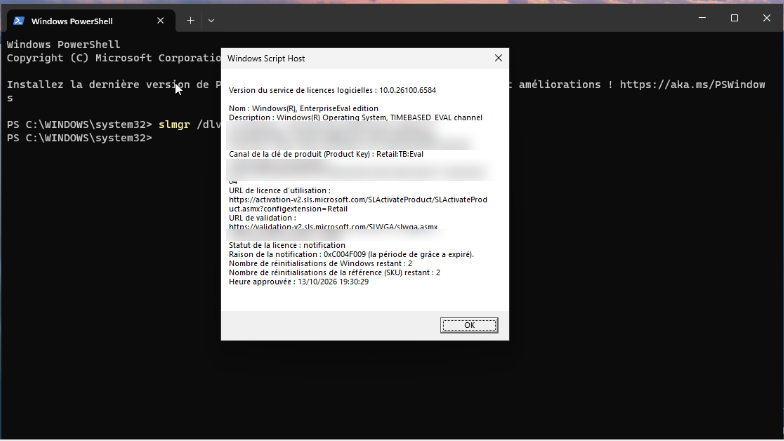
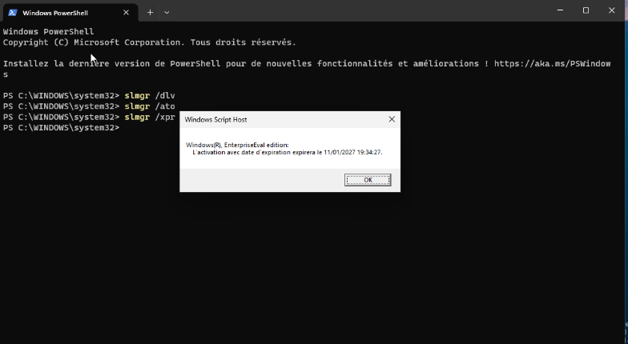

**En entreprise** : licences en volume, activées automatiquement par l'AD (*Active Directory
Based Activation*) ou par un serveur KMS. Personne ne tape `slmgr` poste par poste.

## 7. Réseau : bail DHCP dans le VLAN 20

`ipconfig /all` : **10.10.20.101/24**, passerelle 10.10.20.254, **serveur DHCP et DNS 10.10.10.10**,
suffixe `lab.home.arpa`, bail de 8 jours. Le **relais DHCP** de pfSense fonctionne dans les deux sens.

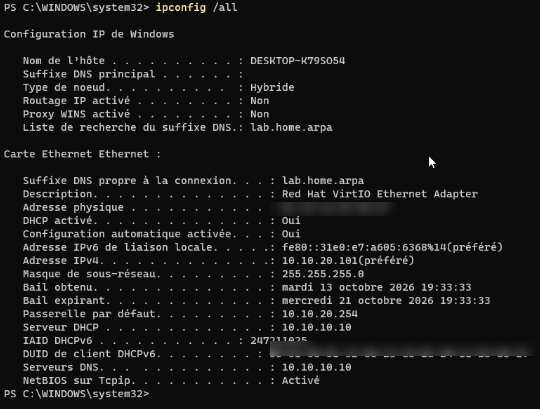

## 8. Renommage et jonction au domaine

1. **Renommer avant de joindre** (`sysdm.cpl` → Modifier) : `DESKTOP-xxxx` → **PC-001**
   (convention `PC-NNN`), redémarrage. Sinon le compte ordinateur arrive dans l'AD avec le mauvais nom.
2. **Vérifier le DNS avant de joindre** : le poste trouve le contrôleur de domaine grâce à un
   enregistrement SRV.
   `Resolve-DnsName -Type SRV _ldap._tcp.dc._msdcs.lab.home.arpa` → `srv-ad01.lab.home.arpa:389` ✅
3. **Jonction** (`sysdm.cpl` → Domaine : `lab.home.arpa`) avec le compte `adm.paulo.rosa`, redémarrage.
4. Le PC arrive dans **AEROTRANS/Ordinateurs** (grâce à `redircmp`, brique 03), puis il est
   **déplacé dans Postes-fixes** : les GPO dépendent de l'OU.

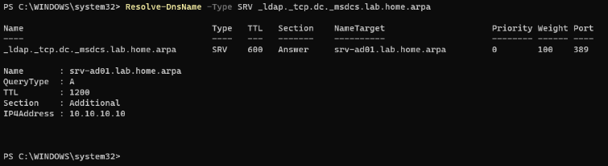
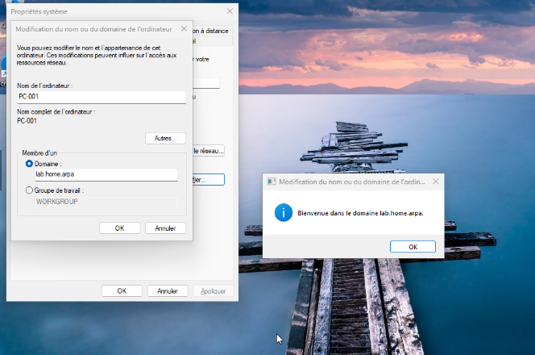
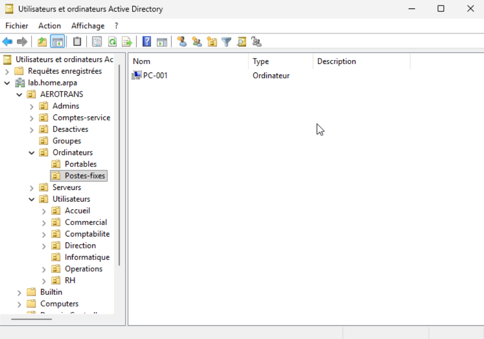

## 9. Première connexion d'une salariée

`nathalie.girard` (Comptabilité) se connecte :

- **changement de mot de passe imposé** à la première connexion ✅ ;
- `whoami` → `lab\nathalie.girard` ; `whoami /groups` → GG_Comptabilite, **pas admin** ;
- `gpresult /r /scope user` → aucune GPO utilisateur : normal, nos GPO n'ont que des
  paramètres **ordinateur**.

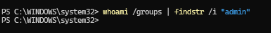

## 10. Test de la GPO de verrouillage (10 minutes)

**Preuve n°1, le registre** : `HKLM\SOFTWARE\Microsoft\Windows\CurrentVersion\Policies\System`
→ `InactivityTimeoutSecs = 600`, lisible en simple utilisatrice.

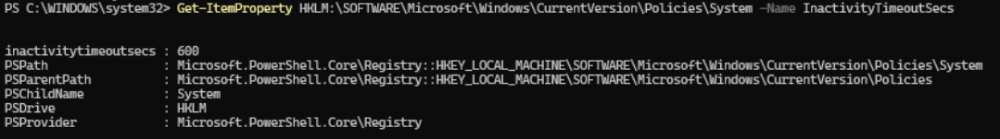

**Preuve n°2, le chrono** : faussée au premier essai, la session se verrouillait **avant** 10 min.

- **Cause** : Windows 11 éteint l'écran après **5 minutes** par défaut, et l'extinction verrouille la session.
  **Le premier mécanisme qui se déclenche gagne.**
- **Méthode** : neutraliser l'un pour tester l'autre. Écran passé à 15 min → chrono à 21:58 →
  **verrouillage à 22:08 pile** ✅
- **Correction durable** : la GPO `C_Config_Alimentation` (section 12).

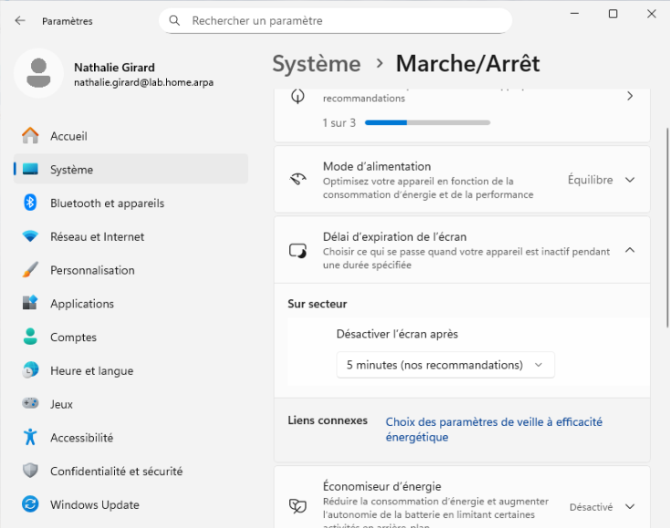
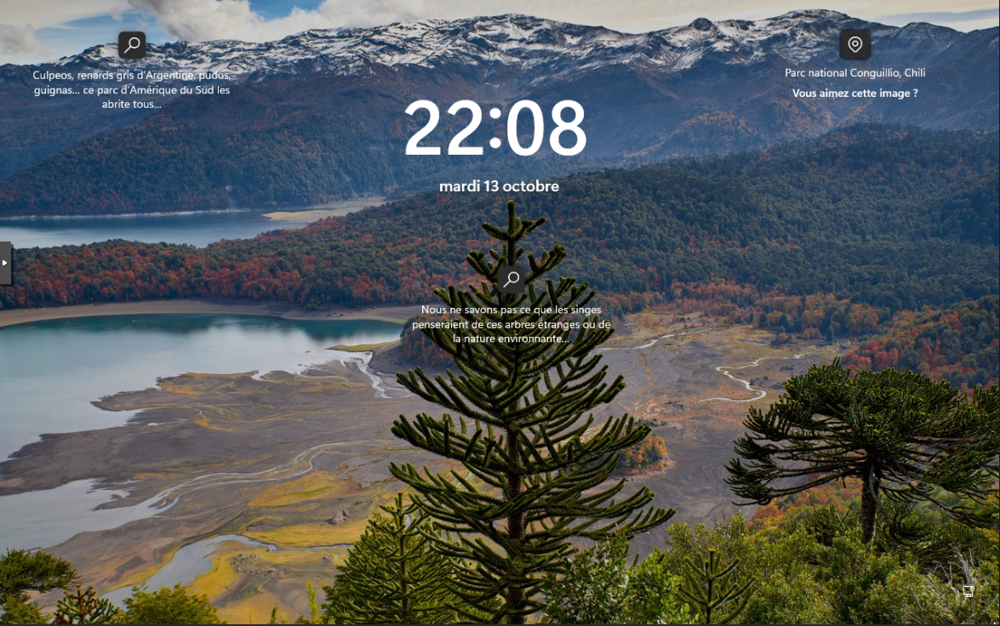

## 11. Administration à distance : vérifier les GPO d'un poste depuis le serveur

**Besoin** : depuis SRV-AD01, lancer l'assistant **Résultats de stratégie de groupe** (RSOP) sur
PC-001, sans se déplacer.

**Symptôme** : « Le serveur RPC n'est pas disponible ».

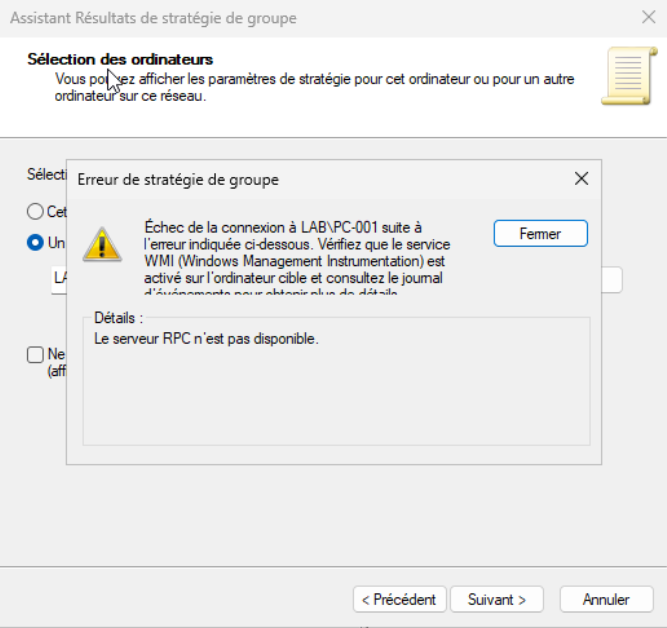

### 11.1 Diagnostic : deux pare-feu sur le chemin

| Test | Résultat | Conclusion |
| --- | --- | --- |
| `Test-NetConnection 10.10.20.101 -Port 135` | False | Le port 135 (RPC) n'est pas joignable |
| Journaux pfSense | SERVEURS / *Default deny* 10.10.10.10 → 10.10.20.101:135 | **pfSense bloque** (refus par défaut, règles au moindre privilège depuis la brique 03) |

RPC fonctionne comme un standard téléphonique : on appelle le **port 135**, qui indique sur quel
**port dynamique** (49152 à 65535) rappeler pour parler à WMI. Il faut donc ouvrir les deux.

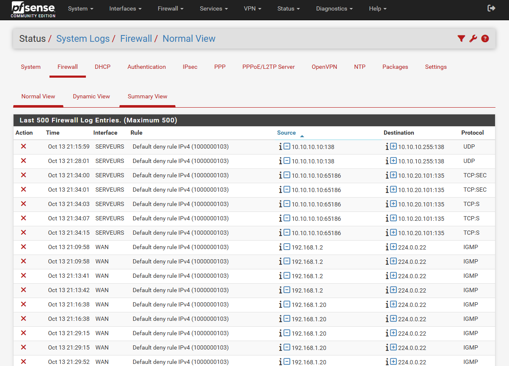

### 11.2 Premier pare-feu : pfSense

Procédure ([procédure pare-feu](../docs/procedure-pare-feu.md)) : besoin écrit dans la matrice
des flux (ligne 7), **sauvegarde de la configuration**, photo des règles, puis :

1. **Alias de ports** `PORTS_RPC_WMI` = `135` et `49152:65535`. Dans pfSense, une plage s'écrit
   avec **deux-points**, pas avec un tiret.
2. **Règle** sur l'interface SERVEURS, ajoutée **en fin de liste** :

| Champ | Valeur | Pourquoi |
| --- | --- | --- |
| Action | Pass | |
| Protocole | TCP | |
| Source | `10.10.10.10` (seul) | Moindre privilège : un autre serveur du VLAN (le futur GLPI) ne peut pas s'en servir |
| Destination | **POSTES subnets** | |
| Ports | `PORTS_RPC_WMI` | |
| Description | `Autorise SRV-AD01 vers POSTES RPC/WMI (admin a distance)` | **57 caractères maximum** (au-delà, coupée dans les journaux) ; sans accents, comme les autres règles |

> ⚠️ **Piège rencontré** : la destination était restée sur **Any** au premier essai. La règle
> aurait « marché », mais elle ouvrait RPC vers **tous** les réseaux, Internet compris.
> Une règle trop large fonctionne aussi : c'est pour ça qu'on teste **ce qui doit être bloqué**,
> pas seulement ce qui doit passer.

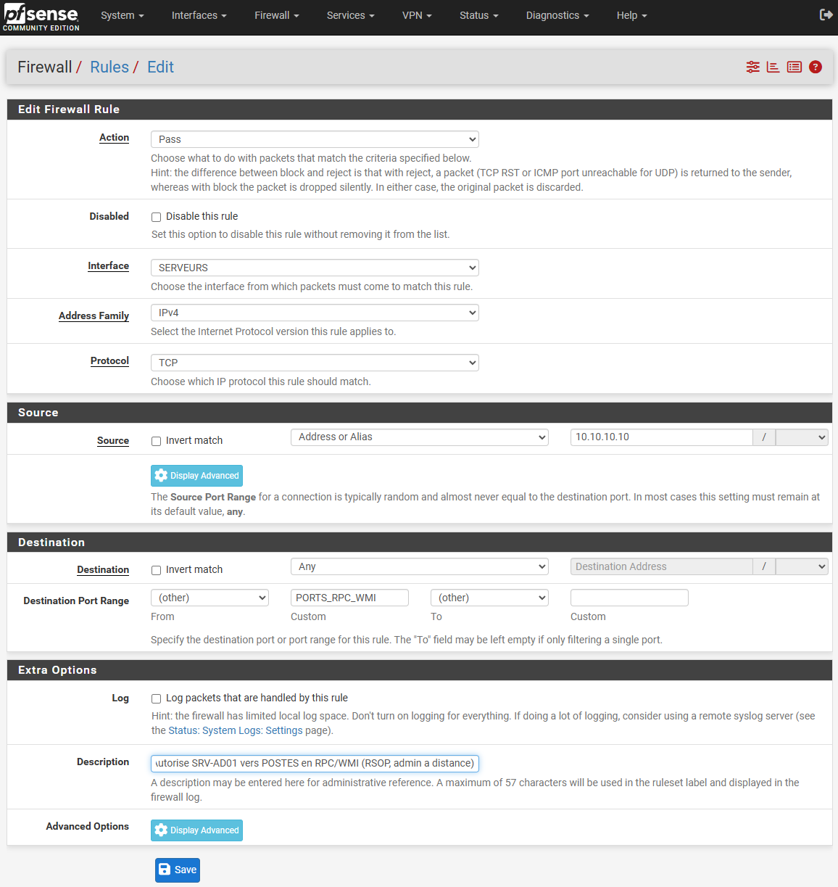
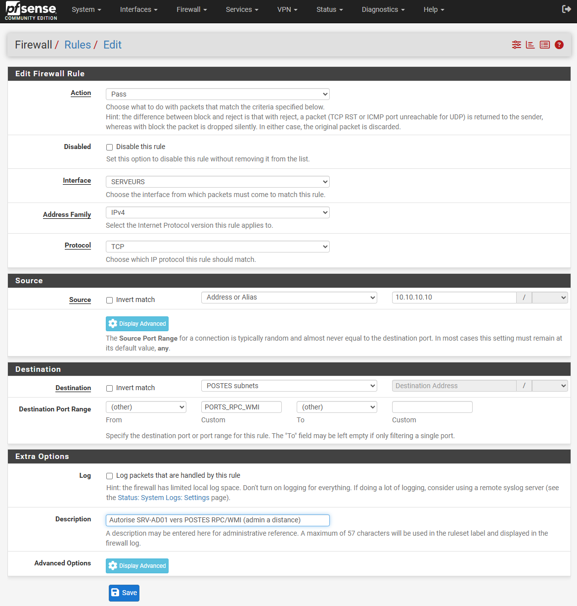
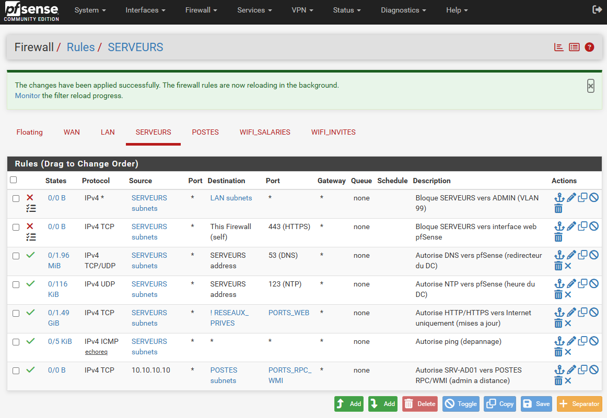

**Test** : `Test-NetConnection PC-001 -Port 135` → **True**. Le tout premier essai a donné False :
pfSense était encore en train de **recharger les règles** (bandeau *reloading in the background*).

Le **ping**, lui, échoue toujours alors que pfSense l'autorise : c'est le **pare-feu Windows** du poste
qui refuse de répondre, par défaut. Preuve qu'il y a bien un deuxième pare-feu.

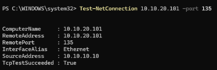

**Après** : nouvelle sauvegarde de la configuration pfSense (étape 12 de la procédure).

### 11.3 Deuxième pare-feu : Windows, par GPO

RSOP échoue encore (« serveur RPC indisponible ») : le port 135 répond, mais le pare-feu Windows
refuse le port dynamique de WMI.

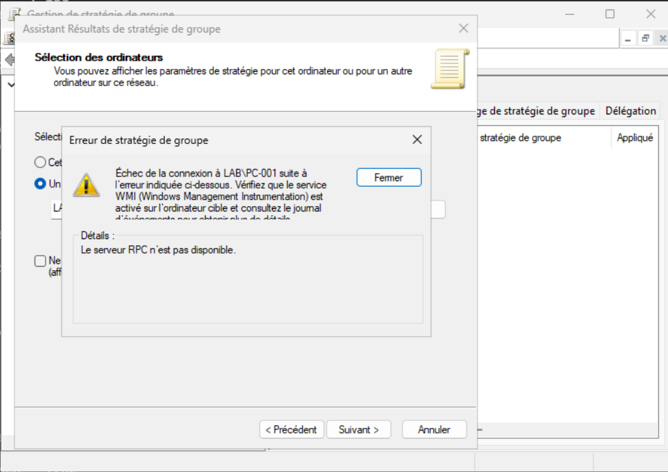

**En entreprise, on ne règle pas le pare-feu poste par poste** : une GPO s'applique à tous les PC,
y compris les futurs.

GPO **`C_Securite_PareFeu_Administration`**, liée à **Ordinateurs** (héritée par Postes-fixes et Portables) :
*Configuration ordinateur → Stratégies → Paramètres Windows → Paramètres de sécurité → Pare-feu
Windows Defender avec fonctions avancées de sécurité → Règles de trafic entrant → Nouvelle règle →
**Prédéfinie** → « Infrastructure de gestion Windows (WMI) »* (c'est le nom français de WMI).

| Règle | Rôle |
| --- | --- |
| WMI (DCOM-In) | Le « standard » sur le port 135 |
| WMI (WMI-In) | Le service WMI, sur le port dynamique |
| WMI (ASync-In) | Les réponses envoyées plus tard (asynchrones) |

Puis, **sur chacune des 3 règles** :

- onglet **Étendue** → Adresse IP distante → **10.10.10.10** uniquement ;
- onglet **Avancé** → profil **Domaine** uniquement : la règle ne s'ouvre qu'au bureau, jamais sur
  le Wi-Fi d'un hôtel (profil Public).

C'est la **défense en profondeur** : la même restriction sur le réseau (pfSense) et sur le poste.

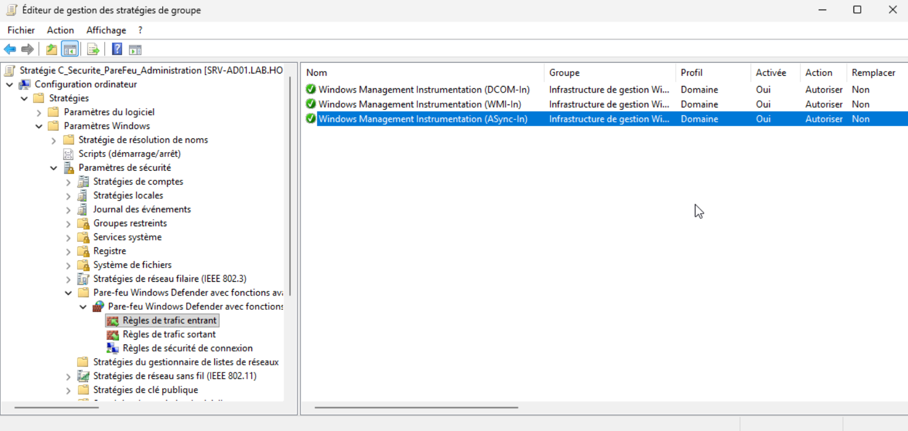

`gpupdate /force` sur PC-001 suffit, **sans redémarrage** (les règles de pare-feu s'appliquent
tout de suite). `gpresult /r /scope computer` répond **« Accès refusé »** pour Nathalie : normal,
une utilisatrice ne voit pas les réglages de l'ordinateur.

### 11.4 Résultat

L'assistant RSOP trouve `LAB\nathalie.girard` sur PC-001 (la liste vient de WMI), et le rapport
s'affiche : PC dans `AEROTRANS/Ordinateurs/Postes-fixes`, verrouillage **600 s** gagné par
`C_Securite_Verrouillage_Inactivite`, les 3 règles WMI gagnées par `C_Securite_PareFeu_Administration`
avec l'étendue **10.10.10.10** et le profil **Domaine** ✅

> Le message « Internet Explorer … configuration de sécurité renforcée » qui s'affiche d'abord n'est
> **pas** une erreur réseau : le rapport est une page HTML, et Windows Server bloque les pages web
> (un serveur ne sert pas à naviguer). On clique sur **Fermer**, **sans** ajouter le site aux sites
> de confiance.

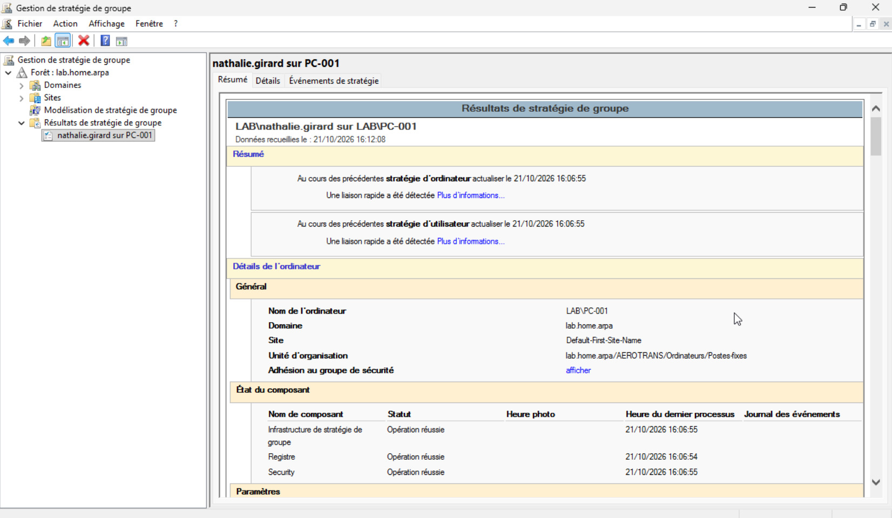
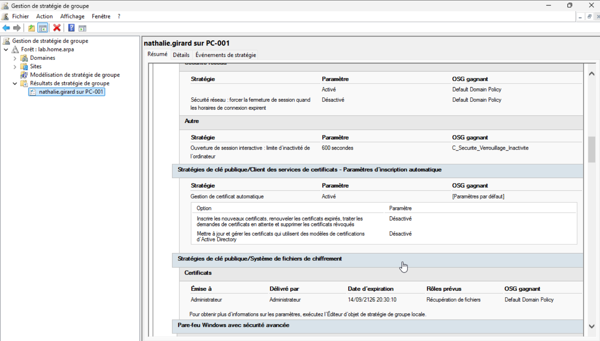
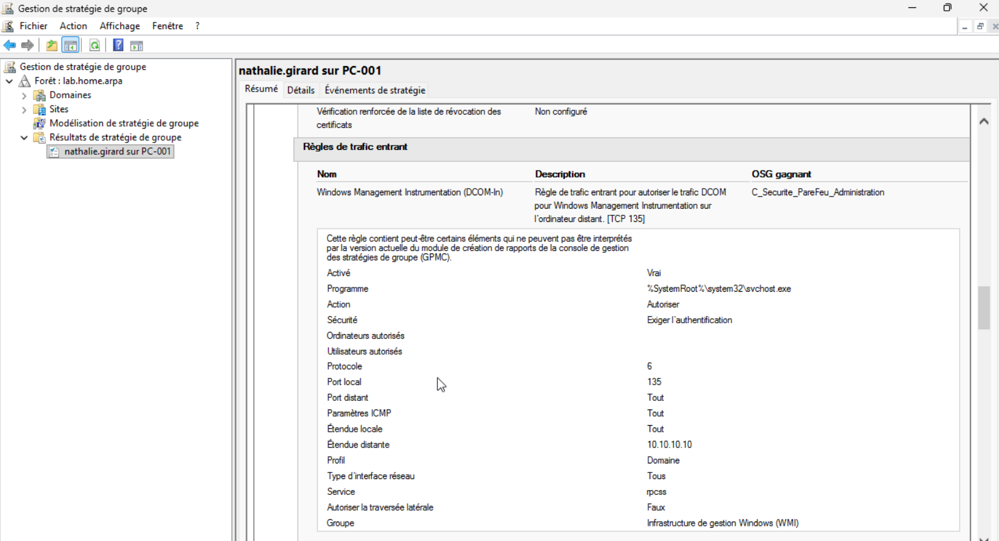

## 12. GPO d'alimentation des postes fixes

GPO **`C_Config_Alimentation`** (« Config » et non « Securite » : confort et fonctionnement), liée
**uniquement à Postes-fixes** :

- un **PC fixe** qui se met en veille rate les mises à jour de nuit, les sauvegardes et
  l'administration à distance → **jamais de veille** ;
- un **portable** sur batterie **doit** se mettre en veille (batterie, chauffe dans le sac) →
  il ne reçoit pas cette GPO. C'est l'intérêt d'avoir deux sous-OU.

*Configuration ordinateur → Stratégies → Modèles d'administration → Système → Gestion de l'alimentation* :

| Paramètre | Valeur |
| --- | --- |
| Paramètres de l'affichage et de la vidéo → **Désactiver l'affichage (sur secteur)** | 900 s (15 min, plus que les 10 min du verrouillage : c'est la GPO de verrouillage qui décide) |
| Paramètres de la veille → **Spécifier le délai de veille du système (sur secteur)** | 0 = jamais |

> Pièges dans la liste : « délai de veille **prolongée** » (l'hibernation) et « délai de veille
> **si l'ordinateur n'est pas utilisé** » (après un réveil automatique) ne sont pas les bons.

**Vérification sur PC-001** :

- Paramètres → Marche/Arrêt : écran **15 min, grisé**, Nathalie ne peut pas le changer ✅ ;
- la ligne « veille » n'apparaît pas : `powercfg /a` montre que **la VM ne gère aucun état de veille**
  (« l'hyperviseur ne prend pas en charge… »), donc Windows cache l'option ;
- `powercfg /q SCHEME_CURRENT SUB_SLEEP STANDBYIDLE` → sur secteur (courant alternatif) **0x00000000**
  = jamais ✅ ; sur batterie (courant continu) **0x258** = 600 s, non touché.

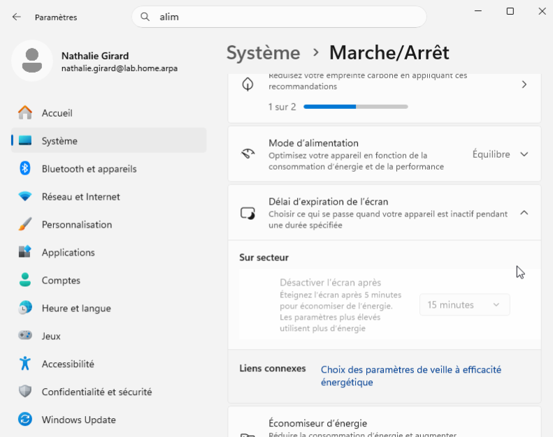
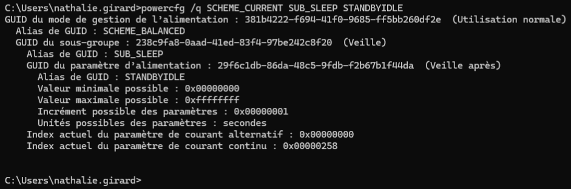

## 13. Durcissement : ms-DS-MachineAccountQuota à 0

Par défaut, **n'importe quel utilisateur du domaine peut joindre 10 ordinateurs**. Risques :
un PC personnel non géré dans le domaine, et surtout un **faux compte ordinateur** créé par un
pirate, point de départ de plusieurs attaques d'élévation de privilèges.

**ADSI Edit** (`adsiedit.msc`) → contexte de nommage par défaut → clic droit sur
`DC=lab,DC=home,DC=arpa` → Propriétés → `ms-DS-MachineAccountQuota` : **10 → 0** → Appliquer.

> ADSI Edit montre tous les attributs bruts de l'annuaire, sans garde-fou : on ne touche qu'à
> ce qui est prévu.

Vérification : `Get-ADObject (Get-ADDomain).DistinguishedName -Properties ms-DS-MachineAccountQuota` → **0**.
Rien n'est cassé : PC-001 est déjà joint, et les admins du domaine gardent le droit de joindre.
Les autres auront une **délégation** (section 15).

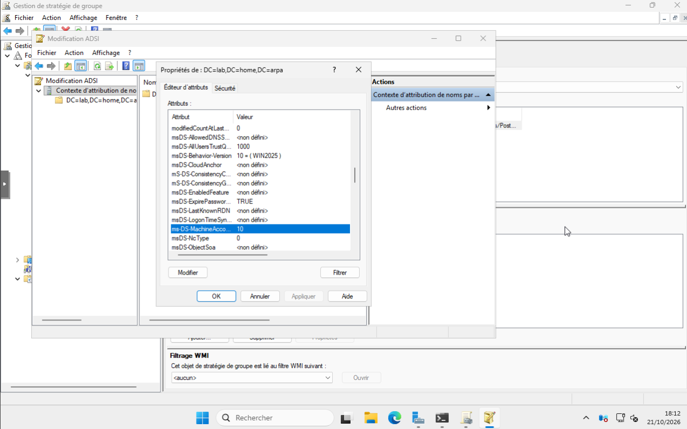
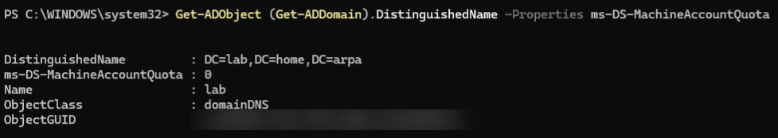

## 14. Désactivation du compte local tech.install

Compte **administrateur local** créé pendant l'installation, mot de passe qui n'expire jamais,
plus utilisé : une porte dérobée idéale.

- Depuis la session de Nathalie, Gestion de l'ordinateur s'ouvre en **lecture seule** : la
  modification renvoie **« Accès refusé »** (moindre privilège) ;
- Gestion de l'ordinateur en **« Exécuter en tant qu'administrateur »** (UAC, compte admin du domaine)
  → Utilisateurs et groupes locaux → `tech.install` → **Le compte est désactivé**.

**Désactivé plutôt que supprimé** : retour arrière en un clic. Tous les comptes locaux sont maintenant
désactivés (petite flèche sur l'icône).

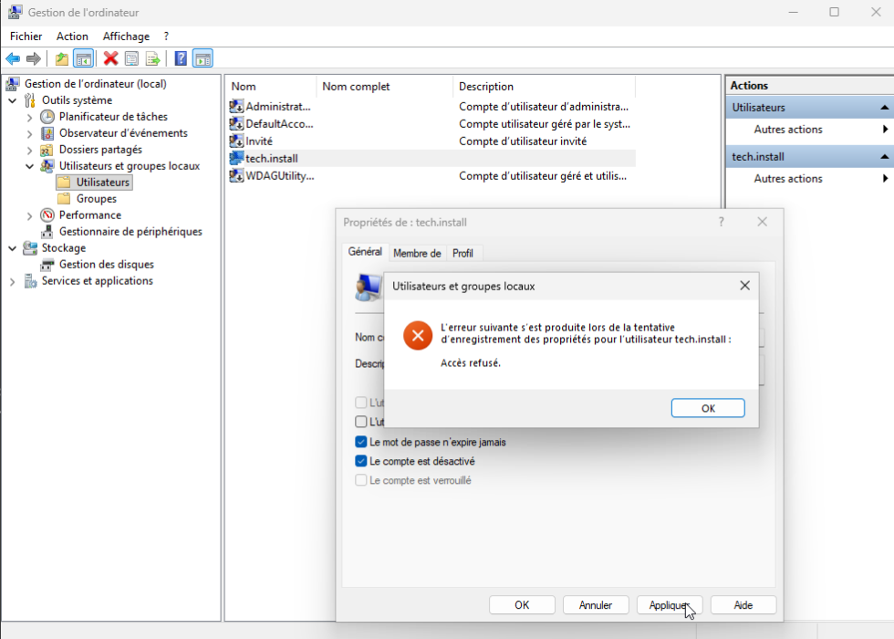
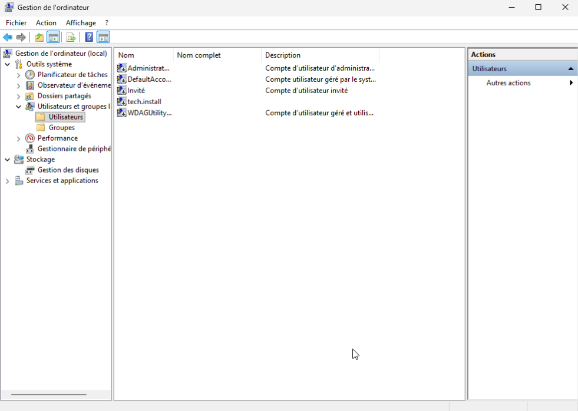

## 15. Délégation : joindre des PC sans être admin du domaine

Le technicien qui installe les PC n'a pas à détenir les clés du domaine. Méthode **AGDLP** :

```
paulo.rosa (compte du quotidien, non admin)
   ∈ GG_Informatique (groupe global, existant)
      ∈ DL_OU-Ordinateurs_JoindrePC (groupe domaine local, nouveau, avec description)
         → reçoit la délégation sur l'OU Ordinateurs
```

Un deuxième technicien ? On l'ajoute à GG_Informatique, sans retoucher aux permissions.

**Délégation de contrôle** sur l'OU Ordinateurs → tâche **personnalisée** → **Objets Ordinateur**
seulement → créer et supprimer → autorisations :

| Autorisation | Pourquoi |
| --- | --- |
| Réinitialiser le mot de passe | Un compte ordinateur a son propre mot de passe, défini à la jonction |
| Lire et écrire Restrictions de compte | Activer le compte et régler son type |
| Écriture validée vers le nom d'hôte DNS | Enregistrer `PC-xxx.lab.home.arpa` ; « validée » = l'AD vérifie la cohérence |
| Écriture validée vers le nom de principal du service (SPN) | Les étiquettes Kerberos du PC, vérifiées elles aussi |

> **Pas de « Contrôle total »**, que proposent beaucoup de tutos : il permettrait de modifier les
> droits et de prendre la main sur les comptes ordinateur existants de l'OU.

Vérification : Affichage → **Fonctionnalités avancées** → Propriétés de l'OU → Sécurité → Avancé :
5 entrées `DL_OU-Ordinateurs_JoindrePC`. On y voit aussi « Tout le monde – Refuser » (la protection
contre la suppression accidentelle) et « Opérateurs de compte », groupe intégré qui peut lui aussi
créer des ordinateurs et doit rester **vide**.

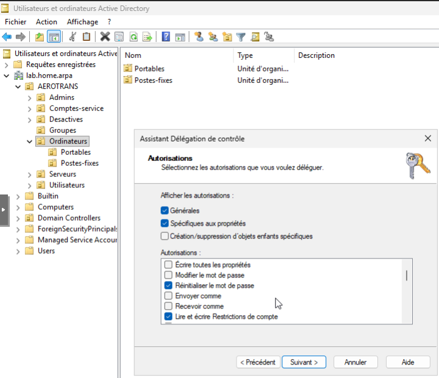
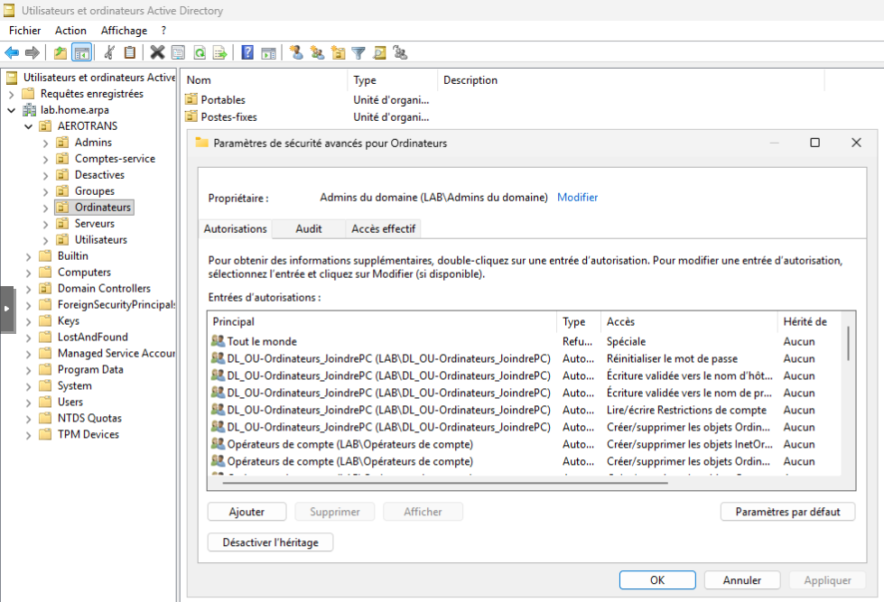

Test réel (joindre un PC avec `paulo.rosa`) : avec le portable PO-001 (section 22).

## 16. LAPS : un mot de passe admin local unique par poste

**Le problème** : si le compte administrateur local a le **même mot de passe sur tous les PC**,
le pirate qui le récupère sur un poste (avec Mimikatz par exemple) se connecte à tous les autres.
C'est le **mouvement latéral**, au cœur de la plupart des attaques par rançongiciel.

**Windows LAPS** : chaque PC génère un mot de passe **unique et aléatoire**, le **change tout seul**,
et le range **chiffré** dans son objet AD, lisible seulement par les personnes autorisées.

### 16.1 Instantané avant de toucher au schéma

L'extension du schéma (la structure de tout l'annuaire) est **irréversible**. Instantané Proxmox
`avant-laps-schema`, **avec la RAM**.

> **Écart entreprise** : on ne restaure pas un instantané de DC quand il y en a plusieurs (*USN rollback*,
> brique 03). On fait une sauvegarde de l'état système, on teste dans un lab, on passe en fenêtre de
> maintenance. Avec un seul DC, l'instantané est sans risque.

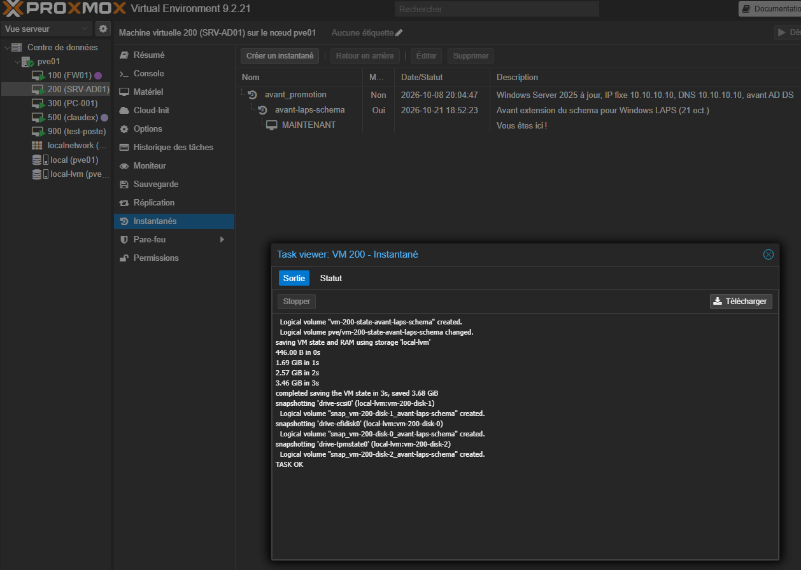

### 16.2 Extension du schéma, en « juste à temps »

Seul le groupe **Administrateurs du schéma** peut modifier le schéma. Il ne contient que le compte
`Administrateur` intégré, et ça doit rester ainsi le reste du temps.

1. `whoami` → `lab\adm.paulo.rosa`. `whoami /groups | findstr /i "schéma"` ne renvoie rien… mais
   `findstr` gère mal les accents : vérification graphique, le groupe ne contient bien que `Administrateur`.
2. **Ajout temporaire** d'`adm.paulo.rosa` au groupe, puis **déconnexion / reconnexion** : les groupes
   sont chargés dans le **jeton** à l'ouverture de session.
3. `whoami /groups | Select-String "sch"` → `LAB\Administrateurs du schéma`, groupe activé.
4. `Update-LapsADSchema -Verbose` (pas d'interface graphique pour cette étape) → 7 attributs `msLAPS-*`
   ajoutés à la classe *computer*, droit étendu `ms-LAPS-Encrypted-Password-Attributes` créé.
5. **Retrait immédiat** du compte du groupe.

C'est le **Just-In-Time** : le droit est donné pour l'opération, puis retiré. En SOC, l'ajout d'un
membre dans un groupe de RID 512 (Admins du domaine), 518 (schéma) ou 519 (entreprise) déclenche
une alerte (événement **4728** sur le DC).

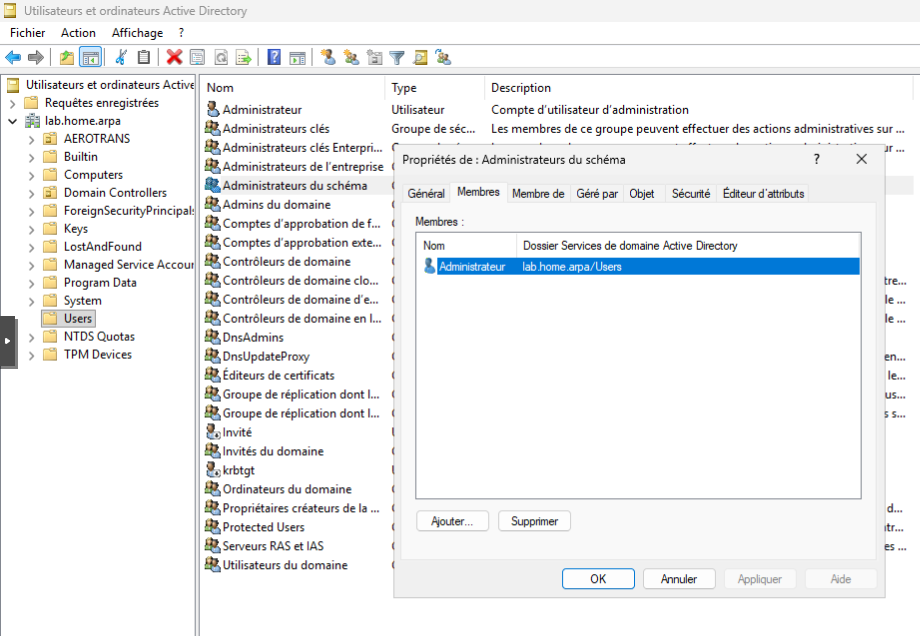
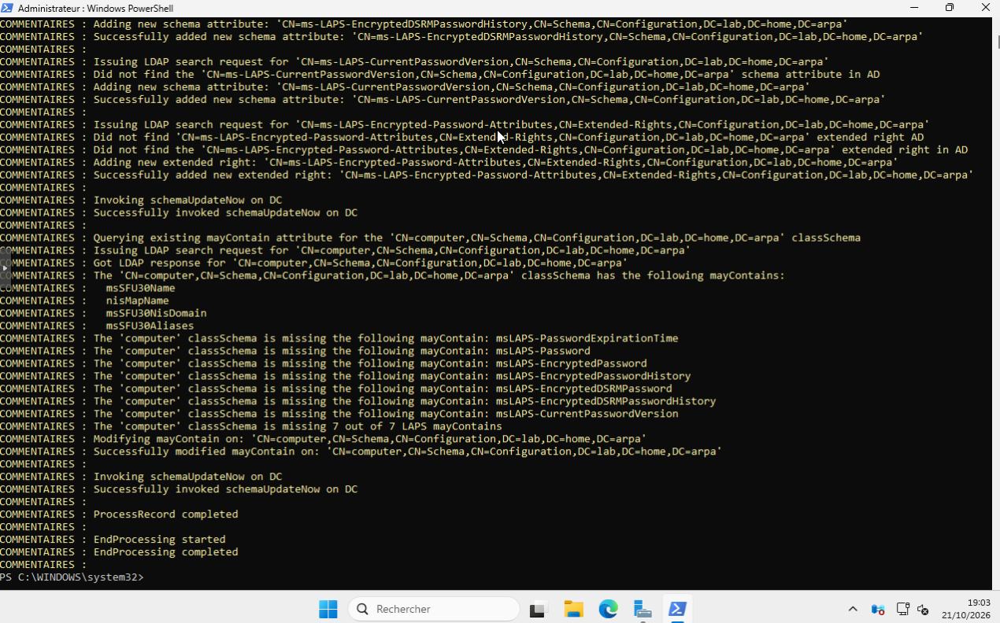
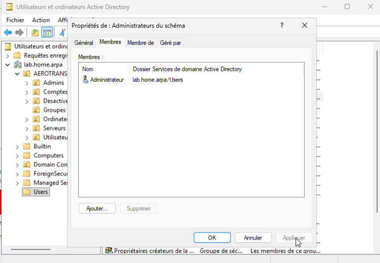

### 16.3 Permission des postes sur leur propre objet

`Set-LapsADComputerSelfPermission -Identity "OU=Ordinateurs,OU=AEROTRANS,DC=lab,DC=home,DC=arpa"` :
chaque PC de l'OU (et des sous-OU) peut écrire **son propre** mot de passe dans l'AD.

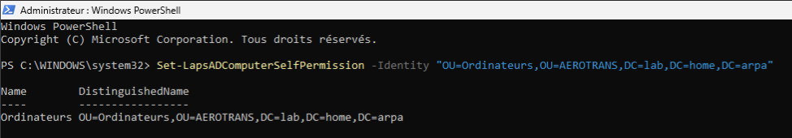

### 16.4 GPO C_Securite_LAPS

Liée à **Ordinateurs** : les portables en ont encore plus besoin (ils sortent, se perdent, se volent).
*Configuration ordinateur → Stratégies → Modèles d'administration → Système → LAPS* :

| Paramètre | Valeur | Pourquoi |
| --- | --- | --- |
| Configurer le répertoire de sauvegarde de mot de passe | **Active Directory** | « Azure Active Directory » (= Entra ID) sert aux PC joints au cloud. Par défaut : désactivé, LAPS ne fait rien |
| Paramètres du mot de passe | Complexité maximale, **20** caractères, **30** jours | La « longueur de phrase secrète » ne sert qu'avec une complexité de type phrase secrète |
| Activer le chiffrement du mot de passe | Activé | Possible à partir du niveau fonctionnel 2016 (ici 2025). Déchiffrement : Admins du domaine |
| Configurer la gestion automatique des comptes | Compte **personnalisé** `secours.local`, **activé**, nom non aléatoire | Voir 16.5 |

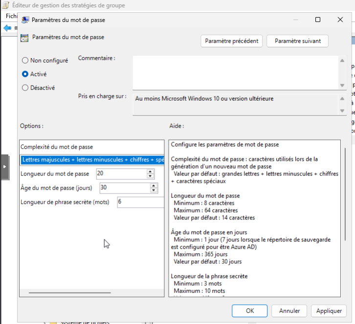
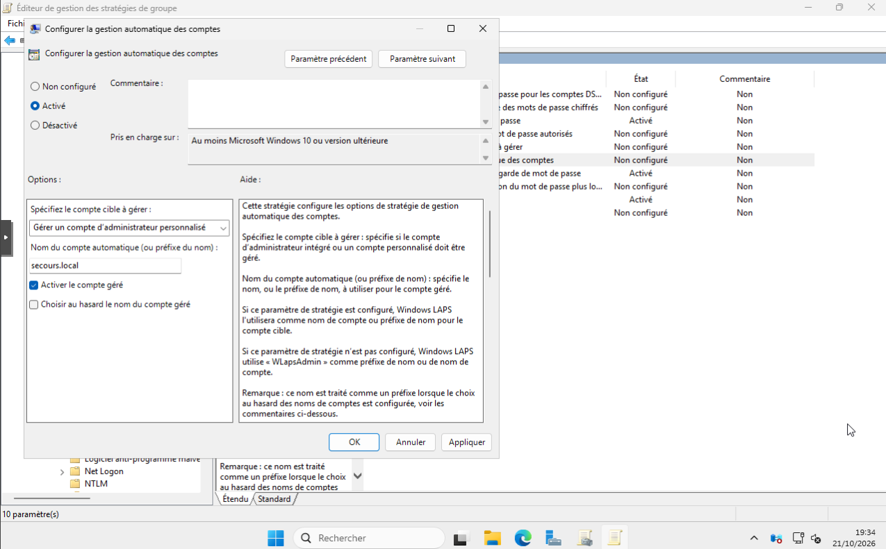

### 16.5 Quel compte confier à LAPS ? (erreur corrigée)

LAPS sert surtout quand le PC a **perdu la relation d'approbation** avec le domaine (portable resté
des mois au placard, restauration ancienne) : plus aucun compte du domaine ne marche, seul un
**compte local** permet d'entrer. Or le compte `Administrateur` intégré est **désactivé** par Windows :
s'il le reste, LAPS range un mot de passe inutilisable.

| Méthode | Principe | Quand |
| --- | --- | --- |
| Classique | Réactiver l'`Administrateur` intégré par GPO (« Comptes : statut du compte Administrateur ») et le confier à LAPS | Parc mélangé (Windows 10, anciens serveurs) : la plus répandue aujourd'hui |
| **Gestion automatique** (retenue) | LAPS **crée et gère** son propre compte (`secours.local`) ; l'`Administrateur` intégré reste désactivé | Tous les postes en Windows 11 **24H2 ou plus** (vérifié : `winver` → 25H2, build 26200) |

La méthode classique a d'abord été configurée « par prudence », sans vérifier la version de Windows,
puis annulée (paramètre remis à **Non défini**) : on vérifie la version **avant** de choisir.

Le nom `secours.local` : pas de « admin », rien qui ressemble aux comptes du domaine `adm.prenom.nom`.
Sans nom, Windows utilise `WLapsAdmin`, connu de tous. L'option « nom aléatoire » (qui change à chaque
rotation) est plus sûre mais plus lourde au quotidien : non activée pour l'instant.

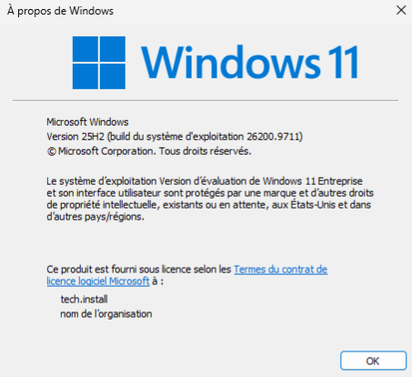

### 16.6 Test

1. PC-001 : `gpupdate /force`, attendre une minute.
2. PC-001, Gestion de l'ordinateur : compte **`secours.local` créé et actif**, description « Ce compte
   est actuellement géré… » ; `Administrateur` toujours désactivé ✅
3. SRV-AD01, Utilisateurs et ordinateurs AD → PC-001 → onglet **LAPS** : compte `secours.local`,
   expiration **20/11/2026** (30 jours), mot de passe **masqué**. On ne clique **pas** sur « Afficher
   le mot de passe » pour une capture.
4. `Get-LapsADPassword -Identity PC-001`, dans un PowerShell **élevé** (obligatoire sur un DC) :

| Champ | Valeur |
| --- | --- |
| Account | secours.local |
| Password | `System.Security.SecureString` (jamais en clair sans `-AsPlainText`) |
| ExpirationTimestamp | 20/11/2026 |
| Source | **EncryptedPassword** |
| DecryptionStatus | Success |
| AuthorizedDecryptor | LAB\Admins du domaine |

> `Get-LapsAADPassword` (avec **AAD**) est la commande pour Entra ID : tapée par erreur, elle ne
> connaît pas `-Identity`.

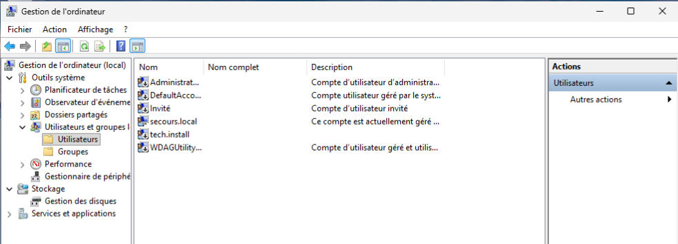
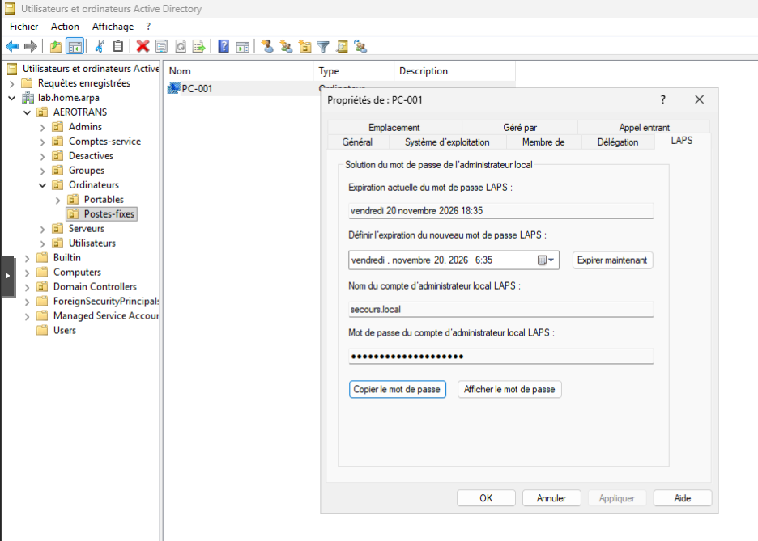
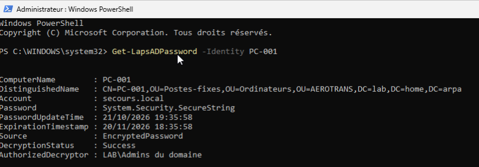

## 17. Récapitulatif sécurité

| Mesure | Contre quoi |
| --- | --- |
| Verrouillage à 10 min | Poste laissé ouvert à la pause |
| RPC/WMI ouvert **seulement** depuis SRV-AD01, sur pfSense **et** sur le poste | Un poste ou un serveur compromis qui sonde les autres |
| MachineAccountQuota = 0 + délégation au moindre privilège | Faux comptes ordinateur, PC non gérés |
| Comptes locaux désactivés (tech.install, Administrateur) | Comptes oubliés aux mots de passe éternels |
| LAPS chiffré, compte de secours au nom non standard | Mouvement latéral avec un mot de passe local partagé |
| Administrateurs du schéma vide (Just-In-Time) | Modification de la structure de l'annuaire |

## 18. Équivalents PowerShell

Les commandes **testées** dans le lab sont marquées ✅. Les autres sont l'équivalent des clics,
données pour référence : à valider dans un lab avant usage.

```powershell
# --- Poste : licence, nom, DNS, jonction ---
slmgr /dlv ; slmgr /ato ; slmgr /xpr                                   # ✅
Rename-Computer -NewName PC-001 -Restart
Resolve-DnsName -Type SRV _ldap._tcp.dc._msdcs.lab.home.arpa           # ✅
Add-Computer -DomainName lab.home.arpa -Credential LAB\adm.paulo.rosa -Restart

# --- Serveur : ranger le PC dans la bonne OU ---
$base = "OU=AEROTRANS,DC=lab,DC=home,DC=arpa"
Move-ADObject -Identity "CN=PC-001,OU=Ordinateurs,$base" -TargetPath "OU=Postes-fixes,OU=Ordinateurs,$base"

# --- Tests réseau ---
Test-NetConnection PC-001 -Port 135                                    # ✅

# --- GPO pare-feu Windows : règles WMI prédéfinies, restreintes à SRV-AD01 et au profil Domaine ---
New-GPO -Name C_Securite_PareFeu_Administration | New-GPLink -Target "OU=Ordinateurs,$base"
$store = "lab.home.arpa\C_Securite_PareFeu_Administration"
Copy-NetFirewallRule -DisplayGroup "Infrastructure de gestion Windows (WMI)" -Direction Inbound -NewPolicyStore $store
Set-NetFirewallRule -PolicyStore $store -DisplayGroup "Infrastructure de gestion Windows (WMI)" `
  -RemoteAddress 10.10.10.10 -Profile Domain -Enabled True

# --- Poste : appliquer et vérifier ---
gpupdate /force                                                        # ✅
powercfg /a                                                            # ✅
powercfg /q SCHEME_CURRENT SUB_SLEEP STANDBYIDLE                       # ✅

# --- GPO alimentation (valeurs de registre des paramètres d'alimentation, GUID publics de Microsoft) ---
New-GPO -Name C_Config_Alimentation | New-GPLink -Target "OU=Postes-fixes,OU=Ordinateurs,$base"
# Écran (sur secteur) : 900 s
Set-GPRegistryValue -Name C_Config_Alimentation -Key "HKLM\Software\Policies\Microsoft\Power\PowerSettings\3C0BC021-C8A8-4E07-A973-6B14CBCB2B7E" -ValueName ACSettingIndex -Type DWord -Value 900
# Veille (sur secteur) : 0 = jamais
Set-GPRegistryValue -Name C_Config_Alimentation -Key "HKLM\Software\Policies\Microsoft\Power\PowerSettings\29F6C1DB-86DA-48C5-9FDB-F2B67B1F44DA" -ValueName ACSettingIndex -Type DWord -Value 0

# --- Durcissement AD ---
Get-ADObject (Get-ADDomain).DistinguishedName -Properties ms-DS-MachineAccountQuota   # ✅
Set-ADDomain -Identity lab.home.arpa -Replace @{"ms-DS-MachineAccountQuota"="0"}

# --- Poste : compte local d'installation ---
Disable-LocalUser -Name tech.install

# --- Délégation de la jonction : le groupe (les autorisations fines : assistant graphique,
#     un script dsacls / Set-Acl sera écrit dans la brique 09) ---
New-ADGroup -Name DL_OU-Ordinateurs_JoindrePC -GroupScope DomainLocal -GroupCategory Security `
  -Path "OU=Groupes,$base" -Description "Droit de joindre des PC au domaine dans l'OU Ordinateurs (delegation)"
Add-ADGroupMember DL_OU-Ordinateurs_JoindrePC -Members GG_Informatique

# --- LAPS ---
whoami /groups | Select-String "sch"                                   # ✅
Update-LapsADSchema -Verbose                                           # ✅ (membre temporaire des Administrateurs du schéma)
Set-LapsADComputerSelfPermission -Identity "OU=Ordinateurs,$base"      # ✅
Get-LapsADPassword -Identity PC-001                                    # ✅ (PowerShell élevé)
Set-LapsADPasswordExpirationTime -Identity PC-001                      # forcer un changement au prochain cycle
Invoke-LapsPolicyProcessing                                            # sur le poste : appliquer LAPS tout de suite
```

## 19. Dépannages rencontrés

| Symptôme | Cause | Solution |
| --- | --- | --- |
| Aucun disque à l'installation | Pilote VirtIO SCSI absent | `vioscsi\w11\amd64` |
| Pas de réseau pendant l'OOBE | Pilote NetKVM absent | Compte local temporaire, puis virtio-win-guest-tools |
| « La licence Windows a expiré » | Évaluation installée hors ligne, jamais activée (`0xC004F009`) | `slmgr /ato` une fois le réseau en place |
| Session verrouillée avant 10 min | Extinction de l'écran à 5 min (défaut Windows 11) | Neutraliser pour tester, puis GPO d'alimentation |
| RSOP : « serveur RPC indisponible » (1) | pfSense, refus par défaut SERVEURS → POSTES | Alias + règle depuis SRV-AD01 seulement |
| `Test-NetConnection` False juste après la règle | Règles pfSense encore en rechargement | Relancer le test |
| RSOP : « serveur RPC indisponible » (2) | Pare-feu Windows du poste, WMI fermé | GPO, règles WMI prédéfinies limitées à 10.10.10.10 / Domaine |
| « Windows Management Instrumentation » introuvable | Nom français : « Infrastructure de gestion Windows (WMI) » | Chercher à la lettre I |
| Rapport RSOP bloqué par Internet Explorer | Configuration de sécurité renforcée d'IE sur le serveur | Fermer, sans ajouter aux sites de confiance |
| `gpresult /scope computer` : Accès refusé | Utilisatrice non administratrice | Normal ; vérifier depuis le serveur (RSOP) |
| Option « veille » absente des Paramètres | La VM ne gère aucun état de veille | `powercfg /a`, `powercfg /q` |
| tech.install : Accès refusé | Console ouverte sans élévation | Exécuter en tant qu'administrateur |
| `findstr "schéma"` ne trouve rien | `findstr` gère mal les accents | `Select-String`, ou vérification graphique |
| `Get-LapsADPassword` : *requires elevation* | PowerShell non élevé sur un DC | Exécuter en tant qu'administrateur |

## 20. Écarts lab / entreprise

| Lab | Entreprise | Pourquoi l'écart |
| --- | --- | --- |
| Activation `slmgr` à la main | Activation par l'AD ou KMS, licences en volume | Évaluation du lab |
| PC installé à la main | Déploiement automatisé (image, MDT, Autopilot) | Brique 14 |
| Instantané avant l'extension du schéma | Sauvegarde de l'état système + test en lab + fenêtre de maintenance | Un seul DC dans le lab |
| Un seul poste | Des dizaines : d'où les GPO plutôt que les réglages locaux | Lab |
| Option « veille » invisible | Visible et grisée sur un vrai PC fixe | Matériel virtuel |
| Mots de passe LAPS lisibles par les Admins du domaine | Groupe dédié de lecteurs LAPS (support N2), lecture auditée | À faire |
| Délégation non encore testée par une vraie jonction | Testée en recette avant la mise en service | Pas de 2e poste (PO-001 prévu) |
| Administration depuis la console Proxmox | Bureau à distance depuis le VLAN d'administration | Attend le switch (brique 02) |

## 21. Utilisation en entreprise : 3 cas concrets

1. **Un portable revient après 6 mois au placard** : « la relation d'approbation a échoué ».
   Le technicien lit le mot de passe LAPS de ce PC dans l'AD, se connecte avec `secours.local`,
   rejoint de nouveau le domaine. Le mot de passe sera changé automatiquement ensuite.
2. **Un poste est infecté** : le pirate récupère le mot de passe local… qui ne marche sur aucun autre PC.
   Il ne peut pas non plus interroger les autres postes par WMI : seul SRV-AD01 y a droit.
3. **Un salarié dit que son PC ne verrouille pas** : depuis le serveur, RSOP sur son poste montre
   en une minute quelle GPO s'applique, et laquelle gagne.

## 22. Questions d'entretien

- **Pourquoi renommer un PC avant de le joindre au domaine ?** Le compte ordinateur est créé avec
  le nom du moment ; renommer après crée des incohérences (DNS, SPN).
- **Une GPO ne s'applique pas sur un poste, que vérifies-tu ?** Le poste est-il dans la bonne OU,
  la GPO liée au bon endroit, partie ordinateur ou utilisateur, filtrage de sécurité ; puis
  `gpupdate /force`, `gpresult /r` ou RSOP depuis le serveur.
- **RSOP à distance échoue avec « serveur RPC indisponible » : ta démarche ?** Tester le port 135
  (`Test-NetConnection`), lire les journaux du pare-feu réseau, puis le pare-feu Windows du poste
  (ports dynamiques WMI). Un pare-feu à la fois, un test entre chaque étape.
- **Pourquoi deux pare-feu ?** Défense en profondeur : si l'un est mal réglé ou contourné, l'autre protège.
- **Qu'est-ce que ms-DS-MachineAccountQuota ?** Le nombre de PC qu'un utilisateur standard peut
  joindre (10 par défaut). On le met à 0 et on délègue.
- **Pourquoi pas « Contrôle total » dans une délégation ?** Il donne aussi le droit de modifier les
  permissions et de prendre le contrôle des objets existants.
- **Qu'est-ce que LAPS et contre quelle attaque ?** Un mot de passe admin local unique par poste,
  changé automatiquement : il bloque le mouvement latéral (*pass-the-hash* avec un mot de passe partagé).
- **Différence entre l'ancien LAPS et Windows LAPS ?** L'ancien était un logiciel à installer, mot
  de passe en clair dans l'AD ; Windows LAPS est intégré, chiffre le mot de passe, sait gérer Entra ID
  et créer son propre compte.
- **Qui peut modifier le schéma, et comment l'as-tu fait ?** Les Administrateurs du schéma ; ajout
  temporaire, reconnexion (jeton), opération, retrait immédiat (Just-In-Time).
- **Pourquoi un compte admin local s'il y a le domaine ?** Pour entrer quand le poste a perdu le
  contact avec le domaine.

## 23. Points en suspens

- Tester la délégation : joindre le portable **PO-001** avec `paulo.rosa` (non admin).
- Vérifier que le groupe **Opérateurs de compte** est vide.
- Groupe dédié aux **lecteurs LAPS** et audit des lectures (brique 11, Wazuh).
- Supprimer l'instantané `avant-laps-schema` après quelques jours sans incident.
- Règles précises du VLAN Postes vers SRV-AD01 (remplacer la règle provisoire « Postes → tout »).
- Renommer ou laisser désactivé l'`Administrateur` intégré (fait : désactivé) ; option « nom aléatoire » de LAPS à évaluer.
- Script de délégation (dsacls / Set-Acl) dans la brique 09.
