# Brique 04 — Postes de travail Windows 11, GPO et LAPS

> **Tuto pas à pas, écrit pour quelqu'un qui débute.** Chaque étape dit **pourquoi** on la fait,
> **où cliquer** ou **quoi taper**, **ce qu'on doit voir**, et **quoi faire si ça ne marche pas**.
> Les étapes sont faites à l'interface graphique ; les commandes PowerShell équivalentes sont en
> annexe B. Les erreurs faites pendant le lab sont laissées volontairement, avec leur correction.
> Les captures sont dans le dossier [`captures/`](captures/).

## Comment lire ce tuto

| Repère | Sens |
| --- | --- |
| 🎯 | **Le but** de l'étape |
| 🖱️ | Ce qu'on fait **à la souris** (menus, boutons, cases) |
| ⌨️ | Ce qu'on **tape**, avec l'explication |
| ✅ | Ce qu'on **doit voir** si tout va bien |
| ❌ | **Si ça ne marche pas** (souvent : l'erreur qu'on a vraiment eue) |
| 🏢 | **En entreprise**, quand on ferait autrement |
| 💡 | Une explication pour bien comprendre |

---

## Résumé pour les pressés

- **PC-001** (Windows 11 Entreprise 25H2, VM 300, VLAN 20, DHCP via relais) **renommé avant d'être
  joint** au domaine, rangé dans `Postes-fixes`, 1re connexion d'une salariée sans droits d'admin.
- **GPO testées pour de vrai** : verrouillage après 10 min (prouvé au chrono, après neutralisation de
  l'extinction d'écran), alimentation des postes fixes (jamais de veille).
- **Administration à distance** (RSOP depuis le serveur) : diagnostic de **deux pare-feu** (pfSense
  puis Windows), ouverture **limitée à SRV-AD01** et au **profil Domaine** (défense en profondeur).
- **Durcissement AD** : `ms-DS-MachineAccountQuota` à 0 + **délégation** de la jonction au moindre
  privilège (AGDLP), compte local d'installation désactivé.
- **Windows LAPS** : extension du schéma en **juste à temps**, mot de passe local unique, chiffré, changé
  tous les 30 jours, compte `secours.local` géré automatiquement.

### Les GPO en place à la fin de la brique

| GPO | Liée à | Rôle |
| --- | --- | --- |
| `C_Securite_Verrouillage_Inactivite` | Ordinateurs | Verrouille la session après 600 s d'inactivité (créée en brique 03, testée ici) |
| `C_Securite_PareFeu_Administration` | Ordinateurs | Ouvre WMI dans le pare-feu Windows, **depuis SRV-AD01 seulement**, profil Domaine |
| `C_Config_Alimentation` | **Postes-fixes** | Écran éteint après 15 min, jamais de veille sur secteur |
| `C_Securite_LAPS` | Ordinateurs | Mot de passe du compte local de secours, unique, chiffré, changé tous les 30 jours |

---

## Partie 0 — Comprendre avant de commencer

### 0.1 Le besoin du client

AEROTRANS veut des postes de travail :

- **intégrés au domaine** : un salarié se connecte avec **son** compte, sur n'importe quel PC ;
- qui **appliquent tout seuls** les règles de l'entreprise (verrouillage, alimentation) ;
- que l'informatique peut **administrer à distance**, sans se déplacer ;
- **durcis** : un pirate qui prend la main sur un PC ne doit pas pouvoir **rebondir** sur les autres.

### 0.2 Les mots à connaître

| Mot | Sens | Image |
| --- | --- | --- |
| **Joindre au domaine** | Inscrire le PC dans l'AD : il fait confiance au domaine et applique ses règles | **Embaucher** le PC dans l'entreprise |
| **GPO** | Un paquet de réglages appliqué automatiquement à une OU | Une **note de service** |
| **RSOP** | Le rapport « quelles GPO s'appliquent vraiment sur ce PC, et laquelle gagne » | Le **bilan** des notes de service reçues |
| **RPC / WMI** | Les mécanismes qui permettent d'interroger un PC **à distance** | Le **téléphone** de l'administration |
| **LAPS** | Un mot de passe admin local **différent sur chaque PC**, changé tout seul | Une **serrure différente** par bureau, au lieu d'un passe-partout |
| **Mouvement latéral** | Un pirate qui passe d'un PC à l'autre avec le même mot de passe | Le cambrioleur qui a le **passe-partout** |

### 0.3 Les choix

| Besoin | Choix | Alternatives | Pourquoi |
| --- | --- | --- | --- |
| Système des postes | **Windows 11 Entreprise** (évaluation 90 j) | Windows 11 Pro | Édition des grandes entreprises, celle qu'on gère en ESN. La Pro suffit en PME |
| Réglages des postes | **GPO** | Intune (cloud) | Les postes sont joints à l'AD local (brique 03). Intune : brique 08 |
| Mot de passe admin local | **Windows LAPS** (intégré) | Ancien LAPS (logiciel, abandonné), mot de passe identique partout | Unique par PC, changé tout seul, chiffré dans l'AD |
| Compte géré par LAPS | **Gestion automatique** (`secours.local`) | Compte `Administrateur` intégré réactivé | Possible car tous les postes sont en Windows 11 24H2 ou plus (étape 24) |

### 0.4 L'architecture

```
          VLAN 10 Serveurs                         VLAN 20 Postes
          10.10.10.0/24                            10.10.20.0/24
   SRV-AD01 10.10.10.10                        PC-001 10.10.20.101 (DHCP)
   AD DS · DNS · DHCP · GPO · LAPS             Windows 11 Entreprise 25H2
          |                                          |
          +-------------- pfSense (fw01) ------------+
            relais DHCP · refus par défaut · règle 7 :
            SRV-AD01 → Postes en RPC/WMI uniquement
```

Adresses : [plan d'adressage](../docs/plan-adressage.md) · Flux : [matrice des flux](../docs/matrice-des-flux.md) ·
Noms : [conventions](../docs/conventions.md).

---

## Partie 1 — Créer et installer le poste

### Étape 1 · La bonne ISO, vérifiée

🖱️ Proxmox > **local (pve01)** > **Images ISO** > **Téléverser** l'ISO **Windows 11 Entreprise Évaluation
(français)**, avec l'empreinte **SHA-256** publiée par Microsoft.

❌ **Erreur du lab** : une première ISO **« grand public »** (Famille/Pro) avait été envoyée. Elle ne
permet pas d'avoir l'édition Entreprise : **supprimée**.

✅ `checksum verified`, `TASK OK`.

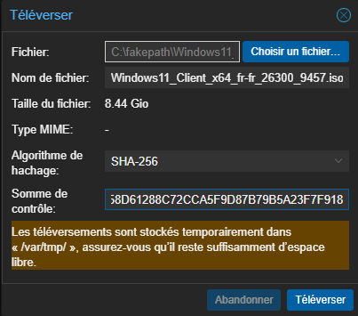
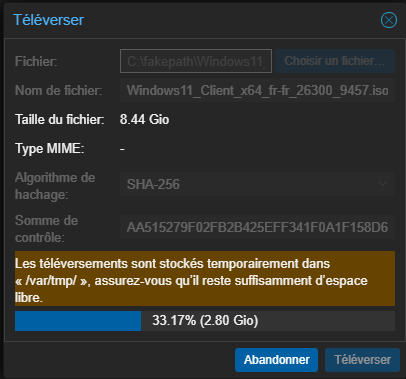
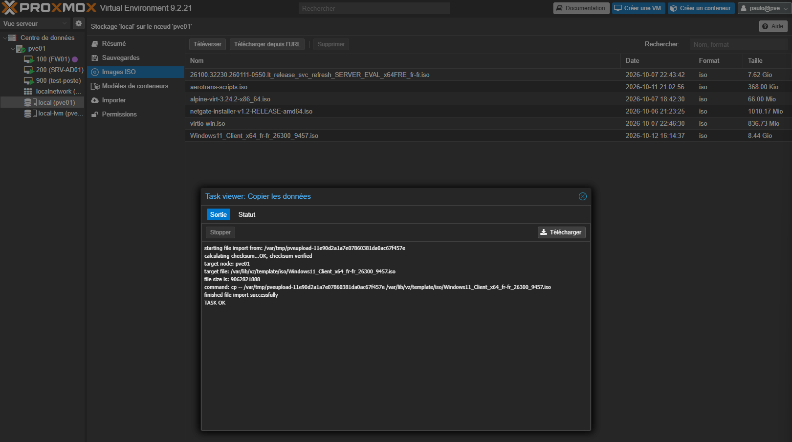
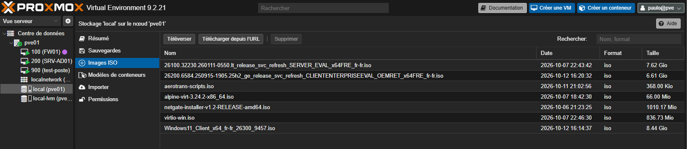


### Étape 2 · Créer la VM 300 · PC-001

🖱️ **Créer une VM** (case **Avancé** cochée) :

| Onglet | Réglage | Valeur | Pourquoi |
| --- | --- | --- | --- |
| Général | ID / Nom | `300` / `PC-001` | 3xx = postes ; convention `PC-NNN` |
| Système d'exploitation | ISO / type | Windows 11 Entreprise / Microsoft Windows 11 ; ✅ lecteur pour les pilotes VirtIO | |
| Système | Machine / BIOS | **q35**, **UEFI (OVMF)** + disque EFI, ✅ **TPM 2.0** | Exigences de Windows 11 (démarrage sécurisé, puce TPM) |
| Disques | Taille | `64` Gio, VirtIO SCSI, ✅ **discard**, ✅ **SSD** | Discard : l'espace libéré par Windows est rendu à Proxmox (ajouté **en relisant** le récapitulatif) |
| Processeur | | `2` cœurs, **host** | |
| Mémoire | | `4096` | Le minimum de Windows 11 |
| Réseau | | VirtIO, `vmbr1`, **tag 20** | Directement dans le VLAN Postes |


### Étape 3 · Installer Windows 11

1. 🖱️ Démarrer, **Console**. Comme pour le serveur (brique 03) : **aucun disque visible** →
   **Charger un pilote** > virtio-win > `vioscsi\w11\amd64`.
2. Configuration de Windows (OOBE) : pays **France**, clavier **Français**.

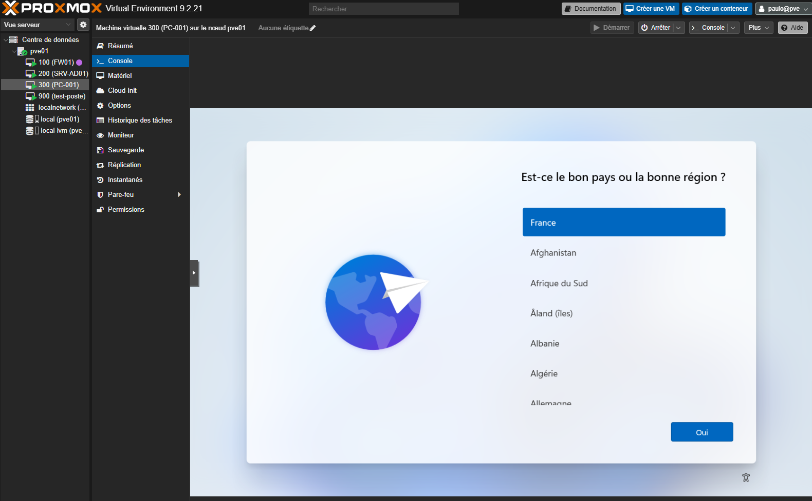

3. ❌ **Pas de réseau** : la carte VirtIO n'a pas encore de pilote. 🖱️ **Je n'ai pas Internet** >
   **Continuer avec une configuration limitée** → création d'un **compte local temporaire**
   `tech.install` (on le **désactivera** à l'étape 15).


4. Sur le bureau : lecteur virtio-win > **virtio-win-guest-tools** > installer : tous les pilotes
   (réseau compris) + l'agent QEMU.

### Étape 4 · Dépannage : « La licence Windows a expiré »

❌ **Symptôme** : dès la première connexion, un message sur le bureau : « La licence Windows a expiré ».

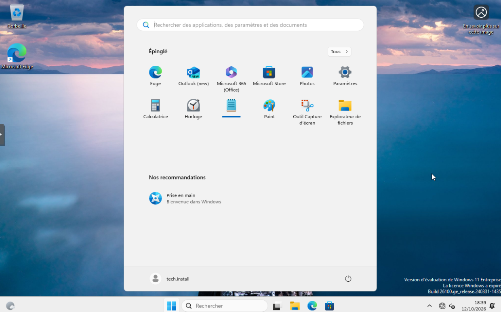

⌨️ Diagnostic, **sans réinstaller** (invite de commandes en administrateur) :

| Commande | Résultat | Sens |
| --- | --- | --- |
| `slmgr /dlv` | EnterpriseEval, TIMEBASED_EVAL, erreur `0xC004F009` | La période de grâce est passée : l'évaluation **n'a jamais été activée** (installée hors ligne) |
| `slmgr /ato` | « Produit activé » | **Activation** en ligne, maintenant que le réseau marche |
| `slmgr /xpr` | Expire le 11/01/2027 | 90 jours d'évaluation à partir de l'activation |

💡 `slmgr` = l'outil de gestion des licences de Windows : `/dlv` = afficher le détail, `/ato` = activer,
`/xpr` = date d'expiration.


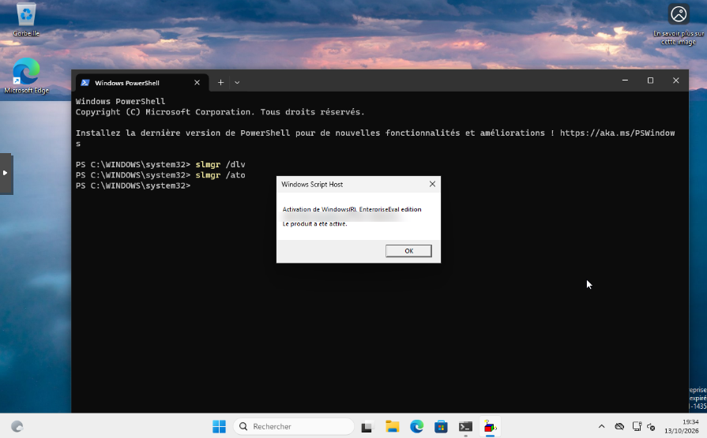


🏢 En entreprise : licences en volume, **activées automatiquement** par l'AD (*Active Directory Based
Activation*) ou un serveur KMS. Personne ne tape `slmgr` poste par poste.

### Étape 5 · Vérifier l'adresse IP

⌨️ `ipconfig /all`

✅ `10.10.20.101/24`, passerelle `10.10.20.254`, **serveur DHCP et DNS `10.10.10.10`**, suffixe
`lab.home.arpa`, bail de 8 jours. 💡 Le **relais DHCP** de pfSense fonctionne dans les deux sens : la
demande du poste est arrivée au serveur Windows, et la réponse est revenue.


---

## Partie 2 — Joindre le poste au domaine

### Étape 6 · Renommer le PC **avant** de le joindre

💡 Le compte de l'ordinateur est créé dans l'AD **avec le nom du moment**. Renommer après la jonction crée
des incohérences (DNS, identifiants Kerberos).

🖱️ **Windows + R** > `sysdm.cpl` > **Modifier** > Nom de l'ordinateur : `PC-001` > **OK** > redémarrer.

⌨️ Vérification : `hostname` → `PC-001`.

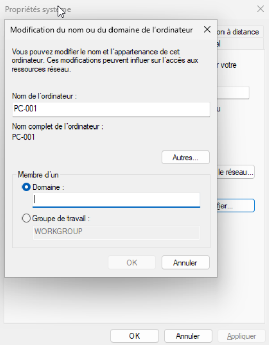
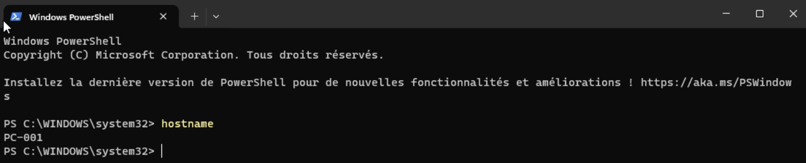

### Étape 7 · Vérifier que le PC trouve le contrôleur de domaine

⌨️

```powershell
Resolve-DnsName -Type SRV _ldap._tcp.dc._msdcs.lab.home.arpa
```
✅ `srv-ad01.lab.home.arpa`, port 389. 💡 C'est **grâce à cet enregistrement** qu'un PC trouve le DC. Si ça
ne répond pas, la jonction échouera : on vérifie **avant**.


### Étape 8 · Joindre le domaine

🖱️ `sysdm.cpl` > **Modifier** > **Membre d'un domaine** : `lab.home.arpa` > **OK** > identifiants
**`adm.paulo.rosa`** (un compte qui a le droit de joindre) > « Bienvenue dans le domaine lab.home.arpa » >
redémarrer.

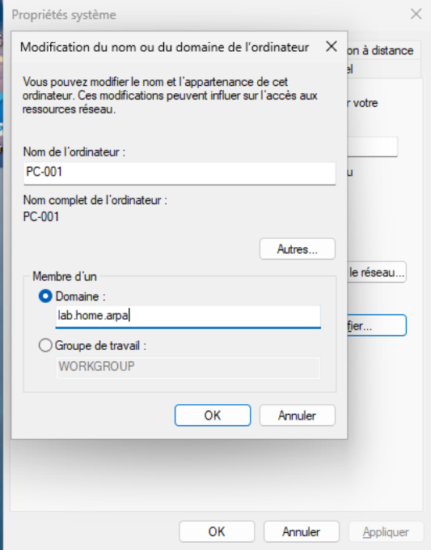
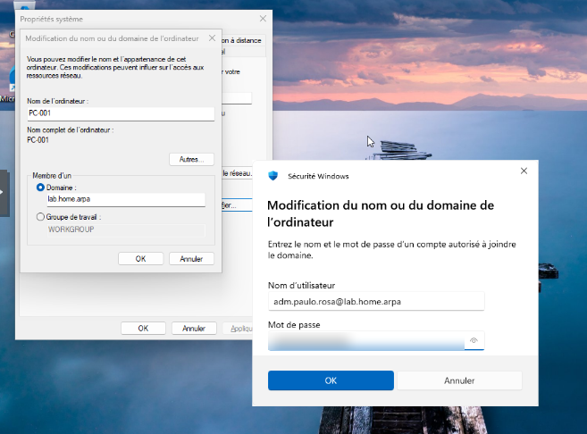

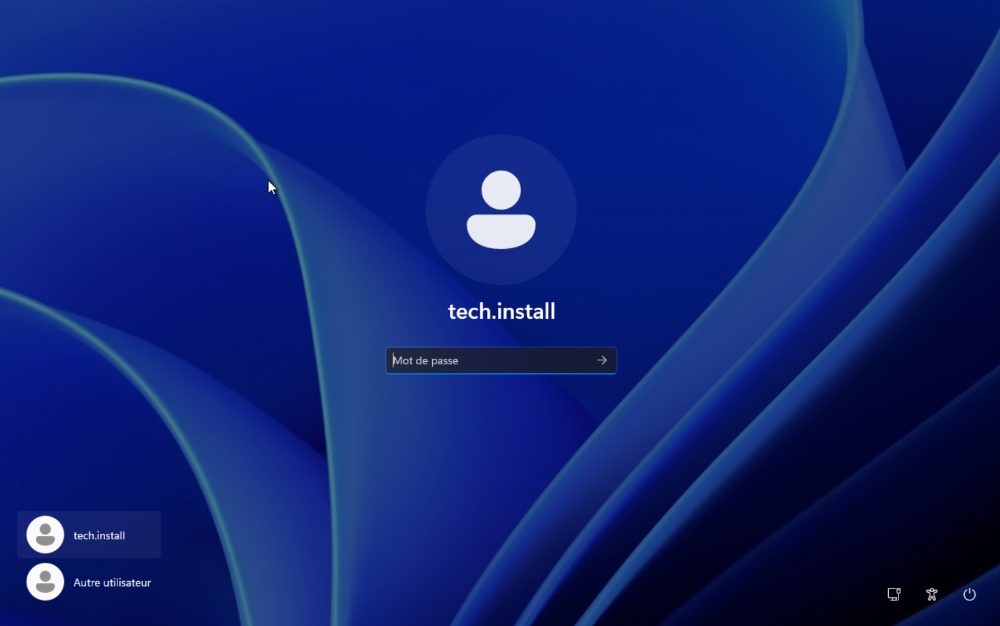

### Étape 9 · Ranger le PC dans la bonne OU

🖱️ Sur SRV-AD01 : **Utilisateurs et ordinateurs AD** > `AEROTRANS` > **Ordinateurs** : ✅ PC-001 est là
(grâce à `redircmp`, brique 03), et **pas** dans `Computers`. Clic droit > **Déplacer** > **Postes-fixes**.

💡 Les GPO dépendent de l'OU : la GPO d'alimentation (étape 13) ne vise que `Postes-fixes`.

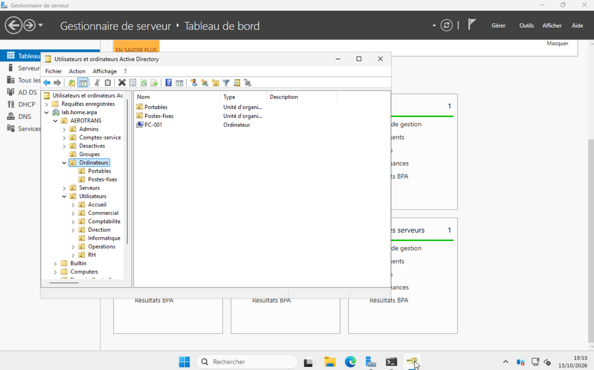

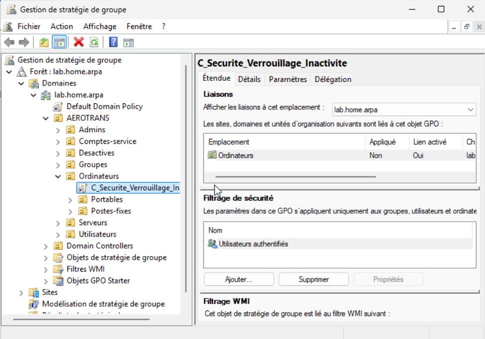

### Étape 10 · La première connexion d'une salariée

🖱️ Sur PC-001 : **Autre utilisateur** > `nathalie.girard` (Comptabilité) > son mot de passe provisoire.

✅ **Changement de mot de passe imposé** à la première connexion (réglé par le script d'import, brique 03).


⌨️ Vérifications :

| Commande | Résultat | Sens |
| --- | --- | --- |
| `whoami` | `lab\nathalie.girard` | Connectée avec son compte **du domaine** |
| `gpresult /r /scope user` | Aucune GPO utilisateur | Normal : nos GPO n'ont que des paramètres **ordinateur** |
| `whoami /groups` | `GG_Comptabilite`, **pas** d'Administrateurs | ✅ **Pas admin** : moindre privilège |

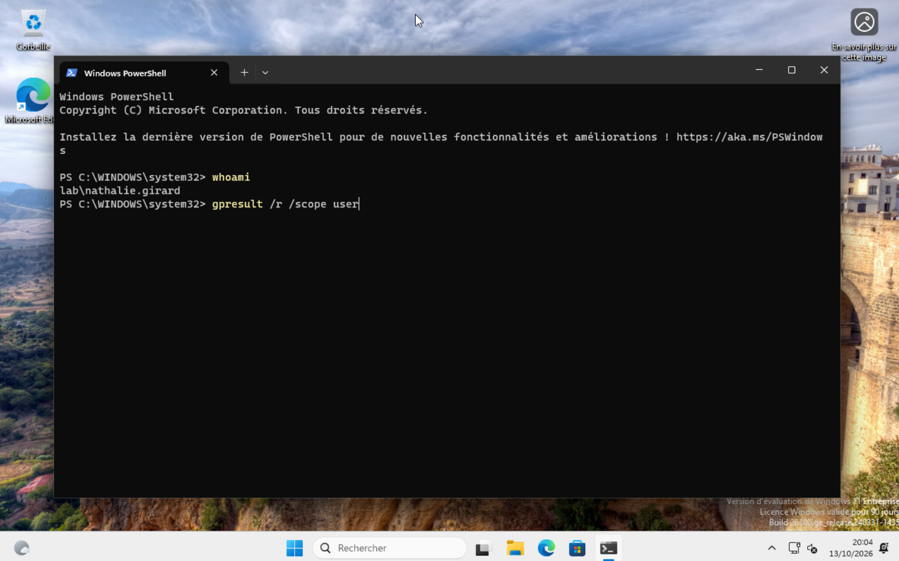
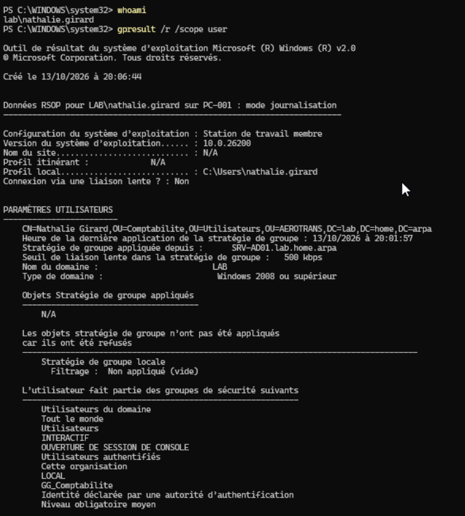


---

## Partie 3 — Tester la GPO de verrouillage

### Étape 11 · Preuve n° 1 : le registre

💡 Une GPO écrit ses réglages dans le **registre** du PC. Si la valeur est là, la GPO est arrivée.

🖱️ Sur PC-001 (session de Nathalie) : `regedit` > `HKLM\SOFTWARE\Microsoft\Windows\CurrentVersion\Policies\System`.

✅ `InactivityTimeoutSecs = 600` (lisible en simple utilisatrice).


### Étape 12 · Preuve n° 2 : le chronomètre

🎯 Vérifier que la session se verrouille bien **au bout de 10 minutes**, pas avant, pas après.

❌ **Premier essai faussé** : départ à 21:45… et la session se verrouille **avant** 10 minutes.

💡 **Cause** : Windows 11 **éteint l'écran après 5 minutes** par défaut, et l'extinction de l'écran
**verrouille aussi** la session. **Le premier mécanisme qui se déclenche gagne.**

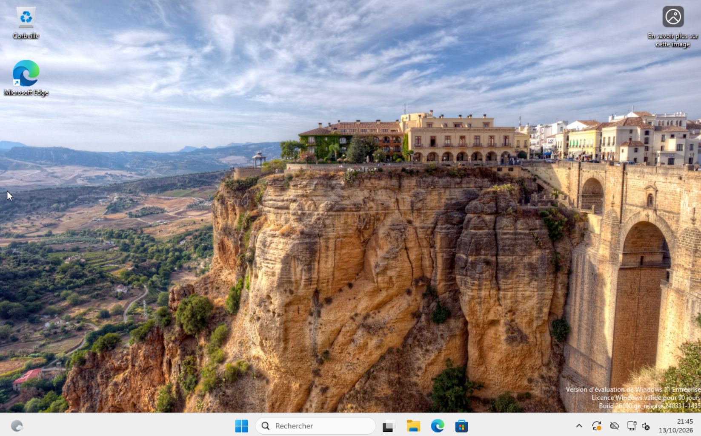
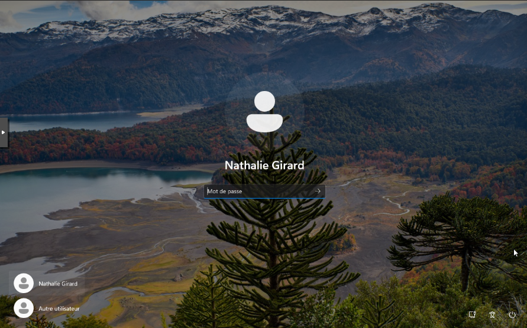


✅ **Méthode** : **neutraliser l'un pour tester l'autre**. Extinction de l'écran passée à 15 min →
chrono à 21:58 → **verrouillage à 22:08 pile**.

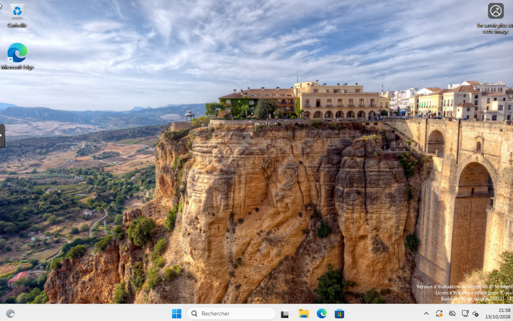


💡 **Correction durable** : la GPO d'alimentation (étape 13) règle l'écran à 15 min sur tous les postes fixes.

### Étape 13 · La GPO d'alimentation des postes fixes

💡 **Pourquoi seulement les postes fixes ?** Un **PC fixe** qui se met en veille rate les mises à jour de
nuit, les sauvegardes et l'administration à distance → **jamais de veille**. Un **portable** sur batterie
**doit** se mettre en veille (batterie, chauffe dans le sac) → il ne reçoit pas cette GPO. C'est tout
l'intérêt d'avoir deux sous-OU.

🖱️ **Gestion des stratégies de groupe** > clic droit sur l'OU **Postes-fixes** > **Créer un objet GPO dans ce
domaine, et le lier ici** > `C_Config_Alimentation` (« Config » et non « Securite » : c'est du confort et
du fonctionnement) > clic droit > **Modifier** :

Configuration ordinateur > Stratégies > Modèles d'administration > Système > **Gestion de l'alimentation** :

| Dossier > paramètre | Valeur |
| --- | --- |
| Paramètres de l'affichage et de la vidéo > **Désactiver l'affichage (sur secteur)** | Activé, **900** s (15 min : plus que les 10 min du verrouillage, c'est la GPO de verrouillage qui décide) |
| Paramètres de la veille > **Spécifier le délai de veille du système (sur secteur)** | Activé, **0** = jamais |

❌ **Pièges dans la liste** : « délai de veille **prolongée** » (c'est l'hibernation) et « délai de veille
**si l'ordinateur n'est pas utilisé** » (après un réveil automatique) ne sont **pas** les bons.

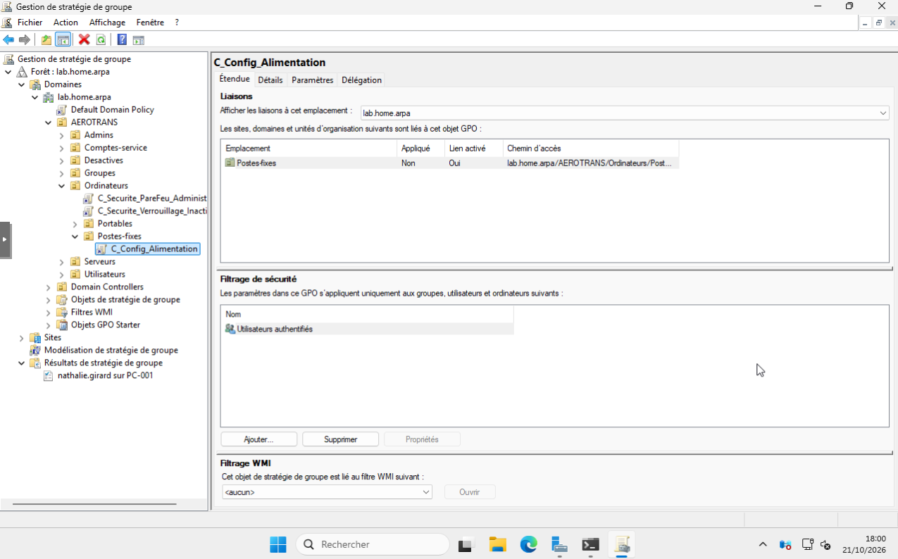
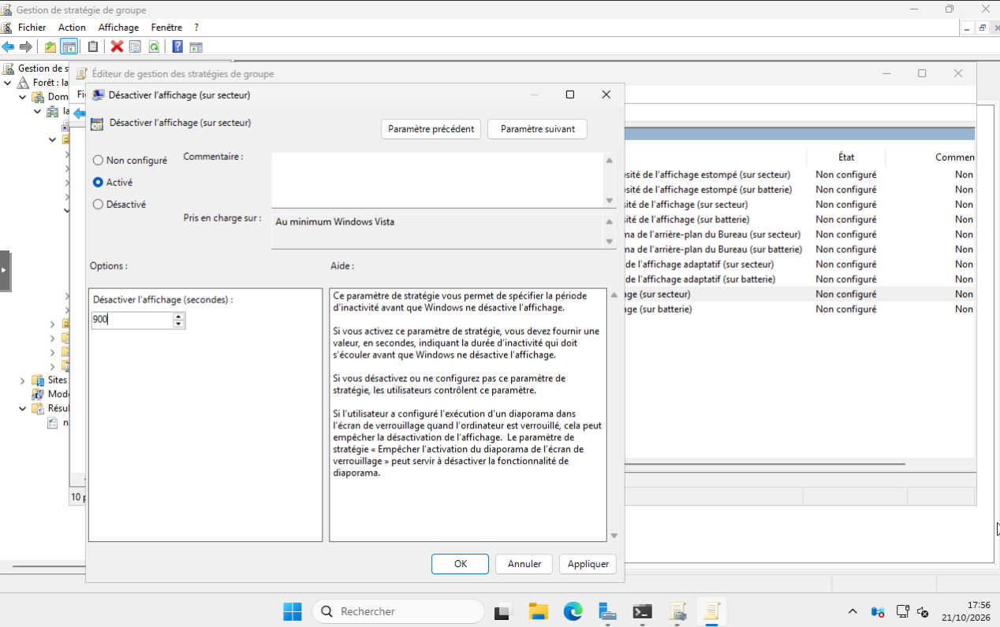
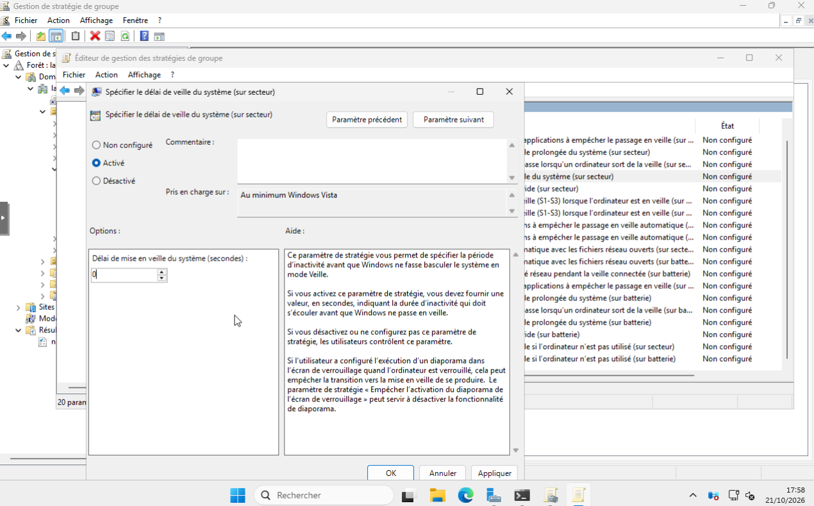

⌨️ **Vérification sur PC-001** (après `gpupdate /force`) :

- Paramètres > Système > Alimentation : écran **15 min, grisé** : Nathalie ne peut pas le changer ✅ ;
- la ligne « veille » n'apparaît pas : `powercfg /a` montre que **la VM ne gère aucun état de veille**
  (« l'hyperviseur ne prend pas en charge… »), donc Windows cache l'option ;
- `powercfg /q SCHEME_CURRENT SUB_SLEEP STANDBYIDLE` → sur secteur **0x00000000** = jamais ✅ ; sur
  batterie **0x258** = 600 s, non touché.


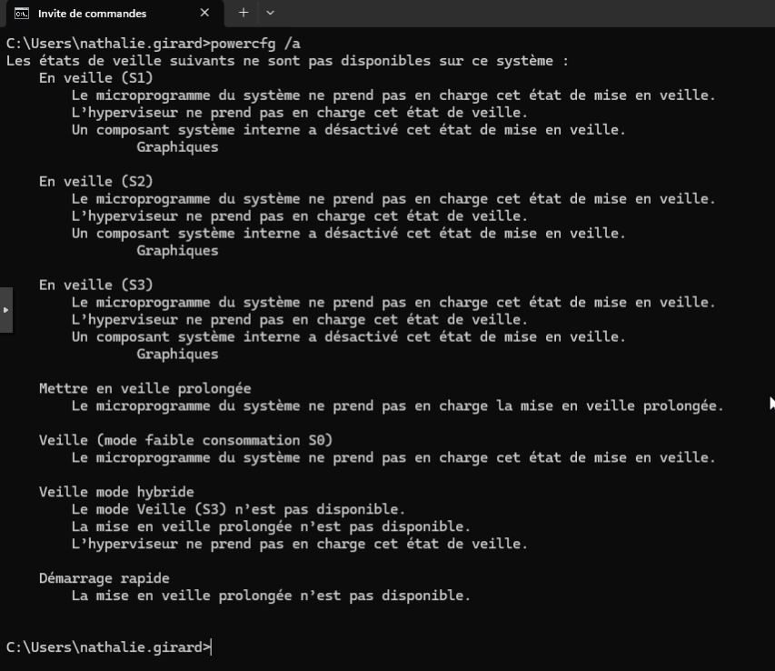


---

## Partie 4 — Administrer le poste à distance

### Étape 14 · Le besoin, et l'erreur « serveur RPC indisponible »

🎯 Depuis SRV-AD01, lancer **Résultats de stratégie de groupe** (RSOP) sur PC-001 : savoir quelles GPO
s'appliquent, **sans se déplacer**.

🖱️ **Gestion des stratégies de groupe** > clic droit sur **Résultats de stratégie de groupe** > **Assistant** >
**Un autre ordinateur** : `PC-001`.

❌ « **Le serveur RPC n'est pas disponible** ».

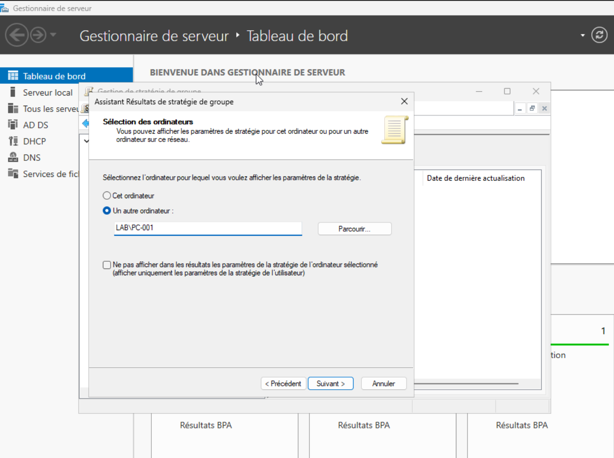


### Étape 15 · Diagnostic : il y a deux pare-feu sur le chemin

⌨️ Sur SRV-AD01 :

```powershell
Test-NetConnection 10.10.20.101 -Port 135
```
❌ `TcpTestSucceeded : False` : le port **135** (RPC) n'est pas joignable.

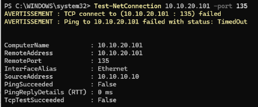

🖱️ pfSense > **Status > System Logs > Firewall** : `SERVEURS … Default deny … 10.10.10.10 → 10.10.20.101:135`.
→ **pfSense bloque** (refus par défaut : le VLAN Serveurs est au moindre privilège depuis la brique 03).

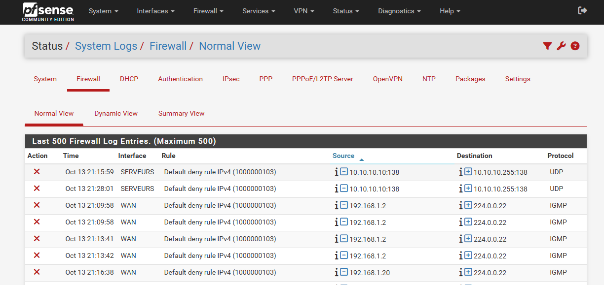


💡 **Comment marche RPC** : comme un **standard téléphonique**. On appelle d'abord le **port 135**, qui
répond « rappelle WMI sur tel **port dynamique** » (entre 49152 et 65535). Il faut donc ouvrir **les deux**.

### Étape 16 · Premier pare-feu : pfSense

🎯 Autoriser **seulement SRV-AD01** à joindre les postes en RPC/WMI. Méthode :
[procédure pare-feu](../docs/procedure-pare-feu.md) : besoin écrit dans la matrice des flux (ligne 7),
**sauvegarde de la configuration**, photo des règles avant.

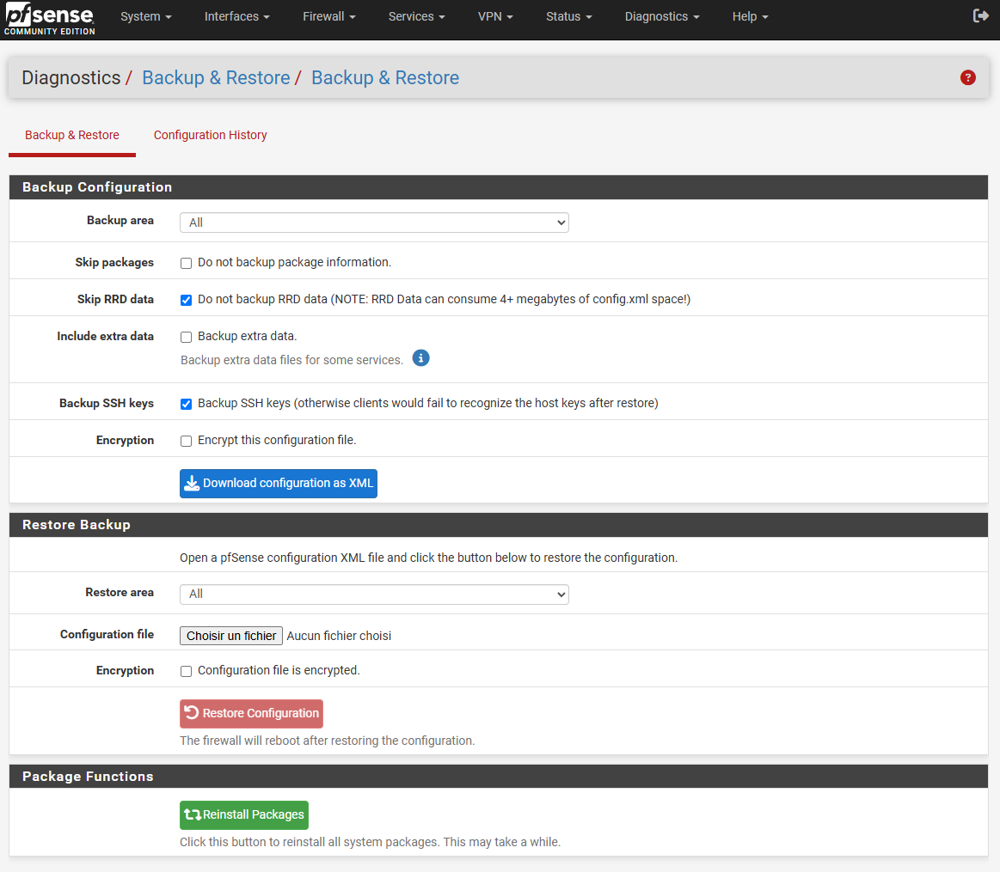
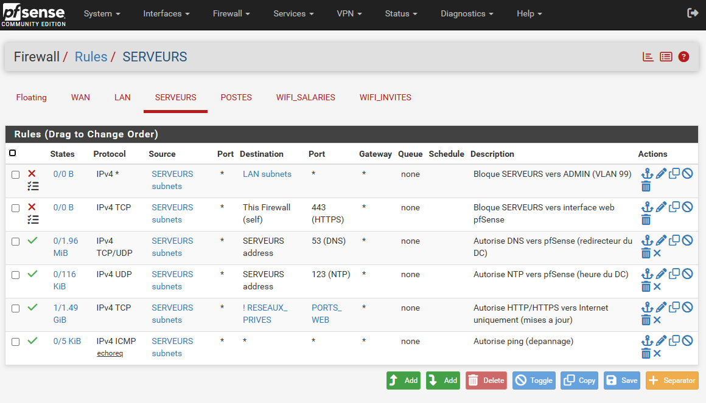

🖱️ **Firewall > Aliases** > onglet **Ports** > **Add** : nom `PORTS_RPC_WMI`, ports `135` et `49152:65535`.
💡 Dans pfSense, une plage s'écrit avec **deux-points** (`49152:65535`), pas avec un tiret.

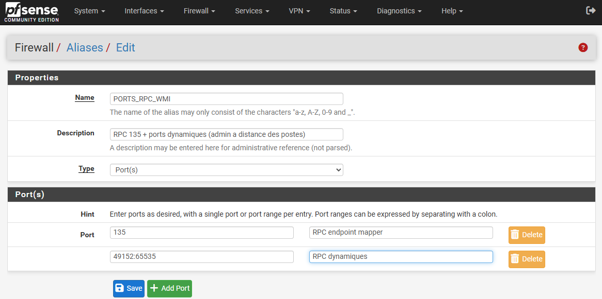

🖱️ **Firewall > Rules > SERVEURS** > **Add** (en **fin de liste**) :

| Champ | Valeur | Pourquoi |
| --- | --- | --- |
| Action | Pass | |
| Protocol | TCP | |
| Source | Single host : `10.10.10.10` | **Moindre privilège** : un autre serveur du VLAN (le futur GLPI) ne peut pas s'en servir |
| Destination | **POSTES subnets** | |
| Destination port | `PORTS_RPC_WMI` | |
| Description | `Autorise SRV-AD01 vers POSTES RPC/WMI (admin a distance)` | 57 caractères maximum (sinon coupée dans les journaux), sans accents |

❌ **Piège rencontré** : la destination était restée sur **Any** au premier essai. La règle aurait « marché »,
mais elle ouvrait RPC vers **tous** les réseaux, Internet compris. 👉 **Une règle trop large fonctionne
aussi** : c'est pour ça qu'on teste **ce qui doit être bloqué**, pas seulement ce qui doit passer.


⌨️ `Test-NetConnection 10.10.20.101 -Port 135` → ✅ **True**.

❌ Le tout premier essai a encore donné False : pfSense était en train de **recharger les règles** (bandeau
*reloading in the background*). On relance le test.

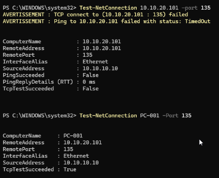


💡 Le **ping**, lui, échoue toujours alors que pfSense l'autorise : c'est le **pare-feu Windows** du poste qui
refuse de répondre. Preuve qu'il y a bien **un deuxième pare-feu**. Après : nouvelle sauvegarde de pfSense.

### Étape 17 · Deuxième pare-feu : Windows, par GPO

❌ RSOP échoue encore : le port 135 répond, mais le pare-feu Windows refuse le **port dynamique** de WMI.


🏢 **En entreprise, on ne règle jamais le pare-feu poste par poste** : une GPO s'applique à tous les PC,
y compris les futurs.

🖱️ GPMC > clic droit sur **Ordinateurs** > **Créer un objet GPO… et le lier ici** >
`C_Securite_PareFeu_Administration` > **Modifier** > Configuration ordinateur > Stratégies > Paramètres
Windows > Paramètres de sécurité > **Pare-feu Windows Defender avec fonctions avancées de sécurité** >
**Règles de trafic entrant** > clic droit > **Nouvelle règle** > **Prédéfinie** > « **Infrastructure de
gestion Windows (WMI)** » (le nom français de WMI : chercher à la lettre **I**) > coche les 3 règles >
**Autoriser la connexion**.

| Règle | Rôle |
| --- | --- |
| WMI (DCOM-In) | Le « standard » sur le port 135 |
| WMI (WMI-In) | Le service WMI, sur le port dynamique |
| WMI (ASync-In) | Les réponses envoyées plus tard (asynchrones) |

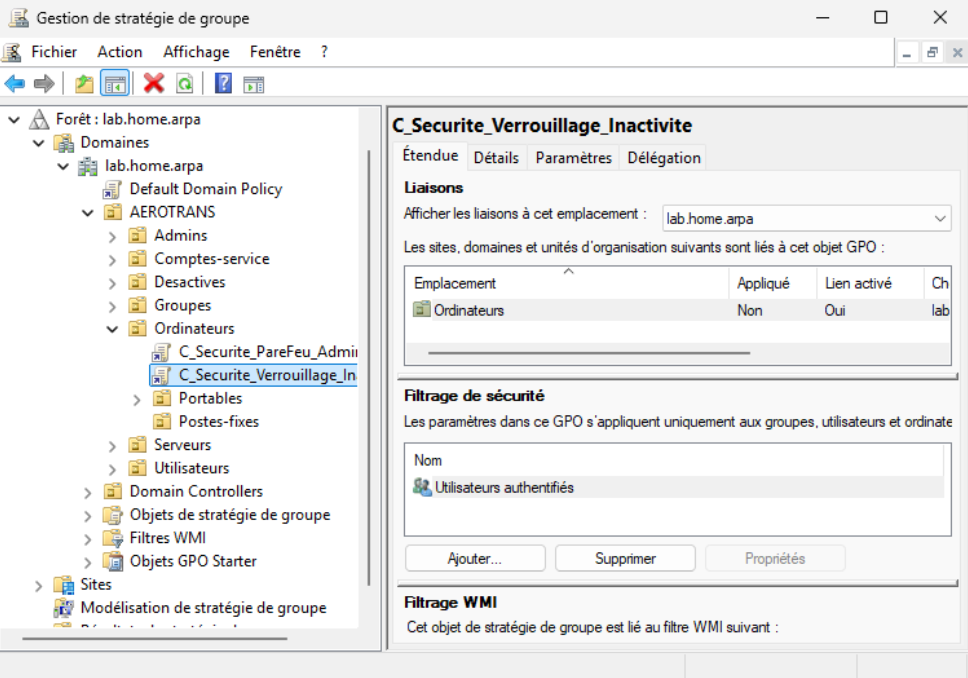
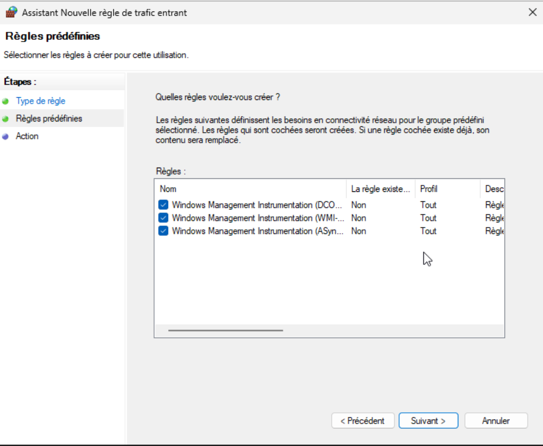
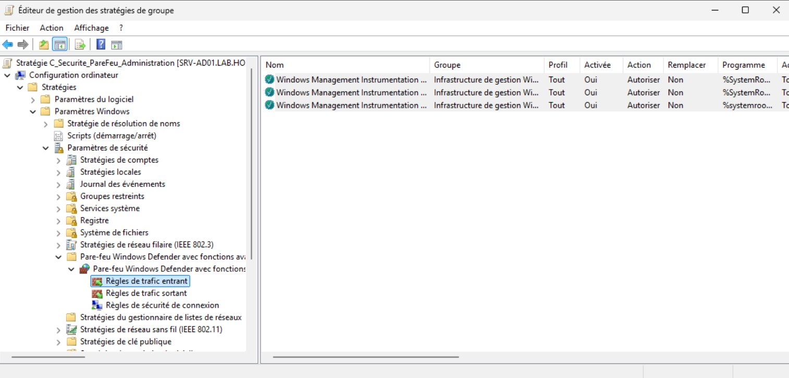

🖱️ Puis, **sur chacune des 3 règles** (double-clic) :
- onglet **Étendue** > **Adresse IP distante** > **Ces adresses IP** > **Ajouter** > `10.10.10.10` ;
- onglet **Avancé** > profils : ✅ **Domaine** uniquement (❌ Privé, ❌ Public).

💡 **Profil Domaine** : la règle ne s'ouvre qu'**au bureau** (quand le PC voit le domaine), jamais sur le
Wi-Fi d'un hôtel (profil Public). Et la même restriction « SRV-AD01 seulement » existe **sur le réseau**
(pfSense) **et sur le poste** : c'est la **défense en profondeur**.

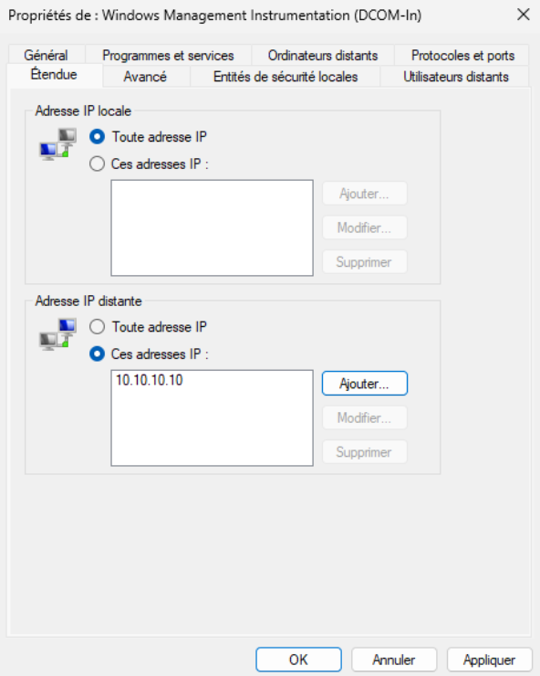
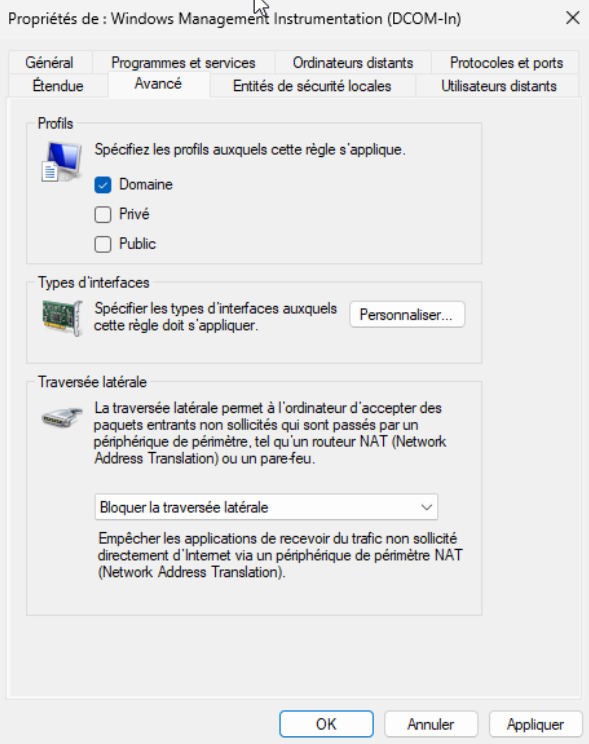
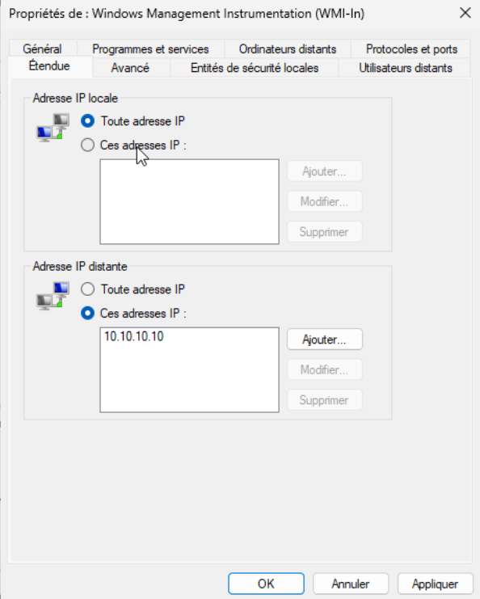
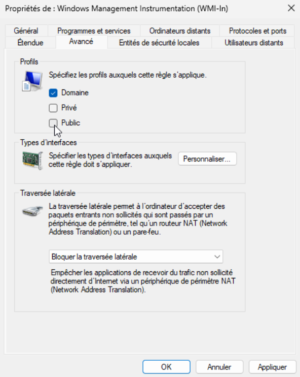
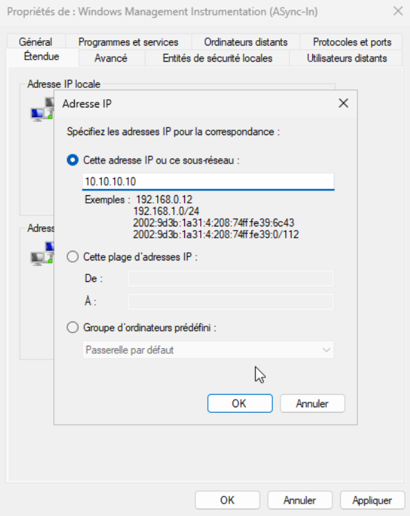
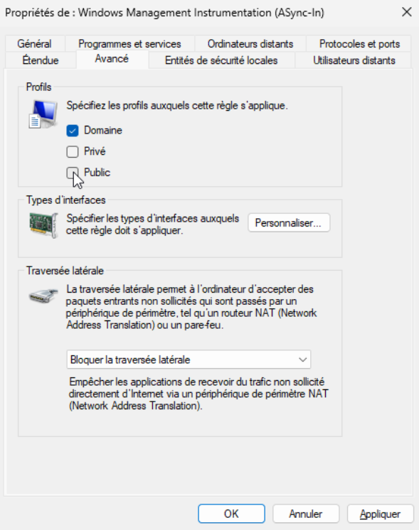


⌨️ Sur PC-001 : `gpupdate /force` (pas besoin de redémarrer : les règles de pare-feu s'appliquent tout de
suite).

💡 `gpresult /r /scope computer` répond **« Accès refusé »** pour Nathalie : normal, une utilisatrice ne voit
pas les réglages de l'ordinateur. On vérifie **depuis le serveur** (étape suivante).

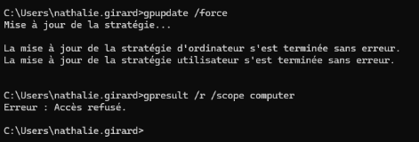

### Étape 18 · Le résultat : le rapport RSOP

🖱️ Assistant RSOP sur PC-001 : ✅ il trouve `LAB\nathalie.girard` (la liste vient de WMI) et le rapport
s'affiche.

❌ Un message « Internet Explorer… configuration de sécurité renforcée » apparaît d'abord : ce n'est **pas** une
erreur réseau. Le rapport est une page web, et Windows Server bloque les pages web (un serveur ne sert pas à
naviguer). 🖱️ **Fermer**, **sans** ajouter le site aux sites de confiance.

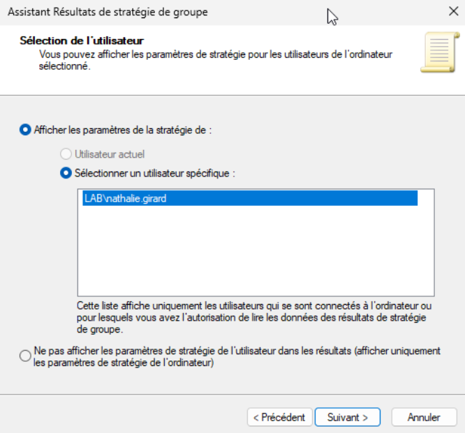
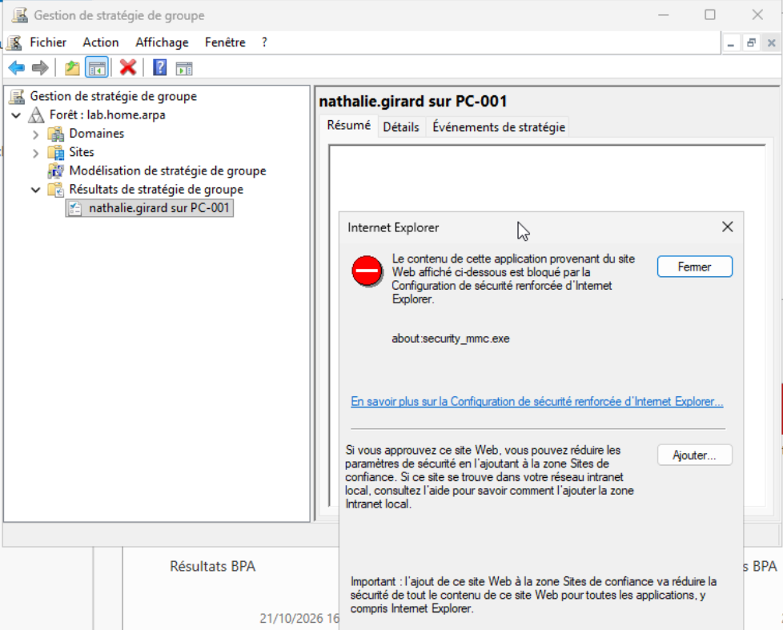

✅ Le rapport montre : PC dans `AEROTRANS/Ordinateurs/Postes-fixes` ; verrouillage **600 s** gagné par
`C_Securite_Verrouillage_Inactivite` ; les 3 règles WMI gagnées par `C_Securite_PareFeu_Administration`,
avec l'étendue **10.10.10.10** et le profil **Domaine**.


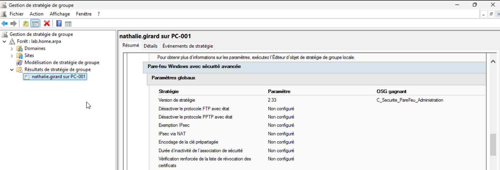

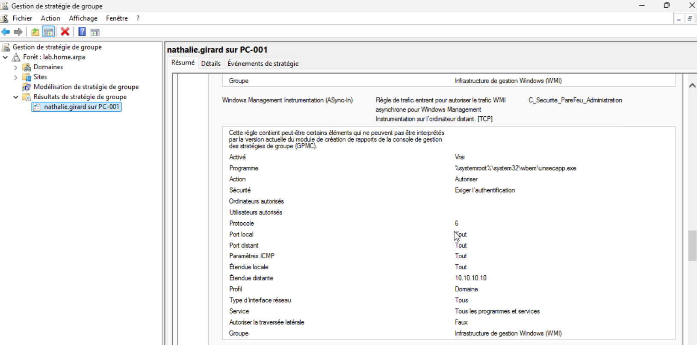
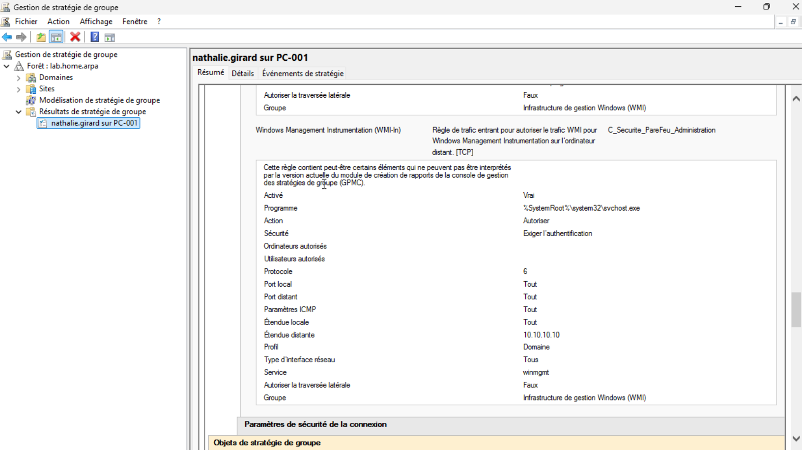

---

## Partie 5 — Durcir l'annuaire et le poste

### Étape 19 · `ms-DS-MachineAccountQuota` à 0

💡 Par défaut, **n'importe quel utilisateur du domaine peut joindre 10 ordinateurs**. Risques : un PC
personnel non géré dans le domaine, et surtout un **faux compte ordinateur** créé par un pirate, point de
départ de plusieurs attaques d'élévation de privilèges.

🖱️ Sur SRV-AD01 : **Windows + R** > `adsiedit.msc` > clic droit **ADSI Edit** > **Connexion** > contexte de
nommage **par défaut** > OK. Clic droit sur `DC=lab,DC=home,DC=arpa` > **Propriétés** > attribut
**`ms-DS-MachineAccountQuota`** > **Modifier** : `10` → **`0`** > OK > **Appliquer**.

⚠️ ADSI Edit montre **tous** les attributs bruts de l'annuaire, **sans garde-fou** : on ne touche qu'à ce qui
est prévu.


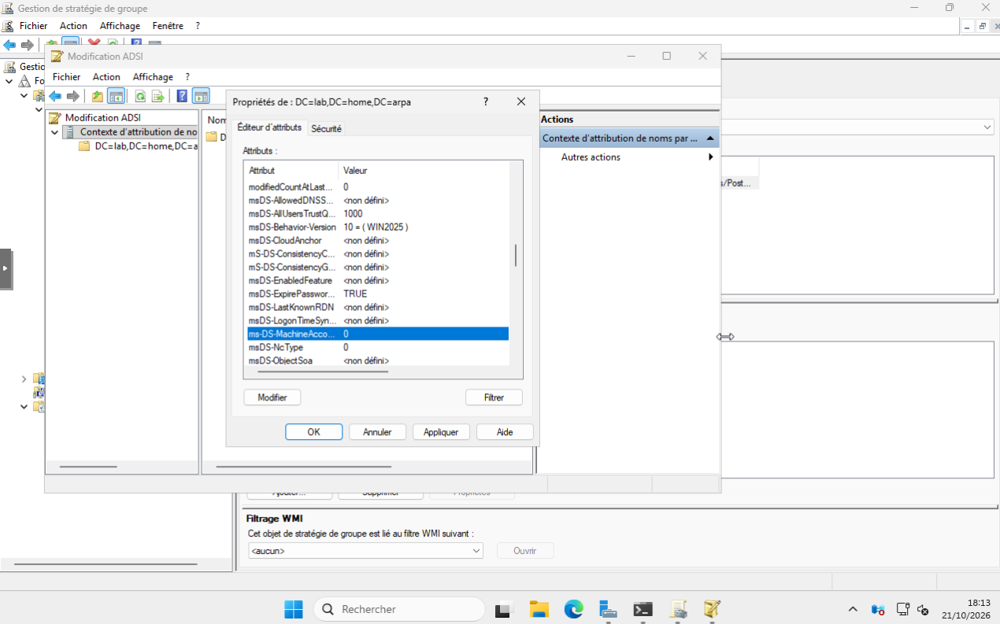

⌨️ Vérification :

```powershell
Get-ADObject (Get-ADDomain).DistinguishedName -Properties ms-DS-MachineAccountQuota
```
✅ `0`. Rien n'est cassé : PC-001 est déjà joint, et les admins du domaine gardent le droit de joindre. Les
autres auront une **délégation** (étape 21).


### Étape 20 · Désactiver le compte local d'installation

💡 `tech.install` (étape 3) est un **administrateur local**, avec un mot de passe qui n'expire jamais, et
plus utilisé : **une porte dérobée idéale**.

❌ Depuis la session de Nathalie, **Gestion de l'ordinateur** s'ouvre en lecture seule : la modification
renvoie « **Accès refusé** ». Normal (moindre privilège).


🖱️ **Démarrer** > clic droit sur **Gestion de l'ordinateur** > **Exécuter en tant qu'administrateur** (UAC,
compte admin du domaine) > **Utilisateurs et groupes locaux** > **Utilisateurs** > double-clic sur
`tech.install` > ✅ **Le compte est désactivé** > OK.

💡 **Désactivé plutôt que supprimé** : retour arrière en un clic si besoin.

✅ Tous les comptes locaux sont désactivés (petite flèche vers le bas sur l'icône).

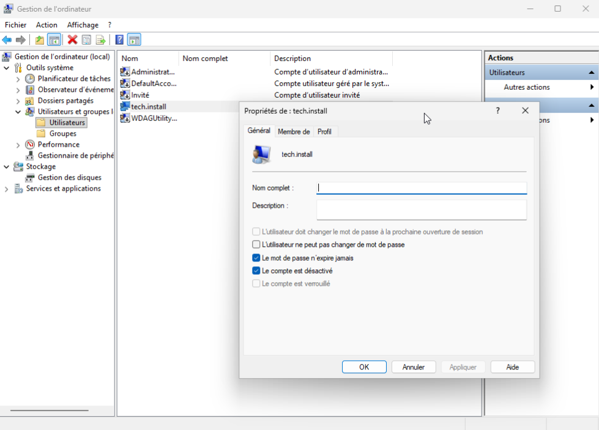


### Étape 21 · Déléguer la jonction des PC, sans être admin du domaine

🎯 Le technicien qui installe les PC n'a pas à détenir **les clés du domaine**. On lui donne **juste** le
droit de joindre des PC dans l'OU Ordinateurs.

💡 **Méthode AGDLP** : on ne donne jamais un droit à une personne, mais à un groupe :

```
paulo.rosa (compte du quotidien, non admin)
   ∈ GG_Informatique (groupe global, existant)
      ∈ DL_OU-Ordinateurs_JoindrePC (groupe domaine local, nouveau, avec description)
         → reçoit la délégation sur l'OU Ordinateurs
```

Un 2e technicien arrive ? On l'ajoute à `GG_Informatique`, **sans retoucher aux permissions**.

🖱️ OU **Groupes** > **Nouveau** > **Groupe** : `DL_OU-Ordinateurs_JoindrePC`, étendue **Domaine local**,
type **Sécurité**, description > onglet **Membres** > **Ajouter** `GG_Informatique`.

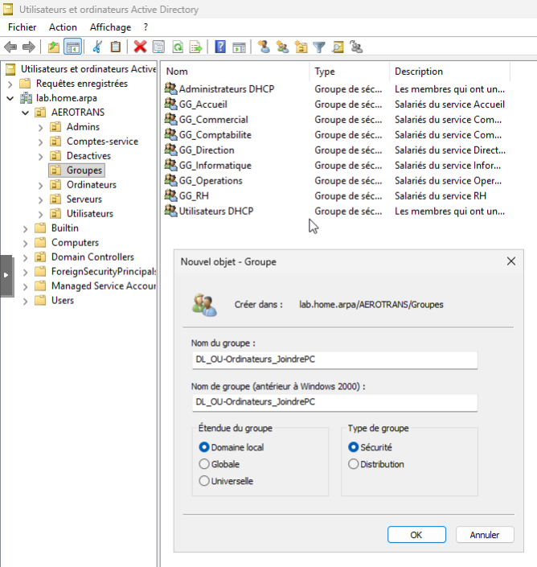
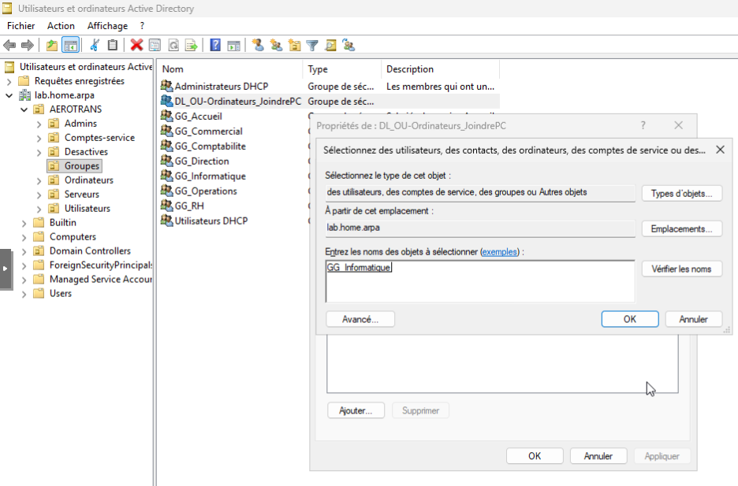
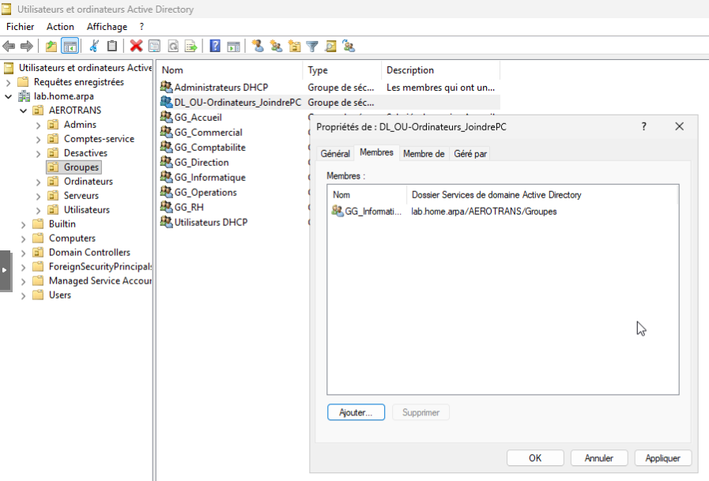


🖱️ Clic droit sur l'OU **Ordinateurs** > **Délégation de contrôle** > Ajouter `DL_OU-Ordinateurs_JoindrePC` >
**Créer une tâche personnalisée à déléguer** > **Seulement des objets suivants** : ✅ **Objets Ordinateur**,
✅ Créer, ✅ Supprimer > Autorisations (cocher **Spécifiques à la propriété** pour les voir) :

| Autorisation | Pourquoi |
| --- | --- |
| Réinitialiser le mot de passe | Un compte ordinateur a son propre mot de passe, défini à la jonction |
| Lire et écrire Restrictions de compte | Activer le compte et régler son type |
| Écriture validée vers le nom d'hôte DNS | Enregistrer `PC-xxx.lab.home.arpa` ; « validée » = l'AD vérifie la cohérence |
| Écriture validée vers le nom de principal du service (SPN) | Les étiquettes Kerberos du PC, vérifiées elles aussi |

❌ **Pas de « Contrôle total »**, que proposent beaucoup de tutos : il permettrait de modifier les droits et
de prendre la main sur les comptes ordinateur **existants** de l'OU.


🖱️ **Vérification** : menu **Affichage** > ✅ **Fonctionnalités avancées** > Propriétés de l'OU Ordinateurs >
onglet **Sécurité** > **Avancé** : 5 entrées `DL_OU-Ordinateurs_JoindrePC`.

💡 On y voit aussi « Tout le monde – Refuser » (la **protection contre la suppression accidentelle**) et
« Opérateurs de compte », un groupe intégré qui peut lui aussi créer des ordinateurs et doit rester **vide**.


Test réel (joindre un PC avec `paulo.rosa`) : à faire avec le portable PO-001.

---

## Partie 6 — LAPS : un mot de passe admin local unique par poste

> 💡 **Le problème** : si le compte administrateur local a le **même mot de passe sur tous les PC**, le
> pirate qui le récupère sur un poste (avec Mimikatz par exemple) se connecte à **tous** les autres. C'est
> le **mouvement latéral**, au cœur de la plupart des attaques par rançongiciel.
>
> **Windows LAPS** : chaque PC génère un mot de passe **unique et aléatoire**, le **change tout seul**, et le
> range **chiffré** dans son objet AD, lisible seulement par les personnes autorisées.

### Étape 22 · Un instantané avant de toucher au schéma

💡 Le **schéma**, c'est la **structure** de tout l'annuaire (quels types d'objets et quels champs existent).
L'étendre est **irréversible**.

🖱️ Proxmox > SRV-AD01 > **Instantanés** > `avant-laps-schema`, **avec la RAM**.


🏢 On ne restaure pas un instantané de DC quand il y en a plusieurs (*USN rollback*, brique 03). En
entreprise : sauvegarde de l'état système, test dans un lab, fenêtre de maintenance. Avec un seul DC,
l'instantané est sans risque.

### Étape 23 · Étendre le schéma, en « juste à temps »

💡 Seul le groupe **Administrateurs du schéma** peut modifier le schéma. Il ne contient que le compte
`Administrateur` intégré, et **ça doit rester ainsi le reste du temps**.

1. ⌨️ `whoami` → `lab\adm.paulo.rosa`. `whoami /groups | findstr /i "schéma"` ne renvoie rien… ❌ mais
   `findstr` gère mal les **accents** : on vérifie à l'interface : le groupe ne contient bien que `Administrateur`.


2. 🖱️ **Ajout temporaire** d'`adm.paulo.rosa` au groupe **Administrateurs du schéma**, puis
   **déconnexion / reconnexion**. 💡 Les groupes sont chargés dans le **jeton** de sécurité à l'ouverture de
   session : sans reconnexion, le nouveau droit n'est pas pris en compte.


3. ⌨️ `whoami /groups | Select-String "sch"` → ✅ `LAB\Administrateurs du schéma`, groupe activé.


4. ⌨️ PowerShell **en administrateur** :

```powershell
Update-LapsADSchema -Verbose
```
✅ 7 attributs `msLAPS-*` ajoutés aux objets ordinateur, et le droit `ms-LAPS-Encrypted-Password-Attributes`
créé. (Il n'y a pas d'interface graphique pour cette étape.)


5. 🖱️ **Retrait immédiat** d'`adm.paulo.rosa` du groupe.


💡 C'est le **Just-In-Time** : le droit est donné **pour l'opération**, puis retiré. En SOC, l'ajout d'un
membre dans un groupe de RID 512 (Admins du domaine), 518 (schéma) ou 519 (entreprise) déclenche une alerte
(événement **4728** sur le DC).

### Étape 24 · Les postes peuvent écrire leur propre mot de passe

⌨️

```powershell
Set-LapsADComputerSelfPermission -Identity "OU=Ordinateurs,OU=AEROTRANS,DC=lab,DC=home,DC=arpa"
```
✅ Chaque PC de l'OU (et des sous-OU) peut écrire **son propre** mot de passe dans l'AD, et seulement le sien.


### Étape 25 · La GPO C_Securite_LAPS

🖱️ GPMC > clic droit sur **Ordinateurs** > **Créer un objet GPO… et le lier ici** > `C_Securite_LAPS` >
**Modifier** > Configuration ordinateur > Stratégies > Modèles d'administration > Système > **LAPS** :

| Paramètre | Valeur | Pourquoi |
| --- | --- | --- |
| Configurer le répertoire de sauvegarde de mot de passe | Activé : **Active Directory** | « Azure Active Directory » (= Entra ID) sert aux PC joints au cloud. Par défaut : désactivé, LAPS ne fait rien |
| Paramètres du mot de passe | Complexité maximale, **20** caractères, **30** jours | La « longueur de phrase secrète » ne sert qu'avec une complexité de type phrase |
| Activer le chiffrement du mot de passe | Activé | Possible à partir du niveau fonctionnel 2016 (ici 2025). Déchiffrement : Admins du domaine |
| Configurer la gestion automatique des comptes | Activé : compte **personnalisé** `secours.local`, compte **activé**, nom non aléatoire | Voir étape 26 |

💡 Liée à **Ordinateurs** (pas seulement Postes-fixes) : les **portables** en ont encore plus besoin (ils
sortent, se perdent, se volent).


### Étape 26 · Quel compte confier à LAPS ? (erreur corrigée)

💡 LAPS sert surtout quand le PC a **perdu la relation d'approbation** avec le domaine (portable resté des
mois au placard, restauration ancienne) : plus aucun compte du domaine ne marche, seul un **compte local**
permet d'entrer. Or le compte `Administrateur` intégré est **désactivé** par Windows : s'il le reste, LAPS
range un mot de passe **inutilisable**.

| Méthode | Principe | Quand |
| --- | --- | --- |
| Classique | Réactiver l'`Administrateur` intégré par GPO (« Comptes : statut du compte Administrateur ») et le confier à LAPS | Parc mélangé (Windows 10, anciens serveurs) : la plus répandue aujourd'hui |
| **Gestion automatique** (retenue) | LAPS **crée et gère** son propre compte (`secours.local`) ; l'`Administrateur` intégré reste désactivé | Tous les postes en Windows 11 **24H2 ou plus** |

❌ **Erreur du lab** : la méthode classique avait d'abord été configurée « par prudence », **sans vérifier** la
version de Windows. ✅ Vérification : `winver` → **25H2** (build 26200), donc gestion automatique possible.
Le réglage classique est remis à **Non défini**. 👉 On vérifie la version **avant** de choisir.


💡 **Le nom `secours.local`** : pas de « admin », rien qui ressemble aux comptes du domaine `adm.prenom.nom`.
Sans nom, Windows utilise `WLapsAdmin`, connu de tous. L'option « nom aléatoire » (qui change à chaque
rotation) est plus sûre mais plus lourde au quotidien : non activée pour l'instant.

### Étape 27 · Tester LAPS

1. ⌨️ PC-001 : `gpupdate /force`, attendre une minute.
2. 🖱️ PC-001, **Gestion de l'ordinateur** (en administrateur) : ✅ compte **`secours.local` créé et actif**,
   description « Ce compte est actuellement géré… » ; `Administrateur` toujours désactivé.


3. 🖱️ SRV-AD01, **Utilisateurs et ordinateurs AD** > PC-001 > onglet **LAPS** : compte `secours.local`,
   expiration **20/11/2026** (30 jours), mot de passe **masqué**. ⚠️ On ne clique **pas** sur « Afficher le mot de
   passe » pour une capture.


4. ⌨️ PowerShell **en administrateur** (obligatoire sur un DC) :

```powershell
Get-LapsADPassword -Identity PC-001
```

| Champ | Valeur | Sens |
| --- | --- | --- |
| Account | secours.local | Le compte géré |
| Password | `System.Security.SecureString` | Jamais affiché en clair sans `-AsPlainText` |
| ExpirationTimestamp | 20/11/2026 | Prochain changement |
| Source | **EncryptedPassword** | Stocké **chiffré** |
| DecryptionStatus | Success | On a le droit de le déchiffrer |
| AuthorizedDecryptor | LAB\Admins du domaine | Qui peut le lire |

❌ **Erreurs du lab** : `Get-LapsAADPassword` (avec **AAD**) est la commande pour **Entra ID** : tapée par erreur,
elle ne connaît pas `-Identity`. Et dans un PowerShell **non élevé**, la commande refuse (*requires elevation*).


---

## Annexes

### A. Récapitulatif sécurité

| Mesure | Contre quoi |
| --- | --- |
| Verrouillage à 10 min | Poste laissé ouvert à la pause |
| RPC/WMI ouvert **seulement** depuis SRV-AD01, sur pfSense **et** sur le poste, profil Domaine | Un poste ou un serveur compromis qui sonde les autres |
| MachineAccountQuota = 0 + délégation au moindre privilège | Faux comptes ordinateur, PC non gérés |
| Comptes locaux désactivés (tech.install, Administrateur) | Comptes oubliés aux mots de passe éternels |
| LAPS chiffré, compte de secours au nom non standard | Mouvement latéral avec un mot de passe local partagé |
| Administrateurs du schéma vide (Just-In-Time) | Modification de la structure de l'annuaire |

### B. Équivalents PowerShell

Les commandes **testées** dans le lab sont marquées ✅. Les autres sont l'équivalent des clics,
données pour référence : à valider dans un lab avant usage.

```powershell
# --- Poste : licence, nom, DNS, jonction ---
slmgr /dlv ; slmgr /ato ; slmgr /xpr                                   # ✅
Rename-Computer -NewName PC-001 -Restart
Resolve-DnsName -Type SRV _ldap._tcp.dc._msdcs.lab.home.arpa           # ✅
Add-Computer -DomainName lab.home.arpa -Credential LAB\adm.paulo.rosa -Restart

# --- Serveur : ranger le PC dans la bonne OU ---
$base = "OU=AEROTRANS,DC=lab,DC=home,DC=arpa"
Move-ADObject -Identity "CN=PC-001,OU=Ordinateurs,$base" -TargetPath "OU=Postes-fixes,OU=Ordinateurs,$base"

# --- Tests réseau ---
Test-NetConnection PC-001 -Port 135                                    # ✅

# --- GPO pare-feu Windows : règles WMI prédéfinies, restreintes à SRV-AD01 et au profil Domaine ---
New-GPO -Name C_Securite_PareFeu_Administration | New-GPLink -Target "OU=Ordinateurs,$base"
$store = "lab.home.arpa\C_Securite_PareFeu_Administration"
Copy-NetFirewallRule -DisplayGroup "Infrastructure de gestion Windows (WMI)" -Direction Inbound -NewPolicyStore $store
Set-NetFirewallRule -PolicyStore $store -DisplayGroup "Infrastructure de gestion Windows (WMI)" `
  -RemoteAddress 10.10.10.10 -Profile Domain -Enabled True

# --- Poste : appliquer et vérifier ---
gpupdate /force                                                        # ✅
powercfg /a                                                            # ✅
powercfg /q SCHEME_CURRENT SUB_SLEEP STANDBYIDLE                       # ✅

# --- GPO alimentation (valeurs de registre des paramètres d'alimentation, GUID publics de Microsoft) ---
New-GPO -Name C_Config_Alimentation | New-GPLink -Target "OU=Postes-fixes,OU=Ordinateurs,$base"
# Écran (sur secteur) : 900 s
Set-GPRegistryValue -Name C_Config_Alimentation -Key "HKLM\Software\Policies\Microsoft\Power\PowerSettings\3C0BC021-C8A8-4E07-A973-6B14CBCB2B7E" -ValueName ACSettingIndex -Type DWord -Value 900
# Veille (sur secteur) : 0 = jamais
Set-GPRegistryValue -Name C_Config_Alimentation -Key "HKLM\Software\Policies\Microsoft\Power\PowerSettings\29F6C1DB-86DA-48C5-9FDB-F2B67B1F44DA" -ValueName ACSettingIndex -Type DWord -Value 0

# --- Durcissement AD ---
Get-ADObject (Get-ADDomain).DistinguishedName -Properties ms-DS-MachineAccountQuota   # ✅
Set-ADDomain -Identity lab.home.arpa -Replace @{"ms-DS-MachineAccountQuota"="0"}

# --- Poste : compte local d'installation ---
Disable-LocalUser -Name tech.install

# --- Délégation de la jonction : le groupe (les autorisations fines : assistant graphique,
#     un script dsacls / Set-Acl sera écrit dans la brique 09) ---
New-ADGroup -Name DL_OU-Ordinateurs_JoindrePC -GroupScope DomainLocal -GroupCategory Security `
  -Path "OU=Groupes,$base" -Description "Droit de joindre des PC au domaine dans l'OU Ordinateurs (delegation)"
Add-ADGroupMember DL_OU-Ordinateurs_JoindrePC -Members GG_Informatique

# --- LAPS ---
whoami /groups | Select-String "sch"                                   # ✅
Update-LapsADSchema -Verbose                                           # ✅ (membre temporaire des Administrateurs du schéma)
Set-LapsADComputerSelfPermission -Identity "OU=Ordinateurs,$base"      # ✅
Get-LapsADPassword -Identity PC-001                                    # ✅ (PowerShell élevé)
Set-LapsADPasswordExpirationTime -Identity PC-001                      # forcer un changement au prochain cycle
Invoke-LapsPolicyProcessing                                            # sur le poste : appliquer LAPS tout de suite
```

### C. Dépannages rencontrés

| Symptôme | Cause | Solution |
| --- | --- | --- |
| Aucun disque à l'installation | Pilote VirtIO SCSI absent | `vioscsi\w11\amd64` |
| Pas de réseau pendant l'OOBE | Pilote NetKVM absent | Compte local temporaire, puis virtio-win-guest-tools |
| « La licence Windows a expiré » | Évaluation installée hors ligne, jamais activée (`0xC004F009`) | `slmgr /ato` une fois le réseau en place |
| Session verrouillée avant 10 min | Extinction de l'écran à 5 min (défaut de Windows 11) | Neutraliser pour tester, puis GPO d'alimentation |
| RSOP : « serveur RPC indisponible » (1) | pfSense, refus par défaut SERVEURS → POSTES | Alias + règle depuis SRV-AD01 seulement |
| `Test-NetConnection` False juste après la règle | Règles pfSense encore en rechargement | Relancer le test |
| RSOP : « serveur RPC indisponible » (2) | Pare-feu Windows du poste, WMI fermé | GPO, règles WMI prédéfinies limitées à 10.10.10.10 / Domaine |
| « Windows Management Instrumentation » introuvable | Nom français : « Infrastructure de gestion Windows (WMI) » | Chercher à la lettre I |
| Rapport RSOP bloqué par Internet Explorer | Sécurité renforcée d'IE sur le serveur | Fermer, sans ajouter aux sites de confiance |
| `gpresult /scope computer` : Accès refusé | Utilisatrice non administratrice | Normal ; vérifier depuis le serveur (RSOP) |
| Option « veille » absente des Paramètres | La VM ne gère aucun état de veille | `powercfg /a`, `powercfg /q` |
| tech.install : Accès refusé | Console ouverte sans élévation | Exécuter en tant qu'administrateur |
| `findstr "schéma"` ne trouve rien | `findstr` gère mal les accents | `Select-String`, ou vérification graphique |
| `Get-LapsADPassword` : *requires elevation* | PowerShell non élevé sur un DC | Exécuter en tant qu'administrateur |

### D. Écarts entre le lab et l'entreprise

| Dans le lab | En entreprise | Pourquoi l'écart |
| --- | --- | --- |
| Activation `slmgr` à la main | Activation par l'AD ou KMS, licences en volume | Évaluation du lab |
| PC installé à la main | Déploiement automatisé (image, MDT, Autopilot) | Brique 14 |
| Instantané avant l'extension du schéma | Sauvegarde de l'état système + test en lab + fenêtre de maintenance | Un seul DC |
| Un seul poste | Des dizaines : d'où les GPO plutôt que les réglages locaux | Lab |
| Option « veille » invisible | Visible et grisée sur un vrai PC fixe | Matériel virtuel |
| Mots de passe LAPS lisibles par les Admins du domaine | Groupe dédié de lecteurs LAPS (support N2), lecture auditée | À faire |
| Délégation non encore testée par une vraie jonction | Testée en recette avant la mise en service | Pas de 2e poste (PO-001 prévu) |
| Administration depuis la console Proxmox | Bureau à distance depuis le VLAN d'administration | Attend le switch (brique 02) |

### E. Utilisation en entreprise : 3 cas concrets

1. **Un portable revient après 6 mois au placard** : « la relation d'approbation a échoué ». Le technicien lit
   le mot de passe LAPS de ce PC dans l'AD, se connecte avec `secours.local`, rejoint de nouveau le domaine.
   Le mot de passe sera changé automatiquement ensuite.
2. **Un poste est infecté** : le pirate récupère le mot de passe local… qui ne marche sur **aucun autre PC**.
   Il ne peut pas non plus interroger les autres postes par WMI : seul SRV-AD01 y a droit.
3. **Un salarié dit que son PC ne se verrouille pas** : depuis le serveur, RSOP sur son poste montre en une
   minute quelle GPO s'applique, et laquelle gagne.

### F. Questions d'entretien (avec la réponse)

- **Pourquoi renommer un PC avant de le joindre au domaine ?** Le compte ordinateur est créé avec le nom du
  moment ; renommer après crée des incohérences (DNS, SPN).
- **Une GPO ne s'applique pas sur un poste, que vérifies-tu ?** Le poste est-il dans la bonne OU, la GPO liée
  au bon endroit, partie ordinateur ou utilisateur, filtrage de sécurité ; puis `gpupdate /force`,
  `gpresult /r` ou RSOP depuis le serveur.
- **RSOP à distance échoue avec « serveur RPC indisponible » : ta démarche ?** Tester le port 135
  (`Test-NetConnection`), lire les journaux du pare-feu réseau, puis le pare-feu Windows du poste (ports
  dynamiques de WMI). Un pare-feu à la fois, un test entre chaque étape.
- **Pourquoi deux pare-feu ?** Défense en profondeur : si l'un est mal réglé ou contourné, l'autre protège.
- **Qu'est-ce que ms-DS-MachineAccountQuota ?** Le nombre de PC qu'un utilisateur standard peut joindre (10 par
  défaut). On le met à 0 et on délègue.
- **Pourquoi pas « Contrôle total » dans une délégation ?** Il donne aussi le droit de modifier les permissions
  et de prendre le contrôle des objets existants.
- **Qu'est-ce que LAPS, et contre quelle attaque ?** Un mot de passe admin local unique par poste, changé
  automatiquement : il bloque le mouvement latéral (*pass-the-hash* avec un mot de passe partagé).
- **Différence entre l'ancien LAPS et Windows LAPS ?** L'ancien était un logiciel à installer, mot de passe en
  clair dans l'AD ; Windows LAPS est intégré, chiffre le mot de passe, sait gérer Entra ID et créer son propre compte.
- **Qui peut modifier le schéma, et comment l'as-tu fait ?** Les Administrateurs du schéma ; ajout temporaire,
  reconnexion (jeton), opération, retrait immédiat (Just-In-Time).
- **Pourquoi un compte admin local s'il y a le domaine ?** Pour entrer quand le poste a perdu le contact avec le domaine.

### G. Points en suspens

- Tester la délégation : joindre le portable **PO-001** avec `paulo.rosa` (non admin).
- Vérifier que le groupe **Opérateurs de compte** est vide.
- Groupe dédié aux **lecteurs LAPS** et audit des lectures (brique 11, Wazuh).
- Règles précises du VLAN Postes vers SRV-AD01 (remplacer la règle provisoire « Postes → tout »).
- Option « nom aléatoire » de LAPS à évaluer.
- Script de délégation (dsacls / Set-Acl) dans la brique 09.
