# Brique 05 — GLPI 11 : parc informatique, tickets et connexion avec l'Active Directory

> **Tuto pas à pas pour quelqu'un qui débute complètement.**  
> Chaque action a son numéro. Chaque capture est placée **juste sous l'action qu'elle montre**, avec  
> une légende qui dit **ce que tu dois voir** et **quoi faire si ce n'est pas pareil**.  
> Les vraies erreurs faites pendant le lab sont gardées, avec leur correction : ce sont elles qui  
> apprennent le plus.

---

## 🧾 Fiche de la brique

| | |
| --- | --- |
| **Objectif** | Installer **GLPI** (outil de tickets + inventaire du parc), le **sécuriser**, le brancher sur l'**Active Directory**, puis **l'utiliser comme un technicien** |
| **Durée** | Environ **15 h** (en 5 ou 6 séances) |
| **Niveau** | Débutant, après les briques [00 à 04](../README.md) |
| **Résultat** | `SRV-GLPI` (Debian 13, 10.10.10.20) avec GLPI 11.0.11 en HTTPS ; inventaire automatique de PC-001 (agent + OAuth) ; salariés connectés avec leur compte Windows (LDAPS) ; mini-PKI AD CS ; profil Technicien automatique ; premier ticket traité de bout en bout |
| **Brique précédente** | [04 · postes et GPO](../04-postes-gpo/) |

### Ce qu'il faut avant de commencer

| Élément | Détail |
| --- | --- |
| Briques 00 à 04 | Proxmox, pfSense (VLAN 10 Serveurs, VLAN 20 Postes), **SRV-AD01** (10.10.10.10), **PC-001** dans le domaine |
| Compte admin nominatif | `LAB\adm.paulo.rosa` |
| ISO Debian 13 « netinst » | Site officiel `https://www.debian.org/distrib/netinst` (environ 700 Mo) |
| Ressources libres | 2 cœurs, 4 Go de RAM, 32 Go de disque |
| Documents du lab | [conventions](../docs/conventions.md), [matrice des flux](../docs/matrice-des-flux.md) |

### Ce que tu sauras faire à la fin

- Installer un **serveur Linux** minimal et une pile web (**Apache, MariaDB, PHP**).
- Installer **GLPI** selon les recommandations de sécurité de l'éditeur.
- Ouvrir **juste** ce qu'il faut dans le **pare-feu**.
- Déployer un **agent d'inventaire** et le sécuriser (empreinte, puis CA, puis OAuth).
- Monter une **autorité de certification** d'entreprise et délivrer des **certificats**.
- Brancher GLPI sur l'**AD** en **LDAPS**, importer et synchroniser les salariés.
- Donner le **profil Technicien** par un groupe AD, et **traiter un ticket** comme en entreprise.

### Le schéma

```
          VLAN 10 Serveurs  10.10.10.0/24                       VLAN 20 Postes  10.10.20.0/24
   +-----------------------------------------------+         +------------------------------+
   | SRV-AD01  10.10.10.10                         |         | PC-001  10.10.20.101         |
   | AD DS · DNS · DHCP · AD CS (AEROTRANS-Root-CA)|         | Edge (interface GLPI)        |
   |        ^  LDAPS 636 (compte svc.glpi)         |         | GLPI Agent 1.21 + OAuth      |
   |        |                                      |         +--------------+---------------+
   | SRV-GLPI  10.10.10.20  Debian 13              |                        |
   | Apache 2.4 · PHP 8.4-FPM · MariaDB · GLPI 11  |<--- HTTPS 443 ---------+
   +-----------------------------------------------+   via pfSense (alias SRV_GLPI)
```

---

## 📖 Comment lire ce tuto

| Repère | Sens |
| --- | --- |
| 🎯 | **Le but** de l'étape, en une phrase |
| 💡 | **Pourquoi** on le fait, ou une explication pour comprendre |
| **3.2** | Une **action** à faire (étape 3, action 2) |
| 📸 | **La capture** de ce que tu dois voir, avec sa légende |
| ✅ | **Vérification** : comment savoir que c'est réussi |
| ❌ | **Si ça ne marche pas** (souvent l'erreur que j'ai vraiment eue) |
| 🏢 | **En entreprise**, ce qu'on ferait autrement |
| ⚠️ | Attention, piège ou risque |
| 📷 | **Capture manquante** : l'écran est décrit en texte |

**Sur quelle machine ?** Chaque action précise **SRV-GLPI** (le serveur Debian), **SRV-AD01** (le
contrôleur de domaine), **PC-001** (le poste) ou **Proxmox** / **pfSense**.

**Notation des menus** : **Configuration > Authentification** = clique sur Configuration, puis sur
Authentification.

---

## 🗂️ Sommaire

- [Partie 0 — Comprendre avant de commencer](#partie-0--comprendre-avant-de-commencer)
- [Partie 1 — Préparer le serveur](#partie-1--préparer-le-serveur-proxmox-et-debian) (étapes 1 à 5)
- [Partie 2 — La pile web](#partie-2--installer-la-pile-web-apache-mariadb-php) (étapes 6 à 10)
- [Partie 3 — Installer GLPI](#partie-3--installer-glpi) (étapes 11 à 18)
- [Partie 4 — DNS et pare-feu](#partie-4--le-réseau--dns-et-pare-feu) (étapes 19 à 21)
- [Partie 5 — L'inventaire automatique](#partie-5--linventaire-automatique-glpi-agent) (étapes 22 à 26)
- [Partie 6 — Brancher GLPI sur l'AD](#partie-6--brancher-glpi-sur-lactive-directory) (étapes 27 à 29)
- [Partie 7 — Autorité de certification](#partie-7--monter-une-autorité-de-certification-mini-pki) (étapes 30 à 36)
- [Partie 8 — LDAPS et import des salariés](#partie-8--glpi-en-ldaps-import-des-salariés) (étapes 37 à 40)
- [Partie 9 — Un vrai certificat pour GLPI](#partie-9--un-vrai-certificat-pour-glpi) (étapes 41 à 45)
- [Partie 10 — Sécuriser l'agent](#partie-10--sécuriser-lagent-ca--oauth) (étapes 46 et 47)
- [Partie 11 — Synchronisation avec l'AD](#partie-11--synchronisation-automatique-avec-lad) (étapes 48 à 50)
- [Partie 12 — Fin de chantier](#partie-12--fin-de-chantier) (étape 51)
- [Partie 13 — GLPI côté technicien : le premier ticket](#partie-13--glpi-côté-technicien--le-premier-ticket) (étapes 52 à 58)
- [Annexes](#annexes) : sécurité, commandes, dépannage, écarts, entreprise, entretien, lexique

---

## Partie 0 — Comprendre avant de commencer

### 0.1 Le besoin

Le directeur d'AEROTRANS dit : *« Les salariés m'appellent directement pour leurs pannes, on oublie
la moitié des demandes, et je ne sais même pas combien on a de PC. »*

Son besoin, en une phrase : **un outil où les salariés déclarent leurs problèmes, et qui connaît
tout seul le parc informatique.** C'est exactement ce que fait **GLPI** (Gestionnaire Libre de Parc
Informatique), très utilisé dans les PME, les hôpitaux et les mairies en France.

On veut aussi :

- que les salariés se connectent **avec leur compte Windows** (pas un mot de passe de plus) ;
- que les techniciens reçoivent leurs droits **automatiquement** ;
- que tout soit **chiffré** et **durci** : GLPI connaît tout le parc, c'est une cible de choix.

### 0.2 Les pièces du puzzle, avec des images simples

| Pièce | Ce que c'est | Image |
| --- | --- | --- |
| **Serveur web (Apache)** | Le programme qui reçoit les visites du navigateur et renvoie les pages | Le **serveur** d'un restaurant : il prend la commande et apporte l'assiette |
| **PHP** | Le langage dans lequel GLPI est écrit ; il fabrique les pages | Le **cuisinier** |
| **Base de données (MariaDB)** | L'endroit où GLPI range toutes ses informations | Le **garde-manger** bien rangé |
| **GLPI** | L'application elle-même | La **carte du restaurant** |
| **Agent GLPI** | Un petit logiciel posé sur chaque PC, qui envoie la fiche du PC à GLPI | Un **mouchard officiel** qui remplit la fiche du PC chaque jour |
| **Active Directory (AD)** | L'annuaire de l'entreprise | L'**annuaire du personnel** à l'accueil |
| **LDAP / LDAPS** | La « langue » pour interroger l'annuaire ; LDAPS = la même, **chiffrée** | Téléphoner à l'accueil… en clair, ou dans une **pièce fermée à clé** |
| **Certificat** | Une preuve d'identité numérique d'un serveur | Une **carte d'identité** |
| **Autorité de certification (CA)** | Celle qui fabrique et signe les certificats | La **mairie** qui délivre les cartes d'identité |

> 💡 **La règle d'or des certificats** : un gendarme te croit quand tu montres ta carte d'identité,  
> sans te connaître, parce qu'il **fait confiance à la mairie** qui l'a faite. Un ordinateur, c'est  
> pareil : il accepte le certificat d'un serveur s'il fait confiance à **l'autorité** qui l'a signé.

### 0.3 Les choix techniques

| Besoin | Choix | Pourquoi pas autre chose |
| --- | --- | --- |
| Gestion de parc + tickets | **GLPI 11.0.11** | GLPI 10 arrive en fin de vie ; GLPI 12.0.0 venait de sortir : **jamais de version « .0 » toute neuve en production**, on attend les premiers correctifs |
| Système du serveur | **Debian 13** | Stable, léger, plateforme de référence de GLPI |
| PHP | **PHP-FPM** | PHP tourne dans ses propres processus (plus sûr et plus rapide que `mod_php`) |
| Inventaire | **GLPI Agent** | Agent officiel ; FusionInventory est abandonné |
| Connexion des salariés | **LDAPS** (port 636) | Windows Server 2025 refuse le LDAP non chiffré (partie 6) |
| Certificats | **AD CS** | Let's Encrypt ne marche pas pour un nom interne ; un certificat « fait maison » n'est reconnu par personne |

---

## Partie 1 — Préparer le serveur (Proxmox et Debian)

### Étape 1 · Télécharger l'image d'installation de Debian

🎯 Mettre l'ISO de Debian 13 dans Proxmox, **en vérifiant qu'elle n'a pas été modifiée**.

**1.1** Proxmox > **local (pve01)** > **Images ISO** > **Télécharger depuis une URL**.

**1.2** **URL** : l'adresse officielle de `debian-13.7.0-amd64-netinst.iso` (page « netinst » de
debian.org) > **Interroger l'URL** : le nom du fichier se remplit.

**1.3** Déplie **Avancé**, choisis **SHA-256**, et colle la **somme de contrôle** publiée sur
debian.org (fichier `SHA256SUMS`, à la ligne du fichier netinst) > **Télécharger**.


> 📸 **Ce que tu dois voir** : la tâche de téléchargement se termine par la somme de contrôle  
> vérifiée et **TASK OK**.

💡 **Pourquoi une « netinst » ?** Une petite image (environ 700 Mo) : elle installe le minimum et
télécharge le reste **à jour** depuis Internet.

💡 **Pourquoi la somme SHA-256 ?** C'est l'**empreinte digitale** du fichier. Si un seul octet a été
modifié, l'empreinte change complètement. Proxmox la recalcule et refuse le fichier si elle ne
correspond pas.

---

### Étape 2 · Créer la machine virtuelle 210 · SRV-GLPI

**2.1** **Créer une VM**, coche **Avancé**, puis onglet par onglet :

| Onglet | Champ | Valeur | Pourquoi |
| --- | --- | --- | --- |
| Général | ID / Nom | `210` / `SRV-GLPI` | 2xx = serveurs ; convention `SRV-ROLENN` |
| | Démarrer au démarrage | ✅ | Si Proxmox redémarre, GLPI repart tout seul |
| | Ordre de démarrage | `3` | Après le pare-feu (1) et le DC (2) : GLPI a besoin du DNS et de l'AD |
| Système d'exploitation | ISO / type | Debian 13 netinst / Linux 6.x - 2.6 Kernel | |
| Système | BIOS / SCSI / agent | SeaBIOS / VirtIO SCSI single / ✅ Agent QEMU | Proxmox pourra « geler » les disques proprement pendant un instantané |
| Disques | Bus / taille / options | SCSI, `local-lvm`, **32 Gio**, ✅ discard, ✅ SSD, ✅ IO thread | Largement assez pour GLPI |
| Processeur | Cœurs / type | `2`, **host** | |
| Mémoire | Taille / ballooning | `4096`, ❌ | MariaDB n'aime pas qu'on lui reprenne de la mémoire |
| Réseau | Pont / VLAN / modèle | `vmbr1`, **tag `10`**, VirtIO, ❌ pare-feu | Directement dans le VLAN **Serveurs** |
| Confirmation | Démarrer après création | ❌ | On relit d'abord le récapitulatif |

**2.2** **Relis** le récapitulatif avant **Terminer**.


> 📸 **Ce que tu dois voir (haut)** : `agent 1`, `balloon 0`, `cores 2`, `cpu host`, `ide2` l'ISO  
> Debian, `memory 4096`, `name SRV-GLPI`, **`net0 virtio,bridge=vmbr1,tag=10`**.

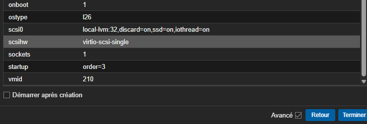

> 📸 **Ce que tu dois voir (bas)** : `onboot 1`, `ostype l26`, **`scsi0 local-lvm:32,discard=on,ssd=on,iothread=on`**,  
> `scsihw virtio-scsi-single`, `startup order=3`, `vmid 210`, et **Démarrer après création**  
> décoché.

---

### Étape 3 · Installer Debian 13

🎯 Installer un Debian **minimal** : pas d'interface graphique, juste de quoi administrer le serveur.

**3.1** VM 210 > **Démarrer** > **Console**. Choisis **Install**, langue **Français**, pays
**France**, clavier **Français**.

**3.2** **Réseau** : la configuration automatique (DHCP) **échoue**.


> 📸 **Ce que tu vois** : « La configuration automatique du réseau a échoué ».  
> 💡 **Normal** : il n'y a pas de serveur DHCP pour le VLAN Serveurs. Choisis **Configurer vous-même  
> le réseau**.

**3.3** Remplis :

| Champ | Valeur |
| --- | --- |
| Adresse IP | `10.10.10.20/24` |
| Passerelle | `10.10.10.254` (pfSense) |
| Serveurs de noms (DNS) | `10.10.10.10` (le DC SRV-AD01) |
| Nom de machine | `srv-glpi` |
| Domaine | `lab.home.arpa` |


> 📸 **Ce que tu dois voir** : le champ adresse IP avec **10.10.10.20/24**.  
> 💡 **Un serveur a toujours une IP fixe** : les postes et les règles de pare-feu doivent toujours le  
> retrouver à la même adresse.

**3.4** **Mot de passe du superutilisateur (root)** : **laisse-le vide**, deux fois.


> 📸 **Ce que tu vois** : l'écran du mot de passe root, laissé **vide**.  
> 💡 Debian **verrouille** alors le compte root et donne le droit `sudo` au premier utilisateur. Chaque  
> action d'administration passe par `sudo`, ce qui **laisse une trace** (qui a fait quoi).

**3.5** **Utilisateur** : nom complet `Paulo Rosa`, identifiant `paulo`, un mot de passe solide.

**3.6** **Partitionnement** : **Assisté - utiliser un disque entier** > le disque de 34 Go > **Tout dans
une seule partition** > **Terminer le partitionnement et appliquer les changements**.


> 📸 **Ce que tu dois voir** : une partition `/` en **ext4** et une petite partition d'échange  
> (**swap**).

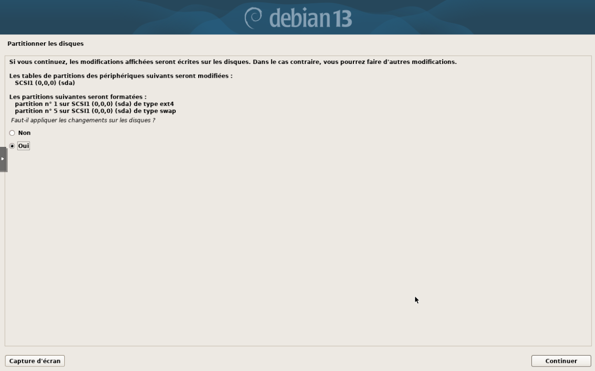

> 📸 **Ce que tu dois voir** : « Faut-il appliquer les changements sur les disques ? » : partition 1  
> ext4 et partition 5 swap sur SCSI1 (sda). Choisis **Oui** > **Continuer**.

**3.7** Miroir **France**, `deb.debian.org`, pas de mandataire. Étude statistique : **Non**.

**3.8** **Sélection des logiciels** : ❌ **décoche tout** ce qui est « environnement de bureau », GNOME…
✅ coche **serveur SSH** et **utilitaires usuels du système**.


> 📸 **Ce que tu dois voir** : seulement **serveur SSH** et **utilitaires usuels du système** cochés.  
> 💡 Pas d'interface graphique sur un serveur : moins de logiciels = **moins de failles**.

**3.9** GRUB : **Oui**, sur `/dev/sda`. Fin : **Continuer** (redémarrage).


> 📸 **Ce que tu dois voir** : `srv-glpi login:`. Connecte-toi avec `paulo`.

---

### Étape 4 · Vérifier le réseau et mettre à jour

**4.1** Vérifie l'adresse et teste la connectivité **du plus proche au plus loin** :

```bash
ip -br a
ping -c 3 10.10.10.254
ping -c 3 srv-ad01.lab.home.arpa
ping -c 3 deb.debian.org
```

| Commande | Ce qu'elle teste |
| --- | --- |
| `ip -br a` | Les cartes réseau et leurs adresses (`-br` = format court) |
| `ping -c 3 10.10.10.254` | La passerelle (pfSense) ; `-c 3` = 3 essais |
| `ping -c 3 srv-ad01…` | Le DNS (nom traduit) + le DC |
| `ping -c 3 deb.debian.org` | Internet par le nom |

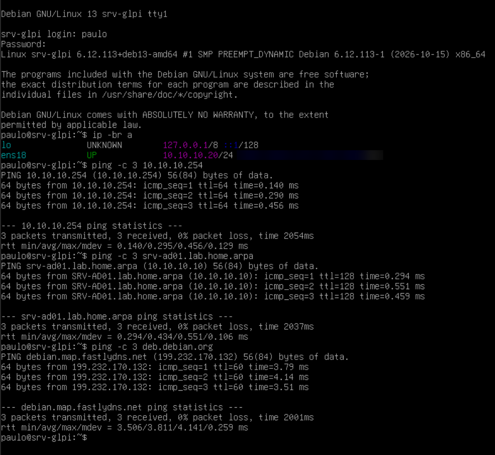

> 📸 **Ce que tu dois voir** : `ens18 UP 10.10.10.20/24` (l'IPv6 publique est floutée), puis  
> **0% packet loss** pour les 3 pings : pfSense, **SRV-AD01 (10.10.10.10)** et **deb.debian.org**.

**4.2** Mets à jour :

```bash
sudo apt update && sudo apt full-upgrade -y
```

- `sudo` : « exécute en administrateur » (il demande **ton** mot de passe la première fois) ;
- `apt update` : télécharge la **liste** des paquets disponibles (le catalogue) ;
- `&&` : « puis, **seulement si** la commande d'avant a réussi » ;
- `apt full-upgrade -y` : installe toutes les mises à jour ; `-y` répond « oui » tout seul.


> 📸 **Ce que tu dois voir** quand on relance : **0 mis à jour, 0 nouvellement installés** : tout est  
> à jour.

**4.3** **Instantané** dans Proxmox : VM 210 > **Instantanés** > **Créer un instantané** :
`debian-propre`, sans la RAM.

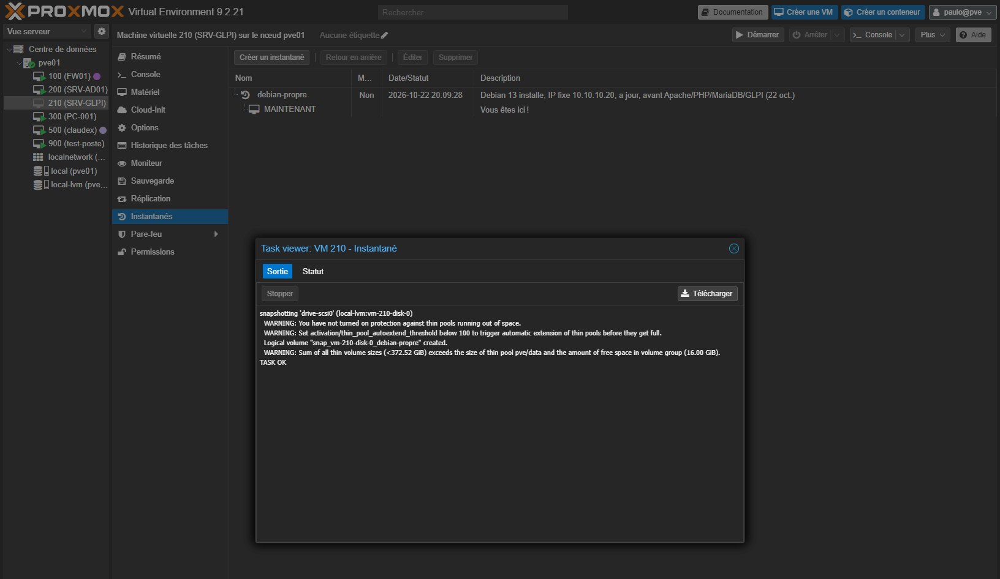

> 📸 **Ce que tu vois** : **TASK OK**, mais avec des lignes **WARNING** : « Sum of all thin volume  
> sizes (372 GiB) exceeds the size of thin pool ».  
> 💡 **Thin provisioning** : on a **promis** plus de disque aux VM que ce qu'on a, parce qu'elles  
> n'utilisent pas tout. Ce n'est pas une erreur, c'est un **avertissement** à surveiller.

**4.4** Vérifie l'occupation **réelle** : **local-lvm (pve01)** > **Résumé**.


> 📸 **Ce que tu dois voir** : environ **81 Go utilisés sur 374,5 Go** (21,6 %). Pas urgent, mais on  
> surveille les instantanés, qui grossissent au fil du temps.

---

### Étape 5 · Une console qui accepte le copier-coller

💡 La console noVNC de Proxmox **affiche une image** de l'écran : on ne peut pas y coller de texte. La
console **xterm.js** est un vrai terminal texte, qui accepte le copier-coller. Elle passe par un
**port série** virtuel.

**5.1** VM 210 > **Matériel** > **Ajouter** > **Port série** > numéro `0` > **Ajouter**.

**5.2** La ligne apparaît en orange : **arrête** puis **démarre** la VM depuis Proxmox (un simple
redémarrage depuis Debian ne suffit pas).

**5.3** Dans Debian :

```bash
sudo systemctl enable --now serial-getty@ttyS0.service
```

- `systemctl` : l'outil qui gère les **services** ;
- `enable` : démarrer ce service **à chaque démarrage** ; `--now` : et **tout de suite** ;
- `serial-getty@ttyS0` : l'invite de connexion sur le port série n° 0.

**5.4** En haut à droite : bouton **Console** > flèche > **xterm.js**.

✅ Une fenêtre noire avec `starting serial terminal on interface serial0`, puis l'invite. **Ctrl + Maj
+ V** pour coller (ou clic droit).

> 📷 **Capture manquante** : l'ajout du port série et la console xterm.js.

🏢 En entreprise, on se connecte en **SSH** depuis le poste d'administration.

---

## Partie 2 — Installer la pile web (Apache, MariaDB, PHP)

### Étape 6 · Installer les logiciels

**6.1** Sur SRV-GLPI :

```bash
sudo apt install -y apache2 mariadb-server php8.4-fpm php8.4-curl php8.4-gd php8.4-intl php8.4-mysql php8.4-zip php8.4-bcmath php8.4-mbstring php8.4-xml php8.4-bz2 php8.4-ldap
```

| Paquet | Rôle |
| --- | --- |
| `apache2` | Le serveur web |
| `mariadb-server` | La base de données |
| `php8.4-fpm` | PHP, dans ses propres processus (FPM = *FastCGI Process Manager*) |
| `php8.4-mysql` | Permet à PHP de parler à MariaDB |
| `php8.4-ldap` | Permet à PHP de parler à l'Active Directory |
| `php8.4-curl`, `gd`, `intl`, `zip`, `bcmath`, `mbstring`, `xml`, `bz2` | Extensions exigées par GLPI |

**6.2** Vérifie que les services tournent :

```bash
systemctl status apache2 --no-pager
systemctl status mariadb --no-pager
```


> 📸 **Ce que tu dois voir** : **Active: active (running)** en vert pour Apache.


> 📸 **Ce que tu dois voir** : **Active: active (running)** pour MariaDB.  
> 💡 `--no-pager` : affiche tout d'un coup, sans avoir à appuyer sur `q`.

---

### Étape 7 · Vérifier qu'on n'installe pas une version de PHP vulnérable

🎯 Une alerte de sécurité venait de sortir sur PHP (faille surnommée « PHP2Shell »). GLPI est écrit en
PHP : **si PHP est troué, GLPI l'est aussi**.

**7.1** Tape :

```bash
php -v
apt policy php8.4-fpm
```


> 📸 **Ce que tu dois voir** : version **8.4.27-1~deb13u1**, venant du dépôt **trixie-security** (les  
> correctifs de sécurité de Debian 13). La 8.4.24 du dépôt principal aurait été vulnérable.

💡 **Réflexe pro** : quand une faille sort, on ne se demande pas « est-ce que je suis concerné ? »,
on **vérifie** la version exacte.

---

### Étape 8 · Sécuriser MariaDB

**8.1** Lance l'assistant et lis chaque question :

```bash
sudo mariadb-secure-installation
```

| Question | Réponse | Pourquoi |
| --- | --- | --- |
| Enter current password for root | *(Entrée)* | Pas de mot de passe : root entre par `unix_socket` |
| Switch to unix_socket authentication | `n` | C'est **déjà** le cas sur Debian |
| Change the root password | `n` | Seul le root **Linux** (via `sudo`) peut entrer. Rien à voler |
| Remove anonymous users | `y` | Un compte sans nom, ouvert à tous |
| Disallow root login remotely | `y` | Root ne se connecte que depuis le serveur lui-même |
| Remove test database | `y` | Base de test ouverte à tous |
| Reload privilege tables | `y` | Appliquer tout de suite |


> 📸 **Ce que tu dois voir** à la fin : **All done! … your MariaDB installation should now be secure.**

---

### Étape 9 · Charger les fuseaux horaires dans MariaDB

**9.1** Tape :

```bash
sudo mariadb-tzinfo-to-sql /usr/share/zoneinfo | sudo mariadb mysql
sudo mariadb -e "SELECT COUNT(*) FROM mysql.time_zone_name;"
```

- `mariadb-tzinfo-to-sql /usr/share/zoneinfo` : transforme les fuseaux horaires de Linux en
  instructions SQL ;
- `|` (« pipe », **AltGr + 6**) : envoie le résultat de la 1re commande à la 2e ;
- la 2e ligne compte les fuseaux chargés.


> 📸 **Ce que tu dois voir** : **486**.

---

### Étape 10 · Créer la base de données et l'utilisateur de GLPI

🎯 Donner à GLPI **sa propre base** et **son propre compte**, qui n'a de droits que sur elle.

**10.1** Ouvre la console de MariaDB : `sudo mariadb`. L'invite devient `MariaDB [(none)]>`.

**10.2** Tape **une commande à la fois**, chacune se termine par `;` :

```sql
CREATE DATABASE glpi CHARACTER SET utf8mb4 COLLATE utf8mb4_unicode_ci;
CREATE USER 'glpi_app'@'localhost' IDENTIFIED BY 'un-mot-de-passe-long-et-unique';
GRANT ALL PRIVILEGES ON glpi.* TO 'glpi_app'@'localhost';
GRANT SELECT ON mysql.time_zone_name TO 'glpi_app'@'localhost';
FLUSH PRIVILEGES;
EXIT;
```

| Ligne | Explication |
| --- | --- |
| `CREATE DATABASE glpi … utf8mb4` | Crée la base `glpi`. `utf8mb4` = accepte tous les caractères |
| `CREATE USER 'glpi_app'@'localhost'` | Crée le compte, utilisable **seulement depuis le serveur lui-même** |
| `GRANT ALL … ON glpi.*` | Tous les droits, mais **uniquement sur la base glpi** |
| `GRANT SELECT ON mysql.time_zone_name` | Lecture seule de la liste des fuseaux |
| `FLUSH PRIVILEGES` | Applique les droits tout de suite |


> 📸 **❌ Mes erreurs** : **point-virgule oublié** : MariaDB affiche `->` au lieu de  
> `MariaDB [(none)]>` : il **attend la suite**. En tapant autre chose : `ERROR 1064 (syntax error)`.  
> Et des fautes de frappe (`DATABES`) : le message montre l'endroit exact (`near 'DATABES…'`).  
> 👉 **Toujours lire le message d'erreur.**


> 📸 **Ce que tu dois voir** : les `GRANT` corrigés, **Query OK**.


> 📸 **Ce que tu dois voir** : la base **glpi** et l'utilisateur **glpi_app@localhost** créés.

🏢 Le mot de passe de `glpi_app` doit être **généré au hasard** (30 caractères) et rangé dans le
**coffre-fort** de l'équipe. Dans le lab, il était court et a été vu sur une capture : écart assumé
(annexe D).

---

## Partie 3 — Installer GLPI

### Étape 11 · Choisir la version et la télécharger

**11.1** Installe `curl` et liste les versions publiées :

```bash
sudo apt install -y curl
curl -s https://api.github.com/repos/glpi-project/glpi/releases | grep '"tag_name"' | head -8
```

- `curl -s` : télécharge la page **sans** barre de progression ;
- `grep '"tag_name"'` : ne garde que les lignes avec le numéro de version ;
- `head -8` : seulement les 8 premières.


> 📸 **Ce que tu dois voir** : `12.0.0`, `11.0.11`, `12.0.0-rc3`, `11.0.10`, `10.0.28`…  
> 💡 **Comment choisir** : les `rc` (*release candidate*) sont des versions **de test**. La `12.0.0`  
> vient de sortir : on laisse les autres essuyer les plâtres. → **11.0.11**.

**11.2** Télécharge et calcule l'empreinte :

```bash
cd /tmp
wget https://github.com/glpi-project/glpi/releases/download/11.0.11/glpi-11.0.11.tgz
sha256sum glpi-11.0.11.tgz
```


> 📸 **Ce que tu dois voir** : le téléchargement à 100 %, `glpi-11.0.11.tgz` enregistré.


> 📸 **Ce que tu dois voir** : l'empreinte calculée, **identique** à celle publiée par GitHub sur la  
> page de la version (champ *digest*).  
> ❌ Si elle est différente : **on n'installe pas**, on supprime et on retélécharge.

---

### Étape 12 · Extraire GLPI et ranger les dossiers comme il faut

🎯 Appliquer la méthode de l'éditeur : **séparer le code, la configuration, les données et les
journaux**, avec les bons propriétaires.

**12.1** Tape :

```bash
sudo tar -xzf glpi-11.0.11.tgz -C /var/www/
sudo mv /var/www/glpi/config /etc/glpi
sudo mv /var/www/glpi/files /var/lib/glpi
sudo mkdir /var/log/glpi
sudo chown -R root:root /var/www/glpi
sudo chown -R www-data:www-data /etc/glpi /var/lib/glpi /var/log/glpi /var/www/glpi/marketplace
ls -ld /var/www/glpi /etc/glpi /var/lib/glpi /var/log/glpi
```

| Commande | Explication |
| --- | --- |
| `tar -xzf … -C /var/www/` | Décompresse l'archive dans `/var/www/` |
| `mv … config /etc/glpi` | La configuration va dans `/etc` (là où Linux range les configurations) |
| `mv … files /var/lib/glpi` | Les données (documents, cache, sessions) vont dans `/var/lib` |
| `mkdir /var/log/glpi` | Le dossier des journaux |
| `chown -R root:root /var/www/glpi` | Le **code** appartient à **root** |
| `chown -R www-data:www-data …` | Les dossiers où GLPI **doit écrire** appartiennent à **www-data**, le compte d'Apache |


> 📸 **Ce que tu dois voir** : `root root` pour `/var/www/glpi` et `www-data www-data` pour les trois  
> autres.  
> 💡 Apache (www-data) **ne peut pas modifier le code** : un pirate qui trouve une faille ne pourra pas  
> y déposer un fichier piégé. Et la configuration est **hors du dossier web**.

---

### Étape 13 · Dire à GLPI où sont ses dossiers

**13.1** Fichier 1 (dans le code, il dit « ma configuration est dans /etc/glpi ») :

```bash
sudo nano /var/www/glpi/inc/downstream.php
```
```php
<?php
define('GLPI_CONFIG_DIR', '/etc/glpi/');
if (file_exists(GLPI_CONFIG_DIR . '/local_define.php')) {
    require_once GLPI_CONFIG_DIR . '/local_define.php';
}
```

**13.2** Fichier 2 (dans la configuration, il donne les autres dossiers) :

```bash
sudo nano /etc/glpi/local_define.php
```
```php
<?php
define('GLPI_VAR_DIR', '/var/lib/glpi');
define('GLPI_LOG_DIR', '/var/log/glpi');
```

💡 **nano** : on tape le texte, **Ctrl + O** puis Entrée pour enregistrer, **Ctrl + X** pour quitter.


> 📸 **Ce que tu dois voir** : le contenu des deux fichiers (affiché avec `cat`).

---

### Étape 14 · Configurer Apache pour GLPI, en HTTPS

**14.1** Crée le fichier du site : `sudo nano /etc/apache2/sites-available/glpi.conf`. Contenu **au
moment de l'installation** (le certificat « snakeoil » sera remplacé à la partie 9) :

```apache
<VirtualHost *:80>
    ServerName srv-glpi.lab.home.arpa
    Redirect permanent / https://srv-glpi.lab.home.arpa/
</VirtualHost>

<VirtualHost *:443>
    ServerName srv-glpi.lab.home.arpa
    DocumentRoot /var/www/glpi/public

    SSLEngine on
    SSLCertificateFile /etc/ssl/certs/ssl-cert-snakeoil.pem
    SSLCertificateKeyFile /etc/ssl/private/ssl-cert-snakeoil.key

    <Directory /var/www/glpi/public>
        Require all granted
        RewriteEngine On
        RewriteCond %{HTTP:Authorization} ^(.+)$
        RewriteRule .* - [E=HTTP_AUTHORIZATION:%{HTTP:Authorization}]
        RewriteCond %{REQUEST_FILENAME} !-f
        RewriteRule ^(.*)$ index.php [QSA,L]
    </Directory>

    <FilesMatch \.php$>
        SetHandler "proxy:unix:/run/php/php8.4-fpm.sock|fcgi://localhost/"
    </FilesMatch>
</VirtualHost>
```

| Bloc / ligne | Explication |
| --- | --- |
| `<VirtualHost *:80>` + `Redirect permanent` | Tout ce qui arrive en **HTTP** est **renvoyé** vers HTTPS (code 301) |
| `<VirtualHost *:443>` | Le site en **HTTPS** |
| `DocumentRoot /var/www/glpi/public` | ⭐ Seul le sous-dossier **public** est visible depuis le navigateur |
| `SSLEngine on` + `SSLCertificate…` | Chiffrement avec un certificat et sa clé (le **snakeoil** = certificat « fait maison » de Debian) |
| `Require all granted` | Tout le monde peut visiter (le filtrage réseau est fait par pfSense) |
| `RewriteCond … Authorization` | Transmet à PHP l'en-tête d'authentification (API, OAuth) |
| `RewriteRule ^(.*)$ index.php` | Toutes les adresses passent par le « standard » de GLPI 11 |
| `SetHandler "proxy:unix:…fpm.sock…"` | Les fichiers `.php` sont envoyés à PHP-FPM |


> 📸 **Ce que tu dois voir** : le fichier `glpi.conf` complet, dans la console **xterm.js**.

**14.2** Active les modules et le site, teste, recharge :

```bash
sudo a2enmod ssl rewrite proxy_fcgi setenvif
sudo a2ensite glpi
sudo a2dissite 000-default
sudo apache2ctl configtest
sudo systemctl reload apache2
```

| Commande | Rôle |
| --- | --- |
| `a2enmod …` | Active les modules `ssl`, `rewrite`, `proxy_fcgi`, `setenvif` |
| `a2ensite glpi` / `a2dissite 000-default` | Active notre site, désactive la page « It works » |
| `apache2ctl configtest` | Apache **relit** sa configuration **sans rien appliquer** : le contrôle avant décollage ✈️ |
| `reload` | Applique, sans couper les visiteurs |


> 📸 **Ce que tu dois voir** : « Enabling module ssl… rewrite… proxy_fcgi… ».


> 📸 **Ce que tu dois voir** : **Syntax OK**.  
> ❌ Sinon, l'erreur donne le **fichier** et le **numéro de ligne** : on corrige avant de recharger.

---

### Étape 15 · Durcir PHP et Apache

**15.1** **Les cookies de session** (le « bracelet » que GLPI donne à l'utilisateur connecté) :

```bash
sudo sed -i -e 's/^;\?session.cookie_httponly =.*/session.cookie_httponly = On/' -e 's/^;\?session.cookie_secure =.*/session.cookie_secure = On/' -e 's/^;\?session.cookie_samesite =.*/session.cookie_samesite = Lax/' /etc/php/8.4/fpm/php.ini
grep -E '^session.cookie_(httponly|secure|samesite)' /etc/php/8.4/fpm/php.ini
```

- `sed -i -e 's/ancien/nouveau/'` : **remplace** du texte dans un fichier ; `^;\?` = « en début de
  ligne, avec ou sans `;` devant » ;
- `grep -E` : affiche les lignes, pour vérifier.

| Réglage | Protège contre |
| --- | --- |
| `cookie_httponly = On` | Le cookie est **illisible par du JavaScript** (vol par faille XSS) |
| `cookie_secure = On` | Le cookie n'est **jamais envoyé en HTTP** non chiffré |
| `cookie_samesite = Lax` | Le cookie n'est pas envoyé quand un **autre site** agit à ta place |


> 📸 **Ce que tu dois voir** : les 3 lignes avec **On**, **On**, **Lax**.

**15.2** Redémarre et vérifie l'en-tête renvoyé :

```bash
sudo systemctl restart php8.4-fpm apache2
curl -kI https://localhost
```

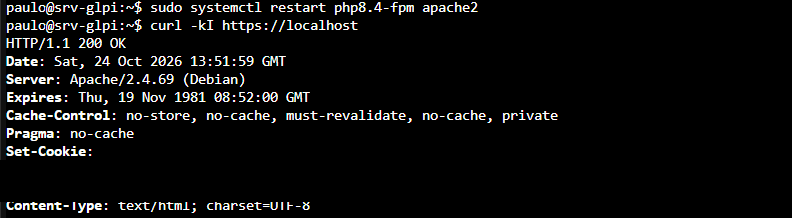

> 📸 **Ce que tu dois voir** : **HTTP/1.1 200 OK**, et une ligne **Set-Cookie** (sa valeur est masquée)  
> qui se termine par `secure; HttpOnly; SameSite=Lax`.  
> ⚠️ Remarque : **Server: Apache/2.4.69 (Debian)** révèle encore la version : on la cache en 15.3.

**15.3** **Cacher la version d'Apache** :

```bash
sudo sed -i -e 's/^ServerTokens .*/ServerTokens Prod/' -e 's/^ServerSignature .*/ServerSignature Off/' /etc/apache2/conf-available/security.conf
sudo systemctl reload apache2
curl -kI https://localhost | grep Server
```


> 📸 **Ce que tu dois voir** : **Server: Apache** tout court. Un pirate ne sait plus quelles failles  
> connues tenter. (`-k` : accepte le certificat fait maison pour ce test ; `-I` : en-têtes seulement.)

---

### Étape 16 · L'installation web de GLPI

**16.1** Sur **PC-001**, dans Edge : `https://10.10.10.20`


> 📸 **Ce que tu vois** : « Votre connexion n'est pas privée ».  
> 💡 Normal : le certificat est fait maison. **Avancé** > **Continuer**. On l'accepte **uniquement**  
> parce qu'on sait pourquoi (réglé proprement en partie 9).

**16.2** Langue **Français** > **OK**, accepte la licence > **Continuer** > **Installer**.

**16.3** **Vérification de compatibilité** : tous les tests doivent être verts.


> 📸 **Ce que tu dois voir (début)** : les prérequis (version de PHP, extensions…) avec une **coche ✓**.

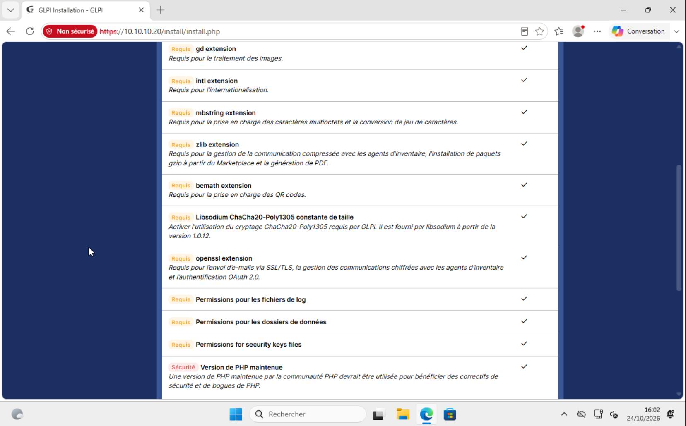

> 📸 **Suite** : extensions gd, intl, mbstring, zlib, bcmath, Sodium, openssl, **permissions** des  
> fichiers de log, des dossiers de données et des clés de sécurité : tout ✓.

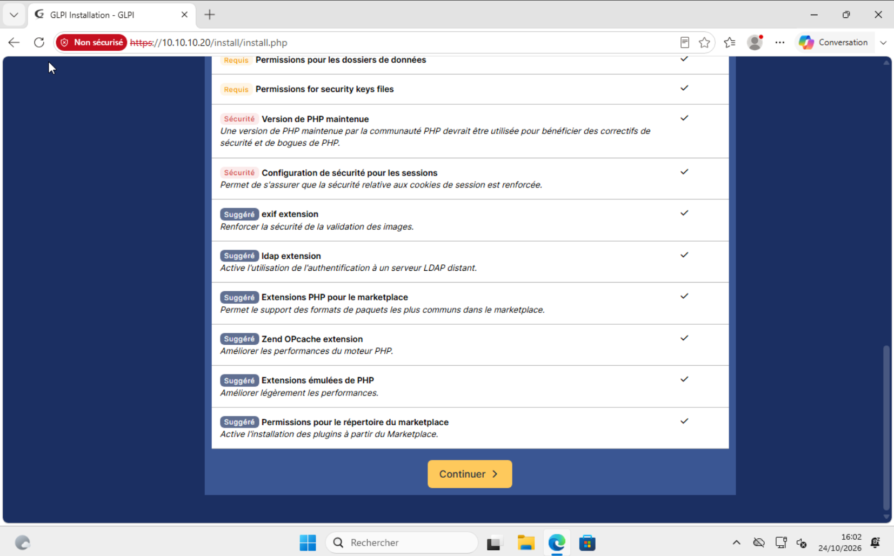

> 📸 **Fin** : « Configuration de sécurité pour les sessions » ✓ (grâce à 15.1), extensions suggérées  
> (exif, ldap, Zend OPcache…). Clique sur **Continuer**.

**16.4** **Connexion à la base** : serveur `localhost`, utilisateur `glpi_app`, son mot de passe >
**Continuer**.

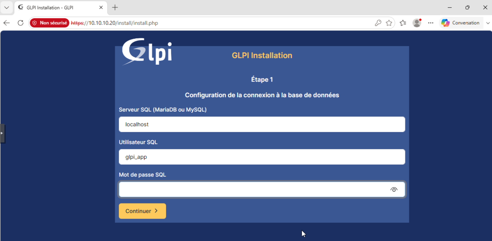

> 📸 **Ce que tu dois voir** : **Étape 1, Configuration de la connexion à la base de données**,  
> `localhost`, `glpi_app`, mot de passe masqué.


> 📸 **Ce que tu dois voir** : **Connexion à la base de données réussie**. Choisis la base existante  
> **glpi** > **Continuer**.

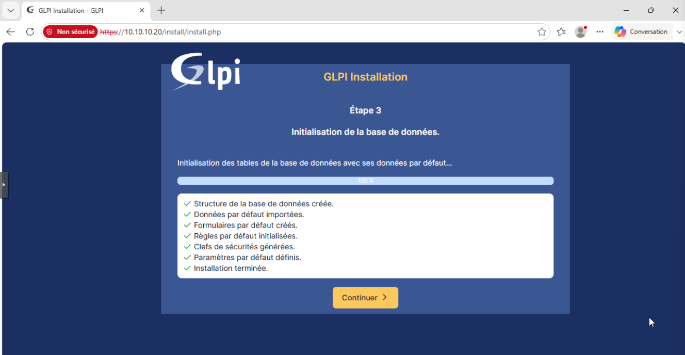

> 📸 **Ce que tu dois voir** : **Étape 3, Initialisation de la base de données** : structure créée,  
> données importées, formulaires, règles, clés de sécurité, paramètres, **Installation terminée** ✓.

**16.5** **Télémétrie** :

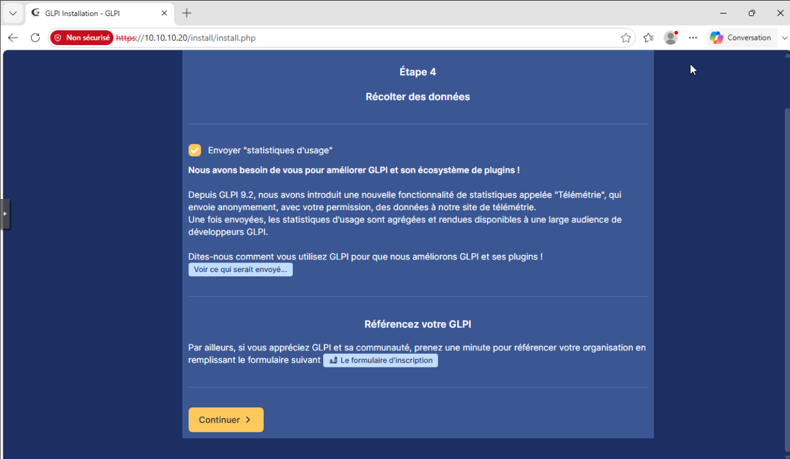

> 📸 **Ce que tu vois** : **Étape 4**, la case **Envoyer « statistiques d'usage »** est **cochée par  
> défaut**.


> 📸 **Ce que tu dois voir** : la case **décochée**.  
> 💡 On n'envoie pas d'informations sur le parc d'un client à un tiers.

**16.6** **Continuer** sur l'écran de l'offre commerciale.

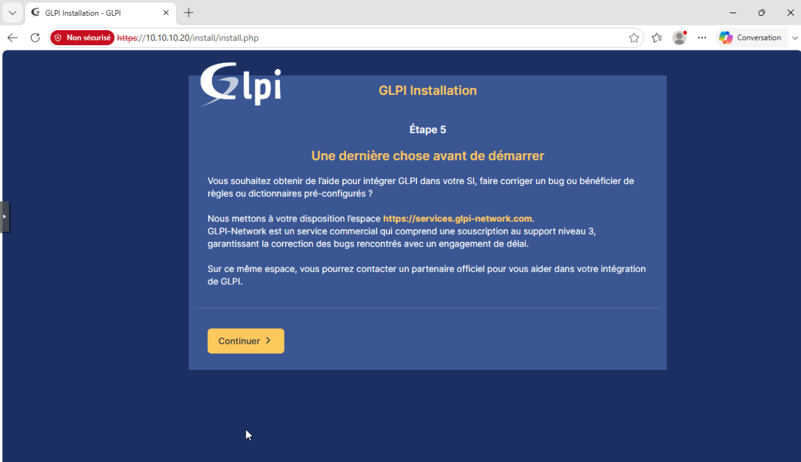

> 📸 **Ce que tu vois** : **Étape 5, Une dernière chose avant de démarrer** : la publicité pour  
> GLPI-Network (support payant). **Continuer**.


> 📸 **Ce que tu dois voir** : l'écran final qui rappelle les **4 comptes créés par défaut** (`glpi`,  
> `tech`, `normal`, `post-only`) > **Utiliser GLPI**.

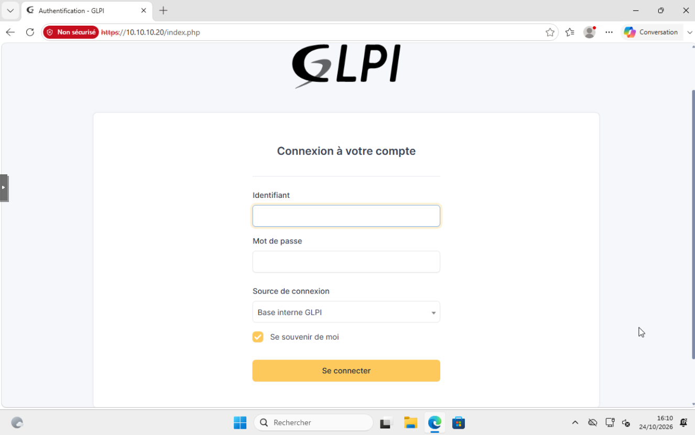

> 📸 **Ce que tu dois voir** : la page **Connexion à votre compte**, avec **Source de connexion : Base  
> interne GLPI**.

---

### Étape 17 · Supprimer le fichier d'installation

🎯 Empêcher n'importe qui de **relancer l'installation** et d'écraser la configuration.

**17.1** Sur SRV-GLPI :

```bash
sudo rm /var/www/glpi/install/install.php
ls /var/www/glpi/install/install.php /tmp/glpi-11.0.11.tgz
```

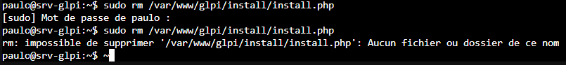

> 📸 **Ce que tu vois** : la suppression, puis une 2e tentative qui confirme « Aucun fichier ou  
> dossier de ce nom » : il est bien parti.

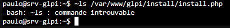

> 📸 **❌ Erreur du lab** : un `~` tapé par erreur devant la commande (`~ls …`) → **commande  
> introuvable**. Relire la ligne avant Entrée.


> 📸 **Ce que tu dois voir** : **Aucun fichier ou dossier de ce nom** pour `install.php` **et** pour  
> l'archive.  
> 💡 L'archive dans `/tmp` avait déjà disparu : sur Debian 13, `/tmp` est **en mémoire** et vidé à  
> chaque redémarrage. Ne jamais garder quelque chose d'important dans `/tmp`.

---

### Étape 18 · S'occuper des comptes par défaut

🎯 Les 4 comptes par défaut ont des mots de passe **connus de tout Internet**.

**18.1** Connecte-toi avec `glpi` / `glpi`.


> 📸 **Ce que tu vois** : un bandeau **rouge** qui liste les comptes dont le mot de passe n'a pas été  
> changé.

**18.2** **Administration > Utilisateurs** > ouvre **glpi**.

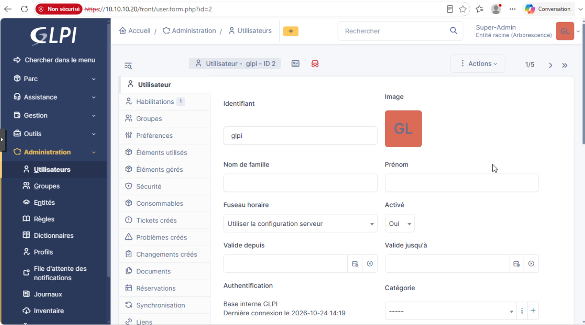

> 📸 **Ce que tu vois** : la fiche **Utilisateur - glpi - ID 2**, Actif **Oui**, Authentification  
> **Base interne GLPI**.

**18.3** Renseigne un **nouveau mot de passe** solide (2 fois) > **Sauvegarder**.
💡 On garde `glpi` comme **compte de secours** : si l'AD tombe un jour, on peut encore entrer.


> 📸 **Ce que tu dois voir** : le mot de passe changé (masqué).

**18.4** Ouvre **tech**, **normal**, **post-only** : **Actif : Non** > **Sauvegarder**.


> 📸 **Ce que tu dois voir** : dans la liste, `tech`, `normal`, `post-only` **Actif : Non** ; seul  
> `glpi` reste actif.


> 📸 **Ce que tu dois voir** : l'accueil **sans** le bandeau rouge ✅.

**18.5** Instantané Proxmox `glpi-installe`.

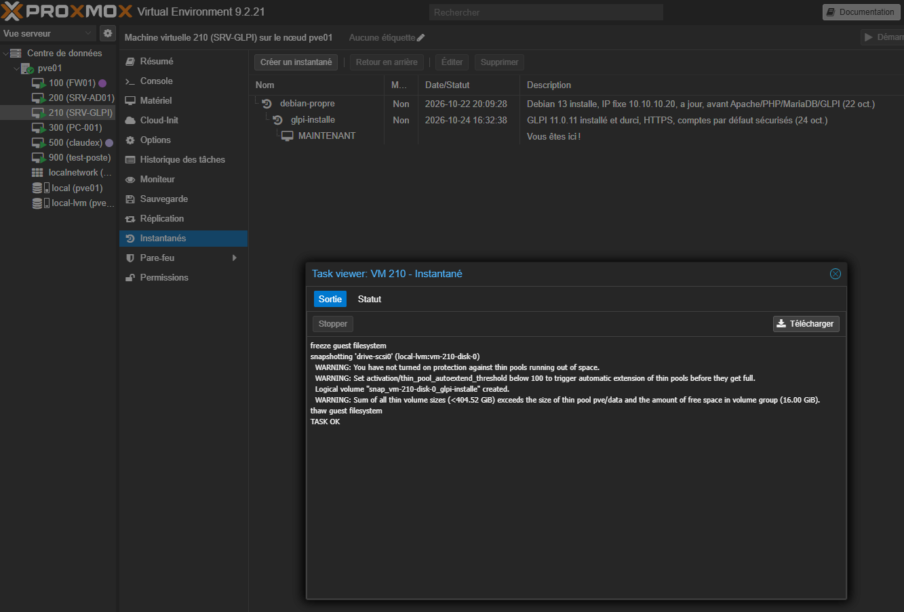

> 📸 **Ce que tu dois voir** : **glpi-installe** sous `debian-propre`, **TASK OK** (avec le même  
> avertissement thin pool qu'en 4.3).

**18.6** Ménage : supprime l'instantané `debian-propre` (plus utile), et l'ancien instantané
`avant_promotion` de SRV-AD01.

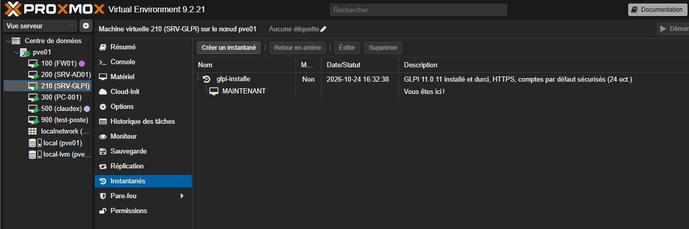

> 📸 **Ce que tu dois voir** : VM 210 avec un seul instantané, **glpi-installe**.

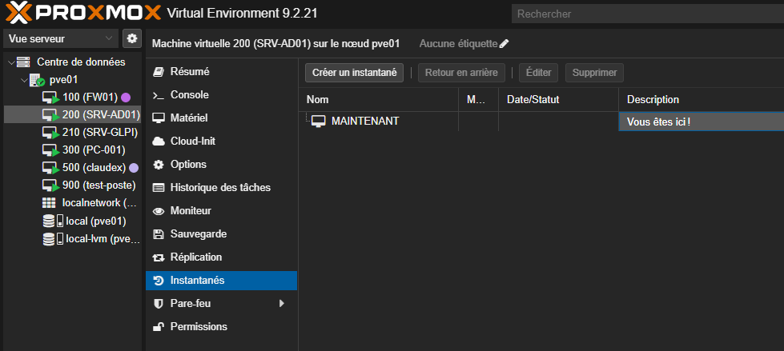

> 📸 **Ce que tu dois voir** : VM 200 (SRV-AD01) sans instantané, seulement **MAINTENANT**.  
> 💡 Un instantané **grossit** au fil des écritures : on n'en garde pas « pour rien ».

---

## Partie 4 — Le réseau : DNS et pare-feu

### Étape 19 · Donner un nom au serveur dans le DNS

🎯 Pouvoir taper `srv-glpi.lab.home.arpa` au lieu de `10.10.10.20`.

💡 **Pourquoi un nom ?** Le nom est écrit sur le **certificat** (partie 9) : sans nom, pas de vrai
HTTPS. Et si l'IP change, on modifie une ligne dans le DNS au lieu de prévenir tout le monde.

**19.1** Sur SRV-AD01 : **Outils** > **DNS** > déplie **SRV-AD01**.

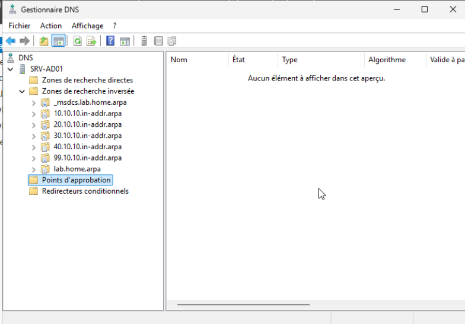

> 📸 **❌ Ce que tu vois** : **Zones de recherche directes** est **vide**, et `lab.home.arpa` est  
> rangée dans **Zones de recherche inversée**.

**19.2** Clic droit sur **lab.home.arpa**.

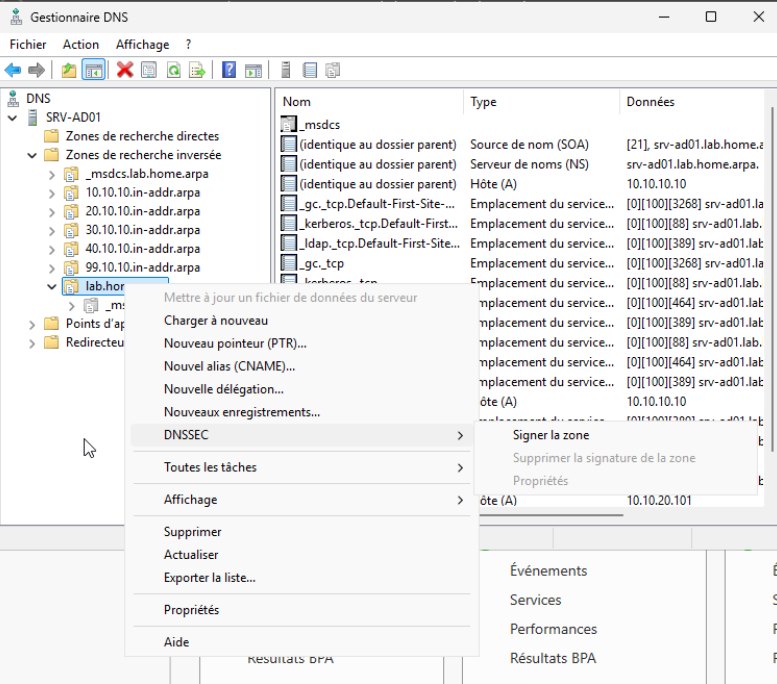

> 📸 **❌ Ce que tu vois** : le menu ne propose **pas** « Nouvel hôte (A ou AAAA) », seulement  
> **Nouveau pointeur (PTR)**, **Nouvel alias**, **Nouveaux enregistrements…**  
> 💡 **Cause** : le nom se termine par **.arpa**, et Windows en déduit que c'est une zone **inversée**  
> (voir brique 03). Seul le menu change : le DNS fonctionne.

**19.3** **Contournement** : **Nouveaux enregistrements…** > **Hôte (A ou AAAA)** > **Créer un
enregistrement** :
- **Hôte** : `srv-glpi` ;
- **Adresse IP** : `10.10.10.20` ;
- ✅ **Mettre à jour l'enregistrement de pointeur (PTR) associé** > **OK**.


> 📸 **Ce que tu dois voir** : **Nouvel hôte**, nom `srv-glpi`, FQDN `srv-glpi.lab.home.arpa.`,  
> adresse **10.10.10.20**, PTR coché.  
> 💡 **A** = nom → IP ; **PTR** = IP → nom.


> 📸 **La preuve** (`Get-DnsServerZone`) : `lab.home.arpa` → **IsReverseLookupZone : True**.

**19.4** Vérifie en PowerShell :

```powershell
Resolve-DnsName srv-glpi.lab.home.arpa
Resolve-DnsName 10.10.10.20
```


> 📸 **Ce que tu dois voir** : la 1re donne **10.10.10.20**, la 2e donne  
> **srv-glpi.lab.home.arpa** : ça marche **dans les deux sens** ✅.

🏢 En entreprise, le domaine AD est un **sous-domaine d'un vrai domaine** qu'on possède
(`ad.aerotrans.fr`).

---

### Étape 20 · Vérifier l'accès par le nom et la redirection HTTP → HTTPS

**20.1** Sur PC-001 : `https://srv-glpi.lab.home.arpa`

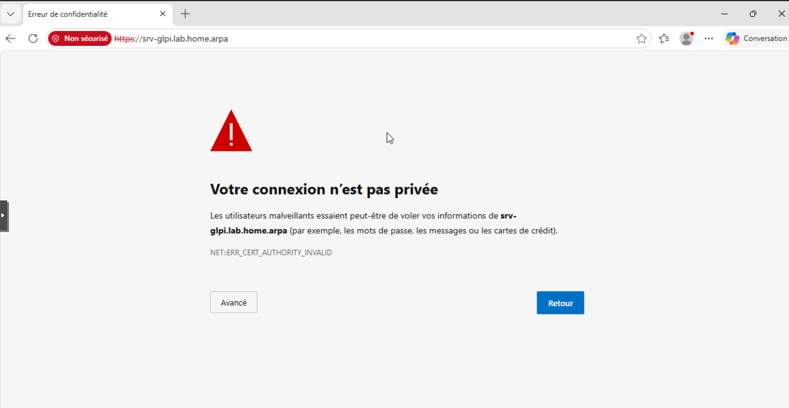

> 📸 **Ce que tu vois** : « Votre connexion n'est pas privée », code **NET::ERR_CERT_AUTHORITY_INVALID**.  
> ✅ C'est **bon signe** : le code n'est **pas** `ERR_CERT_COMMON_NAME_INVALID` (« mauvais nom »). Le  
> nom est bon, seule la « mairie » est inconnue. **Avancé** > **Continuer**.


> 📸 **Ce que tu dois voir** : GLPI s'ouvre par **son nom**.

**20.2** Sur SRV-GLPI :

```bash
curl -sI http://localhost
```


> 📸 **Ce que tu dois voir** : **HTTP/1.1 301 Moved Permanently** et **Location:  
> https://srv-glpi.lab.home.arpa/** ✅.

---

### Étape 21 · pfSense : les postes vers GLPI, en 443 seulement

🎯 Les PC des salariés doivent joindre GLPI, **uniquement** sur le port du site web chiffré.

**21.1** pfSense > **Firewall** > **Aliases** > onglet **IP** > **Add** :

| Champ | Valeur |
| --- | --- |
| Name | `SRV_GLPI` |
| Description | `Serveur GLPI (brique 05)` |
| Type | Host(s) |
| IP or FQDN | `10.10.10.20` |

**Save** > **Apply Changes**.


> 📸 **Ce que tu dois voir** : le formulaire de l'alias **SRV_GLPI**, type **Host(s)**, **10.10.10.20**.

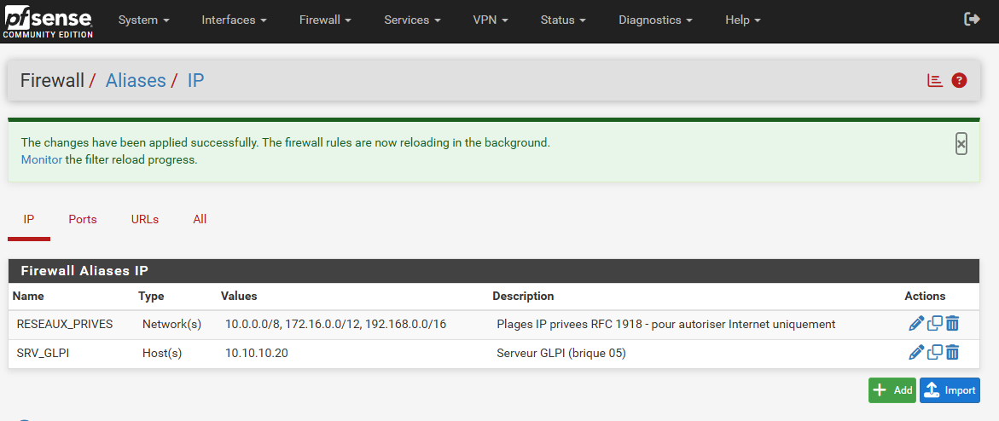

> 📸 **Ce que tu dois voir** : dans **Aliases / IP** : `RESEAUX_PRIVES` (brique 03) et **SRV_GLPI**.  
> 💡 Si l'IP de GLPI change, on modifie **l'alias**, pas chaque règle.

**21.2** **Firewall** > **Rules** > onglet **POSTES** > **Add** :

| Champ | Valeur | Pourquoi |
| --- | --- | --- |
| Action | Pass | |
| Protocol | TCP | HTTPS = TCP |
| Source | POSTES subnets | Tous les postes du VLAN 20 |
| Destination | Address or Alias → `SRV_GLPI` | |
| Destination Port Range | HTTPS (443) → HTTPS (443) | Le site chiffré, et rien d'autre |
| Description | `Postes vers GLPI HTTPS (tickets, inventaire)` | |

**Save**.


> 📸 **Ce que tu dois voir** : Pass, TCP, source **POSTES subnets**, destination **SRV_GLPI**, port  
> **HTTPS (443)**.

**21.3** **L'ordre des règles** (très important) : pfSense lit **de haut en bas** et s'arrête à la
**première** qui correspond.

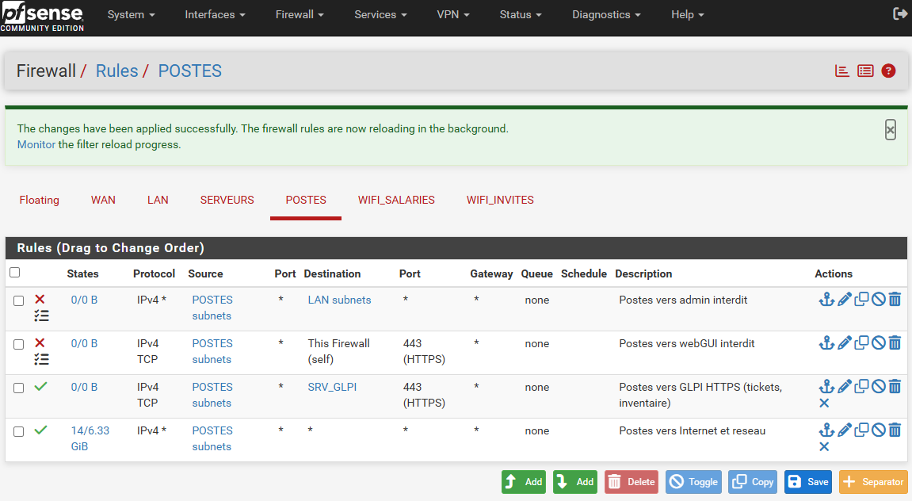

> 📸 **❌ Erreur du lab** : la nouvelle règle s'était placée… regarde l'ordre : on la veut **sous** les  
> deux blocages et **au-dessus** de la règle provisoire.

**21.4** Fais glisser la règle pour obtenir cet ordre, puis **Save** > **Apply Changes** :

1. Bloquer : Postes → réseau d'administration
2. Bloquer : Postes → interface web de pfSense
3. **Autoriser : Postes → SRV_GLPI TCP 443** ← notre règle
4. Autoriser : Postes → tout (règle **provisoire**, à supprimer plus tard)


> 📸 **Ce que tu dois voir** : les 4 règles dans cet ordre.  
> 💡 Une autorisation placée **au-dessus** d'un blocage peut **l'annuler**. Et notre règle est au-dessus  
> de la règle provisoire, pour rester valable le jour où celle-ci sera supprimée.

**21.5** **Preuve que la règle sert** : ouvre GLPI sur PC-001, puis regarde la colonne **States**.


> 📸 **Ce que tu dois voir** : la règle SRV_GLPI affiche un compteur de trafic qui augmente ✅.

📄 La [matrice des flux](../docs/matrice-des-flux.md) est mise à jour (règle POSTES n° 3, alias `SRV_GLPI`).

---

## Partie 5 — L'inventaire automatique (GLPI Agent)

### Étape 22 · Activer l'inventaire dans GLPI

**22.1** GLPI > **Administration > Inventaire** > ✅ **Activer l'inventaire** > **Sauvegarder**.


> 📸 **Ce que tu dois voir** : la case **Activer l'inventaire** cochée, avant **Sauvegarder**.  
> 💡 Il est **désactivé par défaut** : GLPI refuse les inventaires tant qu'on ne l'a pas décidé.

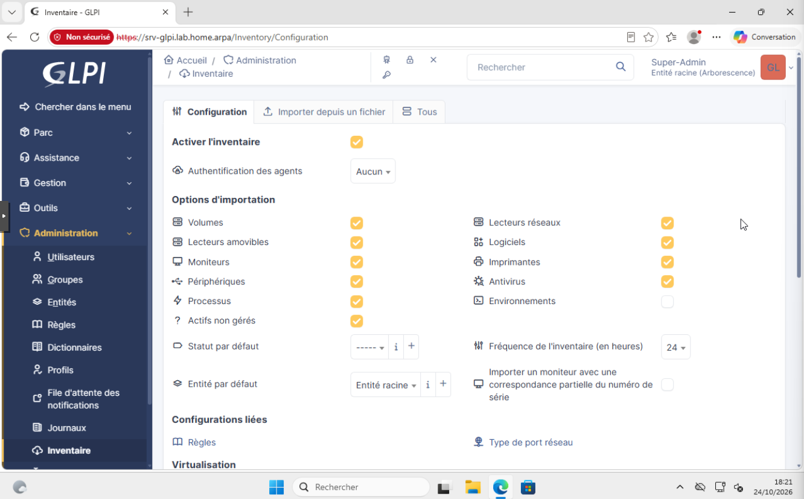

> 📸 **Ce que tu vois** : les **options d'importation** (volumes, moniteurs, logiciels, imprimantes…),  
> toutes cochées par défaut, et **Authentification des agents : Aucun** (on la rendra obligatoire à  
> l'étape 47).

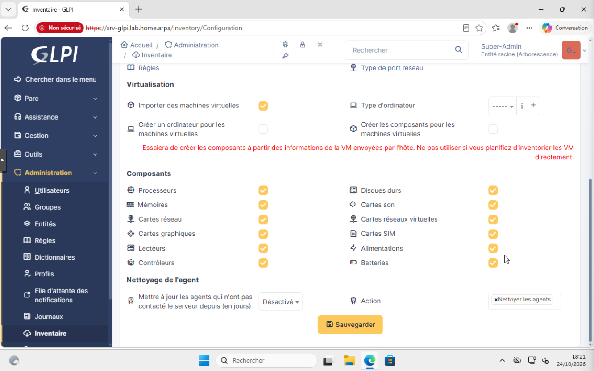

> 📸 **Ce que tu vois** (plus bas) : les **composants** importés (processeurs, mémoires, disques,  
> cartes réseau…) et la virtualisation. Laisse par défaut.

---

### Étape 23 · Télécharger l'agent et vérifier son empreinte

**23.1** Sur PC-001 : page officielle `github.com/glpi-project/glpi-agent` > **Releases** >
**v1.21**.

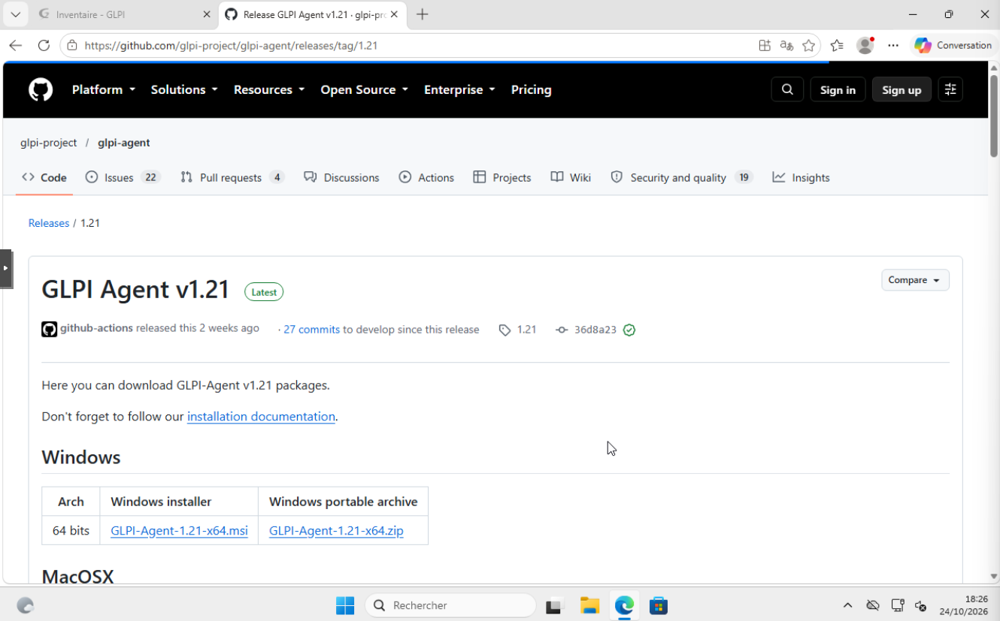

> 📸 **Ce que tu dois voir** : **GLPI Agent v1.21** (Latest), section **Windows** : **GLPI-Agent-1.21-x64.msi**.

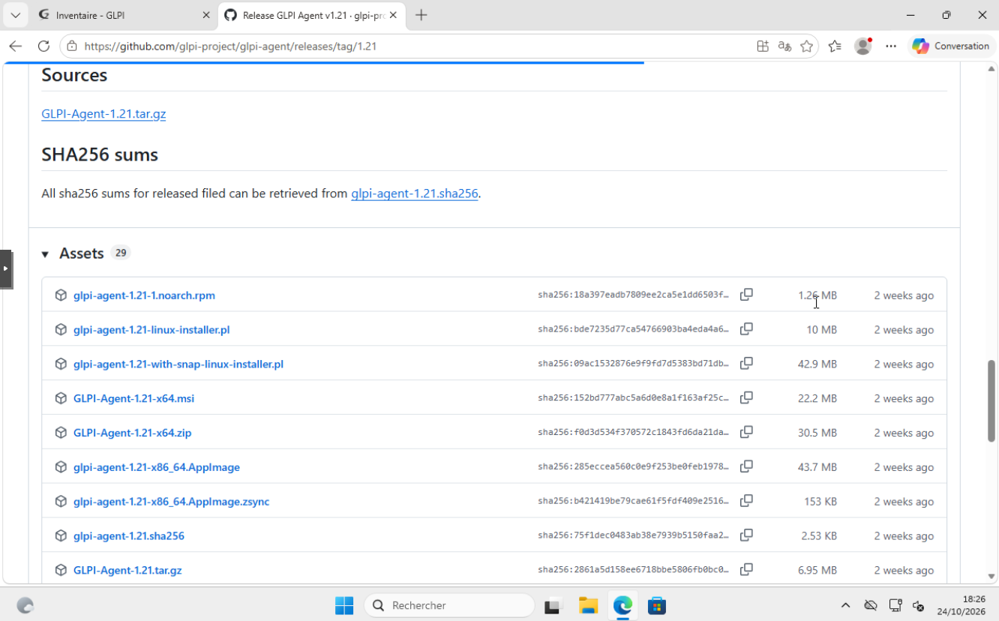

> 📸 **Ce que tu dois voir** : dans **Assets**, la ligne **GLPI-Agent-1.21-x64.msi** avec son  
> **sha256:152bd777…**. Télécharge le `.msi`.

**23.2** Dans PowerShell, dossier Téléchargements :

```powershell
Get-FileHash .\GLPI-Agent-1.21-x64.msi -Algorithm SHA256
```


> 📸 **Ce que tu dois voir** : une empreinte **identique** à celle de GitHub ✅.

---

### Étape 24 · Installer l'agent (installation personnalisée)

🎯 N'installer que ce qui sert, avec des réglages sûrs.

**24.1** Double-clic sur le `.msi` > **Next** > accepte la licence > **Next**. Écran **Choose Setup
Type** : **Custom**.


> 📸 **Ce que tu dois voir** : Typical / **Custom** / Complete. On choisit **Custom** pour régler  
> chaque option nous-mêmes.

**24.2** **Choose Targets** > **Remote Targets** : `https://srv-glpi.lab.home.arpa/`


> 📸 **Ce que tu dois voir** : le serveur GLPI, **par son nom**, en **HTTPS**.

**24.3** **Remote Targets SSL Options**.

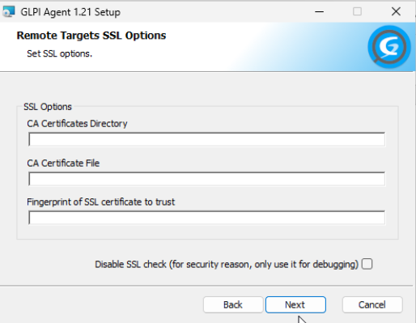

> 📸 **Ce que tu vois (par défaut)** : CA Certificates Directory, CA Certificate File, Fingerprint :  
> vides ; **Disable SSL check** décoché.


> 📸 **Ce que j'ai fait** : ✅ **Disable SSL check**, **temporairement**.  
> 💡 Le certificat est fait maison : l'agent refuserait de se connecter. On le désactive le temps de  
> **lire l'empreinte** du certificat (étape 25), puis on le remet. ⚠️ À ne jamais laisser.

**24.4** **Server Target Options** (proxy, authentification) : laisse **vide**.

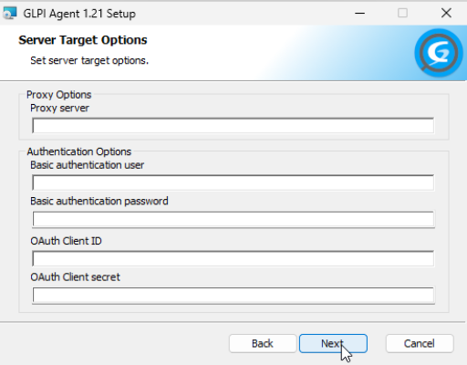

> 📸 **Ce que tu vois** : Proxy server, Basic authentication, **OAuth Client ID / secret** vides.  
> (OAuth sera ajouté à l'étape 47.)

**24.5** **Execution Mode** : **As a Windows Service**.


> 📸 **Ce que tu dois voir** : **As a Windows Service** sélectionné.  
> 💡 L'agent tourne en permanence, même sans session ouverte.

**24.6** **HTTP Server Options**.

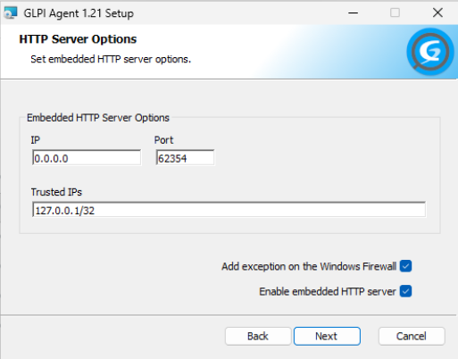

> 📸 **Ce que tu vois (par défaut)** : IP **0.0.0.0** (= écoute sur **toutes** les cartes réseau),  
> port 62354, **Add exception on the Windows Firewall** coché.  
> ⚠️ Par défaut, la petite page de l'agent serait **ouverte sur le réseau**.


> 📸 **Ce que j'ai mis** : IP **127.0.0.1**, port `62354`, Trusted IPs `127.0.0.1/32`,  
> ❌ **Add exception on the Windows Firewall**, ✅ Enable embedded HTTP server.  
> 💡 La page de l'agent (pour forcer un inventaire) n'est accessible **que depuis le PC lui-même**.

**24.7** **Miscellaneous Options**.

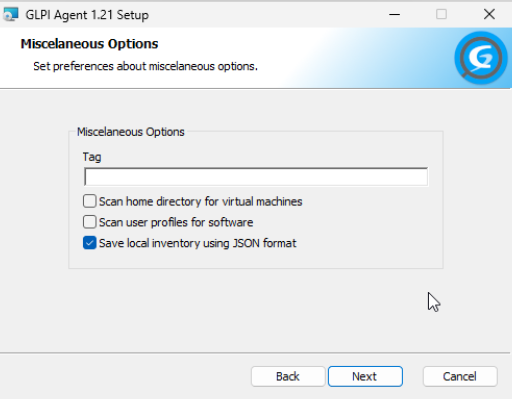

> 📸 **Ce que tu vois (par défaut)** : Tag vide, scans décochés.


> 📸 **Ce que j'ai mis** : Tag **AEROTRANS**, ✅ **Scan user profiles for software**.  
> 💡 Le tag permet de retrouver les machines de ce client ; le scan des profils trouve aussi les  
> logiciels installés pour un seul utilisateur.

**24.8** **Advanced Options** : laisse par défaut.

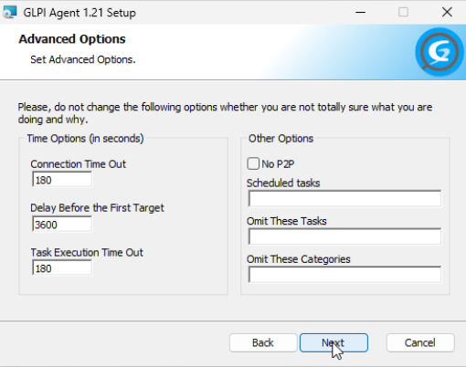

> 📸 **Ce que tu vois** : délais (180 s, 3600 s), No P2P décoché. L'écran prévient : « ne changez pas  
> ces options si vous n'êtes pas sûr ».

**24.9** **Debug Options** : **Level 1**, Logger **File**.


> 📸 **Ce que tu dois voir** : Debug Level **1**, Logger **File**.  
> 💡 **Temporaire** : le journal détaillé contiendra l'empreinte du certificat (étape 25).

**24.10** **Install**.

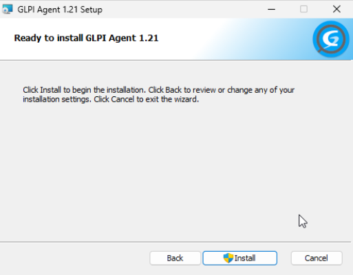

> 📸 **Ce que tu vois** : **Ready to install GLPI Agent 1.21**, bouton **Install** (avec le bouclier  
> UAC).


> 📸 **Ce que tu dois voir** : la fenêtre UAC indique **Éditeur vérifié : TECLIB SAS** ✅.  
> ⚠️ Si l'éditeur était « Inconnu », on **s'arrête** : le fichier ne viendrait pas de l'éditeur.

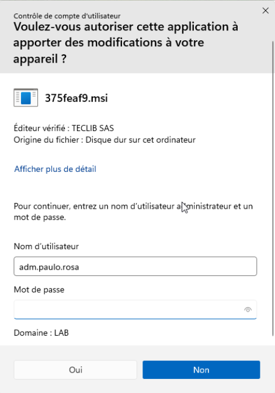

> 📸 **Ce que tu fais** : identifiants **adm.paulo.rosa** (domaine LAB), mot de passe masqué > **Oui**.

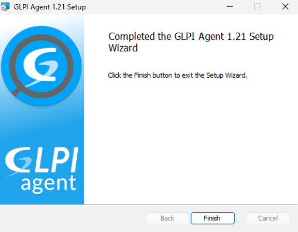

> 📸 **Ce que tu dois voir** : **Completed the GLPI Agent 1.21 Setup Wizard** > **Finish**.

**24.11** Dans GLPI : **Parc > Ordinateurs**.


> 📸 **Ce que tu dois voir** : **PC-001** apparaît **tout seul** ✅.


> 📸 **Ce que tu dois voir** : la fiche de PC-001 remplie (système, processeur, mémoire…), avec  
> **134 logiciels** et **27 composants**.

---

### Étape 25 · Remettre la vérification SSL, avec l'empreinte du certificat

🎯 L'agent ne doit **jamais** envoyer l'inventaire à un faux serveur. On lui apprend à reconnaître le
vrai, par son **empreinte**.

**25.1** Lis l'empreinte vue par l'agent (PowerShell sur PC-001) :

```powershell
Select-String -Path "C:\Program Files\GLPI-Agent\logs\glpi-agent.log" -Pattern "fingerprint"
```


> 📸 **Ce que tu dois voir** : **SSL server certificate fingerprint: sha256$4876c3c5…**

**25.2** **Vérification hors bande** : recalcule l'empreinte **sur le serveur lui-même** :

```bash
openssl x509 -in /etc/ssl/certs/ssl-cert-snakeoil.pem -noout -fingerprint -sha256
```


> 📸 **Ce que tu dois voir** : **48:76:C3:C5:…** : **identique** à celle de l'agent (même suite, avec  
> des `:`).  
> 💡 **Hors bande** = vérifier par **un autre chemin**. Si un pirate s'était placé entre le PC et le  
> serveur, l'agent aurait vu **sa** fausse empreinte.

**25.3** `regedit` **en tant qu'administrateur** > `HKEY_LOCAL_MACHINE\SOFTWARE\GLPI-Agent`.

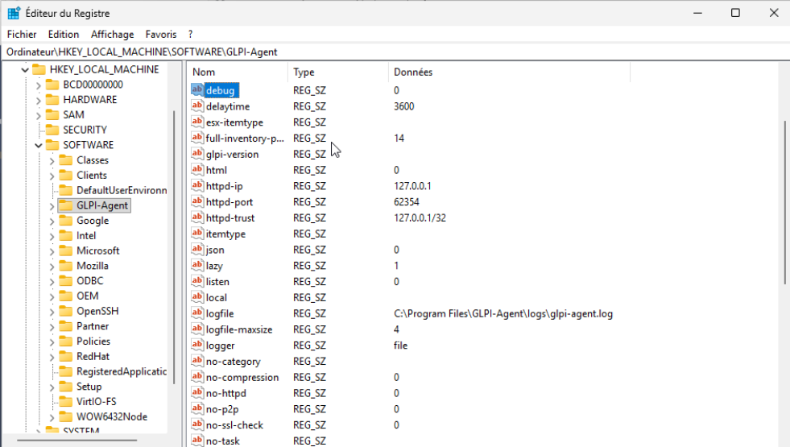

> 📸 **Ce que tu vois** : toutes les valeurs de l'agent (`debug`, `httpd-ip 127.0.0.1`,  
> `httpd-trust 127.0.0.1/32`, `logfile`, `no-ssl-check`…).

**25.4** Modifie :

| Valeur | Nouvelle donnée |
| --- | --- |
| `ssl-fingerprint` | `sha256$4876c3c5…` (l'empreinte complète) |
| `no-ssl-check` | `0` (vérification **réactivée**) |
| `debug` | `0` (journal normal) |


> 📸 **Ce que tu dois voir** : `ssl-fingerprint` rempli, `no-ssl-check = 0`.

**25.5** `services.msc` > **GLPI Agent** > clic droit > **Redémarrer** (l'agent ne relit le registre
qu'au démarrage).

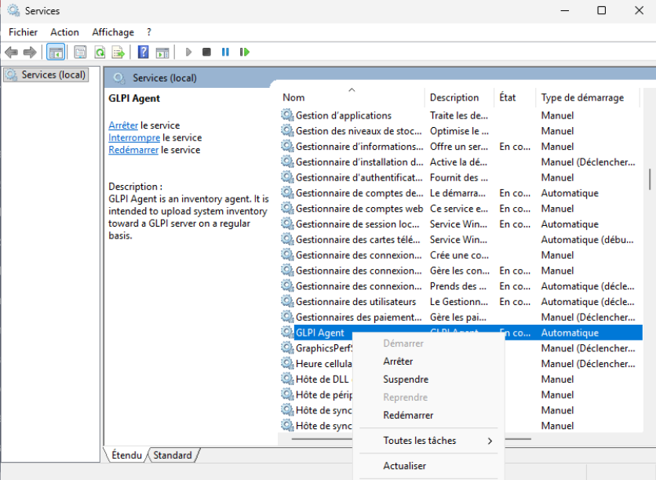

> 📸 **Ce que tu fais** : clic droit sur **GLPI Agent** > **Redémarrer**.

**25.6** Dans Edge : `http://127.0.0.1:62354` > **Force an Inventory**.


> 📸 **Ce que tu vois** : **This is GLPI Agent 1.21**, et le lien **Force an Inventory**.

**25.7** Vérifie le journal :

```powershell
Get-Content "C:\Program Files\GLPI-Agent\logs\glpi-agent.log" -Tail 15
```

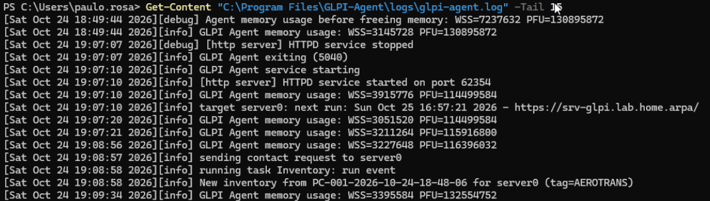

> 📸 **Ce que tu dois voir** : « running task Inventory », « **New inventory from PC-001… for server0  
> (tag=AEROTRANS)** », sans erreur SSL ✅.

💡 Cette empreinte est une **solution provisoire** : elle sera remplacée à l'étape 46 par une
confiance dans l'autorité de certification, qui tient dans la durée.

---

### Étape 26 · Mettre GLPI à l'heure de Paris

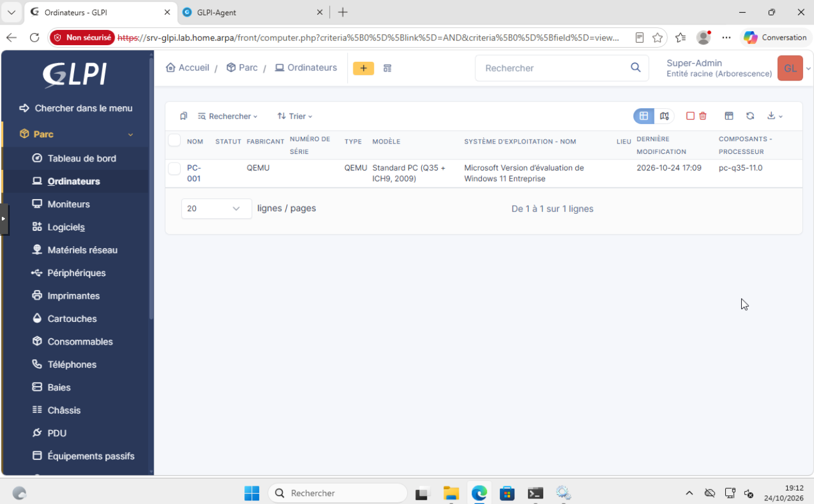

> 📸 **❌ Ce que tu vois** : la **dernière modification** de PC-001 affiche **17:09**… alors qu'il est  
> 19:09. GLPI est réglé sur l'heure universelle (UTC).

**26.1** **Configuration > Générale** > valeurs par défaut > **Fuseau horaire** : **Europe/Paris** >
**Sauvegarder**. (Ça marche grâce aux fuseaux chargés dans MariaDB à l'étape 9.)


> 📸 **Ce que tu dois voir** : **Fuseau horaire : Europe/Paris**.


> 📸 **Ce que tu dois voir** : les heures justes ✅.

**26.2** Instantané Proxmox `glpi-agent-ok`, puis supprime `glpi-installe`.

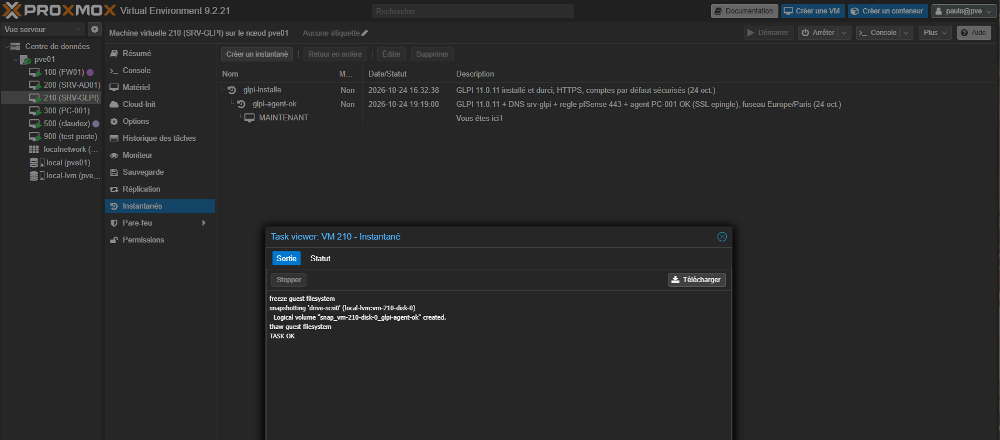

> 📸 **Ce que tu dois voir** : **glpi-agent-ok** créé, **TASK OK**, cette fois **sans** l'alerte thin  
> pool (l'ancien instantané `debian-propre` a été supprimé à l'étape 18).

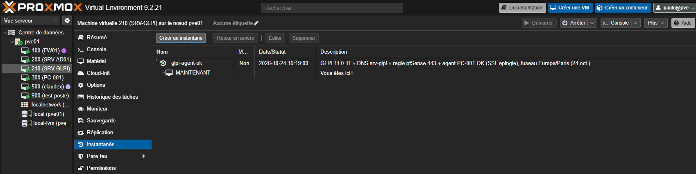

> 📸 **Ce que tu dois voir** : un seul instantané, **glpi-agent-ok**.

---

## Partie 6 — Brancher GLPI sur l'Active Directory

### Étape 27 · Créer le compte de service svc.glpi

🎯 GLPI doit **lire** l'annuaire. On lui donne un compte **à lui**, qui ne sait faire que ça.

💡 **Pourquoi pas un compte admin ?** Si GLPI se fait pirater, le pirate récupère le compte que GLPI
utilise. Avec `svc.glpi`, il ne récupère qu'un compte **sans aucun droit**. C'est le **moindre
privilège**.

**27.1** Sur SRV-AD01 : **Utilisateurs et ordinateurs Active Directory** > `AEROTRANS` >
**Comptes-service** > clic droit > **Nouveau** > **Utilisateur**.

**27.2** Nom complet `svc.glpi`, nom d'ouverture de session `svc.glpi` (`@lab.home.arpa`) > **Suivant**.

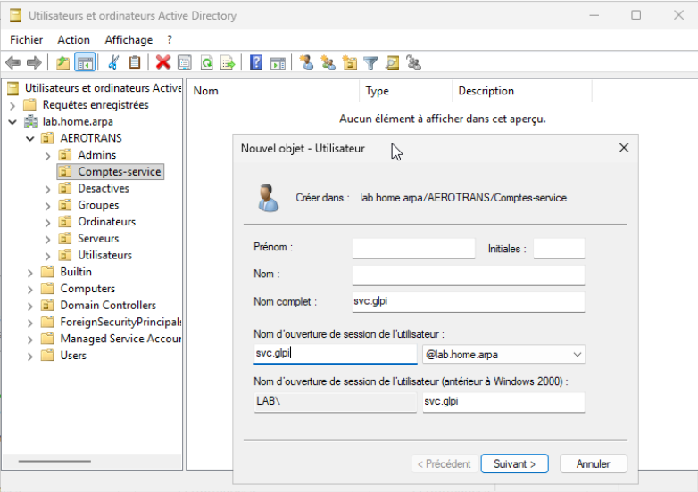

> 📸 **Ce que tu dois voir** : Créer dans **lab.home.arpa/AEROTRANS/Comptes-service**, nom complet  
> **svc.glpi**, ouverture de session **svc.glpi@lab.home.arpa** et **LAB\svc.glpi**.

**27.3** Mot de passe **long et aléatoire** (25 caractères ou plus, rangé au coffre) ;
✅ **L'utilisateur ne peut pas changer de mot de passe** ; ✅ **Le mot de passe n'expire jamais** ;
le reste décoché > **Suivant** > **Terminer**.


> 📸 **Ce que tu dois voir** : le résumé avec « L'utilisateur ne peut pas changer de mot de passe » et  
> « Le mot de passe n'expire jamais ».  
> 💡 « N'expire jamais » : sinon la connexion de GLPI à l'AD tomberait le jour de l'expiration, sans  
> prévenir. **Contrepartie** : on change ce mot de passe **à la main, une fois par an**.

**27.4** **N'ajoute aucun groupe** : tout compte du domaine peut déjà lire l'annuaire.


> 📸 **Ce que tu dois voir** : **svc.glpi** dans l'OU **Comptes-service**.

---

### Étape 28 · Déclarer l'annuaire dans GLPI

**28.1** GLPI > **Configuration > Authentification > Annuaires LDAP** > **Ajouter** :

| Champ | Valeur | Explication |
| --- | --- | --- |
| Nom | `AD AEROTRANS` | |
| Serveur par défaut / Actif | Oui / Oui | |
| Serveur | `srv-ad01.lab.home.arpa` | Le DC, par son nom (on passera en `ldaps://` en partie 8) |
| Port | `389` | Le port LDAP classique (on passera en 636 en partie 8) |
| Filtre de connexion | `(&(objectClass=user)(objectCategory=person)(!(userAccountControl:1.2.840.113556.1.4.803:=2)))` | Voir ci-dessous |
| BaseDN | `OU=Utilisateurs,OU=AEROTRANS,DC=lab,DC=home,DC=arpa` | **Où** chercher : seulement les salariés, ni les admins ni les comptes de service |
| Utiliser bind | Oui | GLPI se connecte avec un compte (pas en anonyme) |
| DN du compte | `svc.glpi@lab.home.arpa` | |
| Mot de passe du compte | celui de `svc.glpi` | |
| Champ de l'identifiant | `samaccountname` | Le login Windows : `nathalie.girard` |
| Champ de synchronisation | `objectguid` | L'identifiant **unique et définitif** du compte dans l'AD |

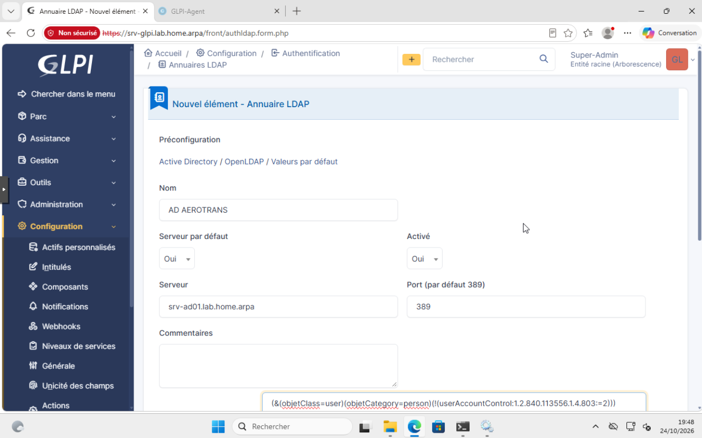

> 📸 **Ce que tu dois voir (haut du formulaire)** : **Nouvel élément - Annuaire LDAP**, Nom **AD  
> AEROTRANS**, Serveur par défaut **Oui**, Actif **Oui**, Serveur **srv-ad01.lab.home.arpa**, Port  
> **389**, et le filtre en bas.

💡 **Le filtre, morceau par morceau** :
- `(&( … )( … )( … ))` : « **et** » : les 3 conditions doivent être vraies ;
- `(objectClass=user)(objectCategory=person)` : un **utilisateur humain** (un ordinateur est aussi de
  classe `user` dans l'AD !) ;
- `(!( … ))` : « **non** » ;
- `userAccountControl:1.2.840.113556.1.4.803:=2` : « le **bit 2** du champ `userAccountControl` est
  allumé » = le compte est **désactivé** ;
- **résultat** : les personnes dont le compte est **actif**.


> 📸 **❌ Mes erreurs** : `objetClass` et `objetCategory` tapés **en français** (les attributs LDAP  
> sont **en anglais**), et **`uid`** au lieu de `samaccountname` (`uid` est l'identifiant des annuaires  
> **Linux**, pas de l'AD).


> 📸 **Ce que tu dois voir (corrigé)** : `objectClass`, `objectCategory`, champ de l'identifiant  
> **samaccountname**, champ de synchronisation **objectguid**, mot de passe masqué.

**28.2** **Ajouter**.

---

### Étape 29 · Le test échoue : comprendre pourquoi

**29.1** Onglet **Tester** : ❌ échec.

> 📷 **Capture manquante** : l'onglet Tester en échec sur le port 389.

🎯 Quand une application échoue, on **teste sans elle**, pour savoir si le problème vient de
l'application ou du serveur en face.

**29.2** Sur SRV-GLPI :

```bash
sudo apt install -y ldap-utils
ldapsearch -x -H ldap://srv-ad01.lab.home.arpa -D "svc.glpi@lab.home.arpa" -W -b "OU=Utilisateurs,OU=AEROTRANS,DC=lab,DC=home,DC=arpa" "(sAMAccountName=nathalie.girard)"
```

| Morceau | Sens |
| --- | --- |
| `ldapsearch` | « Fais une recherche dans l'annuaire » |
| `-x` | Connexion **simple** (identifiant + mot de passe) |
| `-H ldap://…` | Le serveur, en LDAP classique (389) |
| `-D "svc.glpi@…"` / `-W` | Le compte / demande le mot de passe **sans l'afficher** |
| `-b "…"` / `"(sAMAccountName=…)"` | Où chercher / quoi chercher |


> 📸 **❌ Ce que tu vois** : **« The server requires binds to turn on integrity checking if SSL\TLS  
> are not already active on the connection »**.  
> 💡 **Traduction** : *« Je refuse les connexions simples non protégées. Chiffre (SSL/TLS) ou signe. »*  
> **Windows Server 2025 exige par défaut la signature LDAP.** Sur le 389 en connexion simple, le mot de  
> passe de `svc.glpi` passerait **en clair** sur le réseau.

**Décision de « chef »** : on ne désactive **pas** cette protection sur le contrôleur de domaine (c'est
possible par GPO, mais c'est exactement ce qu'un attaquant espère). On passe en **LDAPS** (LDAP chiffré,
port 636). Pour ça, le DC a besoin d'un **certificat**, donc il faut une **autorité de certification**.
→ partie 7.

---

## Partie 7 — Monter une autorité de certification (mini-PKI)

> 🏛️ **Rappel de l'image** : l'autorité de certification (CA), c'est **la mairie**. Elle fabrique des  
> **cartes d'identité** (certificats) pour les serveurs. Une **PKI** (*Public Key Infrastructure*),  
> c'est l'ensemble : la mairie, les cartes, et la liste de ceux qui font confiance.

### Étape 30 · Un instantané avant de toucher au DC

**30.1** Proxmox > **200 (SRV-AD01)** > **Instantanés** > **Créer un instantané** :
nom `avant-adcs` (pas d'espace ni d'accent), **Inclure la RAM : non**, description `Avant installation
AD CS + LDAPS - brique 05`.


> 📸 **Ce que tu dois voir** : **avant-adcs** dans la liste, **TASK OK**.

🏢 Sur un vrai DC, on fait plutôt une **sauvegarde de l'état du système**, et on **évite de restaurer
un instantané** de DC quand il y en a plusieurs (risque d'« USN rollback »).

---

### Étape 31 · Installer le rôle AD CS

**31.1** Sur SRV-AD01 : **Gérer** > **Ajouter des rôles et fonctionnalités** > Suivant (basée sur un
rôle, serveur SRV-AD01).

**31.2** ✅ **Services de certificats Active Directory** > **Ajouter des fonctionnalités** > Suivant.


> 📸 **Ce que tu dois voir** : **Services de certificats Active Directory** coché.

**31.3** **Services de rôle** : ✅ **uniquement Autorité de certification** > Suivant.


> 📸 **Ce que tu dois voir** : **Autorité de certification** coché, tout le reste décoché.  
> 💡 Les autres services (inscription par le Web, répondeur en ligne…) installent des services en plus,  
> dont un site web sur le DC. On **réduit la surface d'attaque**.

**31.4** **Confirmation** : laisse **décochée** « Redémarrer automatiquement » > **Installer**.

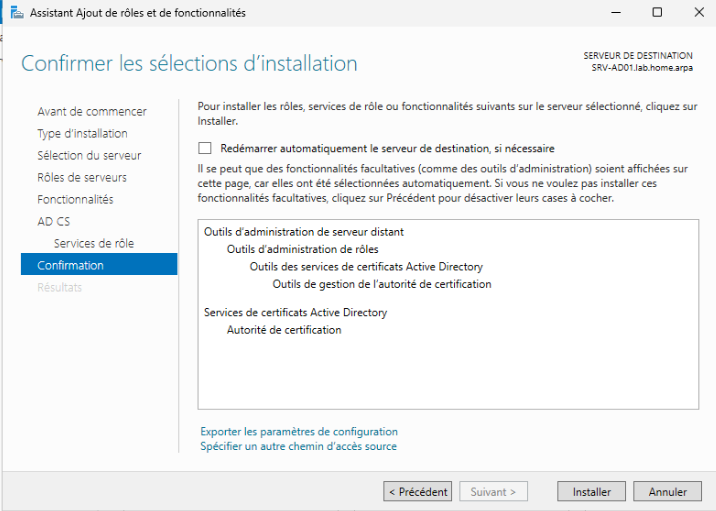

> 📸 **Ce que tu dois voir** : les outils d'administration AD CS et **Services de certificats Active  
> Directory > Autorité de certification**.


> 📸 **Ce que tu dois voir** : **Configuration requise. Installation réussie sur SRV-AD01**, et le  
> lien bleu de configuration.

---

### Étape 32 · Configurer la CA

**32.1** Clique sur **Configurer les services de certificats Active Directory sur le serveur de
destination**.

**32.2** **Informations d'identification** : `LAB\adm.paulo.rosa`.

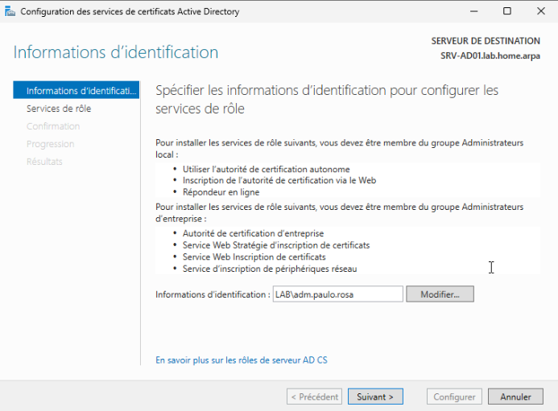

> 📸 **Ce que tu dois voir** : **Informations d'identification : LAB\adm.paulo.rosa**.  
> 💡 Compte admin **nominatif** : dans les journaux, on sait **qui** a fait quoi. Une CA d'entreprise  
> exige un membre des **Administrateurs de l'entreprise** (ajout temporaire, comme pour le schéma en  
> brique 04).

**32.3** **Services de rôle** : ✅ **Autorité de certification**.

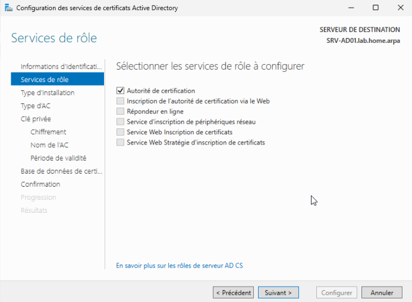

> 📸 **Ce que tu dois voir** : seule **Autorité de certification** est cochée.

**32.4** **Type d'installation** : ⭐ **Autorité de certification d'entreprise**.


> 📸 **Ce que tu dois voir** : ⦿ **Autorité de certification d'entreprise**.  
> 💡 Reliée à l'AD : les machines du domaine reçoivent leurs certificats **automatiquement**. Une CA  
> « autonome » obligerait à tout faire à la main.

**32.5** **Type d'AC** : ⭐ **AC racine**.


> 📸 **Ce que tu dois voir** : ⦿ **AC racine**.  
> 💡 Il n'existe aucune autre CA : c'est nous le sommet de la confiance. Une AC **secondaire** a besoin  
> d'une racine au-dessus d'elle.

**32.6** **Clé privée** : ⦿ **Créer une clé privée**.

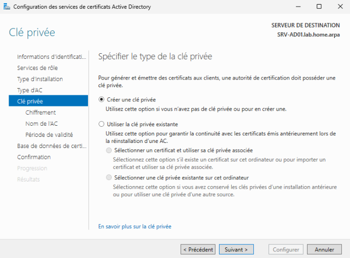

> 📸 **Ce que tu dois voir** : ⦿ **Créer une clé privée**. (L'autre option sert à réinstaller une CA  
> existante après une panne.)

**32.7** **Chiffrement** : fournisseur `RSA#Microsoft Software Key Storage Provider`, longueur
**4096**, hachage **SHA256** (clique dessus pour qu'il soit bien **en bleu**).


> 📸 **Ce que tu dois voir** : **RSA#Microsoft Software Key Storage Provider**, **4096**, **SHA256**  
> sélectionné.  
> 💡 La racine vit 10 ans : clé longue. **SHA1 est cassé** depuis des années, interdit.

**32.8** **Nom de l'AC** : remplace le nom proposé par **`AEROTRANS-Root-CA`**.


> 📸 **Ce que tu vois (par défaut)** : **lab-SRV-AD01-CA**.


> 📸 **Ce que tu dois voir** : **AEROTRANS-Root-CA**, suffixe `DC=lab,DC=home,DC=arpa` (ne pas toucher).  
> 💡 Le nom est écrit sur **tous** les certificats et **ne peut plus jamais changer**. On nomme la CA  
> par ce qu'elle **est** (l'entreprise, son rôle), jamais par la machine qui l'héberge.  
> ❌ **Réflexion du lab** : la proposition était `AEROTRANS-SRV-AD01-CA`. À moitié juste : si la CA  
> déménage un jour sur SRV-AD02, tous les certificats afficheraient un serveur qui n'existe plus.

**32.9** **Période de validité** : **10 ans**.


> 📸 **Ce que tu dois voir** : **10 Années**, expiration en **2036**.  
> 💡 Un certificat ne peut pas durer plus longtemps que la CA qui l'a signé.

**32.10** **Base de données** : par défaut.

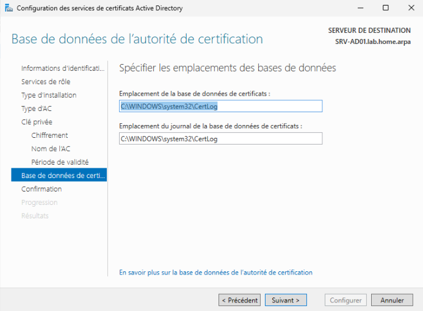

> 📸 **Ce que tu dois voir** : `C:\WINDOWS\system32\CertLog` pour la base et son journal : le  
> « registre » de la mairie.

**32.11** **Confirmation** : **relis chaque ligne** (impossible de changer après) > **Configurer**.


> 📸 **Ce que tu dois voir** : AC d'entreprise, AC racine, RSA 4096, SHA256, **AEROTRANS-Root-CA**,  
> 10 ans.


> 📸 **Ce que tu dois voir** : **Autorité de certification : Configuration réussie** (coche verte).

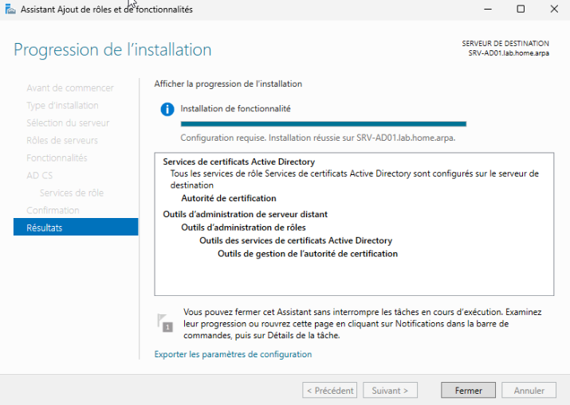

> 📸 **Ce que tu dois voir** : dans l'assistant de rôles : « Tous les services de rôle Services de  
> certificats Active Directory sont configurés ».

🏢 **En entreprise**, on monte une PKI **à deux niveaux** : une **racine hors ligne** (éteinte, au
coffre) et une ou plusieurs **AC secondaires** en ligne, sur des serveurs dédiés. Et **jamais** de CA
sur un contrôleur de domaine.

---

### Étape 33 · Vérifier que le DC a reçu son certificat tout seul

**33.1** Sur SRV-AD01 : **Windows + R** > `certlm.msc` > **Personnel** > **Certificats**.


> 📸 **Ce que tu dois voir** : deux lignes :
>
> | Délivré à | Délivré par | Expire | Ce que c'est |
> | --- | --- | --- | --- |
> | AEROTRANS-Root-CA | AEROTRANS-Root-CA | 2036 | La carte de la **mairie elle-même** (autosignée : normal pour une racine) |
> | SRV-AD01.lab.home.arpa | AEROTRANS-Root-CA | 2027 | ⭐ La carte **du DC**, reçue en 2 minutes par **inscription automatique**, renouvelée toute seule chaque année |

💡 `certlm` = certificats de la **machine** ; `certmgr` serait ceux de ton compte.

---

### Étape 34 · Tester le LDAPS sur le DC

**34.1** Sur SRV-AD01 : **Windows + R** > `ldp` > **Connexion** > **Se connecter…** : serveur
`srv-ad01.lab.home.arpa`, port `636`, ✅ **SSL** > **OK**.


> 📸 **Ce que tu dois voir** : serveur **srv-ad01.lab.home.arpa**, port **636**, **SSL** coché.


> 📸 **Ce que tu dois voir** : **Host supports SSL, SSL cipher strength = 256 bits** et **Established  
> connection to srv-ad01.lab.home.arpa** ✅.  
> ❌ Avec l'**adresse IP** au lieu du nom : refusé. Le certificat porte le **nom** du DC.

---

### Étape 35 · Récupérer la « carte de la mairie » sur SRV-GLPI

🎯 SRV-GLPI ne connaît pas encore la mairie AEROTRANS : il refuserait la carte du DC.

**35.1** Le DC envoie-t-il la carte de la mairie ?

```bash
openssl s_client -connect srv-ad01.lab.home.arpa:636 -showcerts </dev/null 2>/dev/null | grep -E "^ *[0-9] s:|i:"
```

- `openssl s_client -connect …:636` : « je me connecte en client et je regarde les certificats » ;
- `-showcerts` : montre **toutes** les cartes envoyées ;
- `grep` : garde les lignes `s:` (à qui est la carte) et `i:` (qui l'a délivrée).


> 📸 **Ce que tu vois** : **une seule** carte (`0 s:CN=SRV-AD01.lab.home.arpa`, délivrée par  
> `AEROTRANS-Root-CA`). Windows n'envoie **pas** la carte de la mairie : comportement normal. Plan B.

**35.2** **Plan B : lire la carte dans l'Active Directory.** Une CA d'entreprise dépose une copie de sa
carte publique **dans l'AD**.

💡 **Le piège de l'œuf et de la poule** : SRV-GLPI ne peut pas encore vérifier le DC. On lui dit
exceptionnellement « ne vérifie pas » (`LDAPTLS_REQCERT=never`), **pour cette seule commande**, et on
contrôle **ensuite** la carte à la main.

```bash
LDAPTLS_REQCERT=never ldapsearch -H ldaps://srv-ad01.lab.home.arpa -D "svc.glpi@lab.home.arpa" -W -b "CN=AEROTRANS-Root-CA,CN=Certification Authorities,CN=Public Key Services,CN=Services,CN=Configuration,DC=lab,DC=home,DC=arpa" -s base -LLL cACertificate | sed -n '/cACertificate::/,$p' | sed 's/^cACertificate:: //; s/^ //' | tr -d '\n' | base64 -d > ~/aerotrans-root-ca.der
openssl x509 -inform der -in ~/aerotrans-root-ca.der -out ~/aerotrans-root-ca.crt && openssl x509 -in ~/aerotrans-root-ca.crt -noout -subject -enddate -fingerprint -sha1
```

| Morceau | Sens |
| --- | --- |
| `-b "CN=AEROTRANS-Root-CA,…"` | L'**adresse exacte** de la carte dans l'annuaire |
| `-s base -LLL cACertificate` | Seulement cet objet, sans commentaires, seulement l'attribut de la carte |
| `sed`, `tr -d '\n'`, `base64 -d` | L'AD renvoie la carte « emballée » en texte : on la **déballe** |
| `openssl x509 -inform der … -out …crt` | Conversion du format binaire (DER) au format texte (PEM) |
| `-subject -enddate -fingerprint -sha1` | Afficher le propriétaire, la date de fin, l'**empreinte** |


> 📸 **Ce que tu dois voir** : `subject=… CN=AEROTRANS-Root-CA`, `notAfter=Oct 25 … 2036 GMT`,  
> **`sha1 Fingerprint=56:3C:02:33:…:6C:E2`**.

**35.3** **La vérification hors bande** : sur SRV-AD01, `certlm.msc` > double-clic sur
**AEROTRANS-Root-CA** > onglet **Détails** > **Empreinte numérique**.


> 📸 **Ce que tu dois voir** : **563c02337180556d5b1ece9a4d14e496666e6ce2** : **identique** caractère  
> par caractère (Windows l'affiche en minuscules et sans `:`) ✅.  
> ❌ Si elle était différente : **on s'arrête**. Quelqu'un se serait fait passer pour la mairie (homme  
> du milieu).

---

### Étape 36 · Dire à SRV-GLPI : « cette mairie, tu peux lui faire confiance »

**36.1** Sur SRV-GLPI :

```bash
sudo cp ~/aerotrans-root-ca.crt /usr/local/share/ca-certificates/ && sudo update-ca-certificates
```

- `/usr/local/share/ca-certificates/` : le dossier des **CA ajoutées par l'administrateur**.
  ⚠️ L'extension doit être **`.crt`**, sinon Debian l'ignore ;
- `update-ca-certificates` : reconstruit la **liste officielle des CA de confiance** (utilisée par
  PHP, GLPI, `ldapsearch`, `curl`…).


> 📸 **Ce que tu dois voir** : **1 added, 0 removed; done.** (La ligne `rehash: warning: skipping  
> ca-certificates.crt…` est **normale**.)

**36.2** **La preuve** : refais la connexion au DC, **en vérifiant** cette fois :

```bash
openssl s_client -connect srv-ad01.lab.home.arpa:636 -verify_return_error </dev/null 2>/dev/null | grep "Verify return code"
```


> 📸 **Ce que tu dois voir** : **Verify return code: 0 (ok)** ✅.

**36.3** Ménage, et redémarrage de PHP (ses processus gardaient l'ancienne liste en mémoire) :

```bash
rm ~/aerotrans-root-ca.der && ls ~/
sudo systemctl restart php8.4-fpm && systemctl status php8.4-fpm --no-pager | head -5
```


> 📸 **Ce que tu dois voir** : seul `aerotrans-root-ca.crt` reste dans ton dossier.

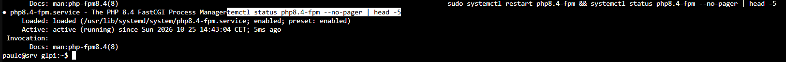

> 📸 **Ce que tu dois voir** : **php8.4-fpm.service … Active: active (running)** (l'identifiant  
> d'invocation est masqué).

---

## Partie 8 — GLPI en LDAPS, import des salariés

### Étape 37 · Passer l'annuaire de GLPI en LDAPS

**37.1** GLPI (Super-Admin) > **Configuration > Authentification > Annuaires LDAP** > **AD AEROTRANS** :

| Champ | Avant | Après |
| --- | --- | --- |
| Serveur | `srv-ad01.lab.home.arpa` | **`ldaps://srv-ad01.lab.home.arpa`** |
| Port | `389` | **`636`** |

⚠️ Ne touche **pas** au mot de passe (le champ est vide à l'affichage, mais il est bien gardé) et ne
coche **surtout pas** « Effacer ». L'option « Utiliser TLS » (onglet **Informations avancées**) reste
sur **Non** : c'est une autre méthode (STARTTLS), incompatible avec LDAPS.

**37.2** **Sauvegarder**.


> 📸 **Ce que tu dois voir** : Serveur **ldaps://srv-ad01.lab.home.arpa**, Port **636**.


> 📸 **Ce que tu dois voir** : Utiliser bind **Oui**, DN du compte **svc.glpi@lab.home.arpa**.  
> 💡 On utilise le **nom complet** du DC, celui écrit sur sa carte d'identité.

---

### Étape 38 · Tester… et trouver un bug invisible

**38.1** Onglet **Tester**.


> 📸 **Ce que tu vois** : 1. Flux TCP ✅, 2. Base DN ✅, 3. LDAP URI ✅, **4. Connexion Bind ✅  
> Authentification réussie** (le blocage de la partie 6 est **résolu**), mais **5. Chercher 🟠 Échec de  
> la recherche : Bad search filter(-7)**.

💡 « Bad search filter » = l'AD ne comprend pas la **phrase de recherche**. À l'écran, le filtre a l'air
parfait. On regarde **ce qui est vraiment enregistré**, avec une loupe qui rend visibles les caractères
invisibles.

**38.2** Sur SRV-GLPI :

```bash
sudo mysql -N -e 'SELECT `condition` FROM glpi_authldaps' glpi | cat -A
```

- `-N` : n'affiche que la valeur, sans le titre de la colonne ;
- `-e '…'` : « montre-moi le filtre (`condition`) de la table des annuaires » ;
- `| cat -A` : 🔍 **la loupe** : `$` = fin de ligne normale, `^M` = retour chariot Windows.


> 📸 **❌ Ce que tu vois** : `…:=2)))^M\n` : un **retour à la ligne Windows caché** à la fin du filtre.  
> La touche **Entrée** avait été appuyée après la saisie, dans la zone de texte.

**38.3** **Correction** dans GLPI : clique dans **Filtre de connexion**, **Ctrl + Fin**, **un seul**
retour arrière (⌫), vérifie que les 3 `)))` sont toujours là, **n'appuie pas sur Entrée**,
**Sauvegarder**. Puis relance la même loupe.


> 📸 **Ce que tu dois voir** : `…:=2)))$` : plus de `^M\n` ✅.

**38.4** Onglet **Tester**.


> 📸 **Ce que tu dois voir** : **5 étapes sur 5** ✅, « Recherche réussie (25 entrées trouvées) ».

💡 **Leçon** : quand « tout a l'air juste » mais que ça ne marche pas, on regarde les **données brutes**
(`cat -A`).

---

### Étape 39 · Importer les 25 salariés

**39.1** **Administration > Utilisateurs** > **Liaison annuaire LDAP** > **Importer de nouveaux
utilisateurs** > critères vides > **Rechercher**.


> 📸 **Ce que tu vois** : la liste des salariés trouvés (les identifiants GUID sont masqués), et en haut  
> **« De 1 à 20 sur 25 lignes »**.

**39.2** Coche la case **tout en haut** de la liste > **Actions** > **Importer** > **Envoyer**.


> 📸 **Ce que tu dois voir** : la fenêtre **Actions**, Action **Importer**.


> 📸 **Ce que tu vois** : « Élément ajouté » pour **20** salariés.  
> ❌ **Piège** : la case « tout cocher » ne sélectionne que la **page affichée** (20 sur 25).

**39.3** Refais **Rechercher** : seuls les **5 restants** s'affichent > tout cocher > **Importer**.


> 📸 **Ce que tu dois voir** : les 5 derniers importés. **20 + 5 = 25** ✅.  
> 👉 Réflexe pro : **toujours comparer le nombre attendu au nombre traité.**

💡 GLPI **ne copie pas les mots de passe** : à chaque connexion, il demande à l'AD « ce mot de passe est
bon ? ».

---

### Étape 40 · Nathalie se connecte avec son compte Windows

**40.1** Dans Edge, **Ctrl + Maj + N** (fenêtre **InPrivate** : elle ne partage pas la session
Super-Admin) > `https://srv-glpi.lab.home.arpa` :
- **Identifiant** : `nathalie.girard` ;
- **Mot de passe** : son mot de passe **Windows** ;
- **Source de connexion** : **AD AEROTRANS** ;
- **Se connecter**.


> 📸 **Ce que tu dois voir** : identifiant **nathalie.girard**, mot de passe masqué, source **AD  
> AEROTRANS**.


> 📸 **Ce que tu dois voir** : l'interface **simplifiée** (*Self-Service*) : « Signaler un incident »,  
> « Créer un ticket », « Voir vos tickets ». **Pas d'administration** (moindre privilège).

🏢 « Se souvenir de moi » était coché. Sur un poste **partagé**, on le **décoche**.

---

## Partie 9 — Un vrai certificat pour GLPI

> Jusqu'ici, GLPI utilise le certificat « fait maison » (snakeoil) : le navigateur affiche **« Non  
> sécurisé »**. On va lui donner une vraie carte, signée par la mairie AEROTRANS. SRV-GLPI n'est pas  
> dans le domaine : il fait sa demande **à la main**.

### Étape 41 · Fabriquer la clé privée et le formulaire de demande (CSR)

**41.1** Sur SRV-GLPI :

```bash
sudo openssl req -new -newkey rsa:2048 -nodes -keyout /etc/ssl/private/srv-glpi.key -out /home/paulo/srv-glpi.csr -subj "/CN=srv-glpi.lab.home.arpa/O=AEROTRANS" -addext "subjectAltName=DNS:srv-glpi.lab.home.arpa" && sudo chmod 600 /etc/ssl/private/srv-glpi.key && sudo chown paulo: /home/paulo/srv-glpi.csr
```

| Morceau | Explication |
| --- | --- |
| `openssl req -new` | Nouvelle **demande** de certificat (CSR = le « formulaire ») |
| `-newkey rsa:2048` | Fabrique en même temps la **clé privée** (RSA 2048 : suffisant pour un serveur) |
| `-nodes` | La clé n'a **pas de mot de passe** (sinon Apache le demanderait à chaque démarrage). On protège le **fichier** |
| `-keyout /etc/ssl/private/srv-glpi.key` | La clé va dans le **coffre** de Debian. 🔑 **Elle ne quittera jamais ce serveur** |
| `-out /home/paulo/srv-glpi.csr` | Le formulaire (pas secret) |
| `-subj "/CN=…/O=AEROTRANS"` | Le **nom** (CN) et l'**organisation** (O) |
| `-addext "subjectAltName=DNS:…"` | ⭐ Le **SAN** : les navigateurs **ne lisent plus que ce champ** |
| `chmod 600` / `chown paulo:` | Seul root lit la clé / le formulaire t'appartient |

**41.2** **Relis le formulaire avant de l'envoyer** :

```bash
openssl req -in ~/srv-glpi.csr -noout -subject -verify && openssl req -in ~/srv-glpi.csr -noout -text | grep -A1 "Subject Alternative"
```


> 📸 **Ce que tu dois voir** : **Certificate request self-signature verify OK**,  
> `subject=CN=srv-glpi.lab.home.arpa, O=AEROTRANS`, `DNS:srv-glpi.lab.home.arpa`.

🔍 **Découverte** : en voulant installer `openssh-server` pour l'étape suivante, Debian répond qu'il est
**déjà installé et actif** (case « serveur SSH » de l'étape 3.8).
👉 Après l'installation d'un serveur, on fait **l'inventaire des services qui écoutent**
(`sudo ss -tlnp`).

---

### Étape 42 · Le DC va chercher le formulaire (scp)

💡 **Pourquoi c'est le DC qui va chercher le fichier ?** Dans ce sens, **aucun mot de passe d'admin
du domaine n'est tapé sur le serveur Linux**. Les identifiants les plus précieux restent sur le DC.

**42.1** Sur SRV-GLPI, relève l'**empreinte d'identité SSH** du serveur :

```bash
ssh-keygen -lf /etc/ssh/ssh_host_ed25519_key.pub
```


> 📸 **Ce que tu dois voir** : **256 SHA256:Wdcoaf/4zl4…KSsY root@srv-glpi (ED25519)**. Laisse-la  
> affichée.

**42.2** Sur SRV-AD01, PowerShell (administrateur) :

```powershell
mkdir C:\PKI
```


> 📸 **Ce que tu dois voir** : le dossier **PKI** créé dans `C:\`.

**42.3** Copie le formulaire :

```powershell
scp paulo@srv-glpi.lab.home.arpa:srv-glpi.csr C:\PKI\
```

💡 `scp source destination` : copie **via SSH** (intégré à Windows Server 2025).

À la 1re connexion : `ED25519 key fingerprint is SHA256:…` → **compare** avec 42.1. Identique →
`yes`. Puis le mot de passe de **paulo** (ton compte **Linux**, pas l'admin du domaine).


> 📸 **Ce que tu dois voir** : l'empreinte **SHA256:Wdcoaf…** (identique à 42.1), `yes`, puis  
> **srv-glpi.csr 100% 1005**.

---

### Étape 43 · La mairie signe

**43.1** Sur SRV-AD01 :

```powershell
certreq -submit -attrib "CertificateTemplate:WebServer" C:\PKI\srv-glpi.csr C:\PKI\srv-glpi.cer
```

- `certreq -submit` : « je dépose ce formulaire à la mairie » ;
- `CertificateTemplate:WebServer` : le **modèle** « Serveur Web » (authentification de serveur,
  2 ans), par son nom **interne**.

**43.2** Une fenêtre demande quelle CA utiliser : **AEROTRANS-Root-CA** > **OK**.


> 📸 **Ce que tu dois voir** : la liste avec **AEROTRANS-Root-CA** sélectionnée (identifiant masqué).


> 📸 **Ce que tu dois voir** : **Certificat récupéré(Délivré) Délivré** (demande n° 3 : les deux  
> premières étaient les cartes du DC).

**43.3** Renvoie la carte à SRV-GLPI :

```powershell
scp C:\PKI\srv-glpi.cer paulo@srv-glpi.lab.home.arpa:
```

⚠️ Le **`:`** final est indispensable : « dans le dossier de paulo, sur ce serveur ».


> 📸 **Ce que tu dois voir** : **srv-glpi.cer 100% 2334**.  
> ❌ **Erreur du lab** (visible au-dessus) : `srv-glpi.lab.home.harpa` → `Could not resolve hostname`.  
> Le message montrait **exactement** le nom fautif.

🏢 En entreprise, on **duplique** le modèle « Serveur Web » (`AEROTRANS-Serveur-Web`) pour régler la
durée, la taille de clé et **qui a le droit** de demander ce type de carte.

---

### Étape 44 · Vérifier la carte et l'installer dans Apache

**44.1** Sur SRV-GLPI, lis la carte, puis vérifie qu'elle va **avec la clé** :

```bash
openssl x509 -in ~/srv-glpi.cer -noout -subject -issuer -enddate -ext subjectAltName
openssl x509 -in ~/srv-glpi.cer -noout -pubkey | sha256sum && sudo openssl pkey -in /etc/ssl/private/srv-glpi.key -pubout | sha256sum
```


> 📸 **Ce que tu dois voir** : `issuer=… CN=AEROTRANS-Root-CA`, `notAfter=Oct 24 … 2028` (2 ans),  
> `DNS:srv-glpi.lab.home.arpa`, puis **deux empreintes identiques** ✅.  
> 💡 La partie publique **écrite sur la carte** et celle **calculée depuis la clé** doivent être les  
> mêmes, comme une serrure et sa clé.  
> ❌ **Erreur du lab** : la commande suivante avait été collée **pendant** que `sudo` demandait le mot  
> de passe. **Un contrôle à moitié lisible = un contrôle à refaire.**

**44.2** Installe la carte et change le site Apache :

```bash
sudo cp ~/srv-glpi.cer /etc/ssl/certs/srv-glpi.crt && sudo sed -i 's#/etc/ssl/certs/ssl-cert-snakeoil.pem#/etc/ssl/certs/srv-glpi.crt#; s#/etc/ssl/private/ssl-cert-snakeoil.key#/etc/ssl/private/srv-glpi.key#' /etc/apache2/sites-available/glpi.conf && grep SSLCertificate /etc/apache2/sites-available/glpi.conf
sudo apache2ctl configtest && sudo systemctl reload apache2 && echo "APACHE RECHARGE OK"
```

- `sed -i 's#ancien#nouveau#'` : le `#` remplace le `/` habituel, parce que les chemins contiennent
  des `/` ;
- grâce aux `&&`, si le test échoue, rien n'est rechargé.


> 📸 **Ce que tu dois voir** : `SSLCertificateFile /etc/ssl/certs/srv-glpi.crt`,  
> `SSLCertificateKeyFile /etc/ssl/private/srv-glpi.key`, **Syntax OK** et **APACHE RECHARGE OK**.

---

### Étape 45 · Le cadenas dans le navigateur

**45.1** Sur PC-001 : `https://srv-glpi.lab.home.arpa`


> 📸 **Ce que tu vois** : encore ❌ **NET::ERR_CERT_AUTHORITY_INVALID**.  
> 💡 La carte est bonne, mais **PC-001 ne connaît pas encore la mairie**. Il reçoit la mise à jour de  
> l'AD environ toutes les 90 minutes.

**45.2** Sur PC-001, PowerShell :

```powershell
gpupdate /force
certutil -store Root AEROTRANS-Root-CA
```


> 📸 **Ce que tu dois voir** : la mise à jour des stratégies sans erreur, et **AEROTRANS-Root-CA** dans  
> le magasin **Root** (autorités racines de confiance).

**45.3** **Ferme complètement Edge** (toutes les fenêtres), rouvre, `https://srv-glpi.lab.home.arpa`.


> 📸 **Ce que tu dois voir** : 🔒 **cadenas**, plus de « Non sécurisé » ✅.  
> 💡 Une CA **d'entreprise** est envoyée par l'AD à **tous les PC du domaine** : demain, 200 PC la  
> recevraient de la même façon, sans rien installer.

---

## Partie 10 — Sécuriser l'agent (CA + OAuth)

### Étape 46 · L'agent fait confiance à la mairie, plus à une empreinte

🎯 L'empreinte de l'étape 25 correspond à **une carte précise**. On vient de changer de carte :
l'agent est **bloqué**. Avec 200 PC, il faudrait tous les reconfigurer à chaque renouvellement.

💡 D'après la documentation officielle : depuis la version 1.11, **sur Windows, l'agent vérifie le
serveur avec le magasin de certificats de Windows**, **sauf si une empreinte est configurée**. Il
suffit donc de **retirer l'empreinte**.

**46.1** Sur PC-001 : `regedit` > `HKEY_LOCAL_MACHINE\SOFTWARE\GLPI-Agent` > double-clic sur
**ssl-fingerprint** > **efface tout** > **OK**.


> 📸 **Ce que tu fais** : **Modification de la chaîne**, `ssl-fingerprint`, **Données de la valeur**  
> vidées.


> 📸 **❌ Ce que j'ai eu** : « **Impossible de modifier ssl-fingerprint : erreur lors de l'écriture** ».  
> 💡 regedit n'avait pas été lancé **en administrateur**. `HKEY_LOCAL_MACHINE` est lisible par tous,  
> mais **modifiable seulement par un administrateur**. C'est une bonne chose : un utilisateur normal ne  
> peut pas désactiver la sécurité de l'agent.

**46.2** **Démarrer** > tape `regedit` > **clic droit** > **Exécuter en tant qu'administrateur**.


> 📸 **Ce que tu fais** : UAC avec **LAB\adm.paulo.rosa** (mot de passe masqué).

**46.3** Recommence 46.1. Vérifie que **no-ssl-check** est toujours à **0**.


> 📸 **Ce que tu dois voir** : **ssl-fingerprint** vide, **no-ssl-check = 0**.

**46.4** `services.msc` > **GLPI Agent** > **Redémarrer**.


> 📸 **Ce que tu fais** : clic droit > **Redémarrer**.

**46.5** Edge : `http://127.0.0.1:62354` > **Force an inventory**.


> 📸 **Ce que tu vois** : **This is GLPI Agent 1.21**, statut **waiting**, lien **Force an inventory**.

**46.6** Fiche PC-001 dans GLPI (**Parc > Ordinateurs > PC-001**, bloc « Informations
d'inventaire »).


> 📸 **Ce que tu dois voir** : **Dernier contact** = l'heure actuelle ✅ (le QR code et l'identifiant  
> de l'agent sont masqués).

---

### Étape 47 · OAuth : un badge obligatoire pour envoyer un inventaire

🎯 Aujourd'hui, GLPI accepte l'inventaire de **n'importe quelle machine** qui le joint. On donne aux
agents un **badge** (OAuth), et on rend le badge **obligatoire**.

💡 **L'ordre, pour ne rien casser** : 1. créer le badge, 2. le donner aux agents, 3. **ensuite
seulement**, l'exiger.

**47.1** **Créer le badge** : GLPI > **Configuration > Clients OAuth** > **Ajouter**.


> 📸 **Ce que tu vois (par défaut)** : Grants **Code d'autorisation**, Scopes vides.

**47.2** Remplis :

| Champ | Valeur | Pourquoi |
| --- | --- | --- |
| Nom | `Agents-Inventaire-AEROTRANS` | |
| Commentaires | `Authentification des agents GLPI pour l'envoi d'inventaire - brique 05` | |
| Grants | **uniquement `Client credentials`** (retire « Code d'autorisation » avec ×) | Authentification **machine à machine** |
| Scopes | **uniquement `inventory`** | Le badge ne permet **que** d'envoyer un inventaire |
| Restrictions d'IP | `10.10.20.0/24` | Même volé, le badge ne marche **que depuis le VLAN Postes** |


> 📸 **Ce que tu dois voir** : Grants **Client credentials**, Scopes **inventory**, Restrictions d'IP  
> **10.10.20.0/24**.

**47.3** **Ajouter**. ⚠️ GLPI affiche le **Client ID** et le **Client Secret** : **le secret n'est
montré qu'une fois**. Garde la page ouverte, **sans capture**.

**47.4** **Donner le badge à l'agent** : regedit (administrateur) > `HKLM\SOFTWARE\GLPI-Agent` : colle
le Client ID dans **oauth-client-id** et le secret dans **oauth-client-secret** (attention aux espaces
en trop).


> 📸 **Ce que tu fais** : la fiche du client OAuth à gauche (ID et secret **masqués**), le registre à  
> droite avec **oauth-client-id** et **oauth-client-secret** remplis (masqués).

**47.5** Redémarre le service **GLPI Agent** > **Force an inventory**.


> 📸 **Ce que tu fais** : **Redémarrer** le service.


> 📸 **Ce que tu dois voir** : dernier contact à jour (**17:07**) ✅.

❌ **Erreur du lab** : une capture du registre montrait le **début du secret** (masqué ensuite).
🏢 En entreprise : **un secret qui a été vu est considéré comme compromis** → on le **change**
(**rotation**). Dans le lab, choix assumé de ne pas le faire.

**47.6** **Rendre le badge obligatoire** : **Administration > Inventaire** > **Authentification des
agents** : **OAuth - Identifiants du Client** > **Sauvegarder**.


> 📸 **Ce que tu dois voir** : **Authentification des agents : OAuth - Identifiants du Client**.

**47.7** **Force an inventory**.


> 📸 **Ce que tu vois** : **The current status is running task Inventory**.


> 📸 **Ce que tu dois voir** : l'agent répond **OK**.


> 📸 **Ce que tu dois voir** : dernier contact **17:11** : l'agent est accepté **avec** son badge,  
> alors que GLPI l'**exige** désormais ✅.

🏢 Le secret est stocké **en clair** dans `HKLM\SOFTWARE`, lisible par **tous les utilisateurs du
PC**. En entreprise : droits de la clé restreints, secret déployé par GPO ou script, rotation régulière.

---

## Partie 11 — Synchronisation automatique avec l'AD

### Étape 48 · Décider ce qui se passe quand un salarié part

🎯 Un salarié qui quitte l'entreprise ne doit **plus pouvoir se connecter** à GLPI, mais son
historique (ses tickets) doit rester.

**48.1** GLPI > **Configuration > Authentification** > **Configuration**.


> 📸 **Ce que tu vois (par défaut)** : les réglages de ce qui se passe quand un utilisateur est  
> restauré ou supprimé de l'annuaire.

**48.2** Règle :

| Réglage | Valeur | Pourquoi |
| --- | --- | --- |
| Utilisateur **restauré** dans l'annuaire | **Activer** | Retour de congé long, erreur RH |
| Utilisateur **supprimé** → **Utilisateur** | **Désactiver** | Il ne peut plus se connecter, ses tickets restent. On ne supprime jamais |
| … → **Groupes** | **Supprimer les groupes dynamiques** | Les groupes donnés automatiquement disparaissent |
| … → **Habilitations** | **Supprimer les habilitations dynamiques** | Aucun droit automatique ne reste à un ancien salarié |
| Ajout automatique des utilisateurs | Oui (défaut) | Un nouveau salarié peut se connecter tout de suite |

**Sauvegarder**.


> 📸 **Ce que tu dois voir** : retour **Activer**, départ **Désactiver**, **Supprimer les groupes  
> dynamiques**, **Supprimer les habilitations dynamiques**.

💡 Notre filtre **exclut les comptes désactivés** de l'AD. Donc un compte désactivé dans l'AD = un
utilisateur qui a **disparu de l'annuaire** → il sera **désactivé dans GLPI**. Tout s'emboîte.

---

### Étape 49 · Trouver la commande, lire son mode d'emploi, la tester

**49.1** Sur SRV-GLPI :

```bash
sudo -u www-data php /var/www/glpi/bin/console list ldap
```

- `sudo -u www-data` : en tant que **www-data** (le compte d'Apache), **pas en root**. Sinon les
  fichiers de cache créés appartiendraient à root, et GLPI ne pourrait plus les modifier ;
- `list ldap` : liste les commandes qui concernent le LDAP.


> 📸 **Ce que tu dois voir** : **ldap:synchronize_users** (raccourci `ldap:sync`).

**49.2** Lis son mode d'emploi :

```bash
sudo -u www-data php /var/www/glpi/bin/console ldap:synchronize_users --help
```


> 📸 **Ce que tu dois voir** : les stratégies **actuellement configurées** : départ `"1,1,1"` et retour  
> `"3"`. **La console lit exactement ce qu'on a réglé dans l'interface.**

**49.3** Teste-la à la main :

```bash
sudo -u www-data php /var/www/glpi/bin/console ldap:synchronize_users --no-interaction
```


> 📸 **Ce que tu dois voir** : Importé **0**, Synchronisé **25**, Supprimé **0**, Restauré **0** ✅.  
> 💡 `--no-interaction` : aucune question posée, **obligatoire** pour une tâche automatique.  
> 💡 On ne programme **jamais** une commande qu'on n'a pas vue tourner à la main.

---

### Étape 50 · Programmer la synchronisation chaque nuit (cron)

💡 **cron** est le **réveil programmable** de Linux. Les tâches de l'administrateur se mettent dans
`/etc/cron.d/`.

**50.1** Crée la tâche :

```bash
printf '%s\n' '# Synchronisation GLPI <- AD (brique 05) - chaque nuit a 2h17' 'SHELL=/bin/sh' 'PATH=/usr/local/sbin:/usr/local/bin:/usr/sbin:/usr/bin:/sbin:/bin' '17 2 * * * www-data /usr/bin/php /var/www/glpi/bin/console ldap:synchronize_users --no-interaction >> /var/log/glpi/ldap-sync.log 2>&1' | sudo tee /etc/cron.d/glpi-ldap-sync && sudo chmod 644 /etc/cron.d/glpi-ldap-sync
```

Lecture de la ligne principale :

```
17 2 * * *   www-data   /usr/bin/php …ldap:synchronize_users --no-interaction   >> /var/log/glpi/ldap-sync.log 2>&1
│  │ │ │ │      │                          │                                         │
│  │ │ │ │      │                          └ la commande testée juste avant          └ résultat et erreurs ajoutés au journal
│  │ │ │ │      └ exécutée en tant que www-data (jamais root)
│  │ │ │ └ tous les jours de la semaine
│  │ │ └ tous les mois
│  │ └ tous les jours du mois
│  └ à 2 heures
└ et 17 minutes
```

- **2 h 17 plutôt que 2 h 00** : beaucoup de tâches démarrent « pile à l'heure » ; décaler évite les
  pics de charge ;
- `>>` : **ajoute** au journal ; `2>&1` : y met aussi les **erreurs** ;
- `SHELL` et `PATH` : cron démarre avec un environnement **très réduit** ;
- `chmod 644` : **cron ignore un fichier aux droits trop larges.**

**50.2** Vérifie :

```bash
ls -l /etc/cron.d/ && systemctl is-active cron
```


> 📸 **Ce que tu dois voir** : **-rw-r--r-- 1 root root … glpi-ldap-sync** et **active**.

**50.3** Le lendemain matin : `cat /var/log/glpi/ldap-sync.log` montre le tableau de la synchro de la
nuit.

---

## Partie 12 — Fin de chantier

### Étape 51 · Ranger les instantanés

🎯 Un instantané n'est **pas une sauvegarde** : il grossit et remplit le stockage. On garde **un seul**
point de retour, à jour.

**51.1** Dans cet ordre (jamais sans filet) :
1. **SRV-GLPI (210)** : instantané `brique05-terminee`, sans RAM → **TASK OK** ;
2. **ensuite seulement**, supprimer l'ancien `glpi-agent-ok` ;
3. **SRV-AD01 (200)** : supprimer `avant-adcs`.


> 📸 **Ce que tu dois voir** : SRV-GLPI n'a plus que **brique05-terminee**.


> 📸 **Ce que tu dois voir** : SRV-AD01 n'a plus d'instantané.

🏢 La vraie sauvegarde (base GLPI, `/etc/glpi`, `/var/lib/glpi`, la CA, l'état système du DC), c'est la
**brique 07**, prioritaire.

---

## Partie 13 — GLPI côté technicien : le premier ticket

> 💡 Jusqu'ici, on a **construit** GLPI (le **BUILD**). Mais le vrai métier de technicien, c'est  
> l'**utiliser** tous les jours (le **RUN**) : prendre des tickets, poser les bonnes questions,  
> résoudre, documenter. Cette partie est la première séance du module RUN.

| Mot | Sens |
| --- | --- |
| **Incident** | Quelque chose qui **ne marche plus** (« mon imprimante n'imprime plus ») |
| **Demande** | Quelque chose dont on **a besoin** (« je voudrais un 2e écran ») |
| **Profil Self-Service** | L'interface des salariés : créer et suivre **leurs** tickets |
| **Profil Technician** | L'interface des techniciens : traiter les tickets **des autres** |
| **SLA** | Le **délai promis** à l'utilisateur pour prendre en charge et résoudre |
| **Base de connaissances** | La « FAQ » interne des techniciens |

### Étape 52 · Le compte du technicien dans l'AD

🎯 Le technicien utilise **son compte du quotidien** (`paulo.rosa`), pas son compte admin.

💡 **Pourquoi pas `adm.paulo.rosa` ?** Le compte admin sert à **configurer**. Traiter des tickets, c'est
du travail quotidien : on le fait avec le compte **sans droits d'admin** (même logique qu'en brique 03).

**52.1** Sur SRV-AD01 : **Utilisateurs et ordinateurs AD** > double-clic sur **Paulo Rosa**
(Utilisateurs > Informatique) > onglet **Membre de**.


> 📸 **Ce que tu dois voir** : **GG_Informatique** dans la liste.

**52.2** Onglet **Compte** : vérifie que le compte est **actif**.


> 📸 **Ce que tu dois voir** : le compte **paulo.rosa** actif (« Le compte est désactivé » décoché).

---

### Étape 53 · Récupérer les groupes AD dans GLPI

🎯 Pour qu'une règle puisse dire « si tu es dans GG_Informatique, tu es technicien », GLPI doit
**connaître** les groupes de l'AD.

**53.1** Connecte-toi à GLPI avec le compte de secours `glpi`, **Source de connexion : Base interne
GLPI**.

❌ **Erreur du lab** : connexion refusée avec `glpi`. La source était restée sur **AD AEROTRANS** (le
choix mémorisé). Le compte `glpi` n'existe que dans la **base interne** de GLPI.

**53.2** **Configuration > Authentification > Annuaires LDAP** > **AD AEROTRANS** > onglet **Groupes** :

| Champ | Valeur | Pourquoi |
| --- | --- | --- |
| Type de recherche | **Dans les utilisateurs** | GLPI lit les groupes **depuis la fiche de chaque utilisateur** |
| Attribut utilisateur indiquant ses groupes | `memberof` | Dans l'AD, chaque compte porte la liste de ses groupes dans `memberof` |
| Utiliser le DN dans la recherche | **Oui** | `memberof` contient le **chemin complet** du groupe (son DN) |

**Sauvegarder**.

> 📷 **Capture manquante** : l'onglet Groupes de l'annuaire LDAP rempli.

**53.3** **Administration > Groupes** > bouton **Annuaire LDAP** > **Importer de nouveaux groupes** >
filtre `GG_Informatique` > **Rechercher** > coche **GG_Informatique** > **Actions** > **Importer** >
**Envoyer**.

> 📷 **Capture manquante** : l'import du groupe GG_Informatique.

💡 Dans GLPI 11, il n'y a plus de lien « Critères LDAP » dans les règles : on importe le groupe, puis
on utilise le critère **Groupe** (étape 54).

---

### Étape 54 · La règle : « membre de GG_Informatique = profil Technician »

**54.1** **Administration > Règles** > **Règles d'affectation d'habilitations à un utilisateur**.

💡 Une règle existe déjà, **Root** : elle donne à tous les utilisateurs venus de l'AD le profil
**Self-Service** sur l'**Entité racine**. C'est grâce à elle que Nathalie a pu se connecter (étape 40).

**54.2** **Ajouter** :

| Champ | Valeur |
| --- | --- |
| Nom | `Techniciens - groupe GG_Informatique` |
| Description | `Profil Technicien pour les membres du groupe AD GG_Informatique` |
| Opérateur logique | ET |
| Actif | Oui |

**Ajouter** (la règle reçoit le numéro **92**).

**54.3** Onglet **Critères** > **Ajouter un nouveau critère** : dans la liste, sous **Critères
globaux**, choisis **Groupe**, condition **est**, valeur **GG_Informatique** > **Ajouter**.


> 📸 **Ce que tu dois voir** : le critère **Groupe**, condition **est**, **GG_Informatique**.  
> 💡 C'est le critère qui vérifie si l'utilisateur appartient à un **groupe importé de l'annuaire**.


> 📸 **Ce que tu dois voir** : la ligne **Groupe → est → GG_Informatique** enregistrée.

**54.4** Onglet **Actions** > **Ajouter une nouvelle action**.


> 📸 **Ce que tu vois** : la liste des actions possibles (Entité, Entité depuis information LDAP,  
> Profils, Récursif, Passer outre les règles restantes…).

**54.5** Ajoute **3 actions**, une par une :

| Action | Type | Valeur | Pourquoi |
| --- | --- | --- | --- |
| **Profils** | Assigner | **Technician** | Le profil qui **traite** les tickets, sans pouvoir modifier la configuration de GLPI |
| **Entité** | Assigner | **Entité racine** | Toute l'entreprise AEROTRANS |
| **Récursif** | Assigner | **Oui** | Le profil vaut aussi pour d'éventuelles sous-entités (un futur 2e site) |


> 📸 **Ce que tu dois voir** : les 3 lignes **Profils = Technician**, **Entité = Entité racine**,  
> **Récursif = Oui**.  
> 💡 Pas « Entité depuis information LDAP » : ça sert aux grandes entreprises où l'AD indique la filiale  
> de chacun. Ici, une seule entité.  
> ⚠️ Ne coche pas « Passer outre les règles restantes » : GLPI arrêterait de lire les règles suivantes.

💡 **Comme le badge à l'aéroport** : c'est ton **service** qui décide de tes accès. Un nouveau
technicien arrive ? On le met dans **GG_Informatique** dans l'AD, et il a GLPI. Il part ? On désactive
son compte AD, et c'est fini.

---

### Étape 55 · Tester le profil du technicien

**55.1** Ouvre une fenêtre **InPrivate** (**Ctrl + Maj + N**).

💡 **Pourquoi ?** Une fenêtre InPrivate ne garde aucun cookie : GLPI croit que tu es une autre
personne. Ta session `glpi` reste ouverte dans l'autre fenêtre : si la règle a un problème, tu peux
la corriger sans tout refaire.

❌ **Piège** : dans un simple **nouvel onglet**, tu arrives directement en Super-Admin (même
session).

**55.2** `https://srv-glpi.lab.home.arpa` > identifiant **paulo.rosa**, son mot de passe Windows,
source **AD AEROTRANS** > **Se connecter**.

**55.3** En haut à droite, clique sur ton nom.


> 📸 **Ce que tu dois voir** : **2 profils** : **Self-Service** (donné par la règle Root) et  
> **Technician** (donné par la règle 92) ✅.  
> 💡 GLPI ouvre par défaut en **Self-Service**, le profil « le plus petit » : c'est le **principe du  
> moindre privilège**.

| Profil | Qui tu es | À quoi il sert |
| --- | --- | --- |
| Self-Service | Paulo l'**employé** | Créer **tes** tickets (ton PC qui plante) |
| Technician | Paulo le **technicien** | Traiter les tickets **des autres** |

**55.4** Clique sur **Technician**.


> 📸 **Ce que tu dois voir** : l'interface technicien, avec le menu de gauche (**Parc**, **Assistance**,  
> **Gestion**, **Outils**…) et le tableau de bord des tickets, tous à 0.

Le tableau de bord montre **le cycle de vie d'un ticket** :

| Statut | Ce que ça veut dire |
| --- | --- |
| 🟢 **Nouveau** | Créé par l'utilisateur, **personne ne s'en occupe encore** (ce qu'on surveille le matin) |
| ❓ **Validation** | Attend l'accord d'un chef (achat…) |
| ⭕ **En cours (Attribué)** | Un technicien l'a pris |
| 📅 **En cours (Planifié)** | Une intervention est prévue à une date |
| 🟠 **En attente** | Bloqué : on attend l'utilisateur ou une pièce |
| ⚪ **Résolu** | Le technicien dit « c'est réparé » |
| ⚫ **Clos** | L'utilisateur a confirmé, c'est terminé |

💡 Le profil Technician par défaut voit aussi **Administration** et **Configuration** en **consultation**.
En entreprise, on ajuste souvent ce profil (point en suspens).

---

### Étape 56 · Nathalie signale un incident

🎯 Jouer la scène : **Nathalie Girard** (Comptabilité) n'arrive plus à imprimer.

**56.1** Dans la fenêtre **normale** : déconnecte `glpi` (en haut à droite > **Déconnexion**), puis
connecte-toi en **nathalie.girard**, source **AD AEROTRANS**.


> 📸 **Ce que tu dois voir** : l'accueil Self-Service de Nathalie (initiales **NG**), sans menu  
> technique : la règle 92 ne lui donne **pas** le profil Technician, elle n'est pas dans GG_Informatique.

**56.2** Clique sur **Signaler un incident** (une imprimante cassée = un **incident** ; une **demande**
serait « je voudrais une nouvelle imprimante »).

**56.3** Remplis comme une vraie utilisatrice :

| Champ | Valeur |
| --- | --- |
| Titre | `Imprimante ne marche plus` |
| Urgence | Moyenne |
| Description | `Bonjour, depuis ce matin je n'arrive plus à imprimer. Quand je lance une impression il ne se passe rien. J'ai des factures à envoyer avant ce soir. Merci, Nathalie` |

**Envoyer**.


> 📸 **Ce que tu dois voir** : le formulaire rempli, puis la confirmation de l'envoi.  
> 💡 **Regarde comment Nathalie écrit** : « ça ne marche pas », sans nom d'imprimante, sans message  
> d'erreur. **C'est toujours comme ça en vrai.** Le boulot du technicien : **poser les bonnes questions**.


> 📸 **Ce que tu dois voir** : dans **Tickets**, le **ticket n° 1** « Imprimante ne marche plus », statut  
> 🟢 **Nouveau**.

---

### Étape 57 · Le technicien prend le ticket et pose les bonnes questions

**57.1** Dans la fenêtre **InPrivate** (paulo.rosa, profil **Technician**) : **F5**, puis
**Assistance > Tickets** > ouvre **Imprimante ne marche plus**.

**57.2** **S'attribuer le ticket** : à droite, bloc **Acteurs** > ligne **Attribué à** > icône
**M'attribuer** (bonhomme avec un +) > **Sauvegarder**.


> 📸 **Ce que tu dois voir** : le statut passé tout seul à ⭕ **En cours (Attribué)**.


> 📸 **Ce que tu dois voir** : **Attribué à : Rosa Paulo**.  
> 💡 **Première chose à faire** : plusieurs techniciens regardent la même file. Sans attribution, deux  
> collègues traitent le même ticket… ou personne. **Ticket que tu touches = ticket que tu t'attribues.**

**57.3** **Répondre** > **Suivi**, écris :

```
Bonjour Nathalie,

Je prends en charge votre demande.
Pour avancer rapidement, pouvez-vous me préciser :
1. Quelle imprimante utilisez-vous (nom sur l'étiquette ou emplacement) ?
2. Un message d'erreur s'affiche-t-il sur votre PC ou sur l'imprimante ?
3. Vos collègues arrivent-ils à imprimer sur cette imprimante ?

Paulo - Support informatique
```

Coche **Mettre en attente**, puis **Ajouter**.


> 📸 **Ce que tu dois voir** : le suivi avec les 3 questions, et l'option de mise **en attente**.


> 📸 **Ce que tu dois voir** : statut 🟠 **En attente**.  
> 💡 On attend la réponse de Nathalie : le **chrono SLA se met en pause**, ce n'est pas la faute du  
> technicien si ça bloque.

💡 **Les 3 questions ne sont pas au hasard** : **quoi** (quelle imprimante), **quel symptôme** (message
d'erreur), **qui est touché** (elle seule, ou tout le monde ?). Si tout le monde est touché → imprimante
ou réseau. Si elle seule → son PC ou son pilote. **Avec 3 questions, le problème est coupé en deux.**

**57.4** Côté **Nathalie** (fenêtre normale) : ouvre le ticket > **Répondre** :

```
Bonjour,
C'est l'imprimante HP du bureau compta, à côté de la fenêtre.
Pas de message d'erreur, rien ne se passe.
Ma collègue Julie arrive à imprimer dessus sans problème.
Nathalie
```


> 📸 **Ce que tu dois voir** : la réponse de Nathalie dans le fil, et le ticket **repassé tout seul**  
> en « En cours » (le chrono repart).

**🧠 Le raisonnement** : Julie imprime sur **la même** imprimante → l'imprimante et le réseau marchent →
le problème est **sur le poste de Nathalie**. Premier réflexe : vérifier que le PC **voit** encore
l'imprimante.

| # | Vérification | Où | Si c'est ça |
| --- | --- | --- | --- |
| 1 | L'imprimante est-elle **toujours installée** ? | Paramètres > Bluetooth et appareils > Imprimantes | La réinstaller |
| 2 | Est-ce la **bonne imprimante par défaut** ? | Même endroit | Souvent, on imprime sans le savoir en PDF 😄 |
| 3 | La **file d'attente** est-elle bloquée ? | Clic sur l'imprimante > Ouvrir la file d'attente | Un document « en erreur » bloque tous ceux qui suivent : **cause n° 1** |
| 4 | Le service **Spouleur d'impression** tourne-t-il ? | `services.msc` | Le redémarrer |

Dans notre scénario : **cas n° 3** (un document coincé « en erreur » dans la file).

---

### Étape 58 · Résoudre, documenter, clôturer

**58.1** Fenêtre InPrivate : flèche ⌄ à droite de **Répondre** > **Solution**. Écris :

```
Diagnostic : l'imprimante fonctionne pour les autres utilisateurs (Julie imprime normalement), le problème venait donc du poste de Nathalie.
Cause : un document en erreur bloquait la file d'attente d'impression du poste.
Action : suppression du document bloqué, redémarrage du service Spouleur d'impression, test d'impression OK.
Conseil : si cela se reproduit, me contacter avant de relancer plusieurs fois l'impression.
```

💡 Une solution suit **toujours** le modèle **Diagnostic → Cause → Action** : le collègue qui aura le
même souci dans 3 mois trouvera la réponse en cherchant « spouleur ». Et un recruteur qui lit tes
tickets voit que tu sais **raisonner**.

**58.2** Active **Enregistrer dans la base de connaissances** (petit interrupteur à droite de la
disquette), laisse les 2 listes vides > **Ajouter**.


> 📸 **Ce que tu dois voir** : la solution rédigée et l'option **base de connaissances** activée.  
> 💡 On ne fait **pas** un article pour chaque ticket : seulement pour les problèmes **qui reviennent**  
> ou **qui ont pris du temps à trouver**.

**58.3** GLPI ouvre un **formulaire d'article** prérempli. Change :

| Champ | Valeur | Pourquoi |
| --- | --- | --- |
| Titre | `Impression bloquée : vider la file d'attente et redémarrer le spouleur` | Les **mots que quelqu'un tapera dans la recherche** |
| Texte | « Nathalie » → « l'utilisateur », « Julie » → « un collègue » | Un article est **générique** : pas de noms de salariés |
| Placer dans la FAQ | **Non** | « Oui » = visible par **tous les employés** ; cet article est écrit pour des techniciens |
| Lier avec le ticket | ✅ | On garde le lien avec le ticket d'origine |

**Ajouter**.


> 📸 **Ce que tu dois voir** : le titre générique et le texte sans noms.


> 📸 **Ce que tu dois voir** : l'article créé, rédacteur **Rosa Paulo**, hors FAQ, **Catégories** vide  
> (voir écarts).  
> 💡 **Encore mieux** : écrire l'article comme une **procédure** (Symptôme → Cause probable →  
> Résolution en étapes numérotées → Si ça persiste). Le mien est au format compte-rendu : à améliorer.

**58.4** Vérifie le ticket.


> 📸 **Ce que tu dois voir** : la solution dans le fil, statut ⚪ **Résolu**.

**58.5** Côté **Nathalie** : **F5**, ouvre le ticket > sous la solution, **Approuver** (commentaire :
`Merci, ça fonctionne !`).


> 📸 **Ce que tu dois voir** : la solution **acceptée**, statut ⚫ **Clos** ✅.  
> 💡 **Pourquoi c'est l'utilisateur qui clôture ?** C'est lui qui sait si son problème est **vraiment**  
> réglé. Sans réponse, GLPI clôture tout seul au bout de quelques jours (réglage à voir avec les SLA).


> 📸 **Ce que tu dois voir** : le tableau de bord du technicien avec **1 ticket clos**.

✅ **Le cycle complet** :

| Étape | Qui | Statut |
| --- | --- | --- |
| Signale l'incident | Nathalie | 🟢 Nouveau |
| S'attribue le ticket | Technicien | ⭕ En cours (Attribué) |
| Pose 3 questions, met en pause | Technicien | 🟠 En attente |
| Répond | Nathalie | ⭕ En cours |
| Résout et documente (solution + article) | Technicien | ⚪ Résolu |
| Approuve | Nathalie | ⚫ Clos |

💡 **En entretien**, à « Vous avez déjà utilisé GLPI ? » : *« Oui, côté admin et côté technicien. J'ai
relié GLPI à l'AD pour que les techniciens reçoivent leur profil via leur groupe AD, et je traite des
tickets de bout en bout : prise en charge, diagnostic par questions, mise en attente, solution
documentée et article de base de connaissances. »*

---

## Annexes

### A. Récapitulatif sécurité

| Mesure | Contre quoi |
| --- | --- |
| Code GLPI en root, données hors du dossier web, `DocumentRoot` sur `public` | Dépôt de fichier piégé, téléchargement de la configuration |
| `install.php` supprimé, comptes par défaut désactivés, mot de passe `glpi` changé | Réinstallation sauvage, mots de passe publics |
| HTTPS obligatoire (301), cookies `httponly` / `secure` / `samesite`, version d'Apache cachée | Vol de session, reconnaissance |
| PHP vérifié contre la faille « PHP2Shell » | Prise de contrôle du serveur |
| MariaDB : pas d'anonymes, pas de root à distance, `glpi_app` limité à sa base et en local | Accès à la base |
| pfSense : postes → GLPI en 443 seulement | Accès aux autres services du serveur |
| LDAPS 636, signature LDAP du DC **non** désactivée | Mot de passe du compte de service lu sur le réseau |
| `svc.glpi` sans droits, BaseDN limité aux salariés, filtre « comptes actifs » | Rebond vers les comptes admins, anciens salariés |
| Empreintes vérifiées hors bande (ISO, archive, agent, CA, SSH) | Homme du milieu, logiciel piégé |
| CA nommée par l'entreprise, RSA 4096, SHA256, un seul service de rôle | Certificats faibles, nom trompeur, surface d'attaque |
| Agent : magasin Windows, `no-ssl-check = 0`, page locale en 127.0.0.1 | Faux serveur GLPI, page de l'agent exposée |
| OAuth Client credentials, scope `inventory`, restriction d'IP | Faux inventaires |
| Départ AD = compte GLPI désactivé chaque nuit | Ancien salarié qui garde un accès |

### B. Toutes les commandes en un coup d'œil

```powershell
# --- SRV-AD01 : DNS ---
Add-DnsServerResourceRecordA -ZoneName "lab.home.arpa" -Name "srv-glpi" -IPv4Address 10.10.10.20 -CreatePtr
Resolve-DnsName srv-glpi.lab.home.arpa ; Resolve-DnsName 10.10.10.20
Get-DnsServerZone | Select-Object ZoneName, IsReverseLookupZone

# --- SRV-AD01 : compte de service (équivalent de l'assistant graphique) ---
New-ADUser -Name "svc.glpi" -SamAccountName "svc.glpi" -UserPrincipalName "svc.glpi@lab.home.arpa" `
  -Path "OU=Comptes-service,OU=AEROTRANS,DC=lab,DC=home,DC=arpa" -Description "Lecture annuaire pour GLPI (brique 05)" `
  -AccountPassword (Read-Host -AsSecureString "Mot de passe") -CannotChangePassword $true -PasswordNeverExpires $true -Enabled $true

# --- SRV-AD01 : autorité de certification (équivalent de l'assistant) ---
Install-WindowsFeature ADCS-Cert-Authority -IncludeManagementTools
Install-AdcsCertificationAuthority -CAType EnterpriseRootCA -CACommonName "AEROTRANS-Root-CA" `
  -CryptoProviderName "RSA#Microsoft Software Key Storage Provider" -KeyLength 4096 -HashAlgorithmName SHA256 `
  -ValidityPeriod Years -ValidityPeriodUnits 10
Get-ChildItem Cert:\LocalMachine\My | Format-List Subject, Issuer, NotAfter, Thumbprint

# --- SRV-AD01 : certificat de GLPI ---
mkdir C:\PKI
scp paulo@srv-glpi.lab.home.arpa:srv-glpi.csr C:\PKI\
certreq -submit -attrib "CertificateTemplate:WebServer" C:\PKI\srv-glpi.csr C:\PKI\srv-glpi.cer
scp C:\PKI\srv-glpi.cer paulo@srv-glpi.lab.home.arpa:

# --- PC-001 : agent (console élevée) ---
Get-FileHash .\GLPI-Agent-1.21-x64.msi -Algorithm SHA256
Select-String -Path "C:\Program Files\GLPI-Agent\logs\glpi-agent.log" -Pattern "fingerprint"
gpupdate /force ; certutil -store Root AEROTRANS-Root-CA
Set-ItemProperty -Path "HKLM:\SOFTWARE\GLPI-Agent" -Name "ssl-fingerprint" -Value ""
Restart-Service -DisplayName "GLPI Agent"
Start-Process "http://127.0.0.1:62354"
```

```bash
# --- SRV-GLPI : contrôles du quotidien ---
systemctl status apache2 mariadb php8.4-fpm --no-pager
sudo apache2ctl configtest
sudo ss -tlnp                                   # services qui écoutent
openssl s_client -connect srv-ad01.lab.home.arpa:636 -verify_return_error </dev/null 2>/dev/null | grep "Verify return code"
openssl x509 -in /etc/ssl/certs/srv-glpi.crt -noout -subject -issuer -enddate
sudo -u www-data php /var/www/glpi/bin/console ldap:synchronize_users --no-interaction
cat /var/log/glpi/ldap-sync.log
```

### C. Dépannages rencontrés

| Symptôme | Cause | Solution |
| --- | --- | --- |
| Pas d'IP à l'installation de Debian | Pas de DHCP dans le VLAN Serveurs | IP fixe (la règle pour un serveur) |
| Impossible de coller dans la console | noVNC n'a pas de presse-papiers | Port série + console xterm.js |
| Alerte « thin pool » | Plus d'espace promis que réel | Vérifier l'occupation réelle, limiter les instantanés |
| Invite `->`, puis `ERROR 1064` | `;` oublié dans MariaDB | Terminer chaque requête par `;` |
| `~sudo` : commande introuvable | Caractère en trop | Relire avant Entrée |
| Pas de « Nouvel hôte » dans la console DNS | Zone en `.arpa` vue comme inversée | Nouveaux enregistrements… > Hôte A |
| Règle pfSense qui annule un blocage | Placée au-dessus | Ordre : blocages, règle GLPI, règle provisoire |
| Heures décalées de 2 h | GLPI en UTC | Fuseau Europe/Paris |
| Erreurs d'attributs LDAP | `objetClass` en français, `uid` | `objectClass`, `samaccountname` |
| Test LDAP en échec sur le 389 | Windows Server 2025 exige signature ou TLS | LDAPS 636 + PKI, sans affaiblir le DC |
| `openssl -showcerts` sans la CA | Le DC n'envoie que son certificat | Lire `cACertificate` dans l'AD, vérifier l'empreinte |
| « Bad search filter(-7) » | Retour à la ligne caché `^M\n` | `cat -A`, supprimer le caractère |
| 20 utilisateurs importés sur 25 | « Tout cocher » = page affichée seulement | Page 2 ; comparer attendu / traité |
| `Could not resolve hostname …harpa` | Faute de frappe | Lire le nom dans le message |
| Empreinte illisible | Commande collée pendant la demande de mot de passe `sudo` | Refaire le contrôle |
| `ERR_CERT_AUTHORITY_INVALID` avec le nouveau certificat | La CA n'est pas encore sur le poste | `gpupdate /force`, fermer Edge |
| « Impossible de modifier ssl-fingerprint » | regedit non élevé | Exécuter en tant qu'administrateur |
| Connexion `glpi` refusée | Source de connexion restée sur AD AEROTRANS | Source **Base interne GLPI** |
| Pas de lien « Critères LDAP » dans les règles (GLPI 11) | Fonction retirée | Onglet Groupes de l'annuaire + import du groupe + critère **Groupe** |
| Nouvel onglet = déjà connecté en Super-Admin | Même session | Fenêtre **InPrivate** (Ctrl + Maj + N) |
| Impossible de copier-coller dans PC-001 | La console Proxmox ne partage pas le presse-papiers | Bureau à distance (RDP) depuis ADM-001, à mettre en place |

### D. Écarts entre le lab et l'entreprise

| Dans le lab | En entreprise | Pourquoi l'écart |
| --- | --- | --- |
| CA racine **en ligne, sur le DC** | **Racine hors ligne** + **AC secondaire** en ligne sur un serveur dédié ; jamais de CA sur un DC | Une seule VM Windows |
| Modèle « Serveur Web » par défaut | Modèle **dupliqué** (`AEROTRANS-Serveur-Web`) | Simplicité |
| Domaine `lab.home.arpa` (zone vue comme inversée) | Sous-domaine d'un domaine possédé (`ad.aerotrans.fr`) | Renommer un domaine AD = trop risqué |
| VM en SeaBIOS | UEFI + démarrage sécurisé | Simplicité |
| Pare-feu Proxmox non utilisé | Micro-segmentation dans le VLAN Serveurs | Même VLAN = flux non filtrés |
| Administration de GLPI depuis PC-001, console Proxmox | **Poste d'administration** dans le VLAN 99, SSH par clés | Attend le switch (brique 02) |
| Instantané d'un DC avant modification | Sauvegarde de l'état système, test, fenêtre de maintenance | Un seul DC |
| Mot de passe de `glpi_app` faible, vu sur une capture | Généré au hasard, coffre-fort, changé dès qu'il a été vu | Choix assumé pour le lab |
| Secret OAuth vu sur une capture, non changé | **Rotation immédiate** | Choix assumé pour le lab |
| Secret OAuth en clair dans `HKLM`, lisible par tous | Droits restreints, déploiement GPO / script, rotation régulière | Un seul poste |
| `adm.paulo.rosa` (admin du domaine) utilisé sur un poste | **Modèle en tiers** : un compte « admin des postes » sans droits sur les serveurs | Simplicité |
| Agent installé à la main | Déploiement silencieux par GPO / script `msiexec` | Un seul poste |
| SSH actif, par mot de passe | Clés, `PermitRootLogin no`, accès depuis le VLAN 99 seulement | À durcir |
| Actions automatiques de GLPI déclenchées par les visites | `cron` système sur `front/cron.php`, mode CLI | À faire |
| « Se souvenir de moi » coché au test | Décoché sur les postes partagés | Test |
| Compte `glpi` (secours) utilisé pour configurer la règle 92 | Compte admin GLPI nominatif (lié à `adm.paulo.rosa`) | À créer ; `glpi` reste le compte de secours |
| Ticket sans **catégorie** | Catégories ITIL obligatoires (Matériel > Imprimante…) pour les statistiques | Catégories à créer (prochaine séance RUN) |
| Article de base de connaissances au format compte-rendu | Format procédure (symptôme, cause, étapes, si ça persiste) | À améliorer |
| Résolution **simulée** (pas d'imprimante dans le lab) | Intervention réelle sur le poste | Lab sans imprimante |
| Profil Technician par défaut (voit Administration/Configuration en consultation) | Profil ajusté aux besoins du support N1 | À vérifier |

### E. Utilisation en entreprise : 3 cas concrets

1. **Un salarié quitte l'entreprise** : les RH préviennent, le compte AD est désactivé. La nuit
   suivante, la synchro désactive son compte GLPI et lui retire ses droits automatiques. Ses tickets
   restent consultables.
2. **Le certificat de GLPI arrive à expiration** : nouvelle demande signée par la CA, posée dans
   Apache. **Rien à toucher sur les postes** : les agents font confiance à la CA, pas à un certificat précis.
3. **« Combien de PC ont encore tel logiciel ? »** (licence, faille) : une recherche dans GLPI suffit,
   car chaque poste envoie son inventaire tous les jours, avec son badge.

### F. Questions d'entretien (avec la réponse)

- **Pourquoi un compte de service pour GLPI, et pas un compte admin ?** GLPI n'a besoin que de lire
  l'annuaire. S'il est piraté, l'attaquant récupère un compte sans droits.
- **Le test LDAP échoue sur un DC récent : ta démarche ?** Tester sans l'application (`ldapsearch`,
  `ldp`), lire le message. Signature exigée → LDAPS, sans affaiblir le DC.
- **LDAPS et STARTTLS, quelle différence ?** LDAPS chiffre dès le départ, sur le 636. STARTTLS commence
  en clair sur le 389 et bascule en chiffré.
- **Qu'est-ce qu'une PKI, une CA racine, une AC secondaire ?** L'ensemble qui délivre des certificats et
  à qui l'on fait confiance. La racine est le sommet, gardée hors ligne. La secondaire délivre au quotidien.
- **CA d'entreprise ou autonome ?** D'entreprise : reliée à l'AD, inscription automatique, confiance
  distribuée à tous les PC du domaine.
- **Pourquoi le SAN est-il indispensable ?** Les navigateurs ne vérifient plus que le *Subject
  Alternative Name*, plus le CN.
- **Qu'est-ce qu'une vérification hors bande ?** Comparer une empreinte par un **autre chemin** que
  celui qu'on vérifie, pour déjouer un homme du milieu.
- **Pourquoi ne pas épingler l'empreinte d'un certificat sur 200 postes ?** À chaque renouvellement, il
  faudrait tout reconfigurer. On fait confiance à la CA.
- **Comment empêcher de faux inventaires ?** Authentification des agents (OAuth Client credentials,
  scope `inventory`), restriction d'IP, pare-feu.
- **Un salarié part : que se passe-t-il dans GLPI ?** Compte AD désactivé, synchro de nuit, compte GLPI
  désactivé (jamais supprimé, pour garder l'historique).
- **Comment les techniciens reçoivent-ils leurs droits dans GLPI ?** Par une règle d'habilitation : membre
  du groupe AD `GG_Informatique` → profil Technician. Arrivée ou départ = on agit seulement dans l'AD.
- **Incident ou demande ?** Incident = quelque chose qui ne marche plus ; demande = un besoin (matériel,
  accès, information).
- **Pourquoi mettre un ticket en attente ?** On attend l'utilisateur : le délai (SLA) se met en pause.
- **Pourquoi c'est l'utilisateur qui clôture ?** C'est lui qui sait si son problème est vraiment réglé.
- **Une configuration « juste » ne marche pas : comment voir un caractère invisible ?** `cat -A`
  (`^M` = retour chariot Windows, `$` = fin de ligne).

### G. Lexique

| Mot | Sens |
| --- | --- |
| **AD CS** | *Active Directory Certificate Services* : le rôle Windows qui fait autorité de certification |
| **Bind** | Se connecter à un annuaire LDAP avec un compte |
| **CSR** | Demande de certificat (le « formulaire ») |
| **Empreinte (hash, fingerprint)** | Résumé unique d'un fichier ou d'un certificat ; le moindre changement la modifie |
| **FPM** | Gestionnaire de processus PHP, séparé d'Apache |
| **Hors bande** | Par un autre chemin que celui qu'on vérifie |
| **Inscription automatique** | Les machines du domaine demandent et renouvellent seules leurs certificats |
| **LDAPS** | LDAP chiffré (port 636) |
| **OAuth Client credentials** | Authentification d'une machine par un identifiant et un secret |
| **SAN** | Champ du certificat qui liste les noms du serveur |
| **Scope** | Ce qu'un badge OAuth a le droit de faire |
| **Snakeoil** | Certificat autosigné fourni par Debian, pour tester |
| **Thin provisioning** | Promettre plus de disque que ce qu'on a, car tout n'est pas utilisé |
| **www-data** | Le compte sous lequel tourne Apache (et GLPI) |
| **Incident / Demande** | Ce qui ne marche plus / ce dont on a besoin |
| **SLA** | Délai promis à l'utilisateur pour la prise en charge et la résolution |
| **Règle d'habilitation** | Règle GLPI qui donne un profil selon un critère (groupe AD…) |
| **Self-Service / Technician** | Profil des salariés / profil des techniciens |

### H. Points en suspens

- Vérifier le 26 oct. au matin que la synchro de la nuit a tourné (`/var/log/glpi/ldap-sync.log`).
- Actions automatiques de GLPI par `cron` système ; `logrotate` pour `ldap-sync.log`.
- Inventaire des ports ouverts (`ss -tlnp`) ; durcir SSH (clés, `PermitRootLogin no`, VLAN 99).
- Rotation annuelle du mot de passe de `svc.glpi`, à documenter.
- Déploiement de l'agent par GPO ou script pour les prochains postes (PO-001), avec OAuth.
- Modèle de certificat dupliqué et PKI à deux niveaux : brique 19.
- Sauvegarde de SRV-GLPI (base + `/etc/glpi` + `/var/lib/glpi`) et de la CA : brique 07, prioritaire.
- Migration GLPI 11 → 12, comme exercice, quand la 12 sera mûre.
- **RUN** : créer les catégories ITIL (et celles de la base de connaissances), vérifier les droits réels
  du profil Technician, régler la clôture automatique et les SLA ; banque de scénarios de tickets.
- Compte admin GLPI nominatif (au lieu du compte de secours `glpi`).

### I. Captures manquantes

| Étape | Écran à photographier |
| --- | --- |
| 5 | Ajout du port série et console xterm.js |
| 29.1 | Onglet Tester en échec sur le port 389 |
| 53.2 | Onglet Groupes de l'annuaire LDAP (`memberof`) |
| 53.3 | Import du groupe GG_Informatique |
| 54.2 | Création de la règle n° 92 (nom, description) |
