# Brique 05 — GLPI 11 : parc informatique, tickets et connexion avec l'Active Directory

> **Tuto pas à pas, écrit pour quelqu'un qui débute.** Chaque étape dit **pourquoi** on la fait,
> **où cliquer** ou **quoi taper**, **ce qu'on doit voir**, et **quoi faire si ça ne marche pas**.
> Les erreurs faites pendant le lab sont laissées volontairement, avec leur correction : ce sont
> elles qui apprennent le plus. Les captures sont dans le dossier [`captures/`](captures/).

## Comment lire ce tuto

| Repère | Sens |
| --- | --- |
| 🎯 | **Le but** de l'étape, en une phrase |
| 🖱️ | Ce qu'on fait **à la souris** (menus, boutons, cases) |
| ⌨️ | Ce qu'on **tape** (commande), avec l'explication de chaque morceau |
| ✅ | Ce qu'on **doit voir** si tout va bien |
| ❌ | **Si ça ne marche pas** (souvent : l'erreur qu'on a vraiment eue) |
| 🏢 | **En entreprise**, quand on ferait autrement que dans le lab |
| 💡 | Une explication pour bien comprendre |

Notation des menus : **Configuration > Authentification** veut dire « clique sur Configuration,
puis sur Authentification ».

---

## Résumé pour les pressés (recruteurs, techniciens confirmés)

**Contexte** : AEROTRANS, PME fictive de 25 salariés (assistance aéroportuaire). Lab sous Proxmox,
pfSense, Active Directory Windows Server 2025 (briques 00 à 04).

**Ce qui a été construit** :

- **SRV-GLPI** (Debian 13, 10.10.10.20) : Apache 2.4 + PHP 8.4-FPM + MariaDB 11.8 + **GLPI 11.0.11**,
  installé selon les recommandations de sécurité de l'éditeur (code en root, données hors du dossier
  web, HTTPS obligatoire, cookies sécurisés, comptes par défaut désactivés).
- **Inventaire automatique** : GLPI Agent 1.21 sur PC-001, en service Windows, page locale limitée à
  127.0.0.1, authentifié par **OAuth 2 (Client credentials, scope inventory, restriction d'IP)**.
- **Connexion des salariés avec leur compte Windows** : annuaire **LDAPS (636)** vers l'AD, compte de
  service sans droits, import des 25 salariés, **synchronisation chaque nuit** (un départ dans l'AD
  désactive le compte GLPI).
- **PKI d'entreprise AD CS** (`AEROTRANS-Root-CA`, RSA 4096, SHA256, 10 ans) : certificat du DC par
  inscription automatique, certificat signé pour GLPI, confiance distribuée aux postes par l'AD.
- **Pare-feu** : seuls les postes atteignent GLPI, et seulement en 443.

**Points forts** : diagnostic d'un refus LDAP de Windows Server 2025 (on n'a pas affaibli le DC),
**vérifications hors bande** de chaque empreinte (CA, SSH, agent), bug invisible trouvé avec `cat -A`.

**Écarts assumés** (section 30) : CA racine en ligne sur le DC (en entreprise : racine hors ligne +
AC secondaire), administration depuis un poste utilisateur, deux secrets vus sur des captures et non
changés.

```
          VLAN 10 Serveurs  10.10.10.0/24                       VLAN 20 Postes  10.10.20.0/24
   +-----------------------------------------------+         +------------------------------+
   | SRV-AD01  10.10.10.10                         |         | PC-001  10.10.20.101         |
   | AD DS · DNS · DHCP · AD CS (AEROTRANS-Root-CA)|         | Edge (interface GLPI)        |
   |        ^  LDAPS 636 (compte svc.glpi)         |         | GLPI Agent 1.21 + OAuth      |
   |        |                                      |         +--------------+---------------+
   | SRV-GLPI  10.10.10.20  Debian 13              |                        |
   | Apache 2.4 · PHP 8.4-FPM · MariaDB · GLPI 11  |<--- HTTPS 443 ---------+
   +-----------------------------------------------+   via pfSense (alias SRV_GLPI)
```

---

## Sommaire

- [Partie 0 — Comprendre avant de commencer](#partie-0--comprendre-avant-de-commencer)
- [Partie 1 — Préparer le serveur (Proxmox et Debian)](#partie-1--préparer-le-serveur-proxmox-et-debian)
- [Partie 2 — Installer la pile web (Apache, MariaDB, PHP)](#partie-2--installer-la-pile-web-apache-mariadb-php)
- [Partie 3 — Installer GLPI](#partie-3--installer-glpi)
- [Partie 4 — Le réseau : DNS et pare-feu](#partie-4--le-réseau--dns-et-pare-feu)
- [Partie 5 — L'inventaire automatique (GLPI Agent)](#partie-5--linventaire-automatique-glpi-agent)
- [Partie 6 — Brancher GLPI sur l'Active Directory](#partie-6--brancher-glpi-sur-lactive-directory)
- [Partie 7 — Monter une autorité de certification (mini-PKI)](#partie-7--monter-une-autorité-de-certification-mini-pki)
- [Partie 8 — GLPI en LDAPS, import des salariés](#partie-8--glpi-en-ldaps-import-des-salariés)
- [Partie 9 — Un vrai certificat pour GLPI](#partie-9--un-vrai-certificat-pour-glpi)
- [Partie 10 — Sécuriser l'agent (CA + OAuth)](#partie-10--sécuriser-lagent-ca--oauth)
- [Partie 11 — Synchronisation automatique avec l'AD](#partie-11--synchronisation-automatique-avec-lad)
- [Partie 12 — Fin de chantier](#partie-12--fin-de-chantier)
- [Annexes](#annexes) : récapitulatif sécurité, commandes, dépannages, écarts lab/entreprise,
  cas concrets, questions d'entretien, glossaire, points en suspens

---

## Partie 0 — Comprendre avant de commencer

### 0.1 Le besoin du client

Le directeur d'AEROTRANS dit : *« Les salariés m'appellent directement pour leurs pannes, on oublie
la moitié des demandes, et je ne sais même pas combien on a de PC. »*

Son besoin, en une phrase : **un outil où les salariés déclarent leurs problèmes, et qui connaît
tout seul le parc informatique.** C'est exactement ce que fait **GLPI** (Gestionnaire Libre de Parc
Informatique), très utilisé dans les PME, les hôpitaux et les mairies en France.

On veut aussi :

- que les salariés se connectent **avec leur compte Windows** (pas un mot de passe de plus) ;
- que tout soit **chiffré** et **durci** : GLPI connaît tout le parc, c'est une cible de choix pour
  un pirate.

### 0.2 Les pièces du puzzle, avec des images simples

| Pièce | Ce que c'est | Image |
| --- | --- | --- |
| **Serveur web (Apache)** | Le programme qui reçoit les visites du navigateur et renvoie les pages | Le **serveur** d'un restaurant : il prend la commande et apporte l'assiette |
| **PHP** | Le langage dans lequel GLPI est écrit ; il fabrique les pages | Le **cuisinier** : il prépare le plat demandé |
| **Base de données (MariaDB)** | L'endroit où GLPI range toutes ses informations (PC, tickets, utilisateurs) | Le **garde-manger** bien rangé |
| **GLPI** | L'application elle-même | La **carte du restaurant** : ce que le client voit et utilise |
| **Agent GLPI** | Un petit logiciel posé sur chaque PC, qui envoie la fiche du PC à GLPI | Un **mouchard officiel** qui remplit la fiche du PC chaque jour |
| **Active Directory (AD)** | L'annuaire de l'entreprise : tous les salariés et leurs mots de passe | L'**annuaire du personnel** à l'accueil |
| **LDAP / LDAPS** | La « langue » pour interroger l'annuaire ; LDAPS = la même, **chiffrée** | Téléphoner à l'accueil… en clair, ou dans une **pièce fermée à clé** |
| **Certificat** | Une preuve d'identité numérique d'un serveur | Une **carte d'identité** |
| **Autorité de certification (CA)** | Celle qui fabrique et signe les certificats | La **mairie** qui délivre les cartes d'identité |

> 💡 **La règle d'or des certificats** : un gendarme te croit quand tu montres ta carte d'identité,
> sans te connaître, parce qu'il **fait confiance à la mairie** qui l'a faite. Un ordinateur, c'est
> pareil : il accepte le certificat d'un serveur s'il fait confiance à **l'autorité** qui l'a signé.

### 0.3 Les choix techniques

| Besoin | Choix | Pourquoi pas autre chose |
| --- | --- | --- |
| Gestion de parc + tickets | **GLPI 11.0.11** | GLPI 10 arrive en fin de vie ; GLPI 12.0.0 venait de sortir (7 oct.) : **jamais de version « .0 » toute neuve en production**, on attend les premiers correctifs |
| Système du serveur | **Debian 13** | Stable, léger, plateforme de référence de GLPI |
| PHP | **PHP-FPM** | PHP tourne dans ses propres processus (plus sûr et plus rapide que `mod_php`) |
| Inventaire | **GLPI Agent** | Agent officiel ; FusionInventory est abandonné |
| Connexion des salariés | **LDAPS** (port 636) | Windows Server 2025 refuse le LDAP non chiffré (partie 6) |
| Certificats | **AD CS** (la « mairie » de Windows) | Let's Encrypt ne marche pas pour un nom interne ; un certificat « fait maison » n'est reconnu par personne |

### 0.4 Ce qu'il faut avant de commencer

- Les briques 00 à 04 terminées : Proxmox, pfSense (VLAN 10 Serveurs, VLAN 20 Postes), Active
  Directory sur **SRV-AD01** (10.10.10.10), poste **PC-001** dans le domaine.
- Le compte admin nominatif **`LAB\adm.paulo.rosa`**.
- Les noms et règles de [conventions.md](../docs/conventions.md), les flux de
  [matrice-des-flux.md](../docs/matrice-des-flux.md).

---

## Partie 1 — Préparer le serveur (Proxmox et Debian)

### Étape 1 · Télécharger l'image d'installation de Debian

🎯 Mettre l'ISO de Debian 13 dans Proxmox, **en vérifiant qu'elle n'a pas été modifiée**.

🖱️ Dans Proxmox :

1. À gauche, clique sur **local (pve01)**, puis sur **Images ISO**.
2. Clique sur **Télécharger depuis une URL**.
3. **URL** : l'adresse officielle de `debian-13.7.0-amd64-netinst.iso` (site debian.org, page
   « netinst »). Clique sur **Interroger l'URL** : le nom du fichier se remplit.
4. Déplie **Avancé**, choisis l'**algorithme de hachage SHA-256**, et colle la **somme de contrôle**
   publiée sur debian.org (fichier `SHA256SUMS`, à la ligne du fichier netinst).
5. **Télécharger**.

💡 **Pourquoi une « netinst » ?** C'est une petite image (environ 700 Mo) : elle installe le minimum
et télécharge le reste à jour depuis Internet. On évite d'installer des paquets inutiles.

💡 **Pourquoi la somme SHA-256 ?** C'est l'**empreinte digitale** du fichier. Si un seul octet a été
modifié (téléchargement abîmé ou fichier piégé), l'empreinte change complètement. Proxmox la
recalcule et refuse le fichier si elle ne correspond pas.

✅ La tâche se termine par `TASK OK` et le message que la somme de contrôle correspond.

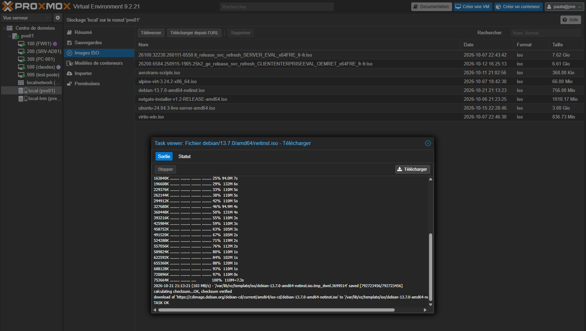

### Étape 2 · Créer la machine virtuelle 210 · SRV-GLPI

🎯 Créer la VM qui hébergera GLPI, avec des réglages adaptés à un serveur.

🖱️ En haut à droite de Proxmox : **Créer une VM**. Coche **Avancé** en bas de la fenêtre (sinon
certaines options sont cachées). Puis, onglet par onglet :

| Onglet | Champ | Valeur | Pourquoi |
| --- | --- | --- | --- |
| Général | ID de la VM | `210` | Plan du lab : 2xx = serveurs |
| | Nom | `SRV-GLPI` | Convention `SRV-ROLENN` |
| | Démarrer au démarrage | ✅ coché | Si Proxmox redémarre, GLPI repart tout seul |
| | Ordre de démarrage | `3` | Après le pare-feu (1) et le DC (2) : GLPI a besoin du DNS et de l'AD |
| Système d'exploitation | ISO | `debian-13.7.0-amd64-netinst.iso` | |
| | Type | Linux, 6.x - 2.6 Kernel | |
| Système | BIOS | SeaBIOS (défaut) | Suffit pour un serveur Linux (🏢 UEFI + démarrage sécurisé, voir annexes) |
| | Contrôleur SCSI | VirtIO SCSI single | Pilote le plus rapide |
| | Agent QEMU | ✅ coché | Proxmox peut « geler » les disques proprement pendant un instantané |
| Disques | Bus | SCSI | |
| | Stockage / taille | `local-lvm`, **32 Gio** | Largement assez pour GLPI et ses documents |
| | Abandon (discard) | ✅ | L'espace libéré dans la VM est rendu au stockage de Proxmox |
| | Émulation SSD | ✅ | |
| | IO thread | ✅ | Les accès disque ont leur propre fil d'exécution |
| Processeur | Cœurs / type | `2`, **host** | Le vrai processeur est transmis tel quel |
| Mémoire | Mémoire | `4096` Mio | |
| | Ballooning | ❌ décoché | MariaDB n'aime pas qu'on lui reprenne de la mémoire en cours de route |
| Réseau | Pont | `vmbr1` | Le pont des VLAN du lab |
| | Étiquette VLAN | `10` | La VM est directement dans le VLAN **Serveurs** |
| | Modèle | VirtIO | |
| | Pare-feu | ❌ décoché | Le filtrage est fait par pfSense (🏢 voir annexes) |
| Confirmation | Démarrer après création | ❌ décoché | On relit d'abord le récapitulatif |

✅ Le récapitulatif affiche bien `agent 1`, `balloon 0`, `cores 2`, `cpu host`, `memory 4096`,
`net0 virtio,bridge=vmbr1,tag=10`, `onboot 1`, `scsi0 local-lvm:32,discard=on,ssd=on,iothread=on`.
**On relit chaque ligne** avant de cliquer sur **Terminer** : c'est le moment où une erreur ne coûte rien.

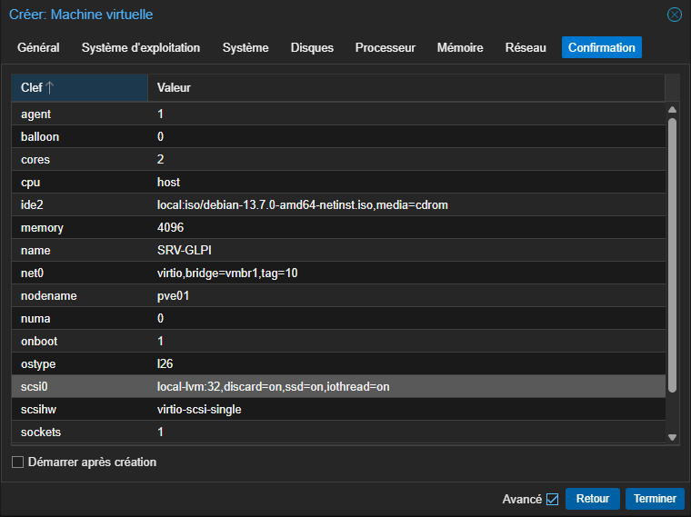

### Étape 3 · Installer Debian 13

🎯 Installer un Debian **minimal** : pas d'interface graphique, juste de quoi administrer le serveur.

🖱️ Sélectionne la VM 210, **Démarrer**, puis **Console**. Dans l'installateur :

1. **Install** (ou **Graphical install**), langue **Français**, pays **France**, clavier **Français**.
2. **Réseau** : la configuration automatique (DHCP) **échoue**. C'est **normal** : il n'y a pas de
   serveur DHCP pour le VLAN Serveurs. Choisis **Configurer vous-même le réseau** :

   | Champ | Valeur |
   | --- | --- |
   | Adresse IP | `10.10.10.20/24` |
   | Passerelle | `10.10.10.254` (pfSense) |
   | Serveurs de noms (DNS) | `10.10.10.10` (le DC SRV-AD01) |
   | Nom de machine | `srv-glpi` |
   | Domaine | `lab.home.arpa` |

   💡 **Un serveur a toujours une IP fixe** : les postes et les règles de pare-feu doivent toujours
   le retrouver à la même adresse. Le `/24` veut dire « les 3 premiers nombres désignent le réseau »
   (10.10.10.x).

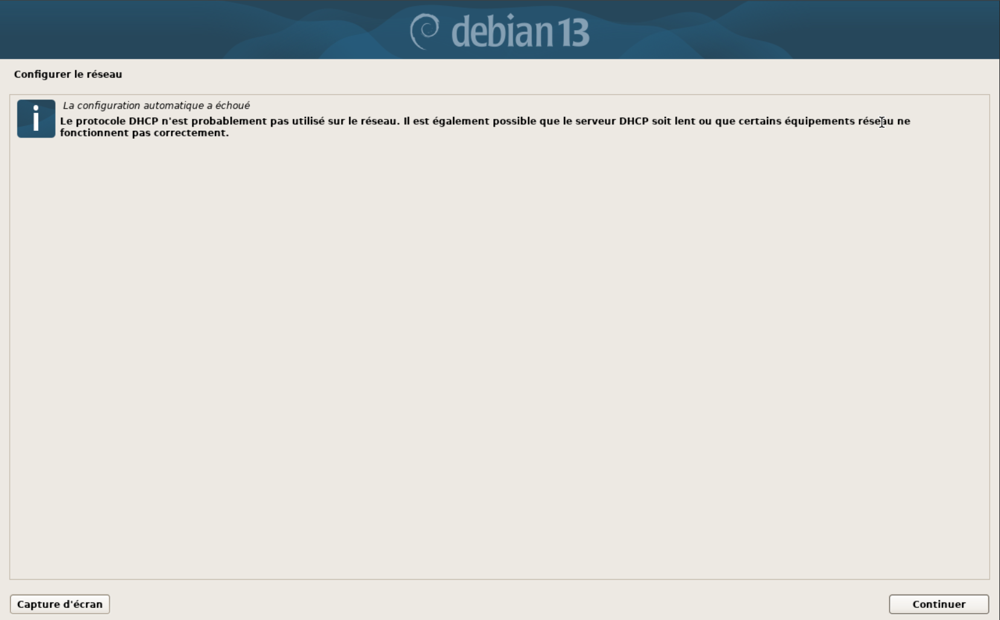
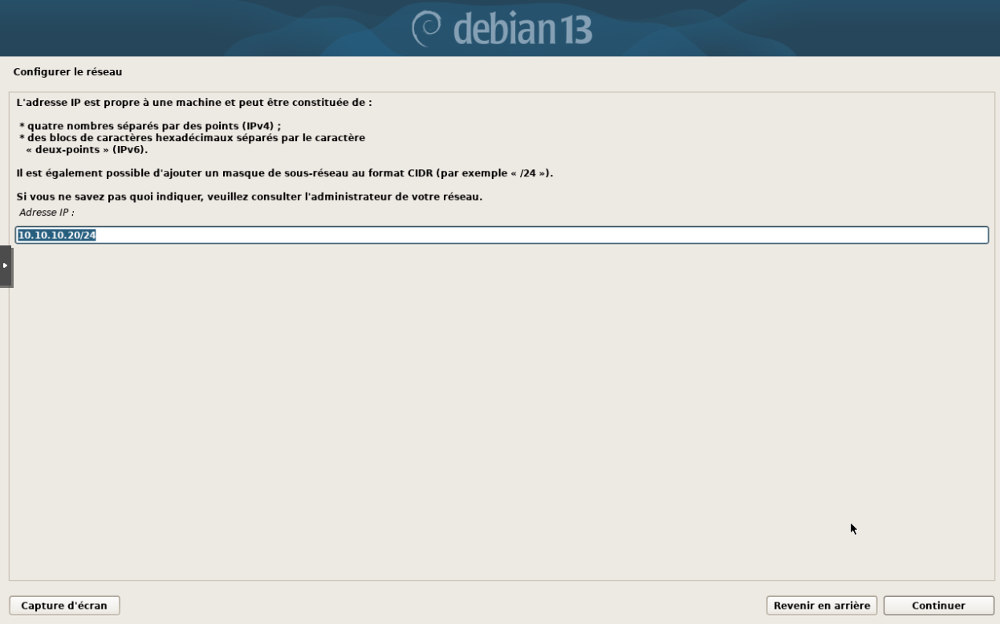

3. **Mot de passe du superutilisateur (root)** : **laisse-le vide**, deux fois.
   💡 Debian **verrouille** alors le compte root et donne le droit `sudo` au premier utilisateur.
   On ne se connecte jamais en root : chaque action d'administration passe par `sudo`, ce qui
   **laisse une trace** (qui a fait quoi) et oblige à réfléchir avant chaque commande sensible.
4. **Utilisateur** : nom complet `Paulo Rosa`, identifiant `paulo`, un mot de passe solide.

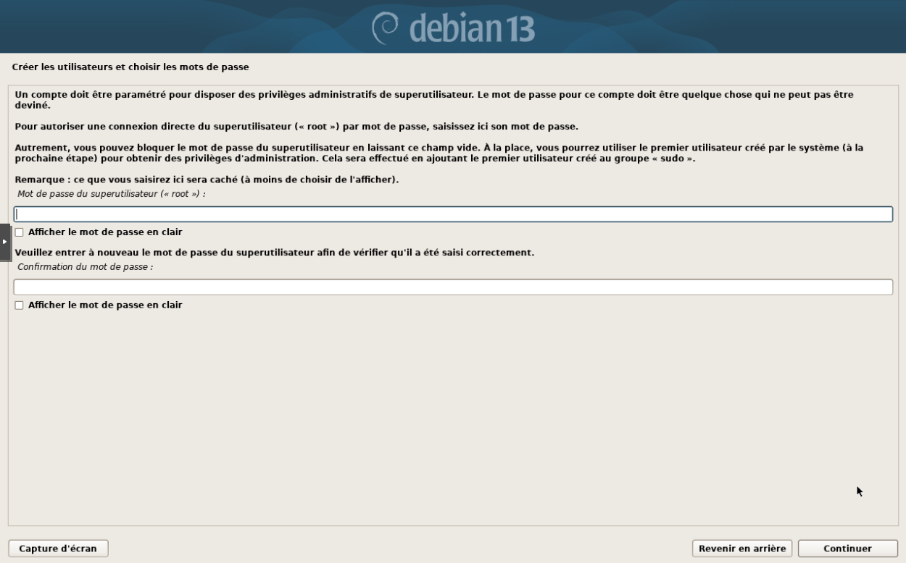

5. **Partitionnement** : **Assisté - utiliser un disque entier** → le disque de 34 Go →
   **Tout dans une seule partition** → **Terminer le partitionnement et appliquer les changements** →
   **Oui**. On obtient une partition `/` en ext4 et une petite partition d'échange (swap).

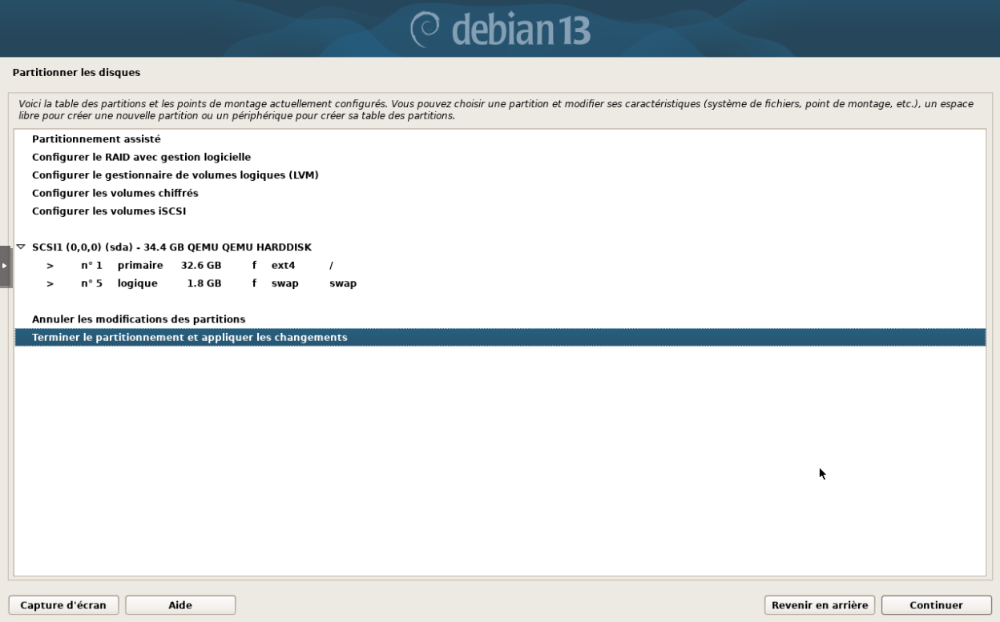

6. Miroir : **France**, `deb.debian.org`, pas de mandataire (proxy). Étude statistique : **Non**.
7. **Sélection des logiciels** : ❌ **décoche tout** ce qui est « environnement de bureau », GNOME…
   ✅ coche **serveur SSH** et **utilitaires usuels du système**.
   💡 Pas d'interface graphique sur un serveur : moins de logiciels = **moins de failles** et moins de
   mises à jour. On l'administre à distance, en ligne de commande.
8. Chargeur de démarrage GRUB : **Oui**, sur le disque `/dev/sda`. Fin : **Continuer** (redémarrage).

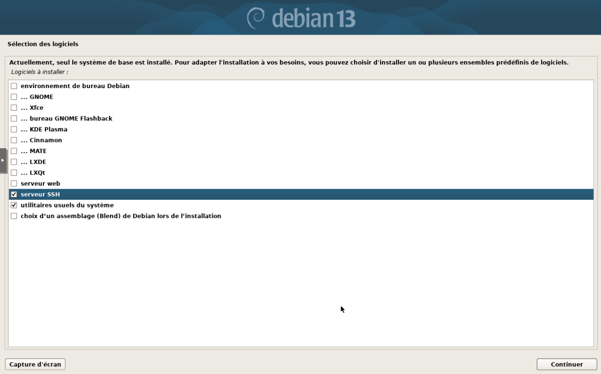

✅ Au redémarrage : `srv-glpi login:`. Connecte-toi avec `paulo`.

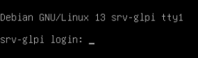

### Étape 4 · Vérifier le réseau et mettre à jour

🎯 S'assurer que le serveur a la bonne adresse, joint Internet, et part **à jour**.

⌨️ Tape :

```bash
ip a
```
- `ip a` (« ip address ») : affiche les cartes réseau et leurs adresses.
  ✅ On doit voir `inet 10.10.10.20/24`.

```bash
sudo apt update && sudo apt full-upgrade -y
```
- `sudo` : « exécute en administrateur » (il demande **ton** mot de passe la première fois) ;
- `apt update` : télécharge la **liste** des paquets disponibles (comme regarder le catalogue) ;
- `&&` : « puis, **seulement si** la commande d'avant a réussi » ;
- `apt full-upgrade -y` : installe toutes les mises à jour ; `-y` répond « oui » tout seul.

✅ À la fin : `0 mis à jour, 0 nouvellement installés…` quand on relance : tout est à jour.

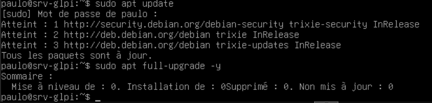

🖱️ **Instantané** dans Proxmox (VM 210 > **Instantanés** > **Créer un instantané**), nom
`debian-propre`, sans la RAM. Si une étape suivante tourne mal, on revient ici en 10 secondes.

❌ **Alerte « thin pool » à la création de l'instantané** : Proxmox prévient que la somme des
disques **promis** à toutes les VM (~372 Gio) dépasse la taille du stockage. C'est le principe du
**thin provisioning** : on promet plus que ce qu'on a, car les VM n'utilisent pas tout. On vérifie
l'occupation **réelle** (local-lvm > Résumé) : 81 Go sur 374,5 Go, soit 21,6 %. Pas urgent, mais on
surveille les instantanés, qui grossissent au fil du temps.

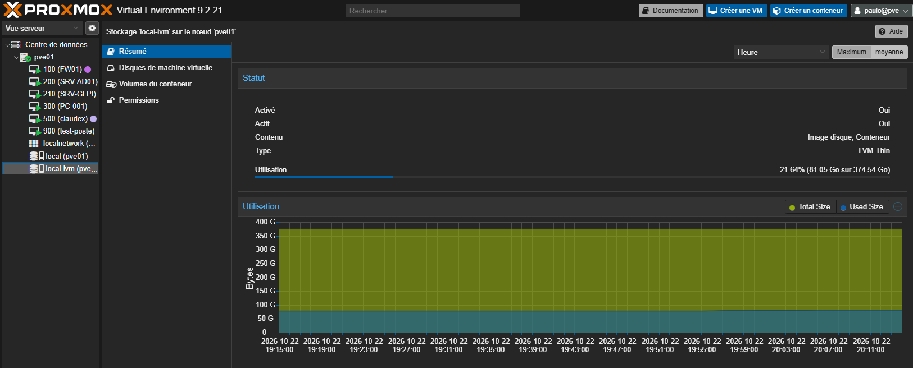

### Étape 5 · Une console qui accepte le copier-coller

🎯 Pouvoir coller les longues commandes au lieu de les taper (et éviter les fautes de frappe).

💡 La console noVNC de Proxmox **affiche une image** de l'écran : on ne peut pas y coller de texte.
La console **xterm.js** est un vrai terminal texte, qui accepte le copier-coller. Elle passe par un
**port série** virtuel.

🖱️ VM 210 > **Matériel** > **Ajouter** > **Port série** > numéro `0` > **Ajouter**. La ligne apparaît
en orange : il faut **arrêter puis démarrer** la VM (un simple redémarrage depuis Debian ne suffit pas).

⌨️ Puis, dans Debian :

```bash
sudo systemctl enable --now serial-getty@ttyS0.service
```
- `systemctl` : l'outil qui gère les **services** (les programmes qui tournent en fond) ;
- `enable` : démarrer ce service **à chaque démarrage** ; `--now` : et **tout de suite** ;
- `serial-getty@ttyS0` : le service qui affiche une invite de connexion sur le port série n° 0.

🖱️ En haut à droite, bouton **Console** > flèche > **xterm.js**.

✅ Une fenêtre noire avec `starting serial terminal on interface serial0`, puis l'invite de
connexion. **Ctrl + Maj + V** pour coller (ou clic droit).

🏢 En entreprise, on se connecte en **SSH** depuis le poste d'administration. Dans le lab, le
poste d'administration n'est pas encore dans le bon réseau (il faut le switch, brique 02).

---

## Partie 2 — Installer la pile web (Apache, MariaDB, PHP)

### Étape 6 · Installer les logiciels

🎯 Installer le « restaurant » : le serveur web, la cuisine (PHP) et le garde-manger (base de données).

⌨️

```bash
sudo apt install -y apache2 mariadb-server php8.4-fpm php8.4-curl php8.4-gd php8.4-intl php8.4-mysql php8.4-zip php8.4-bcmath php8.4-mbstring php8.4-xml php8.4-bz2 php8.4-ldap
```

| Paquet | Rôle |
| --- | --- |
| `apache2` | Le serveur web |
| `mariadb-server` | La base de données |
| `php8.4-fpm` | PHP, dans ses propres processus (FPM = *FastCGI Process Manager*) |
| `php8.4-mysql` | Permet à PHP de parler à MariaDB |
| `php8.4-ldap` | Permet à PHP de parler à l'Active Directory (partie 6) |
| `php8.4-curl`, `gd`, `intl`, `zip`, `bcmath`, `mbstring`, `xml`, `bz2` | Extensions exigées par GLPI (téléchargements, images, langues, archives, calculs, accents, fichiers XML, compression) |

⌨️ Vérifier que les services tournent :

```bash
systemctl status apache2 --no-pager
systemctl status mariadb --no-pager
```
✅ `Active: active (running)` en vert pour les deux. (`--no-pager` : affiche tout d'un coup, sans
avoir à appuyer sur `q` pour quitter.)

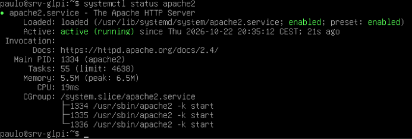
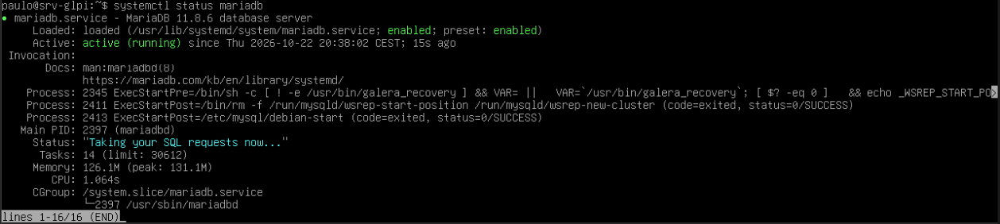

### Étape 7 · Vérifier qu'on n'installe pas une version de PHP vulnérable

🎯 Une alerte de sécurité venait de sortir sur PHP (faille surnommée « PHP2Shell »). GLPI est écrit
en PHP : **si PHP est troué, GLPI l'est aussi**, même si GLPI n'y est pour rien.

⌨️

```bash
php -v
apt policy php8.4-fpm
```
- `php -v` : la version de PHP installée ;
- `apt policy` : d'où vient le paquet, et quelles versions existent.

✅ Version **8.4.27-1~deb13u1**, venant du dépôt **trixie-security** (le dépôt des correctifs de
sécurité de Debian 13). La 8.4.24 du dépôt principal aurait été vulnérable : la mise à jour de
sécurité a bien été prise.

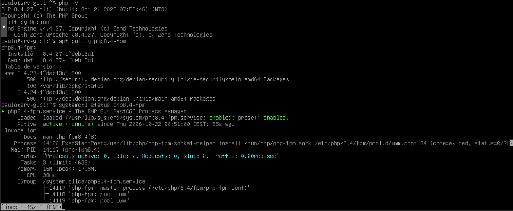

💡 **Réflexe pro** : quand une faille sort, on ne se demande pas « est-ce que je suis concerné ? »,
on **vérifie** la version exacte.

### Étape 8 · Sécuriser MariaDB

🎯 Enlever les réglages « de démonstration » de MariaDB, dangereux en production.

⌨️

```bash
sudo mariadb-secure-installation
```

Réponses (on lit chaque question avant de répondre) :

| Question | Réponse | Pourquoi |
| --- | --- | --- |
| Enter current password for root | *(Entrée)* | Pas de mot de passe : root entre par `unix_socket` |
| Switch to unix_socket authentication | `n` | C'est **déjà** le cas sur Debian |
| Change the root password | `n` | Root n'a pas besoin de mot de passe : seul le root **Linux** (via `sudo`) peut entrer. Rien à voler |
| Remove anonymous users | `y` | Un compte sans nom, ouvert à tous : à supprimer |
| Disallow root login remotely | `y` | Root ne se connecte que depuis le serveur lui-même |
| Remove test database | `y` | Base de test ouverte à tous |
| Reload privilege tables | `y` | Appliquer tout de suite |

✅ `All done! … your MariaDB installation should now be secure.`

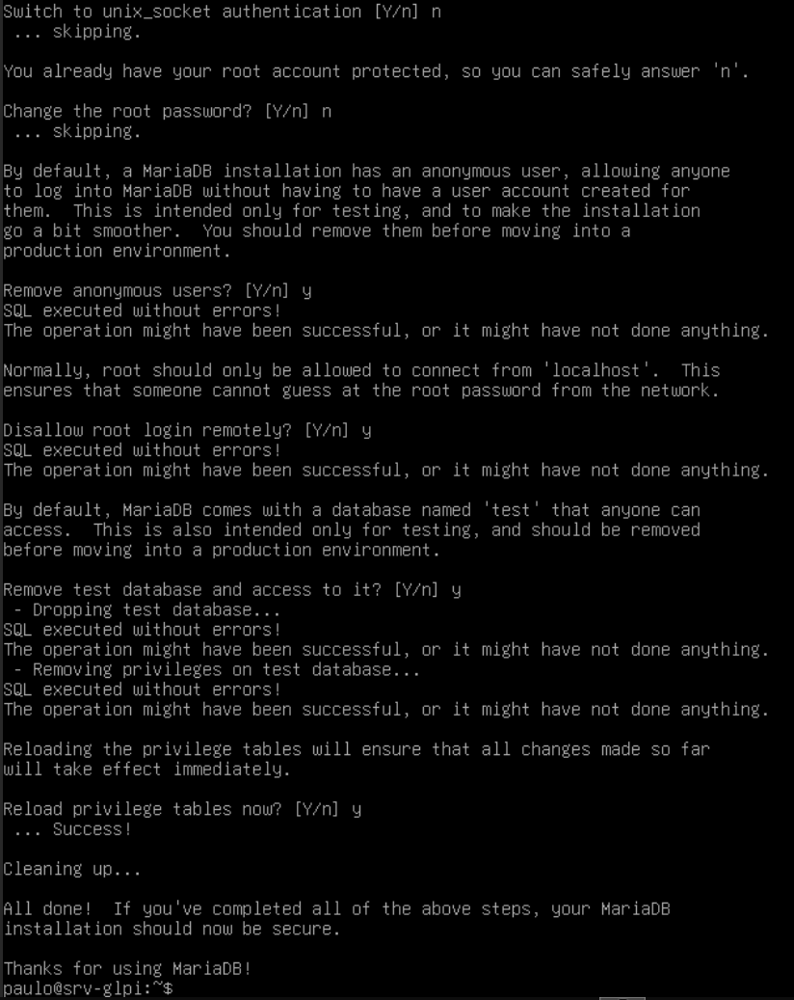

### Étape 9 · Charger les fuseaux horaires dans MariaDB

🎯 GLPI gère les fuseaux horaires (heure de Paris, été / hiver) : MariaDB doit les connaître.

⌨️

```bash
sudo mariadb-tzinfo-to-sql /usr/share/zoneinfo | sudo mariadb mysql
sudo mariadb -e "SELECT COUNT(*) FROM mysql.time_zone_name;"
```
- `mariadb-tzinfo-to-sql /usr/share/zoneinfo` : transforme les fuseaux horaires de Linux en
  instructions SQL ;
- `|` (« pipe », barre verticale, **AltGr + 6**) : envoie le résultat de la 1re commande à la 2e ;
- `sudo mariadb mysql` : les exécute dans la base système `mysql` ;
- la 2e ligne compte les fuseaux chargés.

✅ `486`.

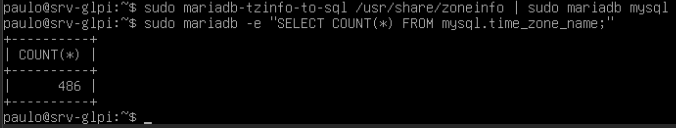

### Étape 10 · Créer la base de données et l'utilisateur de GLPI

🎯 Donner à GLPI **sa propre base** et **son propre compte**, qui n'a de droits que sur elle.

⌨️ Ouvre la console de MariaDB :

```bash
sudo mariadb
```

L'invite devient `MariaDB [(none)]>`. Tape **une commande à la fois**, chacune se termine par `;` :

```sql
CREATE DATABASE glpi CHARACTER SET utf8mb4 COLLATE utf8mb4_unicode_ci;
CREATE USER 'glpi_app'@'localhost' IDENTIFIED BY 'un-mot-de-passe-long-et-unique';
GRANT ALL PRIVILEGES ON glpi.* TO 'glpi_app'@'localhost';
GRANT SELECT ON mysql.time_zone_name TO 'glpi_app'@'localhost';
FLUSH PRIVILEGES;
EXIT;
```

| Ligne | Explication |
| --- | --- |
| `CREATE DATABASE glpi … utf8mb4` | Crée la base `glpi`. `utf8mb4` = accepte tous les caractères (accents, émojis) |
| `CREATE USER 'glpi_app'@'localhost'` | Crée le compte `glpi_app`, utilisable **seulement depuis le serveur lui-même** |
| `GRANT ALL … ON glpi.*` | Tous les droits, mais **uniquement sur la base glpi** (`glpi.*` = toutes ses tables) |
| `GRANT SELECT ON mysql.time_zone_name` | Lecture seule de la liste des fuseaux (étape 9) |
| `FLUSH PRIVILEGES` | Applique les droits tout de suite |

❌ **Erreurs faites pendant le lab** :

- **Point-virgule oublié** : MariaDB affiche `->` au lieu de `MariaDB [(none)]>`. Il **attend la suite**
  de la commande. Si on tape autre chose, on obtient `ERROR 1064 (syntax error)`. Solution : taper
  `;` puis Entrée, ou recommencer la commande proprement.
- **Fautes de frappe** : `DATABES` au lieu de `DATABASE`, `gigest` : le message d'erreur montre
  l'endroit exact (`near 'DATABES…'`). **Toujours lire le message d'erreur.**

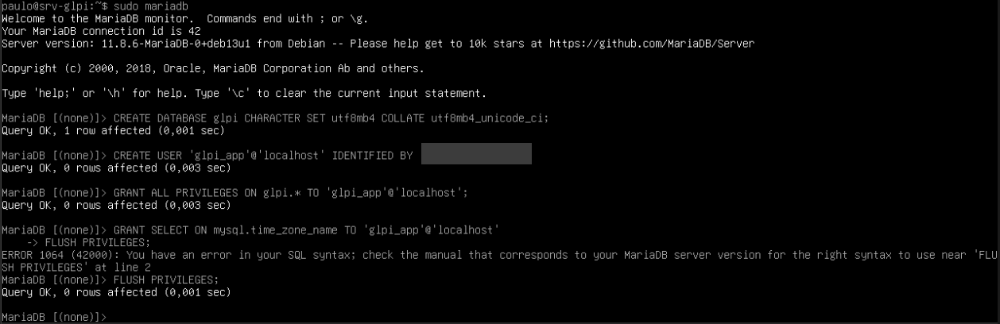
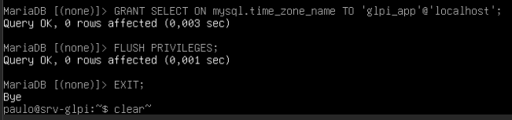
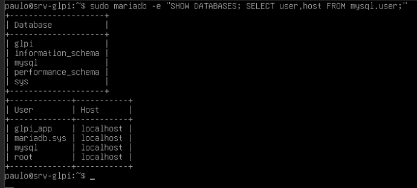

🏢 Le mot de passe de `glpi_app` doit être **généré au hasard** (30 caractères) et rangé dans le
**coffre-fort** de mots de passe de l'équipe. Dans le lab, il était court et a été vu sur une
capture : écart assumé, voir annexes.

---

## Partie 3 — Installer GLPI

### Étape 11 · Choisir la version et la télécharger

🎯 Prendre la **bonne** version, depuis la **source officielle**, et vérifier qu'elle n'a pas été
modifiée.

⌨️ `curl` (outil pour interroger des sites web en ligne de commande) n'est pas installé sur un
Debian minimal :

```bash
sudo apt install -y curl
curl -s https://api.github.com/repos/glpi-project/glpi/releases | grep '"tag_name"' | head -8
```
- `curl -s` : télécharge la page **sans** afficher la barre de progression (`-s` = silencieux) ;
- l'adresse : la liste des versions publiées par l'éditeur sur GitHub ;
- `grep '"tag_name"'` : ne garde que les lignes qui contiennent le numéro de version ;
- `head -8` : seulement les 8 premières.

✅ On voit `12.0.0`, `11.0.11`, `12.0.0-rc3`, `11.0.10`, `10.0.28`…

💡 **Comment choisir** : les `rc` (*release candidate*) sont des versions **de test**, jamais en
production. La `12.0.0` vient de sortir : on laisse les autres essuyer les plâtres. La 10 arrive en fin
de vie. → **11.0.11**, la dernière de la branche 11.

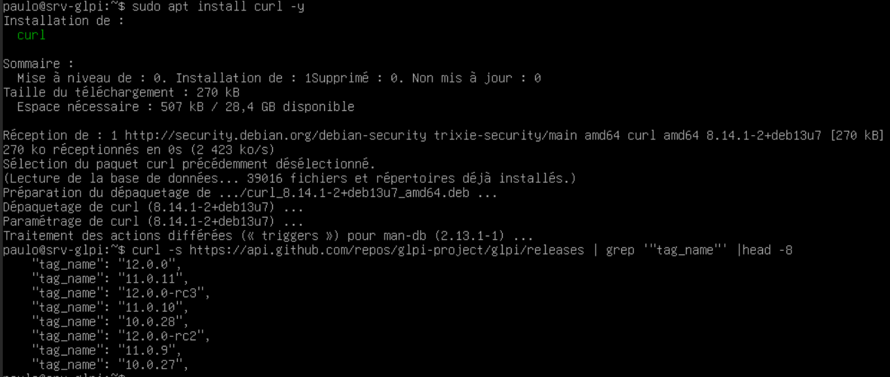

⌨️ Téléchargement dans `/tmp` (le dossier temporaire) :

```bash
cd /tmp
wget https://github.com/glpi-project/glpi/releases/download/11.0.11/glpi-11.0.11.tgz
sha256sum glpi-11.0.11.tgz
```
- `cd /tmp` : « va dans le dossier /tmp » ;
- `wget` : télécharge le fichier ;
- `sha256sum` : calcule son empreinte SHA-256.

✅ L'empreinte affichée est **identique** à celle publiée par GitHub sur la page de la version 11.0.11
(champ *digest* du fichier). On compare au moins le début et la fin, idéalement tout.

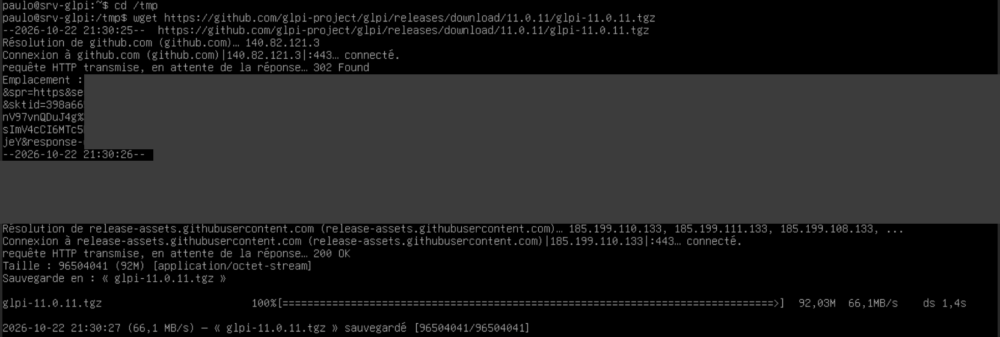
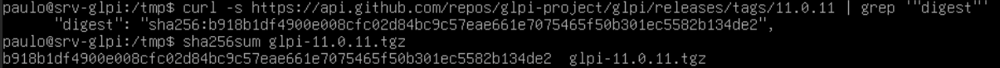

❌ Si l'empreinte est différente : **on n'installe pas**, on supprime le fichier et on retélécharge.

### Étape 12 · Extraire GLPI et ranger les dossiers comme il faut

🎯 Appliquer la méthode recommandée par l'éditeur : **séparer le code, la configuration, les données
et les journaux**, avec les bons propriétaires.

⌨️

```bash
sudo tar -xzf glpi-11.0.11.tgz -C /var/www/
sudo mv /var/www/glpi/config /etc/glpi
sudo mv /var/www/glpi/files /var/lib/glpi
sudo mkdir /var/log/glpi
sudo chown -R root:root /var/www/glpi
sudo chown -R www-data:www-data /etc/glpi /var/lib/glpi /var/log/glpi /var/www/glpi/marketplace
ls -ld /var/www/glpi /etc/glpi /var/lib/glpi /var/log/glpi
```

| Commande | Explication |
| --- | --- |
| `tar -xzf … -C /var/www/` | Décompresse l'archive (`x` extraire, `z` compressée en gzip, `f` ce fichier) dans `/var/www/` |
| `mv … config /etc/glpi` | Déplace la configuration dans `/etc` (là où Linux range les configurations) |
| `mv … files /var/lib/glpi` | Déplace les données (documents joints, cache, sessions) dans `/var/lib` |
| `mkdir /var/log/glpi` | Crée le dossier des journaux, rangé avec ceux du système |
| `chown -R root:root /var/www/glpi` | Le **code** appartient à **root** (`-R` = tout le dossier et son contenu) |
| `chown -R www-data:www-data …` | Les dossiers où GLPI **doit écrire** appartiennent à **www-data**, le compte d'Apache |

💡 **Pourquoi c'est important** : Apache (www-data) **ne peut pas modifier le code**. Si un pirate
trouve une faille dans GLPI, il ne pourra pas y déposer un fichier piégé. Et la configuration (qui
contient l'accès à la base) est **hors du dossier web** : impossible de la télécharger avec un
navigateur.

✅ `ls -ld` montre `root root` pour `/var/www/glpi` et `www-data www-data` pour les trois autres.

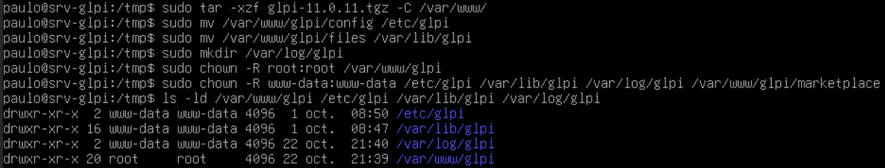

### Étape 13 · Dire à GLPI où sont ses dossiers

🎯 Comme on a déplacé les dossiers, il faut indiquer à GLPI leur nouvelle adresse.

⌨️ Fichier 1 (dans le code, il dit « ma configuration est dans /etc/glpi ») :

```bash
sudo nano /var/www/glpi/inc/downstream.php
```
```php
<?php
define('GLPI_CONFIG_DIR', '/etc/glpi/');
if (file_exists(GLPI_CONFIG_DIR . '/local_define.php')) {
    require_once GLPI_CONFIG_DIR . '/local_define.php';
}
```

Fichier 2 (dans la configuration, il donne les autres dossiers) :

```bash
sudo nano /etc/glpi/local_define.php
```
```php
<?php
define('GLPI_VAR_DIR', '/var/lib/glpi');
define('GLPI_LOG_DIR', '/var/log/glpi');
```

💡 **nano** est un éditeur de texte simple : on tape le texte, **Ctrl + O** puis Entrée pour
enregistrer, **Ctrl + X** pour quitter.

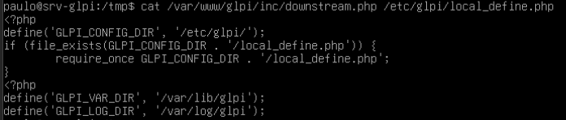

### Étape 14 · Configurer Apache pour GLPI, en HTTPS

🎯 Dire à Apache : « le site `srv-glpi.lab.home.arpa`, c'est GLPI, et **uniquement en HTTPS** ».

⌨️ Crée le fichier du site :

```bash
sudo nano /etc/apache2/sites-available/glpi.conf
```

Contenu **au moment de l'installation** (le certificat « snakeoil » sera remplacé à la partie 9) :

```apache
<VirtualHost *:80>
    ServerName srv-glpi.lab.home.arpa
    Redirect permanent / https://srv-glpi.lab.home.arpa/
</VirtualHost>

<VirtualHost *:443>
    ServerName srv-glpi.lab.home.arpa
    DocumentRoot /var/www/glpi/public

    SSLEngine on
    SSLCertificateFile /etc/ssl/certs/ssl-cert-snakeoil.pem
    SSLCertificateKeyFile /etc/ssl/private/ssl-cert-snakeoil.key

    <Directory /var/www/glpi/public>
        Require all granted
        RewriteEngine On
        RewriteCond %{HTTP:Authorization} ^(.+)$
        RewriteRule .* - [E=HTTP_AUTHORIZATION:%{HTTP:Authorization}]
        RewriteCond %{REQUEST_FILENAME} !-f
        RewriteRule ^(.*)$ index.php [QSA,L]
    </Directory>

    <FilesMatch \.php$>
        SetHandler "proxy:unix:/run/php/php8.4-fpm.sock|fcgi://localhost/"
    </FilesMatch>
</VirtualHost>
```

| Bloc / ligne | Explication |
| --- | --- |
| `<VirtualHost *:80>` + `Redirect permanent` | Tout ce qui arrive en **HTTP** (port 80, non chiffré) est **renvoyé** vers HTTPS (code 301 = « déménagé définitivement ») |
| `<VirtualHost *:443>` | Le site en **HTTPS** (port 443, chiffré) |
| `DocumentRoot /var/www/glpi/public` | ⭐ Seul le sous-dossier **public** est visible depuis le navigateur. Le reste du code est inaccessible par une adresse web |
| `SSLEngine on` + les 2 `SSLCertificate…` | Active le chiffrement avec un certificat et sa clé. Le **snakeoil** est un certificat « fait maison » fourni par Debian |
| `Require all granted` | Tout le monde peut visiter (le filtrage réseau est fait par pfSense) |
| `RewriteCond … Authorization` | Transmet à PHP l'en-tête d'authentification (utilisé par l'API et par OAuth, partie 10) |
| `RewriteRule ^(.*)$ index.php` | Toutes les adresses passent par le « standard » de GLPI 11 (`index.php`) |
| `SetHandler "proxy:unix:…fpm.sock…"` | Les fichiers `.php` sont envoyés à PHP-FPM par son **socket** (une prise de communication locale) |

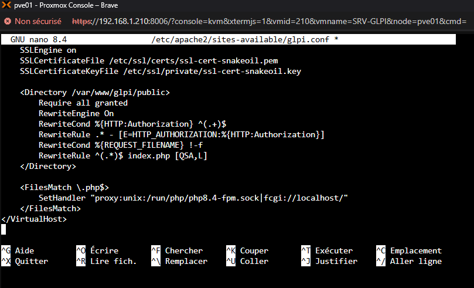

⌨️ Activer les modules et le site, désactiver la page par défaut, tester, recharger :

```bash
sudo a2enmod ssl rewrite proxy_fcgi setenvif
sudo a2ensite glpi
sudo a2dissite 000-default
sudo apache2ctl configtest
sudo systemctl reload apache2
```
- `a2enmod` (« apache2 enable module ») : active les modules `ssl` (HTTPS), `rewrite` (réécriture des
  adresses), `proxy_fcgi` et `setenvif` (dialogue avec PHP-FPM) ;
- `a2ensite glpi` : active notre site ; `a2dissite 000-default` : désactive la page « It works »
  d'Apache, inutile ;
- `apache2ctl configtest` : Apache **relit** sa configuration **sans rien appliquer** : c'est le
  contrôle avant décollage ✈️ ;
- `reload` : applique, sans couper les visiteurs.

✅ `Syntax OK`.

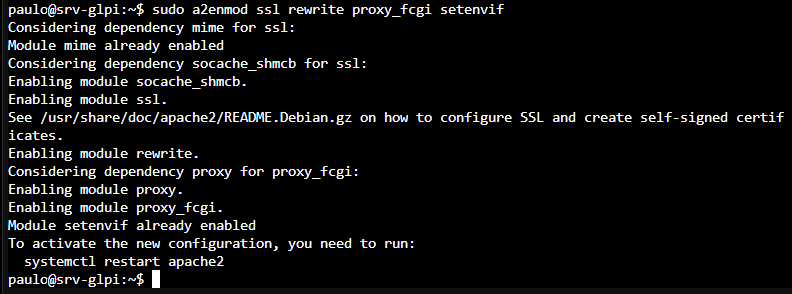
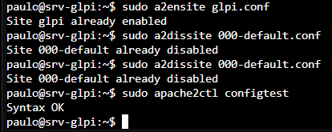

❌ Si `configtest` affiche une erreur, elle donne le **fichier** et le **numéro de ligne** : on corrige
avant de recharger. Tant qu'on n'a pas rechargé, l'ancien réglage continue de tourner.

💡 La clé privée du snakeoil (`/etc/ssl/private/…`) est **illisible** pour l'utilisateur `paulo` :
c'est normal et voulu, seul root (donc Apache au démarrage) peut la lire.

### Étape 15 · Durcir PHP et Apache

🎯 Protéger la **session** des utilisateurs, et ne pas donner d'indices aux pirates.

⌨️ **Les cookies de session** (le « bracelet » que GLPI donne à l'utilisateur connecté) :

```bash
sudo sed -i -e 's/^;\?session.cookie_httponly =.*/session.cookie_httponly = On/' -e 's/^;\?session.cookie_secure =.*/session.cookie_secure = On/' -e 's/^;\?session.cookie_samesite =.*/session.cookie_samesite = Lax/' /etc/php/8.4/fpm/php.ini
grep -E '^session.cookie_(httponly|secure|samesite)' /etc/php/8.4/fpm/php.ini
sudo systemctl restart php8.4-fpm
```
- `sed -i -e 's/ancien/nouveau/'` : **remplace** du texte dans un fichier (`-i` = directement dans le
  fichier). `^;\?` veut dire « en début de ligne, avec ou sans `;` devant » (le `;` désactive une ligne) ;
- `grep -E` : affiche les lignes qui correspondent, pour vérifier.

| Réglage | Protège contre |
| --- | --- |
| `cookie_httponly = On` | Le cookie est **illisible par du JavaScript** : une faille XSS ne peut pas le voler |
| `cookie_secure = On` | Le cookie n'est **jamais envoyé en HTTP** non chiffré |
| `cookie_samesite = Lax` | Le cookie n'est pas envoyé quand un **autre site** essaie d'agir à ta place |

✅ Les 3 lignes affichées avec `On`, `On`, `Lax`.

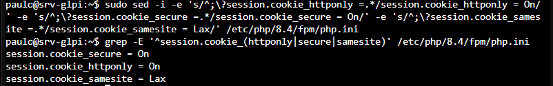

⌨️ **Cacher la version d'Apache** :

```bash
sudo sed -i -e 's/^ServerTokens .*/ServerTokens Prod/' -e 's/^ServerSignature .*/ServerSignature Off/' /etc/apache2/conf-available/security.conf
sudo systemctl reload apache2
curl -kI https://localhost | grep Server
```
✅ `Server: Apache` tout court, sans numéro de version ni système. Un pirate ne sait plus quelles
failles connues tenter. (`-k` : accepte le certificat fait maison pour ce test, `-I` : n'affiche que
les en-têtes.)

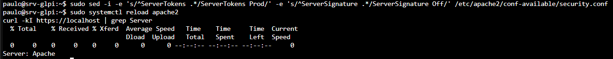

### Étape 16 · L'installation web de GLPI

🎯 Lancer l'assistant d'installation de GLPI depuis un navigateur.

🖱️ Depuis **PC-001** (le seul poste qui peut joindre le serveur pour l'instant), dans Edge :
`https://10.10.10.20`

1. **Avertissement « Votre connexion n'est pas privée »** : normal, le certificat est fait maison.
   **Avancé** > **Continuer**. On l'accepte **uniquement** parce qu'on sait exactement pourquoi il
   apparaît (on le règle proprement en partie 9). Sur Internet, on ne fait jamais ça.

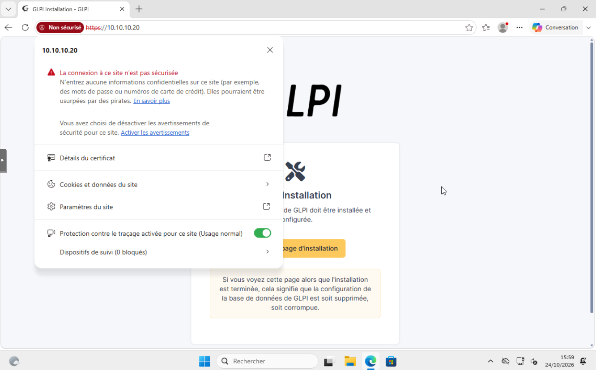

2. Langue **Français** > **OK**, accepter la licence > **Continuer**, puis **Installer**.
3. **Vérification de compatibilité** : tous les tests doivent être verts. → **Continuer**.

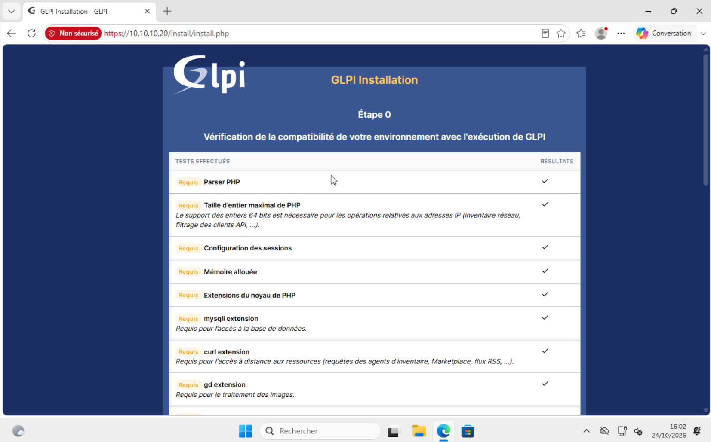

4. **Connexion à la base** : serveur `localhost`, utilisateur `glpi_app`, son mot de passe →
   **Continuer**. Choisir la base existante **glpi** → **Continuer**. L'initialisation prend une minute.

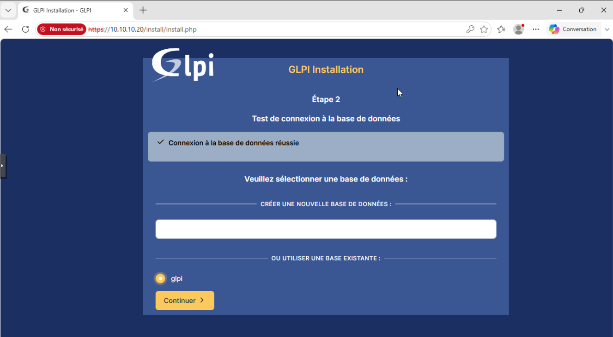

5. **Télémétrie** : la case « Envoyer les statistiques d'usage » est **cochée par défaut** →
   ❌ **décoche-la**. On n'envoie pas d'informations sur le parc d'un client à un tiers.

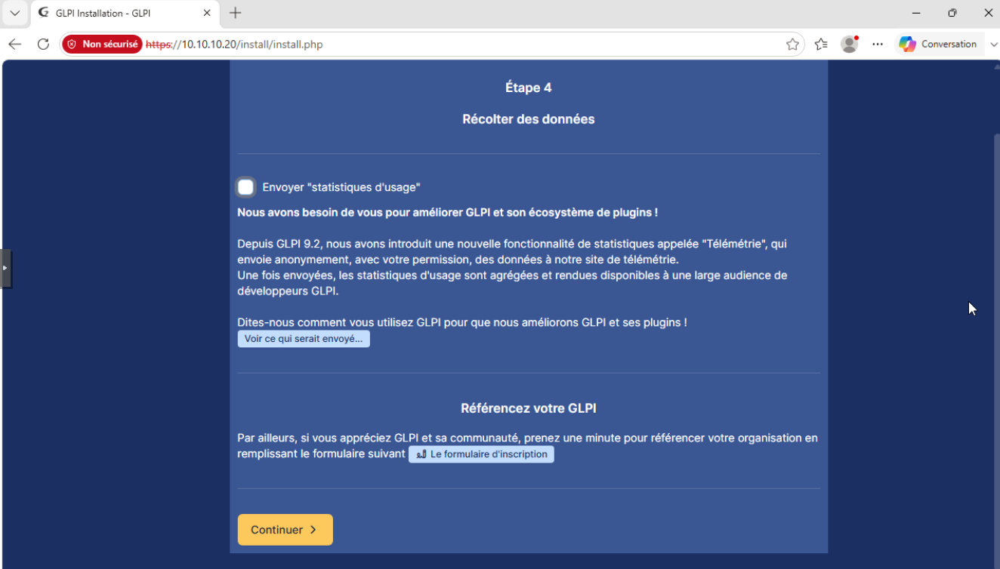

6. Écran de l'offre commerciale → **Continuer**. Écran final : GLPI rappelle les **4 comptes créés
   par défaut** (`glpi`, `tech`, `normal`, `post-only`) → **Utiliser GLPI**.

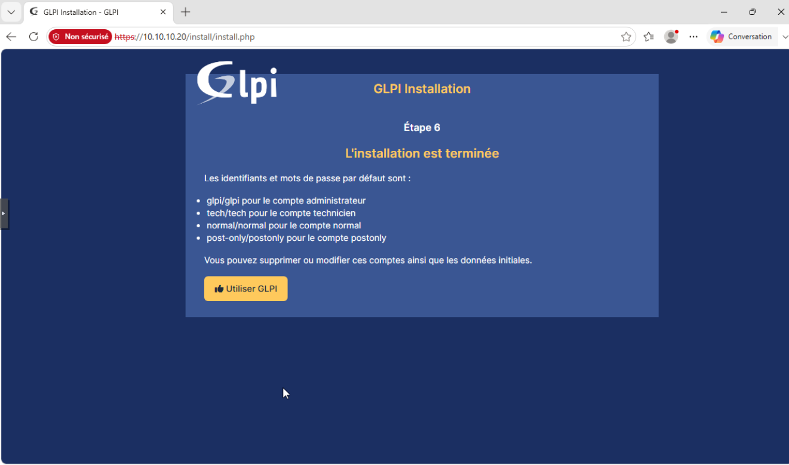

### Étape 17 · Supprimer le fichier d'installation

🎯 Empêcher n'importe qui de **relancer l'installation** et d'écraser la configuration.

⌨️

```bash
sudo rm /var/www/glpi/install/install.php
ls /var/www/glpi/install/install.php /tmp/glpi-11.0.11.tgz
```
✅ `Aucun fichier ou dossier de ce nom` pour les deux.

❌ **Erreur du lab** : un `~` tapé par erreur devant la commande (`~sudo …`) → « commande introuvable ».
Relire la ligne avant Entrée.

💡 L'archive dans `/tmp` avait déjà disparu : sur Debian 13, `/tmp` est **en mémoire** et vidé à chaque
redémarrage. Ne jamais garder quelque chose d'important dans `/tmp`.

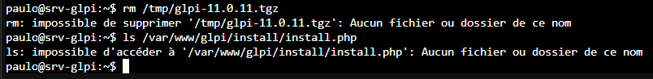

### Étape 18 · S'occuper des comptes par défaut

🎯 Les 4 comptes par défaut ont des mots de passe **connus de tout Internet** (ils sont dans la
documentation). Un bandeau rouge le rappelle.

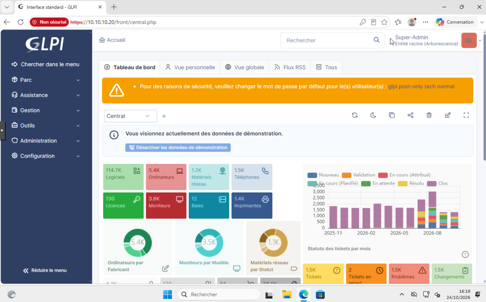

🖱️ Connecte-toi avec `glpi` / `glpi`, puis **Administration > Utilisateurs** :

1. **glpi** : ouvre la fiche, renseigne un **nouveau mot de passe** solide (2 fois) > **Sauvegarder**.
   On le garde comme **compte de secours** : si l'AD tombe un jour, on peut encore entrer.
2. **tech**, **normal**, **post-only** : ouvre chaque fiche, **Actif : Non** > **Sauvegarder**.
   Ils ne servent à rien : les vrais comptes viendront de l'AD.

✅ Le bandeau rouge disparaît de l'accueil.

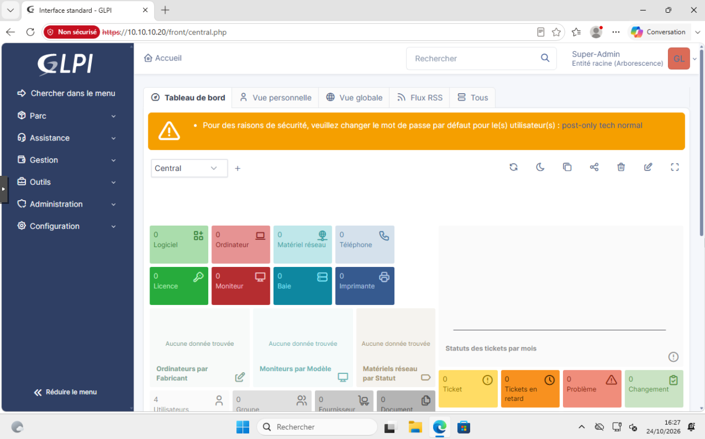
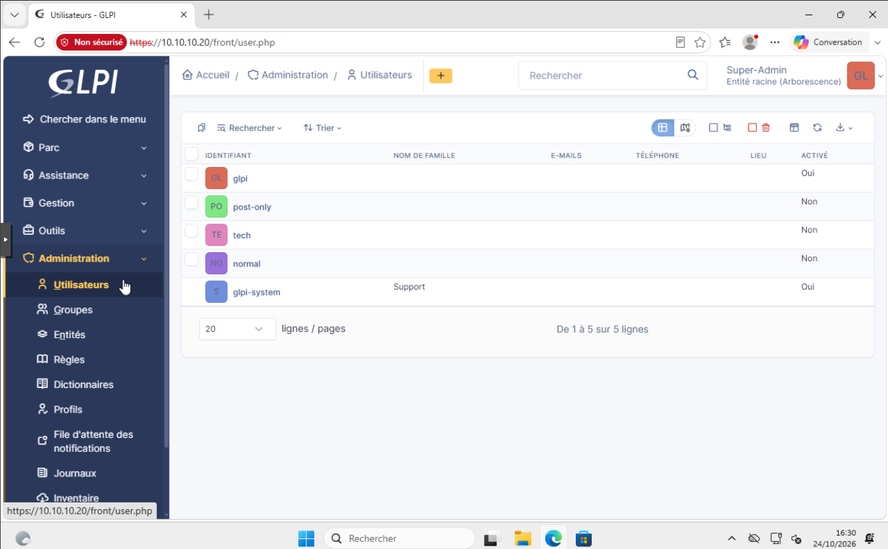
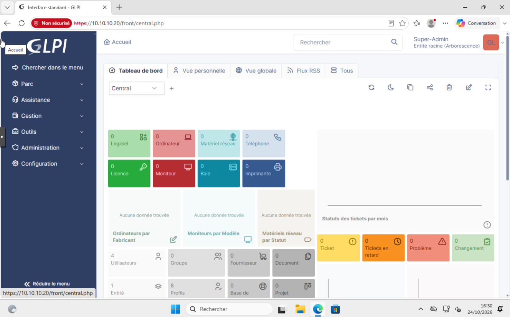

🖱️ Instantané Proxmox `glpi-installe`.

---

## Partie 4 — Le réseau : DNS et pare-feu

### Étape 19 · Donner un nom au serveur dans le DNS

🎯 Qu'on puisse taper `srv-glpi.lab.home.arpa` au lieu de `10.10.10.20`.

💡 **Pourquoi un nom et pas une IP ?** Le nom est écrit sur le **certificat** (partie 9) : sans nom,
pas de vrai HTTPS. Et si l'IP change un jour, on modifie une ligne dans le DNS au lieu de prévenir
tout le monde.

🖱️ Sur **SRV-AD01** : **Gestionnaire de serveur** > **Outils** > **DNS**.

1. Déplie **SRV-AD01**, puis trouve la zone **lab.home.arpa**.
2. Clic droit sur **lab.home.arpa** > **Nouveaux enregistrements…** > **Hôte (A ou AAAA)** >
   **Créer un enregistrement**.
3. **Hôte** : `srv-glpi` ; **Adresse IP** : `10.10.10.20` ;
   ✅ coche **Mettre à jour l'enregistrement de pointeur (PTR) associé** > **OK**.

💡 L'enregistrement **A** traduit le nom en IP ; le **PTR** fait l'inverse (IP → nom). Les deux
servent au dépannage et à certains logiciels.

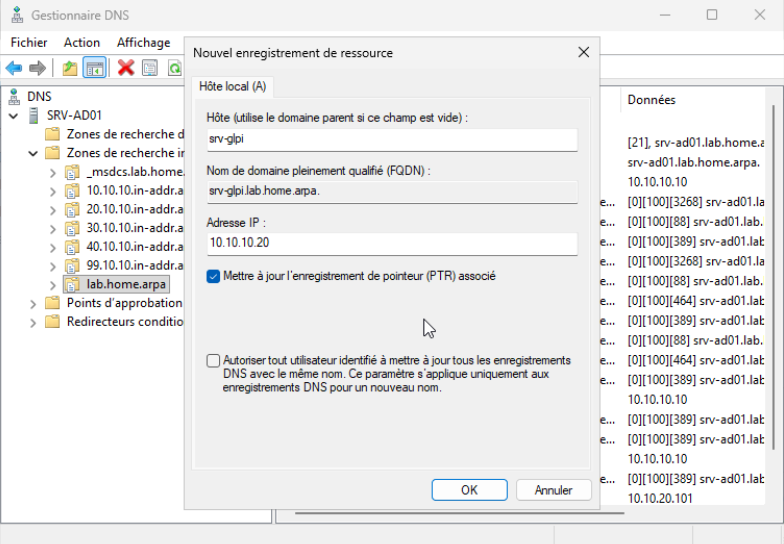

❌ **Surprise du lab : pas de « Nouvel hôte (A ou AAAA) » dans le menu clic droit.**
La zone `lab.home.arpa` apparaît même dans les **zones de recherche inversée** !
- **Cause** : le nom se termine par **.arpa**, et Windows en déduit que c'est une zone **inversée**
  (les zones inversées s'appellent `….in-addr.arpa`). PowerShell le confirme :
  `Get-DnsServerZone` → `IsReverseLookupZone : True`.
- **Conséquence** : seul le menu change, le DNS fonctionne normalement.
- **Contournement** : passer par **Nouveaux enregistrements…** comme ci-dessus.

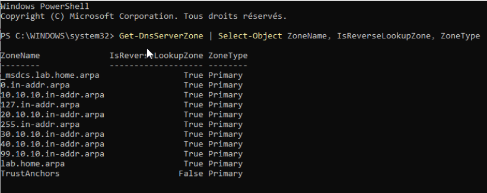

⌨️ **Vérification** (PowerShell sur SRV-AD01) :

```powershell
Resolve-DnsName srv-glpi.lab.home.arpa
Resolve-DnsName 10.10.10.20
```
✅ La 1re donne `10.10.10.20`, la 2e donne `srv-glpi.lab.home.arpa` : ça marche **dans les deux sens**.

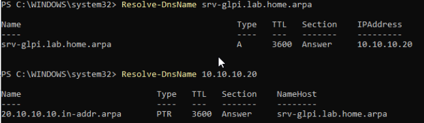

🏢 En entreprise, le domaine AD est un **sous-domaine d'un vrai domaine** qu'on possède
(`ad.aerotrans.fr`). Ni `.local`, ni `home.arpa`. Renommer un domaine AD existant est trop risqué :
on garde et on documente.

### Étape 20 · Vérifier l'accès par le nom et la redirection HTTP → HTTPS

🖱️ Sur PC-001 : `https://srv-glpi.lab.home.arpa` → la page GLPI s'ouvre (toujours avec l'avertissement
de certificat : il est fait maison).

✅ Le code d'erreur est `NET::ERR_CERT_AUTHORITY_INVALID` (« autorité inconnue ») et **pas**
`ERR_CERT_COMMON_NAME_INVALID` (« mauvais nom ») : le nom est bon, seule la « mairie » est inconnue.

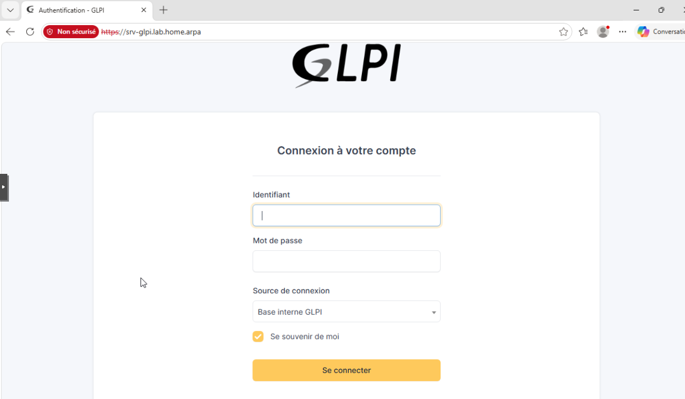

⌨️ Sur SRV-GLPI :

```bash
curl -sI http://localhost
```
✅ `HTTP/1.1 301 Moved Permanently` et `Location: https://srv-glpi.lab.home.arpa/` : celui qui arrive
en HTTP est bien renvoyé en HTTPS.

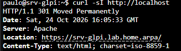

### Étape 21 · pfSense : les postes vers GLPI, en 443 seulement

🎯 Les PC des salariés doivent joindre GLPI, **uniquement** sur le port du site web chiffré (443).

**1. L'alias** (une étiquette qui remplace une adresse IP)

🖱️ pfSense > **Firewall > Aliases** > onglet **IP** > **Add** :

| Champ | Valeur |
| --- | --- |
| Name | `SRV_GLPI` |
| Description | `Serveur GLPI (brique 05)` |
| Type | Host(s) |
| IP or FQDN | `10.10.10.20` |

**Save** > **Apply Changes**.

💡 Si l'IP de GLPI change un jour, on modifie **l'alias**, pas chaque règle.

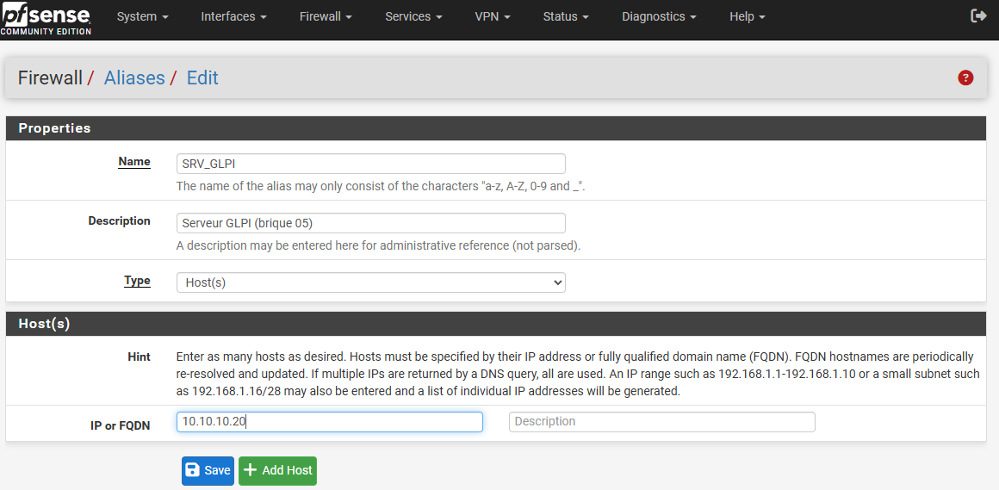

**2. La règle**

🖱️ **Firewall > Rules** > onglet **POSTES** > **Add** :

| Champ | Valeur | Pourquoi |
| --- | --- | --- |
| Action | Pass | Autoriser |
| Interface | POSTES | La règle s'applique au trafic qui **entre** dans pfSense depuis le VLAN Postes |
| Protocol | TCP | HTTPS = TCP |
| Source | POSTES subnets | Tous les postes du VLAN 20 |
| Destination | Address or Alias → `SRV_GLPI` | |
| Destination Port Range | HTTPS (443) → HTTPS (443) | Le site web chiffré, et rien d'autre |
| Description | `Postes vers GLPI HTTPS (tickets, inventaire)` | |

**Save**.

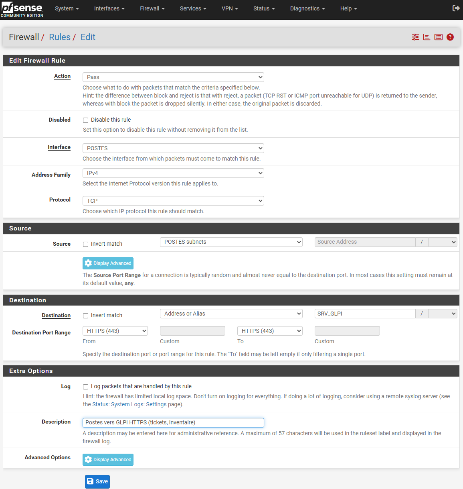

**3. L'ordre des règles** (très important)

💡 pfSense lit les règles **de haut en bas** et s'arrête à la **première** qui correspond.

🖱️ Fais glisser la règle pour obtenir cet ordre, puis **Save** > **Apply Changes** :

1. Bloquer : Postes → réseau d'administration
2. Bloquer : Postes → interface web de pfSense
3. **Autoriser : Postes → SRV_GLPI TCP 443** ← notre règle
4. Autoriser : Postes → tout (règle **provisoire**, à supprimer plus tard)

❌ **Erreur du lab** : la règle avait d'abord été placée **tout en haut**, au-dessus des blocages.
Une autorisation placée au-dessus d'un blocage peut **l'annuler**. Remise en 3e position.
Et elle est **au-dessus** de la règle provisoire, pour rester valable le jour où celle-ci sera supprimée.

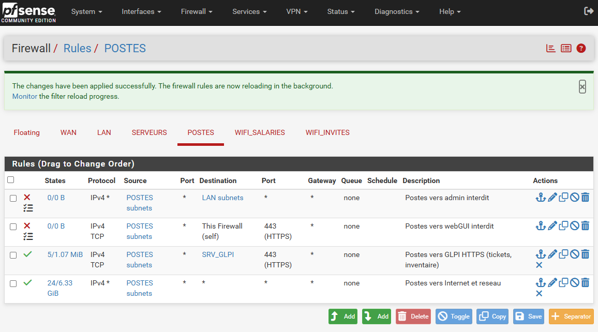

✅ **Preuve que la règle sert** : après avoir ouvert GLPI sur PC-001, la colonne **States** de la
règle affiche un compteur qui augmente.

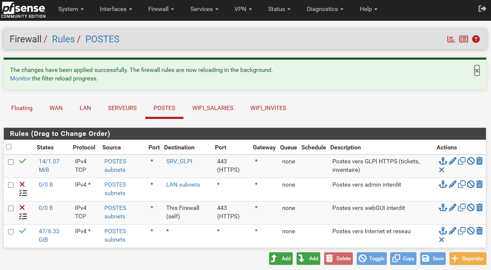

📄 La [matrice des flux](../docs/matrice-des-flux.md) est mise à jour (règle POSTES n° 3, alias `SRV_GLPI`).

---

## Partie 5 — L'inventaire automatique (GLPI Agent)

### Étape 22 · Activer l'inventaire dans GLPI

🖱️ GLPI > **Administration > Inventaire** > ✅ **Activer l'inventaire** > **Sauvegarder**.
(Il est **désactivé par défaut** : GLPI refuse les inventaires tant qu'on ne l'a pas décidé.)

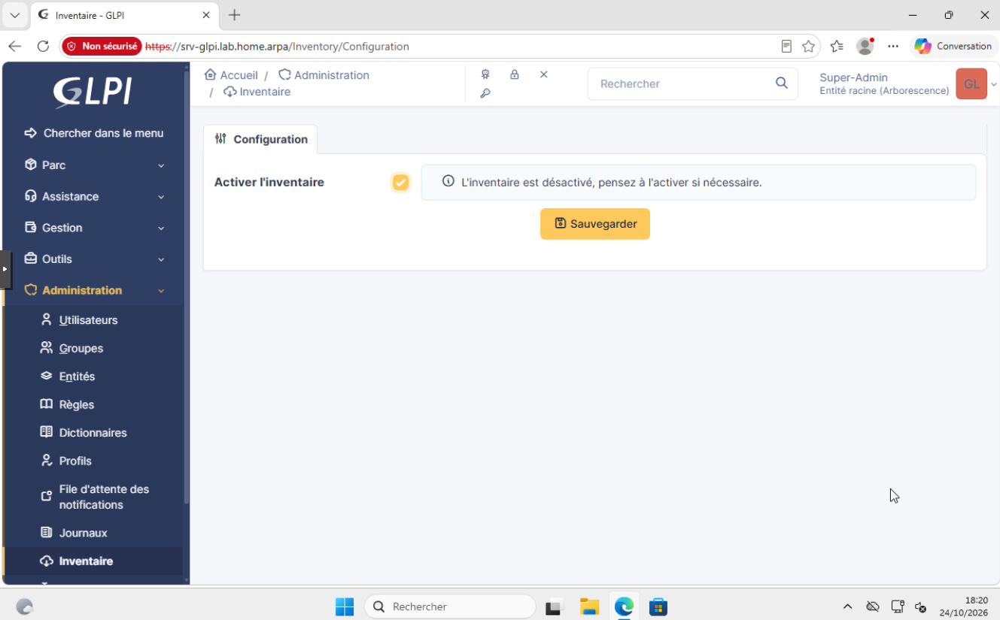

### Étape 23 · Télécharger l'agent et vérifier son empreinte

🖱️ Sur PC-001 : page officielle des versions de GLPI Agent sur GitHub (`github.com/glpi-project/glpi-agent`,
**Releases**, version **1.21**) → fichier **GLPI-Agent-1.21-x64.msi** (Windows 64 bits).

⌨️ Dans PowerShell, dans le dossier Téléchargements :

```powershell
Get-FileHash .\GLPI-Agent-1.21-x64.msi -Algorithm SHA256
```
✅ L'empreinte est **identique** à celle affichée sur la page GitHub de la version.

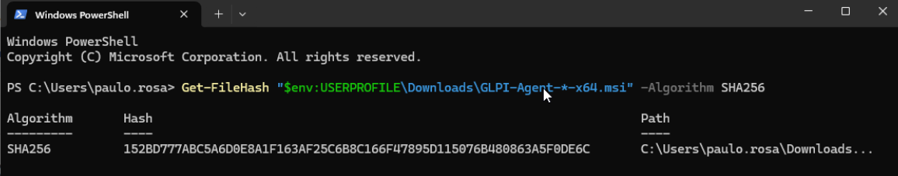

### Étape 24 · Installer l'agent (installation personnalisée)

🎯 N'installer que ce qui sert, avec des réglages sûrs.

🖱️ Double-clic sur le `.msi` → **Next** → accepter la licence → **Next**, puis :

| Écran | Réglage | Pourquoi |
| --- | --- | --- |
| Choose Setup Type | **Custom** | Pour choisir nous-mêmes chaque option |
| Choose Targets > Remote Targets | `https://srv-glpi.lab.home.arpa/` | Le serveur GLPI, **par son nom**, en **HTTPS** |
| Remote Targets SSL Options | ✅ **Disable SSL check**, **temporairement** | Le certificat est fait maison : l'agent refuserait de se connecter. On le désactive le temps de **lire l'empreinte** du certificat (étape 25), puis on le remet |
| Proxy / authentification | vide | Pas de proxy dans le lab |
| Execution Mode | **As a Windows Service** | L'agent tourne en permanence, même sans session ouverte |
| HTTP Server Options | IP `127.0.0.1`, port `62354`, Trusted IPs `127.0.0.1/32` ; ❌ **Add exception on the Windows Firewall** ; ✅ Enable embedded HTTP server | La petite page de l'agent (pour forcer un inventaire) n'est accessible **que depuis le PC lui-même**. Personne sur le réseau ne peut la toucher |
| Miscellaneous Options | Tag `AEROTRANS` ; ✅ Scan user profiles for software | Le tag permet de retrouver les machines de ce client ; le scan des profils trouve aussi les logiciels installés pour un seul utilisateur |
| Debug Options | **Level 1**, Logger **File** | **Temporaire** : le journal détaillé contiendra l'empreinte du certificat (étape 25) |

**Install** → fenêtre UAC : l'éditeur affiché est **TECLIB SAS (vérifié)** → identifiants
`LAB\adm.paulo.rosa`.

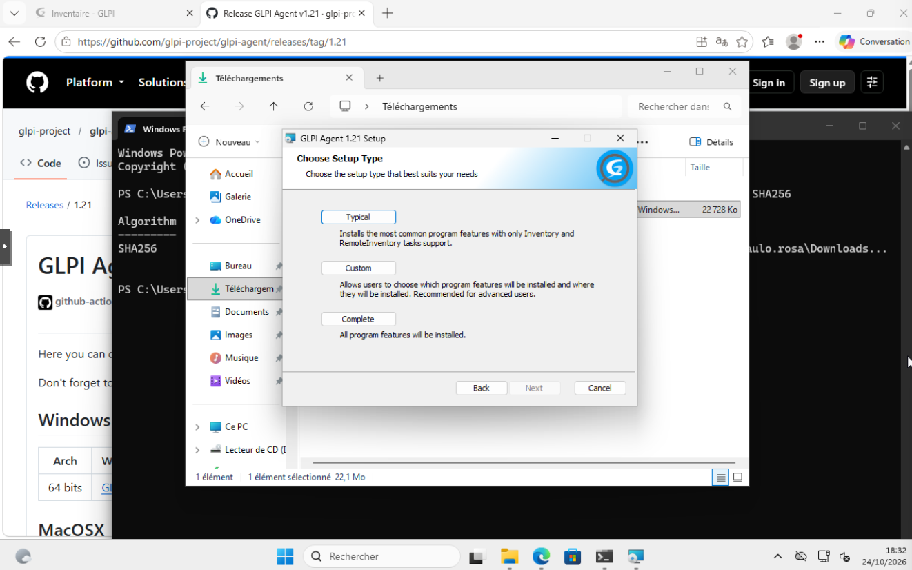


✅ Quelques secondes plus tard, dans GLPI : **Parc > Ordinateurs** → **PC-001** apparaît **tout seul**,
avec 134 logiciels et 27 composants.


### Étape 25 · Remettre la vérification SSL, avec l'empreinte du certificat

🎯 L'agent ne doit **jamais** envoyer l'inventaire à un faux serveur. On lui apprend à reconnaître
le vrai, par son **empreinte**.

**1. Lire l'empreinte vue par l'agent** (PowerShell sur PC-001) :

```powershell
Select-String -Path "C:\Program Files\GLPI-Agent\logs\glpi-agent.log" -Pattern "fingerprint"
```
✅ `SSL server certificate fingerprint: sha256$4876c3c5…`


**2. Vérification hors bande** : on recalcule l'empreinte **sur le serveur lui-même** (SRV-GLPI) :

```bash
openssl x509 -in /etc/ssl/certs/ssl-cert-snakeoil.pem -noout -fingerprint -sha256
```
✅ `48:76:C3:C5:…` : **identique** à celle de l'agent (même suite de caractères, avec des `:`).

💡 **Hors bande** = vérifier par **un autre chemin** que celui qu'on cherche à contrôler. Si un pirate
s'était placé entre le PC et le serveur, l'agent aurait vu **sa** fausse empreinte, différente de celle
lue directement sur le serveur.


**3. Régler l'agent** : `regedit` **en tant qu'administrateur** > `HKEY_LOCAL_MACHINE\SOFTWARE\GLPI-Agent` :

| Valeur | Nouvelle donnée |
| --- | --- |
| `ssl-fingerprint` | `sha256$4876c3c5…` (l'empreinte complète) |
| `no-ssl-check` | `0` (vérification **réactivée**) |
| `debug` | `0` (journal normal) |

**4.** `services.msc` > **GLPI Agent** > clic droit > **Redémarrer**, puis dans Edge
`http://127.0.0.1:62354` > **Force an Inventory**.

✅ La date du dernier inventaire de PC-001 se met à jour. Le journal indique un envoi réussi.


💡 Cette empreinte est une **solution provisoire** : elle sera remplacée en partie 10 par une confiance
dans l'autorité de certification, qui tient dans la durée.

### Étape 26 · Mettre GLPI à l'heure de Paris

❌ **Constat** : les heures affichées dans GLPI avaient **2 h de retard** (17:09 au lieu de 19:09).
GLPI était réglé sur l'heure universelle (UTC).

🖱️ **Configuration > Générale** > section des valeurs par défaut > **Fuseau horaire** :
**Europe/Paris** > **Sauvegarder**. (Ça marche grâce aux fuseaux chargés dans MariaDB à l'étape 9.)

✅ Les heures sont justes.


🖱️ Instantané Proxmox `glpi-agent-ok`.

---

## Partie 6 — Brancher GLPI sur l'Active Directory

### Étape 27 · Créer le compte de service svc.glpi

🎯 GLPI doit **lire** l'annuaire. On lui donne un compte **à lui**, qui ne sait faire que ça.

💡 **Pourquoi pas un compte admin ?** Si GLPI se fait pirater, le pirate récupère le compte que GLPI
utilise. Avec `svc.glpi`, il ne récupère qu'un compte **sans aucun droit**. C'est le **moindre privilège**.

🖱️ Sur SRV-AD01 : **Utilisateurs et ordinateurs Active Directory** > `AEROTRANS` > **Comptes-service** >
clic droit > **Nouveau** > **Utilisateur** :

1. Nom complet `svc.glpi`, nom d'ouverture de session `svc.glpi` (`@lab.home.arpa`) > **Suivant**.
2. Mot de passe **long et aléatoire** (25 caractères ou plus, rangé en lieu sûr) ;
   ✅ **L'utilisateur ne peut pas changer de mot de passe** ;
   ✅ **Le mot de passe n'expire jamais** ; le reste décoché > **Suivant** > **Terminer**.
3. **N'ajoute aucun groupe** : tout compte du domaine peut déjà lire l'annuaire.

💡 « N'expire jamais » : sinon la connexion de GLPI à l'AD tomberait le jour de l'expiration, sans
prévenir. **Contrepartie** : on change ce mot de passe **à la main, une fois par an** (procédure à
documenter, voir points en suspens).


### Étape 28 · Déclarer l'annuaire dans GLPI

🖱️ GLPI > **Configuration > Authentification > Annuaires LDAP** > **Ajouter** :

| Champ | Valeur | Explication |
| --- | --- | --- |
| Nom | `AD AEROTRANS` | |
| Serveur par défaut / Actif | Oui / Oui | |
| Serveur | `srv-ad01.lab.home.arpa` | Le DC, par son nom (on passera en `ldaps://` en partie 8) |
| Port | `389` | Le port LDAP classique (on passera en 636 en partie 8) |
| Filtre de connexion | `(&(objectClass=user)(objectCategory=person)(!(userAccountControl:1.2.840.113556.1.4.803:=2)))` | Voir ci-dessous |
| BaseDN | `OU=Utilisateurs,OU=AEROTRANS,DC=lab,DC=home,DC=arpa` | **Où** chercher : seulement les salariés, ni les admins (`adm.*`) ni les comptes de service |
| Utiliser bind | Oui | GLPI se connecte avec un compte (pas en anonyme) |
| DN du compte | `svc.glpi@lab.home.arpa` | |
| Mot de passe du compte | celui de `svc.glpi` | |
| Champ de l'identifiant | `samaccountname` | Le login Windows : `nathalie.girard` |
| Champ de synchronisation | `objectguid` | L'identifiant **unique et définitif** du compte dans l'AD : même si Nathalie change de nom, GLPI la retrouve |

💡 **Le filtre, morceau par morceau** :
- `(&( … )( … )( … ))` : « **et** » : les 3 conditions doivent être vraies ;
- `(objectClass=user)(objectCategory=person)` : un **utilisateur humain** (pas un ordinateur, qui est
  aussi de classe `user` dans l'AD !) ;
- `(!( … ))` : « **non** » ;
- `userAccountControl:1.2.840.113556.1.4.803:=2` : « le **bit 2** du champ `userAccountControl` est
  allumé » = le compte est **désactivé**. Le `1.2.840…803` est le code de l'opération « ET bit à bit ».
- Résultat : **les personnes dont le compte est actif.**

❌ **Erreurs du lab** :
- `objetClass` et `objetCategory` tapés **en français** : les noms d'attributs LDAP sont **en anglais**,
  et une seule lettre de travers les rend inconnus.
- `uid` au lieu de `samaccountname` : `uid` est l'identifiant des annuaires **Linux** (OpenLDAP),
  pas de l'Active Directory.


### Étape 29 · Le test échoue : comprendre pourquoi

🖱️ Onglet **Tester** : ❌ échec.

🎯 Quand une application échoue, on **teste sans elle**, pour savoir si le problème vient de
l'application ou du serveur en face.

⌨️ Sur SRV-GLPI :

```bash
sudo apt install -y ldap-utils
ldapsearch -x -H ldap://srv-ad01.lab.home.arpa -D "svc.glpi@lab.home.arpa" -W -b "OU=Utilisateurs,OU=AEROTRANS,DC=lab,DC=home,DC=arpa" "(sAMAccountName=nathalie.girard)"
```
- `ldap-utils` : les outils LDAP en ligne de commande ;
- `ldapsearch` : « fais une recherche dans l'annuaire » ;
- `-x` : connexion **simple** (identifiant + mot de passe) ;
- `-H ldap://…` : le serveur, en LDAP classique (389) ;
- `-D "svc.glpi@…"` : le compte ; `-W` : demande le mot de passe **sans l'afficher** ;
- `-b "…"` : où chercher ; `"(sAMAccountName=nathalie.girard)"` : quoi chercher.

✅ (enfin, ❌ !) Réponse : **« The server requires binds to turn on integrity checking if SSL\TLS are
not already active on the connection »**.


💡 **Traduction** : *« Je refuse les connexions simples non protégées. Chiffre (SSL/TLS) ou signe. »*
**Windows Server 2025 exige par défaut la signature LDAP.** Sur le port 389 en connexion simple,
le mot de passe de `svc.glpi` passerait **en clair** sur le réseau : n'importe qui qui écoute
pourrait le lire.

**Décision de « chef »** : on ne désactive **pas** cette protection sur le contrôleur de domaine
(c'est possible par GPO, mais c'est exactement ce qu'un attaquant espère). On passe en **LDAPS**
(LDAP chiffré, port 636). Pour ça, le DC a besoin d'un **certificat**, donc il faut une **autorité de
certification**. → partie 7.

---

## Partie 7 — Monter une autorité de certification (mini-PKI)

> 🏛️ **Rappel de l'image** : l'autorité de certification (CA), c'est **la mairie**. Elle fabrique des
> **cartes d'identité** (certificats) pour les serveurs. Un ordinateur accepte une carte s'il fait
> confiance à la mairie qui l'a signée. Une **PKI** (*Public Key Infrastructure*), c'est l'ensemble :
> la mairie, les cartes, et la liste de ceux qui font confiance.

### Étape 30 · Un instantané avant de toucher au DC

🎯 On va modifier le serveur **le plus important** du réseau : on prend un filet de sécurité.

🖱️ Proxmox > **200 (SRV-AD01)** > **Instantanés** > **Créer un instantané** :
nom `avant-adcs` (pas d'espace ni d'accent : Proxmox les refuse), **Inclure la RAM : non**,
description `Avant installation AD CS + LDAPS - brique 05`.

✅ `TASK OK`.


🏢 Sur un vrai DC, on fait plutôt une **sauvegarde de l'état du système** (*System State*), et on
**évite de restaurer un instantané** de DC quand il y a plusieurs DC (risque d'« USN rollback » : les
DC ne savent plus qui a la bonne version de l'annuaire). Ici, un seul DC : l'instantané suffit,
et on le supprime dès que tout est validé.

### Étape 31 · Installer le rôle AD CS

🖱️ Sur SRV-AD01, **Gestionnaire de serveur** > **Gérer** > **Ajouter des rôles et fonctionnalités** :

1. **Avant de commencer** > Suivant. **Type d'installation** : basée sur un rôle > Suivant.
   **Serveur** : SRV-AD01 > Suivant.
2. **Rôles de serveurs** : ✅ **Services de certificats Active Directory** → fenêtre « Ajouter les
   fonctionnalités requises » > **Ajouter des fonctionnalités** (ce sont les consoles de gestion) > Suivant.
3. **Fonctionnalités** > Suivant. **AD CS** > Suivant.
4. **Services de rôle** : ✅ **uniquement Autorité de certification**.
5. **Confirmation** : laisse **décochée** « Redémarrer automatiquement » > **Installer**.

💡 **Pourquoi un seul service de rôle ?** Les autres (inscription par le Web, répondeur en ligne…)
installent des services en plus, dont un site web sur le DC. Chaque service en plus est une porte de
plus pour un pirate : on **réduit la surface d'attaque**.

✅ « Configuration requise. Installation réussie sur SRV-AD01 ». **Ne clique pas encore** sur le lien
bleu de configuration : on fait les choix importants à l'étape suivante.


### Étape 32 · Configurer la CA

🖱️ Clique sur **Configurer les services de certificats Active Directory sur le serveur de destination**.

| Écran | Choix | Pourquoi |
| --- | --- | --- |
| Informations d'identification | `LAB\adm.paulo.rosa` | Compte admin **nominatif** : dans les journaux, on sait **qui** a fait quoi. Une CA d'entreprise exige un membre des **Administrateurs de l'entreprise** |
| Services de rôle | ✅ Autorité de certification | |
| Type d'installation | ⭐ **Autorité de certification d'entreprise** | Reliée à l'AD : les machines du domaine reçoivent leurs certificats **automatiquement**. Une CA « autonome » obligerait à tout faire à la main |
| Type d'AC | ⭐ **AC racine** | Il n'existe aucune autre CA : c'est nous le sommet de la confiance (« l'État »). Une AC **secondaire** a besoin d'une racine au-dessus d'elle |
| Clé privée | **Créer une clé privée** | L'autre option sert à réinstaller une CA existante après une panne |
| Chiffrement | Fournisseur `RSA#Microsoft Software Key Storage Provider`, longueur **4096**, hachage **SHA256** (clique dessus pour qu'il soit bien **en bleu**), interaction de l'administrateur **décochée** | La racine vit 10 ans : clé longue. **SHA1 est cassé** depuis des années, interdit |
| Nom de l'AC | ⭐ **`AEROTRANS-Root-CA`** (au lieu du `lab-SRV-AD01-CA` proposé) | Le nom est écrit sur **tous** les certificats et **ne peut plus jamais changer**. On nomme la CA par ce qu'elle **est** (l'entreprise, son rôle), jamais par la machine qui l'héberge (qui peut changer) |
| Suffixe | `DC=lab,DC=home,DC=arpa` (ne pas toucher) | Le domaine |
| Période de validité | **10 ans** (expiration 2036) | Un certificat ne peut pas durer plus longtemps que la CA qui l'a signé. Si la racine expire, **tout** tombe en même temps |
| Base de données | `C:\WINDOWS\system32\CertLog` (défaut) | Le « registre » de la mairie : la liste des certificats délivrés |

❌ **Réflexion du lab sur le nom** : la proposition était `AEROTRANS-SRV-AD01-CA`. À moitié juste :
**l'entreprise oui, le nom du serveur non.** Si la CA déménage un jour sur SRV-AD02, tous les
certificats afficheraient encore un serveur qui n'existe plus.

🖱️ Page **Confirmation** : on **relit chaque ligne** avant de cliquer sur **Configurer** (impossible de
changer après).


✅ **Configuration réussie** (coche verte).


🏢 **En entreprise**, on monte une PKI **à deux niveaux** : une **racine hors ligne** (éteinte, rangée
au coffre, allumée seulement pour signer les AC secondaires tous les 5 à 10 ans) et une ou plusieurs
**AC secondaires** en ligne, sur des serveurs dédiés, qui délivrent les certificats au quotidien.
Si la clé de la racine est volée, **toute la confiance de l'entreprise s'effondre**. Et on ne met
jamais la CA sur un contrôleur de domaine.

### Étape 33 · Vérifier que le DC a reçu son certificat tout seul

🖱️ Sur SRV-AD01 : **Windows + R** > `certlm.msc` > **Personnel** > **Certificats**.
(`certlm` = certificats de la machine, *local machine* ; `certmgr` serait ceux de ton compte.)

✅ Deux lignes :

| Délivré à | Délivré par | Expire | Ce que c'est |
| --- | --- | --- | --- |
| AEROTRANS-Root-CA | AEROTRANS-Root-CA | 2036 | La carte de la **mairie elle-même**. Elle s'est signée seule : normal pour une racine, personne n'est au-dessus |
| SRV-AD01.lab.home.arpa | AEROTRANS-Root-CA | 2027 | ⭐ La carte **du DC**, modèle « Contrôleur de domaine », rôle « Authentification du serveur ». Reçue en 2 minutes par **inscription automatique**, et renouvelée toute seule chaque année |


💡 **Pourquoi le certificat du DC ne dure qu'un an ?** Si une carte est volée, elle ne sert pas
longtemps. Et comme le renouvellement est automatique, ça ne coûte rien.

### Étape 34 · Tester le LDAPS sur le DC

🖱️ Sur SRV-AD01 : **Windows + R** > `ldp` > menu **Connexion** > **Se connecter…** :
serveur `srv-ad01.lab.home.arpa`, port `636`, ✅ **SSL** > **OK**.

✅ Dans le texte à droite :
- `Host supports SSL, SSL cipher strength = 256 bits` : la connexion est **chiffrée** (256 bits, très solide) ;
- `Established connection to srv-ad01.lab.home.arpa.` : connexion établie.


❌ Si on tape l'**adresse IP** au lieu du nom : la connexion est refusée. Le certificat porte le **nom**
`SRV-AD01.lab.home.arpa` : l'IP ne correspond pas à la carte.

### Étape 35 · Récupérer la « carte de la mairie » sur SRV-GLPI

🎯 SRV-GLPI ne connaît pas encore la mairie AEROTRANS : il refuserait la carte du DC. Il faut lui
donner le certificat **public** de la CA.

**1. Le DC envoie-t-il la carte de la mairie ?**

```bash
openssl s_client -connect srv-ad01.lab.home.arpa:636 -showcerts </dev/null 2>/dev/null | grep -E "^ *[0-9] s:|i:"
```
- `openssl s_client -connect …:636` : « je me connecte en client et je regarde les certificats » ;
- `-showcerts` : montre **toutes** les cartes envoyées ;
- `</dev/null` : raccroche tout de suite après ; `2>/dev/null` : cache les messages techniques ;
- `grep` : garde seulement les lignes `s:` (à qui est la carte) et `i:` (qui l'a délivrée).

✅ Une seule carte (`0 s:CN=SRV-AD01.lab.home.arpa`, délivrée par `AEROTRANS-Root-CA`) : **Windows
n'envoie pas** la carte de la mairie, c'est son comportement normal. Plan B.


**2. Plan B : lire la carte dans l'Active Directory**

💡 Une CA **d'entreprise** dépose une copie de sa carte publique **dans l'AD**. On la lit en LDAPS avec
`svc.glpi`. **Le piège de l'œuf et de la poule** : SRV-GLPI ne peut pas encore vérifier le DC (il ne
connaît pas la mairie). On lui dit exceptionnellement « ne vérifie pas » (`LDAPTLS_REQCERT=never`),
**pour cette seule commande**, et on contrôle **ensuite** la carte à la main.

```bash
LDAPTLS_REQCERT=never ldapsearch -H ldaps://srv-ad01.lab.home.arpa -D "svc.glpi@lab.home.arpa" -W -b "CN=AEROTRANS-Root-CA,CN=Certification Authorities,CN=Public Key Services,CN=Services,CN=Configuration,DC=lab,DC=home,DC=arpa" -s base -LLL cACertificate | sed -n '/cACertificate::/,$p' | sed 's/^cACertificate:: //; s/^ //' | tr -d '\n' | base64 -d > ~/aerotrans-root-ca.der
```
- `-H ldaps://…` : en **chiffré** (636) ;
- `-b "CN=AEROTRANS-Root-CA,…"` : l'**adresse exacte** de la carte dans l'annuaire (classeur
  Configuration > Services > Public Key Services > Certification Authorities) ;
- `-s base` : seulement cet objet ; `-LLL` : sortie sans commentaires ; `cACertificate` : seulement
  l'attribut qui contient la carte ;
- `sed`, `tr -d '\n'`, `base64 -d` : l'AD renvoie la carte « emballée » en texte (base64, sur plusieurs
  lignes) ; ces outils la **déballent** ;
- `> ~/aerotrans-root-ca.der` : on enregistre le résultat dans ton dossier (`~` = dossier personnel).

```bash
openssl x509 -inform der -in ~/aerotrans-root-ca.der -out ~/aerotrans-root-ca.crt && openssl x509 -in ~/aerotrans-root-ca.crt -noout -subject -enddate -fingerprint -sha1
```
- conversion du format **DER** (binaire) au format **PEM** (texte, celui qu'attend Debian) ;
- affichage du **propriétaire**, de la **date d'expiration** et de l'**empreinte SHA1**.

✅ `subject=… CN=AEROTRANS-Root-CA`, `notAfter=Oct 25 … 2036 GMT`, `sha1 Fingerprint=56:3C:02:33:…:6C:E2`.


**3. La vérification hors bande** (l'étape qui rend tout ça sûr)

🖱️ Sur SRV-AD01 : `certlm.msc` > Personnel > Certificats > double-clic sur **AEROTRANS-Root-CA** >
onglet **Détails** > **Empreinte numérique**.

✅ `563c02337180556d5b1ece9a4d14e496666e6ce2` : **identique** caractère par caractère à celle de Debian
(Windows l'affiche en minuscules et sans `:`). La carte récupérée est authentique.

❌ Si elle était différente : **on s'arrête**, on n'installe rien. Quelqu'un se serait fait passer pour
la mairie au moment du téléchargement (attaque de l'**homme du milieu**).


### Étape 36 · Dire à SRV-GLPI : « cette mairie, tu peux lui faire confiance »

```bash
sudo cp ~/aerotrans-root-ca.crt /usr/local/share/ca-certificates/ && sudo update-ca-certificates
```
- `/usr/local/share/ca-certificates/` : le dossier des **CA ajoutées par l'administrateur**.
  ⚠️ L'extension doit être **`.crt`**, sinon Debian l'ignore ;
- `update-ca-certificates` : reconstruit la **liste officielle des CA de confiance**
  (`/etc/ssl/certs/ca-certificates.crt`), utilisée par PHP, GLPI, `ldapsearch`, `curl`…

✅ `1 added, 0 removed; done.` (La ligne `rehash: warning: skipping ca-certificates.crt…` est
**normale** sur Debian, on peut l'ignorer.)


⌨️ **La preuve** : on refait la connexion au DC, **en vérifiant** cette fois :

```bash
openssl s_client -connect srv-ad01.lab.home.arpa:636 -verify_return_error </dev/null 2>/dev/null | grep "Verify return code"
```
✅ `Verify return code: 0 (ok)` : « la carte du DC a été délivrée par une mairie que je connais, et le
nom correspond ».


⌨️ Ménage et prise en compte par PHP :

```bash
rm ~/aerotrans-root-ca.der && ls ~/
sudo systemctl restart php8.4-fpm && systemctl status php8.4-fpm --no-pager | head -5
```
- le `.der` ne sert plus à rien (on garde le `.crt`, public et sans danger) ;
- PHP-FPM est **redémarré** : ses processus avaient démarré avant l'ajout de la CA et gardaient
  l'ancienne liste en mémoire. ✅ `Active: active (running)`.


---

## Partie 8 — GLPI en LDAPS, import des salariés

### Étape 37 · Passer l'annuaire de GLPI en LDAPS

🖱️ GLPI (Super-Admin) > **Configuration > Authentification > Annuaires LDAP** > **AD AEROTRANS** :

| Champ | Avant | Après |
| --- | --- | --- |
| Serveur | `srv-ad01.lab.home.arpa` | **`ldaps://srv-ad01.lab.home.arpa`** |
| Port | `389` | **`636`** |

- Ne touche **pas** au mot de passe : le champ est vide à l'affichage (GLPI ne réaffiche jamais un mot
  de passe enregistré), mais il est bien gardé. ⚠️ Ne coche **surtout pas** « Effacer ».
- L'option « Utiliser TLS » (onglet **Informations avancées**) reste sur **Non** : c'est une autre
  méthode (STARTTLS sur le 389). Activer les deux en même temps fait échouer la connexion.

**Sauvegarder**.


💡 On utilise le **nom complet** du DC, celui écrit sur sa carte d'identité : sinon, la vérification
du certificat échoue.

### Étape 38 · Tester… et trouver un bug invisible

🖱️ Onglet **Tester** (le test se lance tout seul) :

| Étape du test | Résultat |
| --- | --- |
| 1. Flux TCP | ✅ connexion au port 636 réussie |
| 2. Base DN | ✅ |
| 3. LDAP URI | ✅ (le certificat du DC est vérifié grâce à notre CA) |
| 4. Connexion Bind | ✅ **Authentification réussie** : le blocage de la partie 6 est **résolu** |
| 5. Chercher | 🟠 **Échec de la recherche : Bad search filter(-7)** |


💡 « Bad search filter » = l'AD ne comprend pas la **phrase de recherche**. À l'écran, le filtre a
l'air parfait. On va donc regarder **ce qui est vraiment enregistré**, avec une loupe qui rend visibles
les caractères invisibles.

⌨️ Sur SRV-GLPI :

```bash
sudo mysql -N -e 'SELECT `condition` FROM glpi_authldaps' glpi | cat -A
```
- `sudo mysql … glpi` : ouvre la base `glpi` ;
- `-N` : n'affiche que la valeur, sans le titre de la colonne ;
- `-e '…'` : la requête : « montre-moi le filtre (`condition`) de la table des annuaires LDAP » ;
- `| cat -A` : 🔍 **la loupe** : `$` = fin de ligne normale, `^M` = retour chariot Windows,
  `^I` = tabulation.

❌ Résultat : `…:=2)))^M\n` : un **retour à la ligne Windows caché** à la fin du filtre. La touche
**Entrée** avait été appuyée après la saisie, dans la zone de texte. L'AD reçoit `…)))` **plus un
caractère en trop**, et refuse.


🖱️ **Correction** dans GLPI : clique dans la zone **Filtre de connexion**, **Ctrl + Fin** (le curseur va
tout à la fin, sur une ligne vide), **un seul** retour arrière (⌫), vérifie que les 3 parenthèses
`)))` sont toujours là, **n'appuie pas sur Entrée**, **Sauvegarder**.

⌨️ Revérification avec la même loupe : ✅ `…:=2)))$` (plus de `^M\n`).


🖱️ Onglet **Tester** : ✅ **5 étapes sur 5**, « Recherche réussie (25 entrées trouvées) » : les 25
salariés actifs.


💡 **Leçon à retenir** : `cat -A` sauve souvent la mise (fichiers de configuration, scripts copiés
depuis Windows…). Quand « tout a l'air juste » mais que ça ne marche pas, on regarde les **données brutes**.

### Étape 39 · Importer les 25 salariés

🖱️ **Administration > Utilisateurs** > bouton **Liaison annuaire LDAP** > **Importer de nouveaux
utilisateurs** > laisse les critères vides > **Rechercher** > coche la case **tout en haut** de la liste >
**Actions** > **Importer** > **Envoyer**.

✅ « Élément ajouté : … » pour chaque salarié, « Opération réalisée avec succès ».

❌ **Piège du lab** : en haut de la liste, **« De 1 à 20 sur 25 lignes »**. La case « tout cocher » ne
sélectionne que la **page affichée** : 20 importés, il en manquait **5** (page 2). On refait
**Rechercher** (seuls les 5 restants s'affichent, GLPI ne montre que les nouveaux) > tout cocher >
Importer. **20 + 5 = 25.**
👉 Réflexe pro : **toujours comparer le nombre attendu au nombre traité.**


💡 GLPI **ne copie pas les mots de passe**. À chaque connexion, il demande à l'AD : « ce mot de passe
est bon ? ». Un seul mot de passe, géré au même endroit.

### Étape 40 · Nathalie se connecte avec son compte Windows

🖱️ Dans Edge, **Ctrl + Maj + N** (fenêtre **InPrivate** : elle ne partage pas la session Super-Admin
ouverte à côté) > `https://srv-glpi.lab.home.arpa` :

- **Identifiant** : `nathalie.girard`
- **Mot de passe** : son mot de passe **Windows**
- **Source de connexion** : **AD AEROTRANS**
- **Se connecter**

✅ Nathalie arrive sur l'interface **simplifiée** (*Self-Service*) : « Signaler un incident », « Créer
un ticket », « Voir vos tickets ». **Pas d'administration** : c'est le profil donné par défaut aux
comptes importés (**moindre privilège**).


🏢 « Se souvenir de moi » était coché. Sur un poste **partagé** (accueil, atelier), on le **décoche** :
sinon le salarié suivant se retrouve connecté sous le nom de Nathalie.

---

## Partie 9 — Un vrai certificat pour GLPI

> Jusqu'ici, GLPI utilise le certificat « fait maison » (snakeoil) : le navigateur affiche
> **« Non sécurisé »** en rouge. On va lui donner une vraie carte, signée par la mairie AEROTRANS.
> SRV-GLPI n'est pas dans le domaine : il fait sa demande **à la main**, comme toi à la mairie.

### Étape 41 · Fabriquer la clé privée et le formulaire de demande (CSR)

⌨️ Sur SRV-GLPI :

```bash
sudo openssl req -new -newkey rsa:2048 -nodes -keyout /etc/ssl/private/srv-glpi.key -out /home/paulo/srv-glpi.csr -subj "/CN=srv-glpi.lab.home.arpa/O=AEROTRANS" -addext "subjectAltName=DNS:srv-glpi.lab.home.arpa" && sudo chmod 600 /etc/ssl/private/srv-glpi.key && sudo chown paulo: /home/paulo/srv-glpi.csr
```

| Morceau | Explication |
| --- | --- |
| `openssl req -new` | Nouvelle **demande** de certificat (CSR = *Certificate Signing Request*, le « formulaire ») |
| `-newkey rsa:2048` | Fabrique en même temps la **clé privée** (RSA 2048 : suffisant pour un serveur ; le 4096 était pour la racine) |
| `-nodes` | La clé n'a **pas de mot de passe** (sinon Apache le demanderait à chaque démarrage et le serveur resterait bloqué). En échange, on protège le **fichier** |
| `-keyout /etc/ssl/private/srv-glpi.key` | La clé va dans le **coffre** de Debian. 🔑 **Elle ne quittera jamais ce serveur** |
| `-out /home/paulo/srv-glpi.csr` | Le formulaire va dans ton dossier (il n'est pas secret) |
| `-subj "/CN=…/O=AEROTRANS"` | Le **nom** (CN) et l'**organisation** (O) |
| `-addext "subjectAltName=DNS:…"` | ⭐ Le **SAN** : les navigateurs modernes **ne lisent plus que ce champ**. Sans lui, Edge refuserait la carte, même signée |
| `chmod 600` | Seul root peut lire la clé |
| `chown paulo:` | Le formulaire t'appartient, pour pouvoir le copier |

💡 Les lignes `....+++++` qui défilent sont normales : OpenSSL cherche de grands nombres premiers pour
fabriquer la clé.

⌨️ **Relire le formulaire avant de l'envoyer** :

```bash
openssl req -in ~/srv-glpi.csr -noout -subject -verify && openssl req -in ~/srv-glpi.csr -noout -text | grep -A1 "Subject Alternative"
```
✅ `Certificate request self-signature verify OK`, `subject=CN=srv-glpi.lab.home.arpa, O=AEROTRANS`,
`DNS:srv-glpi.lab.home.arpa`.


🔍 **Découverte** : en voulant installer `openssh-server` pour l'étape suivante, Debian répond qu'il
est **déjà installé et actif depuis l'installation** (case « serveur SSH » de l'étape 3).
👉 Leçon : après l'installation d'un serveur, on fait **l'inventaire des services qui écoutent**
(`sudo ss -tlnp`) pour ne laisser aucune porte ouverte sans le savoir.

### Étape 42 · Le DC va chercher le formulaire (scp)

🎯 Faire signer le formulaire par la CA, sur SRV-AD01, sans copier-coller.

💡 **Pourquoi c'est le DC qui va chercher le fichier ?** Dans ce sens, **aucun mot de passe d'admin du
domaine n'est tapé sur le serveur Linux**. Les identifiants les plus précieux restent sur le DC. On ne
fait jamais « descendre » un compte admin du domaine sur un serveur moins protégé.

⌨️ **1. Sur SRV-GLPI**, relever l'**empreinte d'identité SSH** du serveur (pour la vérification hors bande) :

```bash
ssh-keygen -lf /etc/ssh/ssh_host_ed25519_key.pub
```
✅ Une ligne `256 SHA256:Wdcoaf/4zl4…KSsY root@srv-glpi (ED25519)`. Laisse-la affichée.


⌨️ **2. Sur SRV-AD01**, PowerShell (administrateur) :

```powershell
mkdir C:\PKI
scp paulo@srv-glpi.lab.home.arpa:srv-glpi.csr C:\PKI\
```
- `mkdir C:\PKI` : un dossier de travail ;
- `scp source destination` : copie **via SSH** (outil intégré à Windows Server 2025). La source veut
  dire « le fichier `srv-glpi.csr` dans le dossier de `paulo` sur `srv-glpi` ».

À la 1re connexion : `The authenticity of host … can't be established. ED25519 key fingerprint is
SHA256:…` → **compare** avec l'étape 1. Identique → `yes`. Puis le mot de passe de **paulo** (ton compte
**Linux**, pas l'admin du domaine).

✅ `srv-glpi.csr 100% 1005`. Le DC a **mémorisé** l'identité de SRV-GLPI : si un imposteur prend sa place
un jour, SSH affichera une grosse alerte.


### Étape 43 · La mairie signe

⌨️ Toujours sur SRV-AD01 :

```powershell
certreq -submit -attrib "CertificateTemplate:WebServer" C:\PKI\srv-glpi.csr C:\PKI\srv-glpi.cer
```
- `certreq -submit` : « je dépose ce formulaire à la mairie » ;
- `-attrib "CertificateTemplate:WebServer"` : le **modèle** de carte « **Serveur Web** » (usage :
  authentification de serveur, 2 ans). On écrit son nom **interne** `WebServer`, même si Windows
  l'affiche en français.

🖱️ Une fenêtre demande quelle CA utiliser : **AEROTRANS-Root-CA** (déjà en bleu) > **OK**.

✅ `Certificat récupéré(Délivré) Délivré` (demande n° 3 : les deux premières étaient les cartes du DC).


⌨️ Renvoyer la carte à SRV-GLPI :

```powershell
scp C:\PKI\srv-glpi.cer paulo@srv-glpi.lab.home.arpa:
```
⚠️ Le **`:`** final est indispensable : il veut dire « dans le dossier de paulo, sur ce serveur ».
✅ `srv-glpi.cer 100% 2334`.

❌ **Erreur du lab** : `srv-glpi.lab.home.harpa` → `Could not resolve hostname … Hôte inconnu`.
Le message d'erreur montrait **exactement** le nom fautif : toujours le lire en entier.


🏢 En entreprise, on **duplique** le modèle « Serveur Web » (`AEROTRANS-Serveur-Web`) pour régler
soi-même la durée, la taille de clé et **qui a le droit** de demander ce type de carte.

### Étape 44 · Vérifier la carte et l'installer dans Apache

⌨️ Sur SRV-GLPI :

```bash
openssl x509 -in ~/srv-glpi.cer -noout -subject -issuer -enddate -ext subjectAltName
```
✅ `issuer=… CN=AEROTRANS-Root-CA` (signée par notre mairie), `notAfter=Oct 24 … 2028` (2 ans),
`DNS:srv-glpi.lab.home.arpa`.

```bash
openssl x509 -in ~/srv-glpi.cer -noout -pubkey | sha256sum && sudo openssl pkey -in /etc/ssl/private/srv-glpi.key -pubout | sha256sum
```
💡 La partie publique **écrite sur la carte** et celle **calculée depuis la clé privée** doivent être
les mêmes, comme une serrure et sa clé. ✅ **Deux lignes identiques**.

❌ **Erreur du lab** : la commande suivante avait été collée **pendant** que `sudo` demandait le mot de
passe : la 2e empreinte s'est mélangée au texte collé. **Un contrôle à moitié lisible = un contrôle à refaire.**


```bash
sudo cp ~/srv-glpi.cer /etc/ssl/certs/srv-glpi.crt && sudo sed -i 's#/etc/ssl/certs/ssl-cert-snakeoil.pem#/etc/ssl/certs/srv-glpi.crt#; s#/etc/ssl/private/ssl-cert-snakeoil.key#/etc/ssl/private/srv-glpi.key#' /etc/apache2/sites-available/glpi.conf && grep SSLCertificate /etc/apache2/sites-available/glpi.conf
```
- on range la carte avec les autres certificats du système ;
- `sed -i 's#ancien#nouveau#'` remplace, dans le site Apache, le snakeoil par notre carte et notre clé
  (le `#` remplace le `/` habituel comme séparateur, parce que les chemins contiennent des `/`).

✅ `SSLCertificateFile /etc/ssl/certs/srv-glpi.crt` et `SSLCertificateKeyFile /etc/ssl/private/srv-glpi.key`.

```bash
sudo apache2ctl configtest && sudo systemctl reload apache2 && echo "APACHE RECHARGE OK"
```
✅ `Syntax OK` puis `APACHE RECHARGE OK`. (Grâce aux `&&`, si le test échoue, rien n'est rechargé et le
site continue de tourner avec l'ancien réglage.)


### Étape 45 · Le cadenas dans le navigateur

🖱️ Sur PC-001, Edge : `https://srv-glpi.lab.home.arpa` → encore ❌ `NET::ERR_CERT_AUTHORITY_INVALID`.

💡 « Autorité invalide » : la carte est bonne, mais **PC-001 ne connaît pas encore la mairie**. Il
reçoit la mise à jour de l'AD environ toutes les 90 minutes.


⌨️ Sur PC-001, PowerShell :

```powershell
gpupdate /force
certutil -store Root AEROTRANS-Root-CA
```
- `gpupdate /force` : va chercher les stratégies de l'AD **maintenant** ;
- `certutil -store Root …` : vérifie que la CA est arrivée dans les **autorités racines de confiance**
  de l'ordinateur.

🖱️ **Ferme complètement Edge** (toutes les fenêtres), rouvre, `https://srv-glpi.lab.home.arpa`.

✅ 🔒 **Cadenas**, plus de « Non sécurisé ». Une CA **d'entreprise** est envoyée par l'AD à **tous les PC
du domaine** : demain, 200 PC la recevraient de la même façon, sans rien installer.


---

## Partie 10 — Sécuriser l'agent (CA + OAuth)

### Étape 46 · L'agent fait confiance à la mairie, plus à une empreinte

🎯 L'empreinte de l'étape 25 correspond à **une carte précise**. On vient de changer de carte (et elle
sera renouvelée dans 2 ans) : l'agent est **bloqué** depuis le changement. Avec 200 PC, il faudrait tous
les reconfigurer à chaque renouvellement.

💡 D'après la documentation officielle de l'agent : depuis la version 1.11, **sur Windows, l'agent
vérifie le serveur avec le magasin de certificats de Windows** (option `ssl-keystore`, active par
défaut), **sauf si une empreinte est configurée**. Il suffit donc de **retirer l'empreinte**.

🖱️ Sur PC-001 : **Démarrer** > tape `regedit` > **clic droit** > **Exécuter en tant
qu'administrateur** > UAC : `LAB\adm.paulo.rosa`.
`HKEY_LOCAL_MACHINE\SOFTWARE\GLPI-Agent` > double-clic sur **`ssl-fingerprint`** > **efface tout** >
**OK**. Vérifie que **`no-ssl-check`** est toujours à **0**.

❌ **Erreur du lab** : « Impossible de modifier ssl-fingerprint : erreur lors de l'écriture ». regedit
n'avait pas été lancé **en administrateur**. `HKEY_LOCAL_MACHINE` (réglages de toute la machine) est
lisible par tous, mais **modifiable seulement par un administrateur**. C'est d'ailleurs une bonne
chose : un utilisateur normal ne peut pas désactiver la sécurité de l'agent.


🖱️ `services.msc` > **GLPI Agent** > **Redémarrer** (l'agent ne lit le registre qu'au démarrage) >
Edge : `http://127.0.0.1:62354` > **Force an inventory**.

✅ Fiche PC-001 dans GLPI (**Parc > Ordinateurs > PC-001**, bloc « Informations d'inventaire ») :
**Dernier contact** = l'heure actuelle.


🏢 Pour les captures de la fiche d'un ordinateur : **le QR code** et le **nom de l'agent** (identifiant
unique de l'appareil) sont masqués. On fait défiler la page pour ne pas les avoir à l'écran.

### Étape 47 · OAuth : un badge obligatoire pour envoyer un inventaire

🎯 Aujourd'hui, GLPI accepte l'inventaire de **n'importe quelle machine** qui le joint. Un pirate
pourrait inventer des PC ou écraser les vrais. On donne aux agents un **badge** (OAuth), et on rend le
badge **obligatoire**.

💡 **L'ordre, pour ne rien casser** : 1. créer le badge, 2. le donner aux agents, 3. **ensuite
seulement**, l'exiger. Dans l'autre sens, tous les agents seraient refusés le temps de les configurer.

**1. Créer le badge** — 🖱️ GLPI > **Configuration > Clients OAuth** > **Ajouter** :

| Champ | Valeur | Pourquoi |
| --- | --- | --- |
| Nom | `Agents-Inventaire-AEROTRANS` | |
| Commentaires | `Authentification des agents GLPI pour l'envoi d'inventaire - brique 05` | Toujours une description |
| Grants | **uniquement `Client credentials`** : retire « Code d'autorisation » (×), puis clique dans le champ et choisis « Client credentials » | Authentification **machine à machine**. Le code d'autorisation sert à une **personne** derrière un navigateur |
| Scopes | **uniquement `inventory`** | Le badge ne permet **que** d'envoyer un inventaire : ni API, ni lecture des données |
| URI de redirection | laisser | Ne servent qu'au code d'autorisation |
| Restrictions d'IP | `10.10.20.0/24` | Même volé, le badge ne marche **que depuis le VLAN Postes** (**défense en profondeur**) |

**Ajouter**. ⚠️ GLPI affiche le **Client ID** et le **Client Secret** : **le secret n'est montré qu'une
fois**. **Ne fais pas de capture** de cet écran, garde la page ouverte.


**2. Donner le badge à l'agent** — 🖱️ regedit (administrateur) > `HKLM\SOFTWARE\GLPI-Agent` :
colle le Client ID dans **`oauth-client-id`** et le secret dans **`oauth-client-secret`** (attention aux
espaces en trop au début ou à la fin). Redémarre le service **GLPI Agent**, **Force an inventory**.
✅ Dernier contact à jour (17:07).


❌ **Erreur du lab** : une capture du registre montrait le **début du secret** (masqué ensuite sur la
copie rangée). 🏢 En entreprise : **un secret qui a été vu est considéré comme compromis** → on le
**change** immédiatement (**rotation**). Dans le lab, choix assumé de ne pas le faire.

**3. Rendre le badge obligatoire** — 🖱️ **Administration > Inventaire** > **Authentification des agents** :
**OAuth - Identifiants du Client** > **Sauvegarder**. Puis **Force an inventory**.

✅ L'agent répond `OK`, dernier contact **17:11** : il est accepté **avec** son badge, alors que GLPI
l'**exige** désormais.


🏢 Le secret est stocké **en clair** dans `HKLM\SOFTWARE`, que **tous les utilisateurs du PC** peuvent
lire. En entreprise : droits de la clé restreints à SYSTEM et aux administrateurs, secret déployé par
GPO ou script à l'installation de l'agent, rotation régulière.

---

## Partie 11 — Synchronisation automatique avec l'AD

### Étape 48 · Décider ce qui se passe quand un salarié part

🎯 Un salarié qui quitte l'entreprise ne doit **plus pouvoir se connecter** à GLPI, mais son historique
(ses tickets) doit rester.

🖱️ GLPI > **Configuration > Authentification** > **Configuration** (les réglages généraux, pas
l'annuaire) :

| Réglage | Valeur | Pourquoi |
| --- | --- | --- |
| Action quand un utilisateur est **restauré** dans l'annuaire LDAP | **Activer** | Retour de congé long, erreur RH. (« Restaurer (sortir de la corbeille) » ne sert que si on met les partants à la corbeille, ce qu'on ne fait pas) |
| Utilisateur **supprimé** de l'annuaire → **Utilisateur** | **Désactiver** | Il ne peut plus se connecter, ses tickets restent. On ne supprime jamais : on perdrait la traçabilité |
| … → **Groupes** | **Supprimer les groupes dynamiques** | Les groupes donnés **automatiquement** disparaissent ; ceux ajoutés à la main restent |
| … → **Habilitations** | **Supprimer les habilitations dynamiques** | Aucun droit automatique ne reste à un ancien salarié |
| Ajout automatique des utilisateurs depuis les sources externes | Oui (défaut) | Un nouveau salarié peut se connecter tout de suite |
| Fuseau horaire du serveur GLPI | GMT (défaut) | Sert à comparer les dates de modification avec l'AD, qui travaille en heure universelle |

**Sauvegarder**.

💡 Notre filtre **exclut les comptes désactivés** de l'AD. Donc, pour GLPI, un compte désactivé dans
l'AD = un utilisateur qui a **disparu de l'annuaire** → il sera **désactivé dans GLPI**. Tout s'emboîte.


### Étape 49 · Trouver la commande, lire son mode d'emploi, la tester

⌨️ Sur SRV-GLPI :

```bash
sudo -u www-data php /var/www/glpi/bin/console list ldap
```
- `sudo -u www-data` : en tant que **www-data** (le compte d'Apache), **pas en root**. Sinon les
  fichiers de cache et de journaux créés appartiendraient à root, et GLPI ne pourrait plus les modifier
  (piège classique) ;
- `php …/bin/console` : l'outil en ligne de commande de GLPI ;
- `list ldap` : liste les commandes qui concernent le LDAP.

✅ `ldap:synchronize_users` (raccourci : `ldap:sync`).


```bash
sudo -u www-data php /var/www/glpi/bin/console ldap:synchronize_users --help
```
✅ Le mode d'emploi affiche les stratégies **actuellement configurées** : départ `"1,1,1"` (désactiver,
supprimer les groupes dynamiques, supprimer les habilitations dynamiques) et retour `"3"` (activer).
**La console lit exactement ce qu'on a réglé dans l'interface.**


```bash
sudo -u www-data php /var/www/glpi/bin/console ldap:synchronize_users --no-interaction
```
- `--no-interaction` : aucune question posée. **Obligatoire** pour une tâche automatique la nuit.

✅ Tableau : Importé **0**, Synchronisé **25**, Supprimé **0**, Restauré **0**. Exactement l'attendu :
pas de nouveau salarié, les 25 existants remis à jour.


💡 On ne programme **jamais** une commande qu'on n'a pas vue tourner à la main.

### Étape 50 · Programmer la synchronisation chaque nuit (cron)

💡 **cron** est le **réveil programmable** de Linux : « à telle heure, lance telle commande ». Les tâches
ajoutées par l'administrateur se mettent dans `/etc/cron.d/`.

⌨️

```bash
printf '%s\n' '# Synchronisation GLPI <- AD (brique 05) - chaque nuit a 2h17' 'SHELL=/bin/sh' 'PATH=/usr/local/sbin:/usr/local/bin:/usr/sbin:/usr/bin:/sbin:/bin' '17 2 * * * www-data /usr/bin/php /var/www/glpi/bin/console ldap:synchronize_users --no-interaction >> /var/log/glpi/ldap-sync.log 2>&1' | sudo tee /etc/cron.d/glpi-ldap-sync && sudo chmod 644 /etc/cron.d/glpi-ldap-sync
```

Le fichier obtenu :

```
# Synchronisation GLPI <- AD (brique 05) - chaque nuit a 2h17
SHELL=/bin/sh
PATH=/usr/local/sbin:/usr/local/bin:/usr/sbin:/usr/bin:/sbin:/bin
17 2 * * * www-data /usr/bin/php /var/www/glpi/bin/console ldap:synchronize_users --no-interaction >> /var/log/glpi/ldap-sync.log 2>&1
```

Lecture de la ligne principale :

```
17 2 * * *   www-data   /usr/bin/php …ldap:synchronize_users --no-interaction   >> /var/log/glpi/ldap-sync.log 2>&1
│  │ │ │ │      │                          │                                         │
│  │ │ │ │      │                          └ la commande testée juste avant          └ résultat et erreurs ajoutés au journal
│  │ │ │ │      └ exécutée en tant que www-data (comme le test, jamais root)
│  │ │ │ └ tous les jours de la semaine
│  │ │ └ tous les mois
│  │ └ tous les jours du mois
│  └ à 2 heures
└ et 17 minutes
```

- **2 h 17 plutôt que 2 h 00** : beaucoup de tâches démarrent « pile à l'heure » ; décaler de quelques
  minutes évite les pics de charge.
- `>>` : **ajoute** au journal (sans l'écraser) ; `2>&1` : y met aussi les **erreurs**.
- `SHELL` et `PATH` : cron démarre avec un environnement **très réduit** ; on lui donne les chemins
  pour éviter les « commande introuvable ».
- `sudo tee` : écrit le texte dans le fichier (il faut être root dans `/etc/cron.d/`) ;
  `chmod 644` : root écrit, tout le monde lit. **cron ignore un fichier aux droits trop larges.**

⌨️ Vérification :

```bash
ls -l /etc/cron.d/ && systemctl is-active cron
```
✅ `-rw-r--r-- 1 root root … glpi-ldap-sync` et `active`.


⌨️ Le lendemain matin : `cat /var/log/glpi/ldap-sync.log` montre le tableau de la synchro de la nuit.

---

## Partie 12 — Fin de chantier

### Étape 51 · Ranger les instantanés

🎯 Un instantané n'est **pas une sauvegarde** : il grossit au fil des écritures et remplit le stockage
(l'alerte « thin pool » de l'étape 4). On garde **un seul** point de retour, à jour.

🖱️ Dans Proxmox, **dans cet ordre** (jamais sans filet) :

1. **SRV-GLPI (210)** : **Créer un instantané** `brique05-terminee`, sans RAM, description
   `GLPI 11 + LDAPS + certificat AEROTRANS + agent OAuth + synchro LDAP - 25/10/2026` → `TASK OK`.
2. **Ensuite seulement**, supprimer l'ancien `glpi-agent-ok`.
3. **SRV-AD01 (200)** : supprimer `avant-adcs` (tout a été testé de bout en bout).

✅ SRV-GLPI n'a plus que `brique05-terminee` ; SRV-AD01 n'a plus d'instantané.


🏢 La vraie sauvegarde (base GLPI, `/etc/glpi`, `/var/lib/glpi`, la CA, l'état système du DC), c'est
la **brique 07**, prioritaire.

---

## Annexes

### A. Récapitulatif sécurité

| Mesure | Contre quoi |
| --- | --- |
| Code GLPI en root, données hors du dossier web, `DocumentRoot` sur `public` | Dépôt de fichier piégé, téléchargement de la configuration |
| `install.php` supprimé, comptes par défaut désactivés, mot de passe `glpi` changé | Réinstallation sauvage, mots de passe publics |
| HTTPS obligatoire (301), cookies `httponly` / `secure` / `samesite`, version d'Apache cachée | Vol de session, reconnaissance |
| PHP vérifié contre la faille « PHP2Shell » | Prise de contrôle du serveur |
| MariaDB : pas d'anonymes, pas de root à distance, `glpi_app` limité à sa base et en local | Accès à la base |
| pfSense : postes → GLPI en 443 seulement | Accès aux autres services du serveur |
| LDAPS 636, signature LDAP du DC **non** désactivée | Mot de passe du compte de service lu sur le réseau |
| `svc.glpi` sans droits, BaseDN limité aux salariés, filtre « comptes actifs » | Rebond vers les comptes admins, anciens salariés |
| Empreintes vérifiées hors bande (ISO, archive, agent, CA, SSH) | Homme du milieu, logiciel piégé |
| CA nommée par l'entreprise, RSA 4096, SHA256, un seul service de rôle | Certificats faibles, nom trompeur, surface d'attaque |
| Agent : magasin Windows, `no-ssl-check = 0`, page locale en 127.0.0.1 | Faux serveur GLPI, page de l'agent exposée |
| OAuth Client credentials, scope `inventory`, restriction d'IP | Faux inventaires |
| Départ AD = compte GLPI désactivé chaque nuit | Ancien salarié qui garde un accès |

### B. Toutes les commandes en un coup d'œil

```powershell
# --- SRV-AD01 : DNS ---
Add-DnsServerResourceRecordA -ZoneName "lab.home.arpa" -Name "srv-glpi" -IPv4Address 10.10.10.20 -CreatePtr
Resolve-DnsName srv-glpi.lab.home.arpa ; Resolve-DnsName 10.10.10.20
Get-DnsServerZone | Select-Object ZoneName, IsReverseLookupZone

# --- SRV-AD01 : compte de service (équivalent de l'assistant graphique) ---
New-ADUser -Name "svc.glpi" -SamAccountName "svc.glpi" -UserPrincipalName "svc.glpi@lab.home.arpa" `
  -Path "OU=Comptes-service,OU=AEROTRANS,DC=lab,DC=home,DC=arpa" -Description "Lecture annuaire pour GLPI (brique 05)" `
  -AccountPassword (Read-Host -AsSecureString "Mot de passe") -CannotChangePassword $true -PasswordNeverExpires $true -Enabled $true

# --- SRV-AD01 : autorité de certification (équivalent de l'assistant) ---
Install-WindowsFeature ADCS-Cert-Authority -IncludeManagementTools
Install-AdcsCertificationAuthority -CAType EnterpriseRootCA -CACommonName "AEROTRANS-Root-CA" `
  -CryptoProviderName "RSA#Microsoft Software Key Storage Provider" -KeyLength 4096 -HashAlgorithmName SHA256 `
  -ValidityPeriod Years -ValidityPeriodUnits 10
Get-ChildItem Cert:\LocalMachine\My | Format-List Subject, Issuer, NotAfter, Thumbprint

# --- SRV-AD01 : certificat de GLPI ---
mkdir C:\PKI
scp paulo@srv-glpi.lab.home.arpa:srv-glpi.csr C:\PKI\
certreq -submit -attrib "CertificateTemplate:WebServer" C:\PKI\srv-glpi.csr C:\PKI\srv-glpi.cer
scp C:\PKI\srv-glpi.cer paulo@srv-glpi.lab.home.arpa:

# --- PC-001 : agent (console élevée) ---
Get-FileHash .\GLPI-Agent-1.21-x64.msi -Algorithm SHA256
Select-String -Path "C:\Program Files\GLPI-Agent\logs\glpi-agent.log" -Pattern "fingerprint"
gpupdate /force ; certutil -store Root AEROTRANS-Root-CA
Set-ItemProperty -Path "HKLM:\SOFTWARE\GLPI-Agent" -Name "ssl-fingerprint" -Value ""
Restart-Service -DisplayName "GLPI Agent"
Start-Process "http://127.0.0.1:62354"
```

```bash
# --- SRV-GLPI : contrôles du quotidien ---
systemctl status apache2 mariadb php8.4-fpm --no-pager
sudo apache2ctl configtest
sudo ss -tlnp                                   # services qui écoutent
openssl s_client -connect srv-ad01.lab.home.arpa:636 -verify_return_error </dev/null 2>/dev/null | grep "Verify return code"
openssl x509 -in /etc/ssl/certs/srv-glpi.crt -noout -subject -issuer -enddate
sudo -u www-data php /var/www/glpi/bin/console ldap:synchronize_users --no-interaction
cat /var/log/glpi/ldap-sync.log
```

### C. Dépannages rencontrés

| Symptôme | Cause | Solution |
| --- | --- | --- |
| Pas d'IP à l'installation de Debian | Pas de DHCP dans le VLAN Serveurs | IP fixe (la règle pour un serveur) |
| Impossible de coller dans la console | noVNC n'a pas de presse-papiers | Port série + console xterm.js |
| Alerte « thin pool » | Plus d'espace promis que réel | Vérifier l'occupation réelle, limiter les instantanés |
| Invite `->`, puis `ERROR 1064` | `;` oublié dans MariaDB | Terminer chaque requête par `;` |
| `~sudo` : commande introuvable | Caractère en trop | Relire avant Entrée |
| Pas de « Nouvel hôte » dans la console DNS | Zone en `.arpa` vue comme inversée | Nouveaux enregistrements… > Hôte A |
| Règle pfSense qui annule un blocage | Placée au-dessus | Ordre : blocages, règle GLPI, règle provisoire |
| Heures décalées de 2 h | GLPI en UTC | Fuseau Europe/Paris |
| Erreurs d'attributs LDAP | `objetClass` en français, `uid` | `objectClass`, `samaccountname` |
| Test LDAP en échec sur le 389 | Windows Server 2025 exige signature ou TLS | LDAPS 636 + PKI, sans affaiblir le DC |
| `openssl -showcerts` sans la CA | Le DC n'envoie que son certificat | Lire `cACertificate` dans l'AD, vérifier l'empreinte |
| « Bad search filter(-7) » | Retour à la ligne caché `^M\n` | `cat -A`, supprimer le caractère |
| 20 utilisateurs importés sur 25 | « Tout cocher » = page affichée seulement | Page 2 ; comparer attendu / traité |
| `Could not resolve hostname …harpa` | Faute de frappe | Lire le nom dans le message |
| Empreinte illisible | Commande collée pendant la demande de mot de passe `sudo` | Refaire le contrôle |
| `ERR_CERT_AUTHORITY_INVALID` avec le nouveau certificat | La CA n'est pas encore sur le poste | `gpupdate /force`, fermer Edge |
| « Impossible de modifier ssl-fingerprint » | regedit non élevé | Exécuter en tant qu'administrateur |

### D. Écarts entre le lab et l'entreprise

| Dans le lab | En entreprise | Pourquoi l'écart |
| --- | --- | --- |
| CA racine **en ligne, sur le DC** | **Racine hors ligne** + **AC secondaire** en ligne sur un serveur dédié ; jamais de CA sur un DC | Une seule VM Windows |
| Modèle « Serveur Web » par défaut | Modèle **dupliqué** (`AEROTRANS-Serveur-Web`) | Simplicité |
| Domaine `lab.home.arpa` (zone vue comme inversée) | Sous-domaine d'un domaine possédé (`ad.aerotrans.fr`) | Renommer un domaine AD = trop risqué |
| VM en SeaBIOS | UEFI + démarrage sécurisé | Simplicité |
| Pare-feu Proxmox non utilisé | Micro-segmentation dans le VLAN Serveurs | Même VLAN = flux non filtrés |
| Administration de GLPI depuis PC-001, console Proxmox | **Poste d'administration** dans le VLAN 99, SSH par clés | Attend le switch (brique 02) |
| Instantané d'un DC avant modification | Sauvegarde de l'état système, test, fenêtre de maintenance | Un seul DC |
| Mot de passe de `glpi_app` faible, vu sur une capture | Généré au hasard, coffre-fort, changé dès qu'il a été vu | Choix assumé pour le lab |
| Secret OAuth vu sur une capture, non changé | **Rotation immédiate** | Choix assumé pour le lab |
| Secret OAuth en clair dans `HKLM`, lisible par tous | Droits restreints, déploiement GPO / script, rotation régulière | Un seul poste |
| `adm.paulo.rosa` (admin du domaine) utilisé sur un poste | **Modèle en tiers** : un compte « admin des postes » sans droits sur les serveurs | Simplicité |
| Agent installé à la main | Déploiement silencieux par GPO / script `msiexec` | Un seul poste |
| SSH actif, par mot de passe | Clés, `PermitRootLogin no`, accès depuis le VLAN 99 seulement | À durcir |
| Actions automatiques de GLPI déclenchées par les visites | `cron` système sur `front/cron.php`, mode CLI | À faire |
| « Se souvenir de moi » coché au test | Décoché sur les postes partagés | Test |

### E. Utilisation en entreprise : 3 cas concrets

1. **Un salarié quitte l'entreprise** : les RH préviennent, le compte AD est désactivé. La nuit
   suivante, la synchro désactive son compte GLPI et lui retire ses droits automatiques. Ses tickets
   restent consultables.
2. **Le certificat de GLPI arrive à expiration** : nouvelle demande signée par la CA, posée dans
   Apache. **Rien à toucher sur les postes** : les agents font confiance à la CA, pas à un certificat précis.
3. **« Combien de PC ont encore tel logiciel ? »** (licence, faille) : une recherche dans GLPI suffit,
   car chaque poste envoie son inventaire tous les jours, avec son badge.

### F. Questions d'entretien (avec la réponse)

- **Pourquoi un compte de service pour GLPI, et pas un compte admin ?** GLPI n'a besoin que de lire
  l'annuaire. S'il est piraté, l'attaquant récupère un compte sans droits.
- **Le test LDAP échoue sur un DC récent : ta démarche ?** Tester sans l'application (`ldapsearch`,
  `ldp`), lire le message. Signature exigée → LDAPS, sans affaiblir le DC.
- **LDAPS et STARTTLS, quelle différence ?** LDAPS chiffre dès le départ, sur le 636. STARTTLS commence
  en clair sur le 389 et bascule en chiffré.
- **Qu'est-ce qu'une PKI, une CA racine, une AC secondaire ?** L'ensemble qui délivre des certificats et
  à qui l'on fait confiance. La racine est le sommet, gardée hors ligne. La secondaire délivre au quotidien.
- **CA d'entreprise ou autonome ?** D'entreprise : reliée à l'AD, inscription automatique, confiance
  distribuée à tous les PC du domaine.
- **Pourquoi le SAN est-il indispensable ?** Les navigateurs ne vérifient plus que le *Subject
  Alternative Name*, plus le CN.
- **Qu'est-ce qu'une vérification hors bande ?** Comparer une empreinte par un **autre chemin** que
  celui qu'on vérifie, pour déjouer un homme du milieu.
- **Pourquoi ne pas épingler l'empreinte d'un certificat sur 200 postes ?** À chaque renouvellement, il
  faudrait tout reconfigurer. On fait confiance à la CA.
- **Comment empêcher de faux inventaires ?** Authentification des agents (OAuth Client credentials,
  scope `inventory`), restriction d'IP, pare-feu.
- **Un salarié part : que se passe-t-il dans GLPI ?** Compte AD désactivé, synchro de nuit, compte GLPI
  désactivé (jamais supprimé, pour garder l'historique).
- **Une configuration « juste » ne marche pas : comment voir un caractère invisible ?** `cat -A`
  (`^M` = retour chariot Windows, `$` = fin de ligne).

### G. Petit glossaire

| Mot | Sens |
| --- | --- |
| **AD CS** | *Active Directory Certificate Services* : le rôle Windows qui fait autorité de certification |
| **Bind** | Se connecter à un annuaire LDAP avec un compte |
| **CSR** | Demande de certificat (le « formulaire ») |
| **Empreinte (hash, fingerprint)** | Résumé unique d'un fichier ou d'un certificat ; le moindre changement la modifie |
| **FPM** | Gestionnaire de processus PHP, séparé d'Apache |
| **Hors bande** | Par un autre chemin que celui qu'on vérifie |
| **Inscription automatique** | Les machines du domaine demandent et renouvellent seules leurs certificats |
| **LDAPS** | LDAP chiffré (port 636) |
| **OAuth Client credentials** | Authentification d'une machine par un identifiant et un secret |
| **SAN** | Champ du certificat qui liste les noms du serveur |
| **Scope** | Ce qu'un badge OAuth a le droit de faire |
| **Snakeoil** | Certificat autosigné fourni par Debian, pour tester |
| **Thin provisioning** | Promettre plus de disque que ce qu'on a, car tout n'est pas utilisé |
| **www-data** | Le compte sous lequel tourne Apache (et GLPI) |

### H. Points en suspens

- Vérifier le 26 oct. au matin que la synchro de la nuit a tourné (`/var/log/glpi/ldap-sync.log`).
- Actions automatiques de GLPI par `cron` système ; `logrotate` pour `ldap-sync.log`.
- Inventaire des ports ouverts (`ss -tlnp`) ; durcir SSH (clés, `PermitRootLogin no`, VLAN 99).
- Rotation annuelle du mot de passe de `svc.glpi`, à documenter.
- Déploiement de l'agent par GPO ou script pour les prochains postes (PO-001), avec OAuth.
- Modèle de certificat dupliqué et PKI à deux niveaux : brique 19.
- Sauvegarde de SRV-GLPI (base + `/etc/glpi` + `/var/lib/glpi`) et de la CA : brique 07, prioritaire.
- Migration GLPI 11 → 12, comme exercice, quand la 12 sera mûre.
